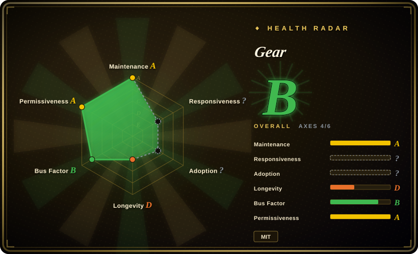
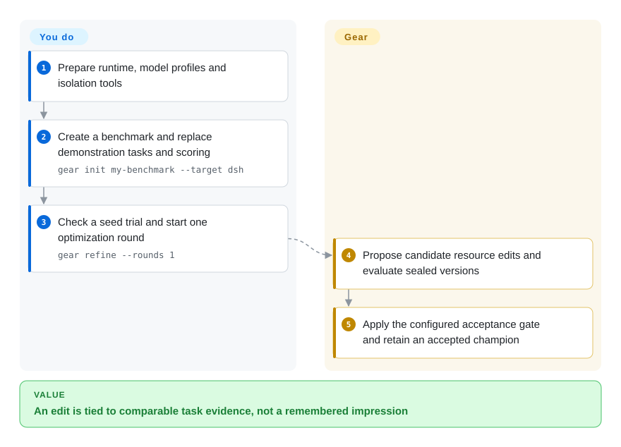
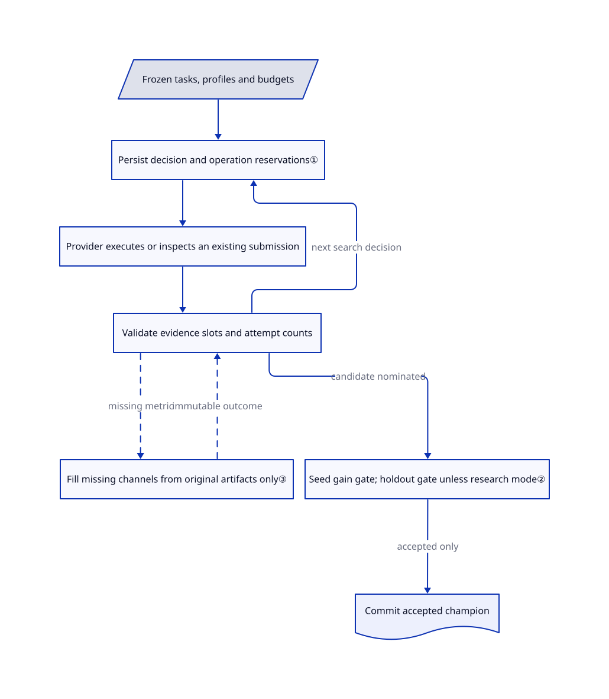

# Gear

You change an agent's tools and instructions, but cannot tell which edit earned a better score. Gear evaluates sealed candidate versions and keeps a winner only after the configured evidence gate.

## When to use

You maintain a task agent that keeps missing required checks: yesterday's prompt fixed one task but broke another, and the two runs used different inputs. You have representative tasks, a scorer and a budget, and want another agent to propose edits to instructions, tools and workflows while a separate runtime controls evaluation and promotion. Gear gives you candidate snapshots, measured feedback, configurable search components and a retained champion instead of a folder of untraceable prompt variants.

Choose it over DSPy when the editable object is an existing agent's resource bundle rather than a typed Python model program. Choose it over a general adapter-learning shell when frozen experiment identities, physical-attempt accounting and an explicit final acceptance gate are central. The documented native editable targets are DSH and Pi; using the Refine Skill from Claude Code does not mean Claude Code's entire harness is a native editable target.

## When NOT to use

- **You only need a release regression check.** Use [promptfoo](../../../llm-eval/promptfoo.md) with reviewed changes. Gear adds an autonomous editor, repeated task execution and model spending, not just assertions in CI.
- **You want a small typed Python extraction pipeline.** Use [DSPy](../dspy.md). Gear's separate Meta and Target profiles, candidate resources and evaluation runtime are extra machinery for that problem.
- **You want to compare many adapter-learning methods under one host-export interface.** Consider [Hermit](hermit.md). Gear's current native target resource contracts are DSH and Pi; host skill installation is a different surface from native target adaptation.
- **You expect automatic model training or task invention to be finished.** Start with DSPy's supported optimization path for a model program. Gear's README explicitly calls model training experimental and the full joint loop and automatic seed-task generation unfinished.
- **You cannot isolate executable candidate tools from host secrets.** Keep production files manually reviewed and run a controlled promptfoo suite. Gear's Codex worker bypasses Codex's own approval/sandbox layer inside an outer sandbox; task agents rely on the Harbor container. Do not transplant those execution flags to an ordinary workstation.

## Comparison

| Alternative | In index | Our verdict | Tradeoff |
|---|---|---|---|
| [DSPy](../dspy.md) | ✅ | Pick DSPy for a typed Python model pipeline; pick Gear to evolve a sealed bundle of agent tools and instructions. | DSPy owns program and prompt abstractions; Gear adds target adapters, execution identities and a durable candidate/evidence lifecycle. |
| [Hermit](hermit.md) | ✅ | Pick Hermit to compare multiple external adapter learners and export host files; pick Gear when the runtime must enforce frozen budgets and a final evidence gate. | Hermit's structure checks are not a universal score gate; Gear requires comparable seed gains and, in holdout mode, independent final checks. |
| [promptfoo](../../../llm-eval/promptfoo.md) | ✅ | Pick promptfoo when a human supplies changes and CI decides whether they regress; pick Gear when the experiment itself must propose candidates. | A regression matrix is simpler to operate; search adds evaluation cost, mutation boundaries and recovery state. |

## Quick start

The [quick start](https://github.com/rsi-gear/gear/blob/8fc520549a7a26af1122fac27ca6d9e20b75ab20/docs/guide/en/quickstart.md#L3-L69) requires compatible Node, Python and platform isolation tools; the README offers `npm install --global rsi-gear@latest agent-hitch@latest @deepseek-ai/dsh@latest` for its DSH example. Prepare Hitch and Docker, run `gear setup --python python3.12`, and initialize the benchmark with the command below. Replace demonstration tasks and scoring rules, create separate Target and Meta profiles, and pass credential references rather than secret values. Run a seed smoke evaluation, preview `gear refine --rounds 1 --dry-run`, then start one real round. Gear evaluates and records candidates and applies the configured promotion gate; you own representative task splits, correct scoring, provider access, isolation and all inference charges. These commands were verified in source, not executed during intake.

<!-- flow-steps:begin (generated from flows/gear.json by tools/flow_card.py — do not edit) -->

Text version of the flow

1. **You**: Prepare runtime, model profiles and isolation tools
2. **You**: Create a benchmark and replace demonstration tasks and scoring — `gear init my-benchmark --target dsh`
3. **You**: Check a seed trial and start one optimization round — `gear refine --rounds 1`
4. **Gear**: Propose candidate resource edits and evaluate sealed versions
5. **Gear**: Apply the configured acceptance gate and retain an accepted champion

**Value**: An edit is tied to comparable task evidence, not a remembered impression

<!-- flow-steps:end -->

## Key techniques

<!-- mechanism:begin (generated from mechanisms/gear.json by tools/mechanism_card.py; do not edit) -->

Text version of the mechanism

- Frozen tasks, profiles and budgets
- Persist decision and operation reservations①
- Provider executes or inspects an existing submission
- Validate evidence slots and attempt counts
- Fill missing channels from original artifacts only③
- Seed gain gate; holdout gate unless research mode②
- Commit accepted champion

- Frozen tasks, profiles and budgets → Persist decision and operation reservations①
- Persist decision and operation reservations① → Provider executes or inspects an existing submission
- Provider executes or inspects an existing submission → Validate evidence slots and attempt counts
- Validate evidence slots and attempt counts → Fill missing channels from original artifacts only③ (missing metric) [optional/fallback]
- Fill missing channels from original artifacts only③ → Validate evidence slots and attempt counts (immutable outcome) [optional/fallback]
- Validate evidence slots and attempt counts → Persist decision and operation reservations① (next search decision)
- Validate evidence slots and attempt counts → Seed gain gate; holdout gate unless research mode② (candidate nominated)
- Seed gain gate; holdout gate unless research mode② → Commit accepted champion (accepted only)

<!-- mechanism:end -->

### 1. Persist decisions before performing external operations

- **Problem:** Retrying after a crash can repeat a paid evaluation or recompute a different search decision.
- **How:** The runner saves algorithm state, decisions and reserved operation identities together before submission. A submitted operation is inspected on recovery; an unknown outcome becomes a recovery error rather than an automatic fresh submission.
- **Limits:** Correct recovery depends on the provider's inspection and idempotency contracts. The journal does not undo external effects or establish exactly-once behavior for arbitrary providers.
- **Source:** [Decision reservation](https://github.com/rsi-gear/gear/blob/8fc520549a7a26af1122fac27ca6d9e20b75ab20/src/runtime/runner.ts#L73-L128), [submission inspection](https://github.com/rsi-gear/gear/blob/8fc520549a7a26af1122fac27ca6d9e20b75ab20/src/runtime/runner.ts#L378-L418).

### 2. Separate candidate nomination from final acceptance

- **Problem:** A search algorithm can select a candidate that memorizes training tasks or lacks comparable evidence.
- **How:** Admission rejects overlapping seed and held-out task IDs in holdout mode. Finalization checks complete seed evidence, constraints and minimum gain, then evaluates anchor and nominee on held-out tasks before committing the champion.
- **Limits:** Research mode explicitly accepts shared-set evidence without independent validation. A holdout gate permits the configured regression tolerance; it does not promise every task improves or generalizes beyond the chosen split.
- **Source:** [Split admission](https://github.com/rsi-gear/gear/blob/8fc520549a7a26af1122fac27ca6d9e20b75ab20/src/runtime/runner.ts#L167-L207), [final gate](https://github.com/rsi-gear/gear/blob/8fc520549a7a26af1122fac27ca6d9e20b75ab20/src/runtime/runner.ts#L565-L619).

### 3. Complete missing evidence without rewriting observed outcomes

- **Problem:** A finished trial can lack a metric; treating it as zero or rerunning the task changes the experiment.
- **How:** Projection reservations bind the original request, provenance and receipt digests. Validation permits only requested missing channels and requires zero physical attempts and zero reported model usage; existing outcome fields remain immutable.
- **Limits:** The provider must support projection. Unsupported metrics, disabled projections or exhausted attempts remain explicit gaps, not fabricated scores; receipt checks are not an independent audit of provider internals.
- **Source:** [Reservations and blockers](https://github.com/rsi-gear/gear/blob/8fc520549a7a26af1122fac27ca6d9e20b75ab20/src/runtime/evidence-projection.ts#L48-L137), [receipt validation](https://github.com/rsi-gear/gear/blob/8fc520549a7a26af1122fac27ca6d9e20b75ab20/src/runtime/evidence-projection.ts#L208-L252).

## Tech stack

TypeScript/Node CLI and runtime, Python algorithm/benchmark/training SDK, JSON contracts and on-disk run journals. The manifest uses Anthropic's sandbox runtime, DeepSeek DSH components, YAML and diff utilities. The GEPA class composes parent selection, proposal planning, sampling, ranking and stopping over local, bridge and global stages; that composition alone is not evidence of better scores.

## Dependencies

- Node `^22.19.0 || >=24.0.0` and Python 3.10+; upstream development uses Python 3.12. Python core declares psutil, tomli where needed, tomli-w and PyYAML.
- Linux algorithm isolation requires bubblewrap, socat and ripgrep; macOS uses the system sandbox. Hitch/Harbor task evaluation needs its runtime and Docker, plus configured model endpoints and credentials.
- Native editable carriers support DSH resource directories or Pi project resources. Dependency manifests, lockfiles and runtime substrate are fixed, not authorized mutation targets.
- The root LICENSE is MIT, copyright 2026 GEAR. The build script bundles a pinned DSH tool package and diff and writes their original licenses into the generated license file; dependencies, datasets and model services keep separate terms. Source installation has a `prepare` hook that invokes that bundling script and can fetch an npm archive.

These requirements come from the fixed [Node manifest](https://github.com/rsi-gear/gear/blob/8fc520549a7a26af1122fac27ca6d9e20b75ab20/package.json), [Python manifest](https://github.com/rsi-gear/gear/blob/8fc520549a7a26af1122fac27ca6d9e20b75ab20/python/pyproject.toml), [MIT license](https://github.com/rsi-gear/gear/blob/8fc520549a7a26af1122fac27ca6d9e20b75ab20/LICENSE) and [bundling script](https://github.com/rsi-gear/gear/blob/8fc520549a7a26af1122fac27ca6d9e20b75ab20/scripts/build-private-tool-fs.mjs).

## Ops difficulty

**Medium to high.** The CLI hides manual server management, but credible experiments still require task/scorer maintenance, sealed runtime images, two model profiles, budget planning and isolated executable resources. Use `gear cancel RUN_ID` and inspect confirmation before assuming external work stopped; `gear resume RUN_ID` recovers the original run rather than adding rounds. `gear export RUN_ID` requires a completed run and verifies its retained snapshot. Preserve reports and configuration before removal; deleting a package or journal does not reverse model charges or task-side changes. See [recovery commands](https://github.com/rsi-gear/gear/blob/8fc520549a7a26af1122fac27ca6d9e20b75ab20/docs/guide/en/evolutions.md#L3-L27).

## Health & viability

- **2026-10-28:** GitHub metadata records creation on August 18, a push on October 28 and no archive flag. The latest release is v0.2.1, published October 26. This is an active project with only about 71 days of history, not a long-lived Lindy signal.
- The repository belongs to the rsi-gear organization; the contributors response is led by `0xsegfaulted` and `YehuiTang0316`. Organization ownership and named paper authors do not establish a foundation, funding commitment or support SLA.
- The fixed tree contains unit/integration tests and CI workflows. The observed 210 stars and 21 forks show attention, not verified production deployments or replicated benchmark gains.
- The generated health score is B across four of six axes. Responsiveness has `no_window_signal`, and adoption is `ambiguous`; these unknowns are not zero usage or proven unresponsiveness. The dated [dependency review](https://github.com/rsi-gear/gear/blob/8fc520549a7a26af1122fac27ca6d9e20b75ab20/docs/dependency-security.zh-CN.md#L16-L45) retains a node-forge advisory while reporting no reachable vulnerable call path in its inspected configuration. That October 11 assessment is not a fresh package audit or a fixed-vulnerability claim.
- **[Inference: based on the short 0.x history, concentrated contribution signals and explicit unfinished roadmap]** Use Gear as a controlled harness-optimization experiment, with a separately reviewed export before production adoption. Active development reduces abandonment concern but does not prove interface stability.

## Caveats (unverified)

- [Unverified: this intake excludes upstream execution, dependency installation and model/data downloads] Installation, sandbox enforcement, cancellation, export and optimization performance were not exercised; source checks are not runtime guarantees.
- [Unverified: reproducing the README experiments requires the authors' benchmark environment and paid model endpoints] Reported task gains and cost reductions are not independently reproduced here and are not predictions for your workload.
- [Inference: based on the early release history and documented experimental roadmap] Long-term maintenance, migration stability and generalization beyond the selected evaluation split remain unproven.
