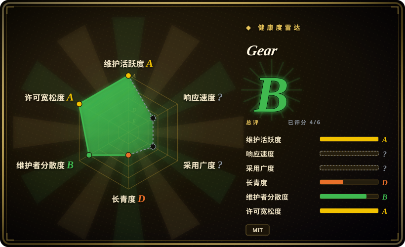
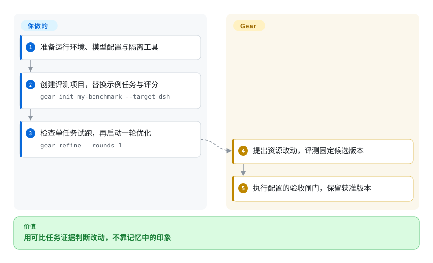
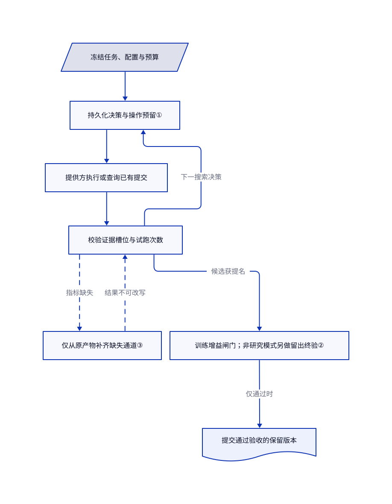

# Gear

你改了代理的工具和指令，却说不清哪次改动真正涨分。Gear 固定候选版本做评测，只在配置的证据门槛通过后保留胜者。

## 何时使用

你维护的任务代理总漏掉必查项：昨天改指令修好一题，却弄坏另一题，两次试跑还用了不同输入。你已有代表性任务、评分器和预算，希望另一个代理提出指令、工具与工作流改动，由独立运行时掌握评测和晋升。Gear 提供候选快照、反馈、可替换的搜索组件与保留版本，不再靠一堆难以追溯的提示词文件比较效果。

如果要改的是现有代理的资源包，而不是带类型的 Python 模型程序，选它而非 DSPy。如果冻结实验身份、实际试跑计数与最终验收门槛最重要，它比通用适配层学习外壳更贴题。文档列出的原生可编辑目标是 DSH 和 Pi；从 Claude Code 调用 Refine Skill，不等于能原生演化 Claude Code 整套运行框架。

## 何时不用

- **只需发布前回归检查。** 用 [promptfoo](../../../llm-eval/promptfoo.zh.md) 检查人工评审的改动。Gear 多了自动编辑、重复任务执行与模型费用，不只是持续集成断言。
- **只做小型 Python 抽取流水线。** 选 [DSPy](../dspy.zh.md)。Gear 分离提案与执行配置，还要管理候选资源与评测运行时，负担更重。
- **想用统一宿主导出接口比较多种适配层学习方法。** 考虑 [Hermit](hermit.zh.md)。Gear 当前的原生目标资源契约面向 DSH 和 Pi；安装宿主技能不等于原生目标适配。
- **指望模型训练与任务生成已全自动完成。** 模型程序优化先用 DSPy 已支持的路径。Gear 自述模型训练仍属实验，联合闭环与自动生成练习任务尚未完成。
- **无法隔离可执行工具与宿主秘密。** 保持生产文件人工评审，用受控的 promptfoo 用例集。Gear 在外层沙箱内绕过 Codex 自身审批与沙箱，任务代理依赖 Harbor 容器；不要把这些执行参数搬到普通工作站。

## 横向对比

| 替代品 | 是否收录 | 我们的评价 | 取舍 |
|---|---|---|---|
| [DSPy](../dspy.zh.md) | ✅ | 优化带类型的 Python 模型流水线选 DSPy；演化固定版本的工具与指令资源包选 Gear。 | DSPy 接管程序和提示词抽象；Gear 增加目标适配器、执行身份与持久化候选证据生命周期。 |
| [Hermit](hermit.zh.md) | ✅ | 比较外部适配层学习器并导出宿主文件选 Hermit；要运行时强制冻结预算与最终证据闸门选 Gear。 | Hermit 的结构检查不统一保证涨分；Gear 要求可比的训练侧增益，并在留出模式下做独立终验。 |
| [promptfoo](../../../llm-eval/promptfoo.zh.md) | ✅ | 人来改、持续集成判断退化时选 promptfoo；实验本身需要提出候选时选 Gear。 | 回归矩阵更轻；搜索增加评测费用、可改范围管理与恢复状态。 |

## 快速上手

[上手文档](https://github.com/rsi-gear/gear/blob/8fc520549a7a26af1122fac27ca6d9e20b75ab20/docs/guide/en/quickstart.md#L3-L69)要求兼容的 Node、Python 与平台隔离工具；README 的 DSH 示例使用 `npm install --global rsi-gear@latest agent-hitch@latest @deepseek-ai/dsh@latest`。准备 Hitch 和 Docker，执行 `gear setup --python python3.12`，再用下图命令创建评测项目。替换示例任务与评分规则，分别创建任务执行端和改动提案端配置，只传凭据引用，不传秘密值。先做单任务试跑，再预览 `gear refine --rounds 1 --dry-run`，最后启动一轮真实优化。Gear 负责评测、记录候选和执行配置的晋升闸门；你负责代表性任务划分、评分正确性、模型访问、隔离与推理费用。本次只核实命令出处，没有执行上游。

<!-- flow-steps:begin (generated from flows/gear.json by tools/flow_card.py — do not edit) -->

流程文字版

1. **你**：准备运行环境、模型配置与隔离工具
2. **你**：创建评测项目，替换示例任务与评分 — `gear init my-benchmark --target dsh`
3. **你**：检查单任务试跑，再启动一轮优化 — `gear refine --rounds 1`
4. **Gear**：提出资源改动，评测固定候选版本
5. **Gear**：执行配置的验收闸门，保留获准版本

**价值**：用可比任务证据判断改动，不靠记忆中的印象

<!-- flow-steps:end -->

## 技术要点

<!-- mechanism:begin (generated from mechanisms/gear.json by tools/mechanism_card.py; do not edit) -->

机制文字版

- 冻结任务、配置与预算
- 持久化决策与操作预留①
- 提供方执行或查询已有提交
- 校验证据槽位与试跑次数
- 仅从原产物补齐缺失通道③
- 训练增益闸门；非研究模式另做留出终验②
- 提交通过验收的保留版本

- 冻结任务、配置与预算 → 持久化决策与操作预留①
- 持久化决策与操作预留① → 提供方执行或查询已有提交
- 提供方执行或查询已有提交 → 校验证据槽位与试跑次数
- 校验证据槽位与试跑次数 → 仅从原产物补齐缺失通道③（指标缺失）〔可选／兜底〕
- 仅从原产物补齐缺失通道③ → 校验证据槽位与试跑次数（结果不可改写）〔可选／兜底〕
- 校验证据槽位与试跑次数 → 持久化决策与操作预留①（下一搜索决策）
- 校验证据槽位与试跑次数 → 训练增益闸门；非研究模式另做留出终验②（候选获提名）
- 训练增益闸门；非研究模式另做留出终验② → 提交通过验收的保留版本（仅通过时）

<!-- mechanism:end -->

### 1. 先持久化决策，再执行外部操作

- **解决：** 崩溃后重试可能重复付费评测，或重新算出不同搜索决策。
- **做法：** 运行器先一起保存算法状态、决策与预留操作身份，再提交执行。恢复时先查询已提交操作；结果不明就报待恢复，不直接新建一次提交。
- **边界：** 恢复依赖执行提供方的查询与幂等契约。日志不撤销外部副作用，也不替任意提供方保证严格只执行一次。
- **源码：** [决策预留](https://github.com/rsi-gear/gear/blob/8fc520549a7a26af1122fac27ca6d9e20b75ab20/src/runtime/runner.ts#L73-L128)、[提交查询](https://github.com/rsi-gear/gear/blob/8fc520549a7a26af1122fac27ca6d9e20b75ab20/src/runtime/runner.ts#L378-L418)。

### 2. 分开候选提名与最终验收

- **解决：** 搜索算法可能选出记住训练题或缺少可比证据的候选。
- **做法：** 留出模式在准入时拒绝训练任务与留出任务身份重叠。终验先查训练证据完整性、约束与最小增益，再让基线和候选跑留出任务，通过后才提交保留版本。
- **边界：** 研究模式明确允许同集证据，不做独立验证。留出闸门允许配置范围内的退化，不保证每题改善，也不保证推广到划分之外。
- **源码：** [划分准入](https://github.com/rsi-gear/gear/blob/8fc520549a7a26af1122fac27ca6d9e20b75ab20/src/runtime/runner.ts#L167-L207)、[最终闸门](https://github.com/rsi-gear/gear/blob/8fc520549a7a26af1122fac27ca6d9e20b75ab20/src/runtime/runner.ts#L565-L619)。

### 3. 补齐指标，不改写已观察结果

- **解决：** 试跑结束后缺少指标，填零或重跑都会改变实验含义。
- **做法：** 补证预留绑定原请求、来源与回执摘要。校验只允许补请求中缺失的通道，并要求实际试跑次数和上报模型用量都为零；已有结果字段不可更改。
- **边界：** 执行提供方必须支持补证。不支持的指标、关闭补证或次数耗尽都保留为明确缺口，不编造分数；回执校验并非对提供方内部行为的独立审计。
- **源码：** [预留与阻断](https://github.com/rsi-gear/gear/blob/8fc520549a7a26af1122fac27ca6d9e20b75ab20/src/runtime/evidence-projection.ts#L48-L137)、[回执校验](https://github.com/rsi-gear/gear/blob/8fc520549a7a26af1122fac27ca6d9e20b75ab20/src/runtime/evidence-projection.ts#L208-L252)。

## 技术栈

TypeScript 与 Node 命令行及运行时，Python 算法、评测与训练开发包，JSON 契约和磁盘运行日志。依赖清单包含 Anthropic 沙箱运行库、DeepSeek DSH 组件、YAML 与差异处理工具。GEPA 类将父代选择、提案、采样、排序与停止规则组合为局部、桥接和全局三个阶段；这种组合本身不证明效果更好。

## 依赖

- Node `^22.19.0 || >=24.0.0`，Python 3.10 以上；上游开发使用 Python 3.12。Python 核心依赖 psutil、按版本需要的 tomli、tomli-w 和 PyYAML。
- Linux 算法隔离需要 bubblewrap、socat 和 ripgrep；macOS 使用系统沙箱。Hitch 与 Harbor 任务评测需要对应运行时、Docker、模型接口及凭据。
- 原生可编辑载体支持 DSH 资源目录与 Pi 项目资源。依赖清单、锁文件和运行时底座固定，不属于允许改动范围。
- 根许可为 MIT，版权标记是 2026 GEAR。构建脚本捆绑固定版本的 DSH 工具包与 diff，并把原许可写入生成的许可文件；依赖、数据集和模型服务仍适用各自条款。源码安装带 `prepare` 钩子，会调用该脚本并可能抓取 npm 归档。

以上要求来自固定版本的 [Node 清单](https://github.com/rsi-gear/gear/blob/8fc520549a7a26af1122fac27ca6d9e20b75ab20/package.json)、[Python 清单](https://github.com/rsi-gear/gear/blob/8fc520549a7a26af1122fac27ca6d9e20b75ab20/python/pyproject.toml)、[MIT 许可](https://github.com/rsi-gear/gear/blob/8fc520549a7a26af1122fac27ca6d9e20b75ab20/LICENSE)与[捆绑脚本](https://github.com/rsi-gear/gear/blob/8fc520549a7a26af1122fac27ca6d9e20b75ab20/scripts/build-private-tool-fs.mjs)。

## 运维难度

**中到高。** 命令行免去手动管理服务端，但可信实验仍要维护任务与评分器、固定运行镜像、两套模型配置、预算和可执行资源隔离。执行 `gear cancel RUN_ID` 后先查确认状态，不能直接假定外部工作已停；`gear resume RUN_ID` 恢复原运行，不会追加轮数。`gear export RUN_ID` 要求运行完成，并检查保留快照。移除前保留需要的报告与配置；删包或删日志不撤销模型费用与任务副作用。参见[恢复命令](https://github.com/rsi-gear/gear/blob/8fc520549a7a26af1122fac27ca6d9e20b75ab20/docs/guide/en/evolutions.md#L3-L27)。

## 健康度与可持续性

- **2026-10-28：** GitHub 元数据记录创建于 8 月 18 日，10 月 28 日有推送，未归档。最新版本 v0.2.1 发布于 10 月 26 日。约 71 天历史说明活跃，但不是长期存续证据。
- 仓库属于 rsi-gear 组织；贡献者响应由 `0xsegfaulted` 和 `YehuiTang0316` 领头。组织归属与论文作者名单不等于基金会治理、持续资金或支持承诺。
- 固定树包含单元测试、集成测试与持续集成配置。观察到的 210 星和 21 个分叉说明关注度，不证明生产部署或基准涨分已复现。
- 自动健康度为 B，六轴中四轴可评分。响应轴原因是 `no_window_signal`，采用轴为 `ambiguous`；这不等于无人使用或已证实不响应。上游的[依赖审查](https://github.com/rsi-gear/gear/blob/8fc520549a7a26af1122fac27ca6d9e20b75ab20/docs/dependency-security.zh-CN.md#L16-L45)保留 node-forge 漏洞告警，同时报告所查配置未发现可达的漏洞调用路径。那是 10 月 11 日的评估，不是本次包审计，更不等于漏洞已修复。
- **[推断：依据短暂的 0.x 历史、集中的贡献信号与明确未完成的路线图]** 将 Gear 用于受控的运行框架优化实验，导出后另行评审再进生产。活跃开发降低弃坑担忧，但不证明接口稳定。

## 存疑（未验证）

- [未验证：本次禁止执行上游、安装依赖及下载模型数据] 未实测安装、沙箱强制性、取消、导出或优化效果；源码检查不等于运行保证。
- [未验证：复现 README 实验需要作者的基准环境与付费模型接口] 上游报告的任务涨分与成本下降未独立复现，不是对其他任务的收益预测。
- [推断：依据早期发布历史与明确的实验路线图] 长期维护、迁移稳定性与所选评测划分之外的泛化仍未获证明。
