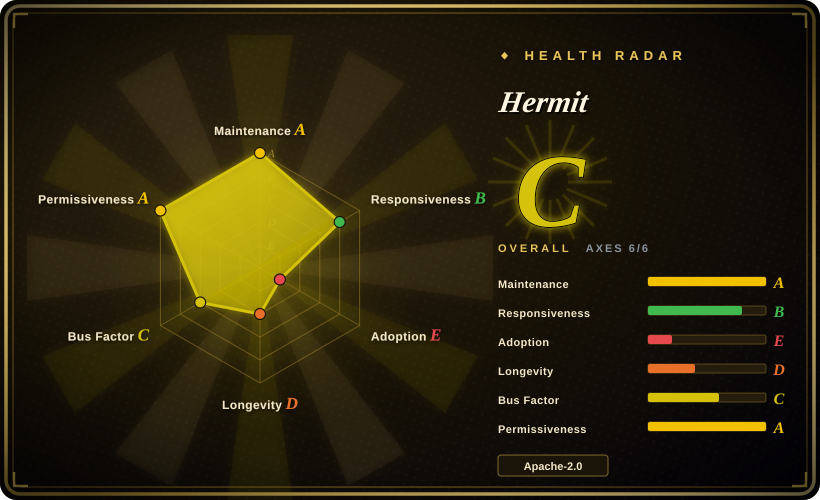
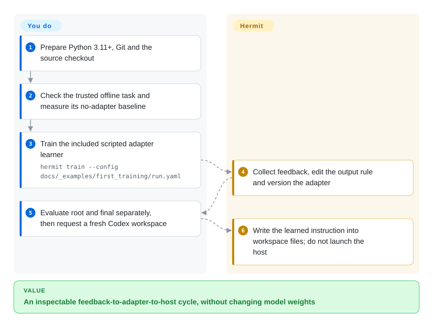
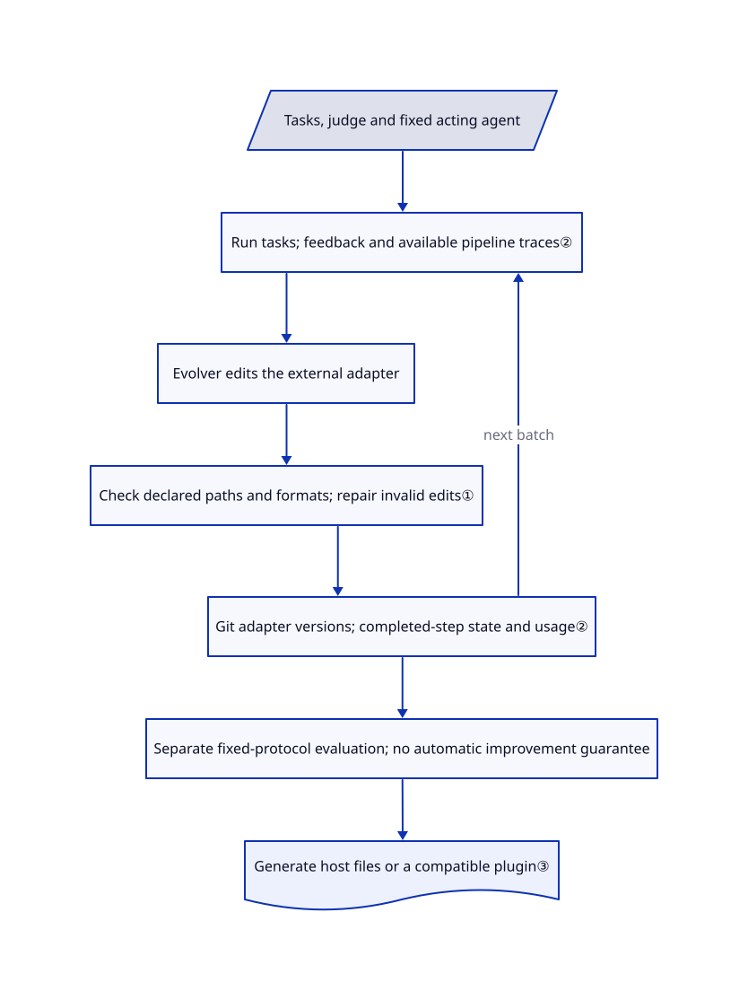

# Hermit

You keep changing an agent's instructions and tools, but cannot connect an edit to its task feedback or reproduce the previous version. Hermit trains and versions an external adapter while leaving the original model weights and host harness unchanged.

## When to use

You are comparing ways to improve an existing coding or question-answering agent. Yesterday's instruction edit is now a different file, its evaluation used different questions, and the learner's temporary state disappeared when the process stopped. You have a runnable agent, task splits and a judge, and want one experiment loop for executing tasks, collecting feedback, proposing adapter edits and saving the resulting files. Hermit supplies that loop and adapters for methods including GEPA, SkillOpt, MWM and Harness², rather than making you rebuild the bookkeeping for each method.

Choose it over using SkillOpt alone when the experiment needs several evolution methods or a file bundle containing instructions, skills, tools and roles, not just one optimized document. Choose it over DSPy when the existing host must stay intact and consume a separately deployed adapter. This is **harness training**, not model-weight training or a GPU inference engine; a task pipeline still owns the acting agent, model calls and judge.

## When NOT to use

- **Every accepted change must improve a held-out score.** Prefer [SkillOpt](../skillopt.md) for its validation-gated document workflow, or build an explicit evaluation gate. Hermit's Trainer checks file structure and deployability, not improvement; `final` defaults to the selected current adapter, not a universal best-scoring checkpoint. A structurally valid edit can regress.
- **You only need to compile a typed Python model pipeline.** Prefer [DSPy](../dspy.md). Hermit adds on-disk templates, Git histories, working copies and task/learner interfaces to preserve an existing host; these are extra machinery for a small extraction or classification pipeline.
- **You want the original task-time Harness² benchmark protocol.** Start with [Harness²](harness2.md). Hermit integrates that method into its own task and adapter lifecycle; its OfficeQA route uses a specific Codex integration, and benchmark/host differences still need protocol review.
- **You cannot isolate executable adapters from secrets or judge answers.** Keep configuration manually reviewed and use [SkillOpt](../skillopt.md) only for a scoped text experiment in an isolated environment. Hermit executes task code, template checks and tools; its sandbox covers configured programs, not arbitrary in-process Python. Linux bubblewrap needs permitted namespaces, restricted proxy networking is best effort, and disabled sandbox examples are trusted teaching code, not a safe way to run strangers' adapters.
- **You need a mature production contract or an all-host lossless plugin.** Prefer a smaller [DSPy](../dspy.md) integration where its program model fits. Hermit is an early 0.x framework; workspace deployment and plugin conversion have different capabilities. In particular, nonempty context is refused for Codex/Pi native conversion unless deliberately omitted; a successful export does not install a host or its tool dependencies.

## Comparison

| Alternative | In index | Our verdict | Tradeoff |
|---|---|---|---|
| [SkillOpt](../skillopt.md) | ✅ | Choose SkillOpt when one deployable skill document and validation-gated edits are enough; choose Hermit when comparing methods and managing a wider adapter package on the same task interface. | Hermit reuses SkillOpt as an optional learner but adds template checks, Git step records and host export; that common shell does not give every other method SkillOpt's performance gate. |
| [DSPy](../dspy.md) | ✅ | Choose DSPy for typed Python model programs optimized against a metric; choose Hermit to preserve an existing agent host and evolve external files it consumes. | DSPy owns the program abstraction and generated prompts; Hermit leaves task execution with your pipeline and makes adapter artifacts and learner state explicit. |
| [Harness²](harness2.md) | ✅ | Choose upstream Harness² to study its original task-time recursion and benchmark runners; choose Hermit to place that method beside other learners under one experiment lifecycle. | Hermit pins and calls the upstream package and records its own integration differences; shared bookkeeping is not evidence of protocol equivalence or better scores. |

## Quick start

Prepare Python 3.11+ and Git, clone the source and follow its virtual-environment setup with `python -m pip install -e .`; the checkout contains examples absent from the package-only install. The documented offline walkthrough uses `hermit check --config docs/_examples/first_training/run.yaml`, a no-adapter evaluation, then the training command below. Its scripted learner reads feedback and writes an uppercase-output rule; evaluate `root` and `final` separately before generating a Codex workspace with the README's `hermit deploy` example. Hermit writes adapter history, results and host files; you start the host separately and supply real tasks, a judge, model access, cost limits and independent evaluation for real workloads. The toy example needs no GPU, model account or download, but its constructed score change is not a real-model benchmark, and no upstream command was executed for this page.

<!-- flow-steps:begin (generated from flows/hermit.json by tools/flow_card.py — do not edit) -->

Text version of the flow

1. **You**: Prepare Python 3.11+, Git and the source checkout
2. **You**: Check the trusted offline task and measure its no-adapter baseline
3. **You**: Train the included scripted adapter learner — `hermit train --config docs/_examples/first_training/run.yaml`
4. **Hermit**: Collect feedback, edit the output rule and version the adapter
5. **You**: Evaluate root and final separately, then request a fresh Codex workspace
6. **Hermit**: Write the learned instruction into workspace files; do not launch the host

**Value**: An inspectable feedback-to-adapter-to-host cycle, without changing model weights

<!-- flow-steps:end -->

## Key techniques

<!-- mechanism:begin (generated from mechanisms/hermit.json by tools/mechanism_card.py; do not edit) -->

Text version of the mechanism

- Tasks, judge and fixed acting agent
- Run tasks; feedback and available pipeline traces②
- Evolver edits the external adapter
- Check declared paths and formats; repair invalid edits①
- Git adapter versions; completed-step state and usage②
- Separate fixed-protocol evaluation; no automatic improvement guarantee
- Generate host files or a compatible plugin③

- Tasks, judge and fixed acting agent → Run tasks; feedback and available pipeline traces②
- Run tasks; feedback and available pipeline traces② → Evolver edits the external adapter
- Evolver edits the external adapter → Check declared paths and formats; repair invalid edits①
- Check declared paths and formats; repair invalid edits① → Git adapter versions; completed-step state and usage②
- Git adapter versions; completed-step state and usage② → Run tasks; feedback and available pipeline traces② (next batch)
- Git adapter versions; completed-step state and usage② → Separate fixed-protocol evaluation; no automatic improvement guarantee
- Separate fixed-protocol evaluation; no automatic improvement guarantee → Generate host files or a compatible plugin③

<!-- mechanism:end -->

### 1. Evolve only declared adapter files

- **Problem:** A learner allowed to rewrite the whole runtime can break the host or change what the experiment measures.
- **How:** The template declares fixed and learnable files. Specification checks compare fixed-file hashes, manifest sections, allowed paths and format limits, then check export loading and template rules. Repair restores fixed files from the template and invalid learned files from the previous version.
- **Limits:** These are structure and deployability checks, not a task-score gate or proof of safe code. Some checks execute modules; their isolation depends on the run configuration and platform.
- **Source:** [File and manifest checks](https://github.com/Infini-AI-Lab/hermit/blob/6957141db1bda07877e0b989bea375eaf9b7cec2/hermit/spec.py#L47-L114), [module checks and repair](https://github.com/Infini-AI-Lab/hermit/blob/6957141db1bda07877e0b989bea375eaf9b7cec2/hermit/spec.py#L130-L244).

### 2. Keep adapter versions separate from learner state

- **Problem:** A saved instruction file alone cannot reconstruct the feedback, search state or spending behind an interrupted experiment.
- **How:** Each task batch produces learning material; the Evolver edits a working copy, and the Trainer checks, repairs and commits the adapter. Completed-step records retain parent/result commits, learner status, usage and state snapshots. Resume restores the last completed boundary, not just the latest Markdown.
- **Limits:** Work after that boundary may repeat, including paid requests or external effects. The recorded rollout score describes the pre-update adapter; comparing successive batches does not measure an edit's effect on the same questions.
- **Source:** [Restore from a completed step](https://github.com/Infini-AI-Lab/hermit/blob/6957141db1bda07877e0b989bea375eaf9b7cec2/hermit/trainer/trainer.py#L260-L330), [material, versioning and records](https://github.com/Infini-AI-Lab/hermit/blob/6957141db1bda07877e0b989bea375eaf9b7cec2/hermit/trainer/trainer.py#L445-L577).

### 3. Export an adapter without rewriting the host globally

- **Problem:** An experiment's learned instructions, skills and tools need to reach an existing agent without silently changing every workspace.
- **How:** Codex deployment writes a managed context block, workspace-local configuration, roles and copied skills. Tool configuration can point at the original adapter through an MCP server. Native plugin conversion instead embeds an adapter copy and refuses unsupported exports unless lossy conversion is explicit.
- **Limits:** Deployment does not launch the host; static instructions need redeployment, and tool paths must remain available. Generated configuration is replaced on redeployment. Workspace and plugin support are not interchangeable.
- **Source:** [Codex workspace emission](https://github.com/Infini-AI-Lab/hermit/blob/6957141db1bda07877e0b989bea375eaf9b7cec2/hermit/hosts/codex.py#L26-L84), [workspace restrictions](https://github.com/Infini-AI-Lab/hermit/blob/6957141db1bda07877e0b989bea375eaf9b7cec2/hermit/hosts/inputs.py#L59-L91), [plugin refusal and embedding](https://github.com/Infini-AI-Lab/hermit/blob/6957141db1bda07877e0b989bea375eaf9b7cec2/hermit/plugins/common.py#L77-L117).

## Tech stack

Python framework and CLI, Git-backed adapter trees, YAML configuration, JSON/JSONL records and Markdown artifacts. Core manifest pins `mcp==2.2.0`, `jsonschema==4.26.0` and `PyYAML==6.0.3`; optional evolution methods use Git-pinned packages. No model-weight optimizer or GPU kernel dependency is declared by the core manifest.

## Dependencies

- **Core and offline example:** Python 3.11+, Git and the three core packages. No GPU is required for adapter training orchestration or context-only deployment.
- **Real-model learning and use:** a compatible endpoint, credentials and paid inference or a separately operated local model server. The learner and acting model can differ. Codex needs Responses API behavior; Claude Code needs Messages API behavior, not merely any chat-completions endpoint.
- **Local inference hardware:** requirements belong to the separately selected model/server. The docs show vLLM and SGLang commands, including a two-way tensor-parallel vLLM example; they do not establish a universal minimum GPU or VRAM figure for Hermit. Hermit does not unload that server or change its model weights.
- **Method/platform extras:** GEPA, SkillOpt and Harness² need their corresponding `requirements-*.txt`; CLI learners need an installed/authenticated host. Sandboxed learner programs require Linux, bubblewrap and usable namespaces. Benchmark recipes add datasets, scorers and sometimes Docker; using a finished adapter does not require its learner state.
- **Rights:** Apache-2.0 covers the project core. Harness²-derived prompt text keeps a Google/Apache NOTICE; documentation fonts and icons keep separate licenses. Optional packages, benchmark data and model services retain their own terms. MWM records an older `metaworld` source map whose complete ownership chain was not independently audited.

## Ops difficulty

**Low for the trusted offline tutorial; medium to high for credible model-backed training.** You must supply task/validation/test splits, score definitions, outbound-data rules, isolated execution and model budgets. In-flight work can overshoot observed budgets; evaluation/probe calls are separate expenses, and unknown prices are not zero. Evaluation of the same selector replaces its output records, so archive evidence before repeating it. Author-reported recipe results are not measurements performed for this page.

For removal, stop the consuming host and its tool servers, preserve any needed adapter tree, completed-step records and learner-state snapshots, then remove the generated workspace or disable its installed plugin through that host. Do not erase the source adapter while a workspace's MCP configuration still points at it. Uninstalling the Python package alone does not restore generated host files, delete run logs or undo external task effects; recovery restores completed framework steps, not provider charges or service state. Any separately running GPU model server must be stopped and its memory release checked separately; complete uninstall and VRAM reclamation were not exercised here.

## Health & viability

- **2026-10-27:** created September 18 and pushed October 27, not archived; `v0.1.0` was published October 26. About 39 days of history and one release are early activity, not a Lindy record.
- The research organization owns the repository; the contributors API lists three people. Contribution and security policies exist, but the security policy promises no older-version backports. Institutional ownership is not a support contract.
- The reviewed tree includes core, deployment and sandbox test files; the visible workflow is documentation publication, not a demonstrated CI run of that test suite. This intake read tests but did not run upstream tests or benchmarks.
- Open PRs propose a self-contained container, dynamic per-task context and Continual Harness fixes. Those proposals are not released capabilities; the reviewed compatibility document explicitly lists unsupported lifecycle and isolation boundaries.
- **[Inference: based on the short release history and explicit 0.x compatibility limits]** Treat Hermit as a research experiment framework with useful artifact contracts, not an automatic production self-improvement service. Recipe score gains need a matched, independent protocol before adoption.

## Caveats (unverified)

- [Unverified: upstream execution, dependency installation, model/data downloads and performance tests are excluded from this intake] No installation, training, inference, host deployment, sandbox enforcement, complete uninstall or GPU memory reclamation was performed. The page describes source-backed contracts, not tested runtime guarantees.
- [Unverified: recipe claims require the authors' datasets, model endpoints and experiment environment] Reported benchmark improvements, local-server compatibility observations and the deterministic toy's expected score change are upstream reports, not reproduced measurements or guarantees for another task.
- [Unverified: the MWM source map names an older `metaworld` repository without a publicly resolved ownership chain in the reviewed material] The project declares Apache-2.0 and preserves source hashes; this is not an independent clearance of every reused MWM file, optional dependency, benchmark or model-service term.
- [Inference: based on one early release, concentrated contributors and documented limitations] Long-term maintenance, stable configuration migration and generalization of a learned adapter remain unproven; valid files and an emitted final tag do not establish improvement.
