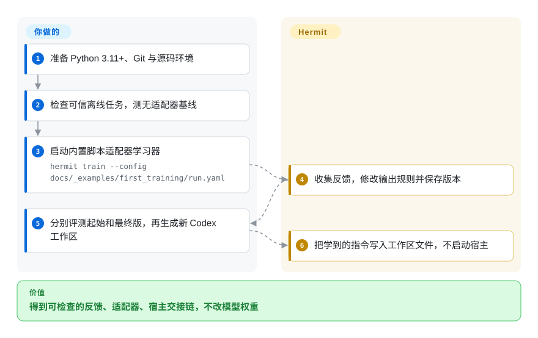
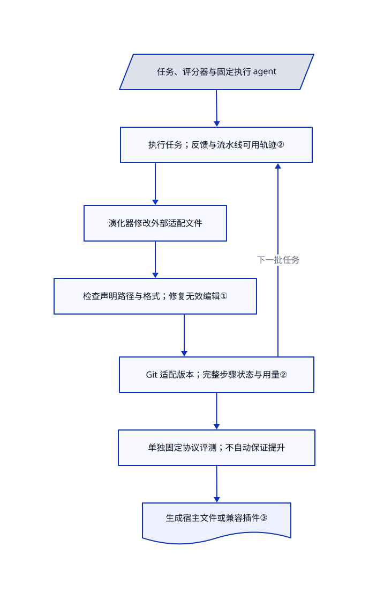

# Hermit

你反复修改 agent 的指令和工具，却对不上修改时的任务反馈，也复原不了上一版。Hermit 把这些外部适配文件拿来训练、分版本，不改原模型权重和宿主运行框架。

## 何时使用

你在比较怎样改进现有的编程或问答 agent。昨天改过的指令已经变样，评测又换了一批题，进程停掉后连学习器的搜索状态也丢了。你有可运行的 agent、任务划分和评分器，想用同一套实验循环执行任务、收集反馈、提出适配文件修改，并保存结果。Hermit 提供这套循环，并接入 GEPA、SkillOpt、MWM、Harness² 等方法，不必为每种方法重新搭实验记账。

当你要比较多种演化方法，或同时演化指令、技能、工具、角色文件时，可选它，而不是只用 SkillOpt 优化一篇文档。当现有宿主不能改、必须读取独立部署的外部文件时，可选它，而不是改写成 DSPy 程序。这里的“训练”是**运行框架适配层训练**，不是模型权重训练，也不是 GPU 推理引擎；实际执行任务、调用模型和评分仍由你的任务流水线负责。

## 何时不用

- **每次接受修改都必须提升留出集分数。** 优先用 [SkillOpt](../skillopt.zh.md) 的验证评分门控文档流程，或自己加显式评测门。Hermit 的训练协调器检查文件结构和可部署性，不检查效果提升；`final` 默认是所选当前适配器，不是通用的最高分检查点。结构有效的修改也会退步。
- **只想编译一个带类型的 Python 模型程序。** 选 [DSPy](../dspy.zh.md)。Hermit 为保留现有宿主，引入磁盘模板、Git 历史、工作副本和任务／学习器接口；小型抽取或分类流水线不一定需要这些。
- **要研究原版 Harness² 的任务内递归与基准协议。** 从 [Harness²](harness2.zh.md) 开始。Hermit 把该方法接入自己的任务和适配器生命周期；OfficeQA 路线采用特定 Codex 集成，仍须逐项复核基准和宿主差异。
- **不能把可执行适配器与密钥、评分答案隔离。** 先保留人工审查的配置，只在隔离环境里用 [SkillOpt](../skillopt.zh.md) 做限定文本实验。Hermit 会执行任务代码、模板检查和工具；沙箱覆盖配置的程序，不覆盖任意进程内 Python。Linux bubblewrap 需要可用命名空间，受限代理网络只是尽力约束；关闭沙箱的样例是可信教学代码，不适合直接运行陌生适配器。
- **需要成熟生产契约或所有宿主无损插件。** 若程序模型合适，优先用较小的 [DSPy](../dspy.zh.md) 集成。Hermit 仍是早期 0.x 框架，工作区部署与插件转换能力不同；Codex／Pi 原生转换会拒绝非空上下文，除非明确舍弃该内容。导出成功也不代表装好了宿主及工具依赖。

## 横向对比

| 替代品 | 是否收录 | 我们的评价 | 取舍 |
|---|---|---|---|
| [SkillOpt](../skillopt.zh.md) | ✅ | 只需一份可部署技能文档并按验证分数接受编辑时选 SkillOpt；要在同一任务接口下比较多方法、管理更宽适配文件包时选 Hermit。 | Hermit 把 SkillOpt 作为可选学习器，再加模板检查、Git 步骤记录和宿主导出；通用外壳不会让其他方法自动拥有 SkillOpt 的效果门控。 |
| [DSPy](../dspy.zh.md) | ✅ | 带类型的 Python 模型程序按指标优化时选 DSPy；保留已有 agent 宿主、演化宿主读取的外部文件时选 Hermit。 | DSPy 接管程序抽象和生成提示词；Hermit 把任务执行留给你的流水线，明确分开适配器产物与学习器状态。 |
| [Harness²](harness2.zh.md) | ✅ | 研究原版任务内递归和基准运行器时选 Harness²；希望与其他学习器共用一套实验生命周期时选 Hermit。 | Hermit 固定并调用上游包，也记录自身集成差异；共用记账不证明协议等价或分数更高。 |

## 快速上手

准备 Python 3.11+ 和 Git，克隆源码后按文档创建虚拟环境，执行 `python -m pip install -e .`；仅装发行包不会带齐仓库里的样例。离线教程先运行 `hermit check --config docs/_examples/first_training/run.yaml` 和无适配器评测，再用下图命令训练。脚本学习器从反馈里读出规则，写下大写输出要求；分别评测 `root` 和 `final`，再按 README 的 `hermit deploy` 示例生成 Codex 工作区。Hermit 写入适配历史、结果和宿主文件；你另行启动宿主，并为真实任务提供题目、评分器、模型访问、费用上限和独立评测。这个玩具例子不需要 GPU、模型账号或下载，但人为构造的分数变化不是真实模型基准，本页也未执行任何上游命令。

<!-- flow-steps:begin (generated from flows/hermit.json by tools/flow_card.py — do not edit) -->

流程文字版

1. **你**：准备 Python 3.11+、Git 与源码环境
2. **你**：检查可信离线任务，测无适配器基线
3. **你**：启动内置脚本适配器学习器 — `hermit train --config docs/_examples/first_training/run.yaml`
4. **Hermit**：收集反馈，修改输出规则并保存版本
5. **你**：分别评测起始和最终版，再生成新 Codex 工作区
6. **Hermit**：把学到的指令写入工作区文件，不启动宿主

**价值**：得到可检查的反馈、适配器、宿主交接链，不改模型权重

<!-- flow-steps:end -->

## 技术要点

<!-- mechanism:begin (generated from mechanisms/hermit.json by tools/mechanism_card.py; do not edit) -->

机制文字版

- 任务、评分器与固定执行 agent
- 执行任务；反馈与流水线可用轨迹②
- 演化器修改外部适配文件
- 检查声明路径与格式；修复无效编辑①
- Git 适配版本；完整步骤状态与用量②
- 单独固定协议评测；不自动保证提升
- 生成宿主文件或兼容插件③

- 任务、评分器与固定执行 agent → 执行任务；反馈与流水线可用轨迹②
- 执行任务；反馈与流水线可用轨迹② → 演化器修改外部适配文件
- 演化器修改外部适配文件 → 检查声明路径与格式；修复无效编辑①
- 检查声明路径与格式；修复无效编辑① → Git 适配版本；完整步骤状态与用量②
- Git 适配版本；完整步骤状态与用量② → 执行任务；反馈与流水线可用轨迹②（下一批任务）
- Git 适配版本；完整步骤状态与用量② → 单独固定协议评测；不自动保证提升
- 单独固定协议评测；不自动保证提升 → 生成宿主文件或兼容插件③

<!-- mechanism:end -->

### 1. 只演化声明允许修改的适配文件

- **解决：** 若学习器能改整个运行时，就可能破坏宿主或改变实验测量对象。
- **做法：** 模板区分固定文件和可学习文件。规格检查对比固定文件哈希、清单字段、允许路径和格式上限，再检查导出加载与模板规则。修复时从模板恢复固定文件，从上一版恢复无效的学习文件。
- **边界：** 这检查结构和可部署性，不是任务评分门，也不证明代码安全。部分检查会执行模块，隔离取决于本轮配置和平台。
- **源码：** [文件与清单检查](https://github.com/Infini-AI-Lab/hermit/blob/6957141db1bda07877e0b989bea375eaf9b7cec2/hermit/spec.py#L47-L114)、[模块检查和修复](https://github.com/Infini-AI-Lab/hermit/blob/6957141db1bda07877e0b989bea375eaf9b7cec2/hermit/spec.py#L130-L244)。

### 2. 适配版本和学习器状态分开保存

- **解决：** 只存一份指令文件，无法恢复中断实验的反馈、搜索状态和费用记录。
- **做法：** 每批任务生成学习材料，演化器修改工作副本，训练协调器检查、修复并提交适配文件。完整步骤记录保存父提交、结果提交、学习器状态、用量和状态快照；恢复针对最后完整步骤，而不只是最新 Markdown。
- **边界：** 完整步骤之后的工作可能重跑，包括付费请求和外部副作用。记录的执行分数对应更新前版本；相邻批次分数对比，不是同一批题上的修改效果。
- **源码：** [恢复完整步骤](https://github.com/Infini-AI-Lab/hermit/blob/6957141db1bda07877e0b989bea375eaf9b7cec2/hermit/trainer/trainer.py#L260-L330)、[学习材料、分版本与记录](https://github.com/Infini-AI-Lab/hermit/blob/6957141db1bda07877e0b989bea375eaf9b7cec2/hermit/trainer/trainer.py#L445-L577)。

### 3. 导出适配器，不全局重写宿主

- **解决：** 实验学到的指令、技能和工具要交给现有 agent，不能悄悄影响所有工作区。
- **做法：** Codex 部署写入受管理的上下文块、工作区配置、角色和复制的技能。工具配置可以通过 MCP 工具服务器指向原适配目录；原生插件转换则内嵌适配器副本，默认拒绝无法承载的导出项，除非明确允许有损转换。
- **边界：** 部署不会启动宿主，静态指令更新后要重新部署，工具路径必须继续存在。重新部署会替换生成配置；工作区和插件支持不能混为一谈。
- **源码：** [生成 Codex 工作区](https://github.com/Infini-AI-Lab/hermit/blob/6957141db1bda07877e0b989bea375eaf9b7cec2/hermit/hosts/codex.py#L26-L84)、[工作区限制](https://github.com/Infini-AI-Lab/hermit/blob/6957141db1bda07877e0b989bea375eaf9b7cec2/hermit/hosts/inputs.py#L59-L91)、[插件拒绝与内嵌](https://github.com/Infini-AI-Lab/hermit/blob/6957141db1bda07877e0b989bea375eaf9b7cec2/hermit/plugins/common.py#L77-L117)。

## 技术栈

Python 框架与命令行、Git 适配文件版本树、YAML 配置、JSON／JSONL 记录和 Markdown 产物。核心清单固定 `mcp==2.2.0`、`jsonschema==4.26.0`、`PyYAML==6.0.3`，可选演化方法使用固定 Git 版本的包。核心清单没有声明模型权重优化器或 GPU 算子依赖。

## 依赖

- **核心和离线例子：** Python 3.11+、Git 和三项核心包。适配层训练编排和纯上下文部署不要求 GPU。
- **真实模型学习及使用：** 兼容接口、凭据和付费推理，或另行运维的本地模型服务。学习模型与执行任务模型可以不同。Codex 需要 Responses API 行为，Claude Code 需要 Messages API 行为，不是任意聊天补全接口都能用。
- **本地推理硬件：** 取决于另选的模型及服务。文档列出 vLLM、SGLang 命令，其中一个 vLLM 示例采用二路张量并行；这不能证明 Hermit 有统一的最低 GPU 或显存要求。Hermit 不会卸载该服务器，也不改模型权重。
- **方法及平台附加项：** GEPA、SkillOpt、Harness² 需要各自的 `requirements-*.txt`；命令行学习器需要已安装、已登录的宿主。沙箱学习程序需要 Linux、bubblewrap 和可用命名空间。基准配方另需数据、评分器，有时需要 Docker；使用成品适配器不必带学习器状态。
- **权利：** 项目核心采用 Apache-2.0。源自 Harness² 的提示保留 Google／Apache NOTICE，文档字体和图标另有许可。可选包、基准数据和模型服务保留自身条款。MWM 记录了更早的 `metaworld` 来源映射，但本轮未独立审计其完整权属链。

## 运维难度

**可信离线教程低，可信的真实模型训练中到高。** 你要准备训练／验证／测试划分、评分定义、数据出站规则、隔离执行和模型预算。执行中的请求会突破已观察预算；评测与探针又是单独开销，未知价格不等于零。同一选择器的再次评测会替换结果，因此先归档证据。作者在配方中报告的成绩，不是本页实测。

停用时先关闭消费适配器的宿主及工具服务器，保留需要的适配版本树、完整步骤记录和学习状态快照，再删除生成工作区，或通过宿主禁用已装插件。工作区的 MCP 配置仍指向源目录时，不要先删源适配器。只卸载 Python 包不会恢复宿主生成文件、删除运行日志或撤销外部任务副作用；恢复只覆盖完整框架步骤，不覆盖服务商费用和外部服务状态。另行启动的 GPU 模型服务器也须另停，并独立检查显存释放；本轮未实测完整卸载和显存回收。

## 健康度与可持续性

- **2026-10-27：** 9 月 18 日创建，10 月 27 日仍有推送，未归档；`v0.1.0` 于 10 月 26 日发布。约 39 天历史和一次发布说明早期活跃，不构成林迪记录。
- 仓库归研究组织所有，contributors API 列出三人。有贡献与安全政策，但安全政策不承诺旧版本补丁。组织所有权不是支持合同。
- 所读文件树包含核心、部署、沙箱测试；可见工作流用于文档发布，不等于已证明该测试套件在 CI 运行。本轮只读测试，没有执行上游测试或基准。
- 开放 PR 正在提议独立容器、按任务动态上下文及 Continual Harness 修复。这些不是已发布能力；所读兼容文档明确列出尚不支持的生命周期与隔离边界。
- **[推断：依据是短发布历史和明确的 0.x 兼容限制]** 把它当作产物契约清楚的研究实验框架，不是自动提升生产效果的服务。采用配方成绩前，仍要做协议匹配的独立实验。

## 存疑（未验证）

- [未验证：本批禁止执行上游、安装依赖、下载模型或数据及性能测试] 未执行安装、训练、推理、宿主部署、沙箱强制隔离、完整卸载或 GPU 显存回收。本页描述源码支持的契约，不是运行保证。
- [未验证：配方结论需要作者的数据、模型接口和实验环境] 基准提升、本地服务兼容观察及确定性例子的预期涨分均为上游报告，不是本轮复现，也不保证其他任务。
- [未验证：MWM 来源映射写了旧 `metaworld` 仓库，所读材料没有解析出公开权属链] 项目声明 Apache-2.0 并保留来源哈希，不等于已独立核清每个复用 MWM 文件、可选依赖、基准和模型服务条款。
- [推断：依据是一次早期发布、集中的贡献者和已记载限制] 长期维护、稳定配置迁移及适配器泛化仍缺证明；文件合规和生成最终标签都不能证明效果提升。
