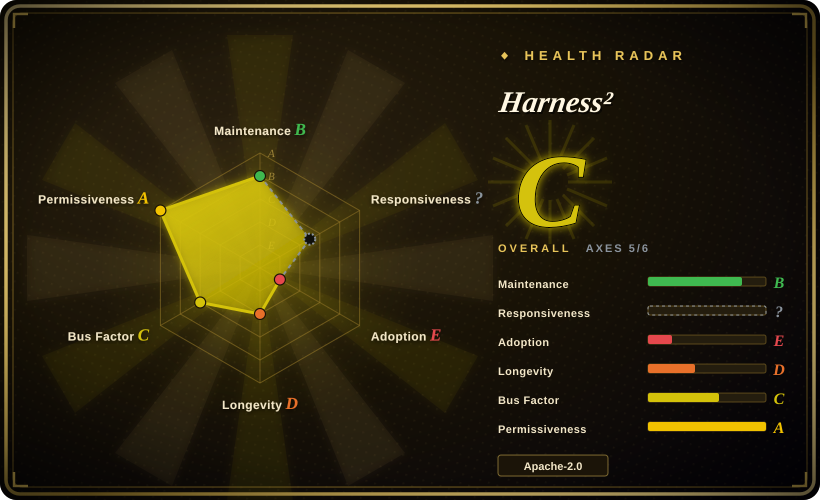
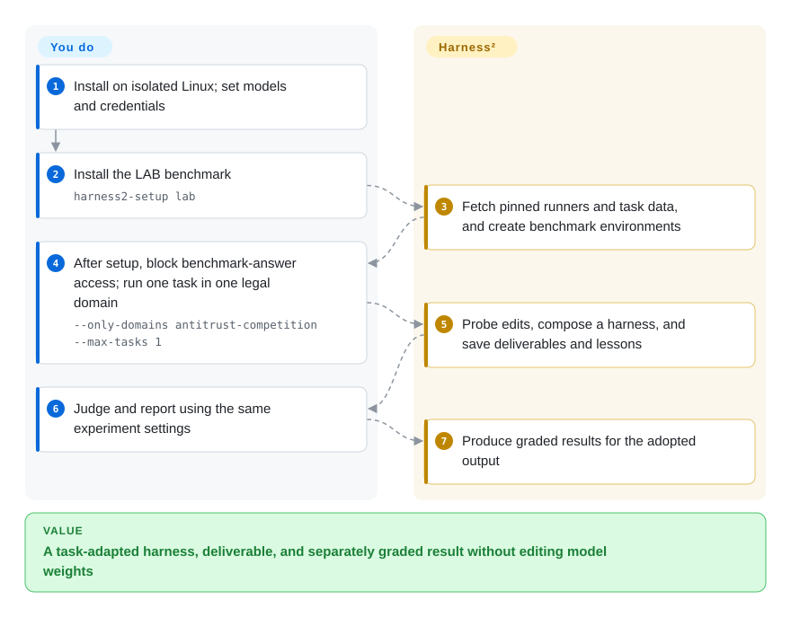
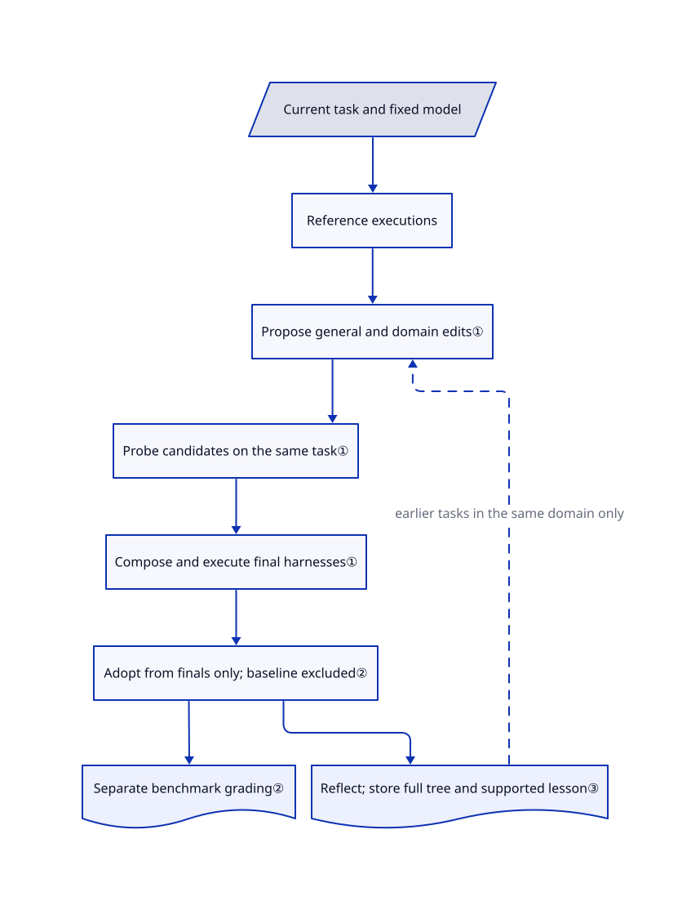

# Harness²

Your agent meets a new task, and yesterday's prompts and tools no longer fit. Harness² reruns that task with edited agent configurations, combines evidence from those trials, and saves lessons for later tasks without changing model weights.



## When to use

You research agents that produce legal memos, spreadsheets, or other professional deliverables. The model stays fixed, but you want to test whether changing its surrounding instructions, tools, skills, and memory helps on tasks absent from your design set. You can afford several executions of each task and operate an isolated Linux experiment host. Harness² supplies the propose–probe–compose loop, OpenCode/Codex execution adapters, and runners for JobBench, Harvey LAB, and WorkBuddy-Bench.

Choose it over SkillOpt when the experiment must adapt a whole agent configuration **on the current task without ground-truth scores**, rather than optimize one skill document against held-out validation. Choose it over DSPy when the object being edited is an on-disk agent harness, not a Python language-model program. For your own workload, expect to implement a benchmark adapter; the shipped CLI targets the three named benchmarks.

## When NOT to use

- **Every adopted edit must beat the baseline.** Use [SkillOpt](skillopt.md) for validation-gated skill edits, or a [promptfoo](../../llm-eval/promptfoo.md) regression gate around manually reviewed changes. Harness² selects only from composed finals; baseline outputs are excluded. At `k=1`, it adopts the single delivered final without a selector session, not because a score improved. See [selection logic](https://github.com/google-research/harness2/blob/1cfe254e8d25b15f37048c3730134686abe60335/harness2/core/selection.py#L93-L111).
- **You need a cheap, static instruction file at deployment.** Prefer [SkillOpt](skillopt.md) when you can pay for offline optimization and deploy the resulting document. Each Harness² recursion mode schedules `4k` task executions, including `k` references, plus `3k` improvement stages; selection and reflection can add calls. `k` is not a dollar cap. See [recursion accounting](https://github.com/google-research/harness2/blob/1cfe254e8d25b15f37048c3730134686abe60335/harness2/core/recursion.py#L15-L19).
- **The agent would share your workstation's secrets or unrestricted internet.** Keep production configuration unchanged and use [promptfoo](../../llm-eval/promptfoo.md) for controlled regression testing instead of running this optimizer on that host. Codex explicitly bypasses approvals and sandboxing; the release does not restrict executor networking. The authors report a validation rollout downloading its public grading rubric. Host isolation and outbound filtering are your work, not features supplied here. See [experiment warning](https://github.com/google-research/harness2/blob/1cfe254e8d25b15f37048c3730134686abe60335/docs/EXPERIMENTS.md#web-access).
- **You want ordinary application prompt optimization with labeled examples.** Pick [DSPy](dspy.md) to compile a Python pipeline against your metric. Harness² adds benchmark checkouts, CLI executors, repeated task runs, and experience libraries that a small extraction/classification app need not operate.

## Comparison

| Alternative | In index | Our verdict | Tradeoff |
|---|---|---|---|
| [SkillOpt](skillopt.md) | ✅ | Pick SkillOpt when a held-out score must gate a deployable skill document; pick Harness² for task-time adaptation across the wider harness without ground-truth feedback. | A static text artifact avoids extra deployment-time search; Harness² can edit more components but pays for probes on each task and lacks that acceptance guarantee. |
| [DSPy](dspy.md) | ✅ | Pick DSPy when your application is a Python model pipeline with examples and a metric; pick Harness² to study edits to an existing CLI agent's configuration. | DSPy provides program/module optimization; Harness² preserves the model and execution substrate while searching prompts, skills, scripts, and other harness files. |
| [promptfoo](../../llm-eval/promptfoo.md) | ✅ | Pick promptfoo when the decision is whether a prompt change may ship in CI; pick Harness² when the experiment must generate and probe the changes itself. | Regression assertions provide an external gate, not recursive harness editing; Harness²'s adaptation still needs separate evaluation before production adoption. |

## Quick start

Clone the source and follow the [Linux/Python setup guide](https://github.com/google-research/harness2/blob/1cfe254e8d25b15f37048c3730134686abe60335/docs/SETUP.md); install the editable package with `uv pip install -e '.[render]'` in a Python 3.12 environment. Set your Vertex AI project and executor, improver, and judge model IDs, then authenticate with `gcloud auth application-default login`; these are the models that perform tasks, edit configurations, and grade results. The README's `cp .env.example .env` is not usable at the reviewed commit because that file is absent: supply the documented variables in your shell or create `.env` yourself, using the [configuration reader](https://github.com/google-research/harness2/blob/1cfe254e8d25b15f37048c3730134686abe60335/harness2/config.py#L35-L102) as the source of names. Install LAB with `harness2-setup lab`, check it with `harness2-check --bench lab`, then run the one-domain, one-task command below on an isolated host with benchmark-answer access blocked. Harness² produces deliverables, adopted configurations, and reflection notes; run the matching judge and report commands to obtain scores, and pay the model/API and machine costs yourself.



<!-- flow-steps:begin (generated from flows/harness2.json by tools/flow_card.py — do not edit) -->
<details>
<summary>Text version of the flow</summary>

1. **You**: Install on isolated Linux; set models, credentials, and outbound restrictions
2. **You**: Install the LAB benchmark — `harness2-setup lab`
3. **Harness²**: Fetch pinned runners and task data, and create benchmark environments
4. **You**: Run one task in one legal domain — `--only-domains antitrust-competition --max-tasks 1`
5. **Harness²**: Probe edits, compose a harness, and save deliverables and lessons
6. **You**: Judge and report using the same experiment settings
7. **Harness²**: Produce graded results for the adopted output

**Value**: A task-adapted harness, deliverable, and separately graded result without editing model weights

</details>
<!-- flow-steps:end -->

The no-credential alternative is `harness2-demo --output runs/demo --k 2`: it uses deterministic editors and real Python executions, so it demonstrates the plumbing, not model quality. The paid benchmark path and the demo are documented in the [README](https://github.com/google-research/harness2/blob/1cfe254e8d25b15f37048c3730134686abe60335/README.md#install).

```bash
harness2 --bench lab --k 1 --mode parallel \
  --only-domains antitrust-competition --max-tasks 1
harness2-judge --bench lab --k 1 --mode parallel
harness2-report --bench lab --k 1 --mode parallel
```

## Key techniques



<!-- mechanism:begin (generated from mechanisms/harness2.json by tools/mechanism_card.py; do not edit) -->
<details>
<summary>Text version of the mechanism</summary>

- Current task and fixed model
- Reference executions
- Propose general and domain edits①
- Probe candidates on the same task①
- Compose and execute final harnesses①
- Adopt from finals only; baseline excluded②
- Separate benchmark grading②
- Reflect; store full tree and supported lesson③

- Current task and fixed model → Reference executions
- Reference executions → Propose general and domain edits①
- Propose general and domain edits① → Probe candidates on the same task①
- Probe candidates on the same task① → Compose and execute final harnesses①
- Compose and execute final harnesses① → Adopt from finals only; baseline excluded②
- Adopt from finals only; baseline excluded② → Separate benchmark grading②
- Adopt from finals only; baseline excluded② → Reflect; store full tree and supported lesson③
- Reflect; store full tree and supported lesson③ → Propose general and domain edits① (earlier tasks in the same domain only) [optional/fallback]

</details>
<!-- mechanism:end -->

### 1. Compare executions before composing a new harness

- **Problem:** An instruction edit that sounds sensible may change tool use or deliverables in the wrong direction.
- **How:** Parallel recursion proposes `k` general and `k` domain-specific configurations, executes them on the same task, and makes `k` compositions from shared evidence. Sequential recursion carries the configuration and accumulated evidence through `k` rounds.
- **Limits:** This is task-time search, not weight training or proof of improvement. Invalid proposals get one retry and then inherit the current configuration; the advertised `4k` executions and `3k` editing stages exclude additional selection/reflection work.
- **Source:** [Recursion modes and proposal validation](https://github.com/google-research/harness2/blob/1cfe254e8d25b15f37048c3730134686abe60335/harness2/core/recursion.py#L108-L251), [parallel and sequential schedules](https://github.com/google-research/harness2/blob/1cfe254e8d25b15f37048c3730134686abe60335/harness2/core/recursion.py#L343-L566).

### 2. Separate adoption evidence from external grading

- **Problem:** Feeding a benchmark's answer key or judge verdict back into the optimizer would contaminate the experiment.
- **How:** Context checks reject known answer-key paths and grader-output markers. Adoption compares anonymized deliverables from the composed finals, while benchmark grading runs separately; a single final at `k=1` needs no selector call.
- **Limits:** Marker checks are not a security boundary or a network firewall. Baseline outputs never enter the selection pool, so this procedure can adopt an output worse than the original configuration.
- **Source:** [Context tripwires](https://github.com/google-research/harness2/blob/1cfe254e8d25b15f37048c3730134686abe60335/harness2/core/context.py#L399-L517), [finals-only pool](https://github.com/google-research/harness2/blob/1cfe254e8d25b15f37048c3730134686abe60335/harness2/core/selection.py#L93-L111), [single-final adoption](https://github.com/google-research/harness2/blob/1cfe254e8d25b15f37048c3730134686abe60335/harness2/core/selection.py#L360-L399).

### 3. Carry complete configurations and lessons across earlier tasks

- **Problem:** A useful edit disappears if every task starts without the earlier experiment record.
- **How:** After adoption, reflection extracts a cue, lesson, and supporting evidence. A per-domain disk library stores the complete adopted file tree and an experience note; the scheduler keeps tasks within each domain ordered and retains only preceding entries.
- **Limits:** This is a scoped experience library, not automatic global learning across all workloads. An incomplete reflection is not stored, and results depend on task order; the seed shuffles the stream but does not control model sampling.
- **Source:** [Library storage and retention](https://github.com/google-research/harness2/blob/1cfe254e8d25b15f37048c3730134686abe60335/harness2/core/library.py#L57-L181), [reflection](https://github.com/google-research/harness2/blob/1cfe254e8d25b15f37048c3730134686abe60335/harness2/core/selection.py#L402-L505), [ordered domain scheduling](https://github.com/google-research/harness2/blob/1cfe254e8d25b15f37048c3730134686abe60335/harness2/core/schedule.py#L669-L733).

## Tech stack

- Python `>=3.12,<3.14`; setuptools; source version `0.1.0`. The base package declares no Python dependencies; the `render` extra adds openpyxl and python-pptx.
- On-disk harness trees, JSON run records, Markdown experience notes, and Python thread pools; OpenCode and Codex execution substrates.
- Optional Responses-API bridge using pinned LiteLLM, FastAPI, and google-auth. See [package manifest](https://github.com/google-research/harness2/blob/1cfe254e8d25b15f37048c3730134686abe60335/pyproject.toml).

## Dependencies

- Linux, Python 3.12 recommended, uv, Node.js 20+, Git, and Google Cloud CLI for the documented benchmark route. Setup installs pinned benchmark/OpenCode checkouts and its own Bun runtime.
- Vertex AI project, credentials, and model access for the documented model-backed route; model IDs are configuration, not included model weights. Other Responses endpoints are configurable for Codex.
- LAB needs Pandoc and Poppler; WorkBuddy needs Docker. Benchmark code and datasets retain separate licenses. See [setup requirements](https://github.com/google-research/harness2/blob/1cfe254e8d25b15f37048c3730134686abe60335/docs/SETUP.md#requirements) and [third-party notices](https://github.com/google-research/harness2/blob/1cfe254e8d25b15f37048c3730134686abe60335/third_party/README.md).

## Ops difficulty

**High for credible model-backed experiments; low for the deterministic demo.** You operate nested benchmark environments, credentials, repeated model calls, disk outputs, and host/network isolation. `--max-tasks` caps tasks **per domain**, not the whole run; pair it with `--only-domains` to bound a first experiment. Keep benchmark, executor, subset, mode, `k`, and seed identical across run/judge/report; use a new output root when models or task selection change. JobBench data resolves at download time, so record its downloaded revision too. These constraints come from the [experiment guide](https://github.com/google-research/harness2/blob/1cfe254e8d25b15f37048c3730134686abe60335/docs/EXPERIMENTS.md).

## Health & viability

- **Research-stage verdict, 2026-10-18.** The repository was created on 2026-10-06, last pushed on 2026-10-14, and is not archived. Source declares `0.1.0`; the GitHub releases endpoint returned no releases. About twelve days of history provides no durability evidence.
- **Backing and governance.** Published by Google Research, with two contributors returned by the contributors endpoint at review time. Contributions require Google's CLA and code review. The README explicitly says this is not an officially supported Google product; institutional ownership is not a support contract. See [contribution rules](https://github.com/google-research/harness2/blob/1cfe254e8d25b15f37048c3730134686abe60335/CONTRIBUTING.md).
- **Adoption and longevity.** The measured 1,828 stars and 155 forks show launch interest, not verified production deployments. [推断] Based on its twelve-day age and research release shape, treat it as an experiment framework rather than a long-term production dependency.
- **Risk flags.** Apache-2.0 covers the project's code, not every downloaded benchmark or dataset. Open [PR #37](https://github.com/google-research/harness2/pull/37) proposes subprocess-secret scrubbing and [PR #32](https://github.com/google-research/harness2/pull/32) proposes symlink/editable-tree containment; both were unmerged on 2026-10-18. These are proposed fixes, not shipped protections. Codex sandbox bypass and unrestricted executor networking are documented release behavior.

## Caveats (unverified)

- [未验证] The README's reported benchmark gains were not independently reproduced: this intake did not provision a Linux benchmark host, cloud model access, or paid evaluation runs. No improvement percentage is used as a selection guarantee.
- [推断] The experimental-not-production verdict follows the twelve-day repository age, source-only `0.1.0` release, and unsupported-product disclaimer; no long-term maintenance commitment was found in the reviewed README or contribution guide.
