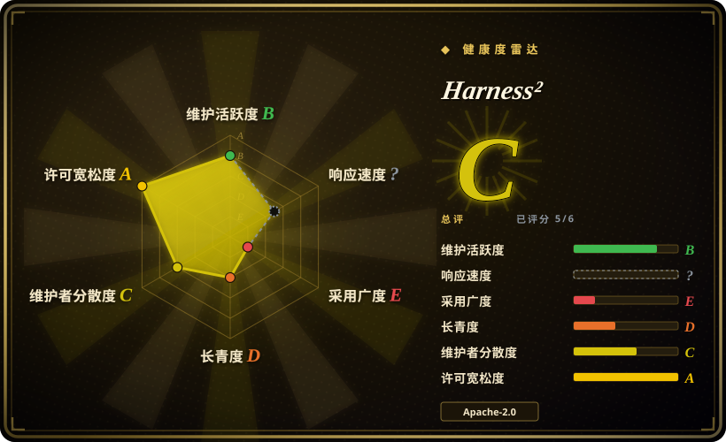
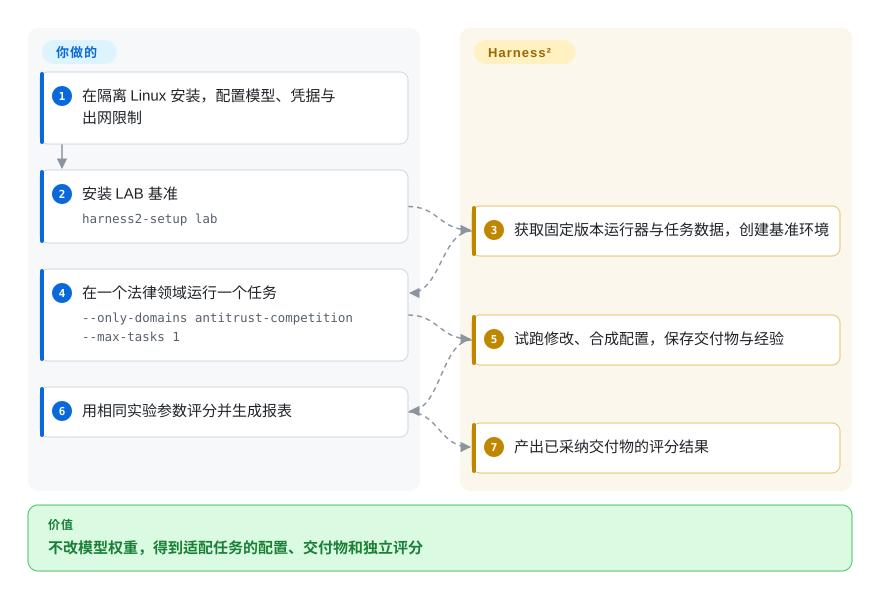
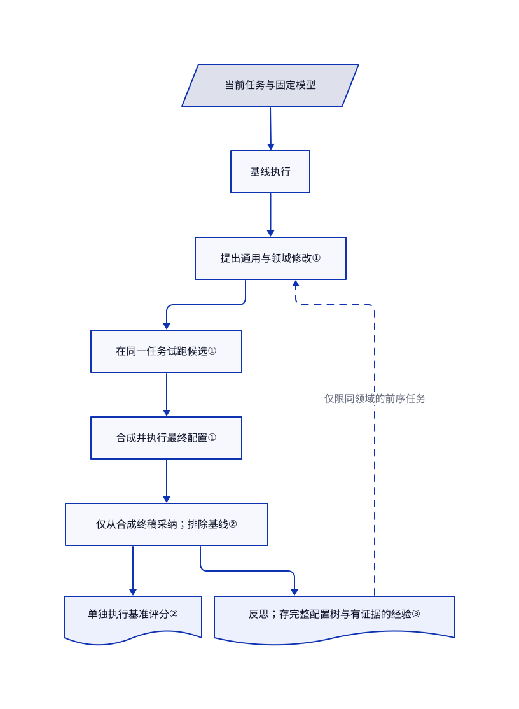

# Harness²

agent 遇到新任务，昨天调好的提示词和工具就不合用了。Harness² 在同一任务上试跑多份配置，再根据执行差异合成新配置，并为后续任务保存经验；它不修改模型权重。



## 何时使用

你在研究能交付法律备忘录、表格等专业成果的 agent。模型不能改，但你想验证：面对设计时没见过的任务，调整指令、工具、技能和记忆有没有帮助。你能承担同一任务多跑几次，也能维护隔离的 Linux 实验机。Harness² 提供“提出修改→试跑→合成配置”的循环，以及 OpenCode／Codex 执行适配器和 JobBench、Harvey LAB、WorkBuddy-Bench 三套基准的运行器。

当实验需要**在当前任务上、没有标准答案评分时**调整整套 agent 配置，而不是靠留出验证集优化一份技能文档，选它而非 SkillOpt。当你要改的是磁盘上的 agent 配置，而不是 Python 大模型程序，选它而非 DSPy。自有任务需要接入基准适配器；现成命令行只覆盖上述三套基准。

## 何时不用

- **每次采纳都必须胜过基线。** 要对技能修改做验证集门禁，选 [SkillOpt](skillopt.zh.md)；要给人工审核的修改加回归门禁，选 [promptfoo](../../llm-eval/promptfoo.zh.md)。Harness² 只在合成后的候选中选优，原始基线产物不参与。`k=1` 时，只要唯一终稿有交付就直接采纳，不是因为得分提高。见[选优源码](https://github.com/google-research/harness2/blob/1cfe254e8d25b15f37048c3730134686abe60335/harness2/core/selection.py#L93-L111)。
- **上线时只想读一份静态指令，不能继续花钱搜索。** 能接受离线优化时，优先选 [SkillOpt](skillopt.zh.md)，部署生成的文档。Harness² 每种递归模式安排 `4k` 次任务执行，其中包含 `k` 次基线执行，另有 `3k` 个改进阶段；选优和反思还可能增加调用。`k` 不是美元预算上限。见[执行计数](https://github.com/google-research/harness2/blob/1cfe254e8d25b15f37048c3730134686abe60335/harness2/core/recursion.py#L15-L19)。
- **agent 会共用工作机的凭据，或不受限地联网。** 不要在这台机器跑优化器；保持生产配置不变，先用 [promptfoo](../../llm-eval/promptfoo.zh.md) 做受控回归测试。Codex 明确绕过审批和沙箱，发行版也不限制执行器网络。作者记录过一次验证运行：agent 自行下载了公开评分细则。主机隔离和出网过滤由你负责，不是项目自带能力。见[实验警告](https://github.com/google-research/harness2/blob/1cfe254e8d25b15f37048c3730134686abe60335/docs/EXPERIMENTS.md#web-access)。
- **只是用带标注样本优化应用提示词。** 选 [DSPy](dspy.zh.md)，按你的指标优化 Python 管线。Harness² 还要维护基准仓库、命令行执行器、重复试跑和经验库；小型抽取、分类应用没必要承担这些。

## 横向对比

| 替代品 | 是否收录 | 我们的评价 | 取舍 |
|---|---|---|---|
| [SkillOpt](skillopt.zh.md) | ✅ | 要用留出评分把关一份可部署技能文档，选 SkillOpt；要在任务进行时无标准答案地调整整套配置，选 Harness²。 | 静态文档免去部署时搜索；Harness² 能改更多组件，但每个任务都要付试跑成本，也没有同等采纳保证。 |
| [DSPy](dspy.zh.md) | ✅ | 应用是有样本、有指标的 Python 大模型管线，选 DSPy；研究现有命令行 agent 的配置改进，选 Harness²。 | DSPy 优化程序和模块；Harness² 保持模型与执行底座不变，搜索提示词、技能、脚本等配置文件。 |
| [promptfoo](../../llm-eval/promptfoo.zh.md) | ✅ | 要在持续集成中决定提示词修改能否发布，选 promptfoo；实验需要自动生成并试跑修改，选 Harness²。 | 回归断言提供外部门禁，不负责递归改配置；Harness² 的改进仍要单独评测，才能考虑采纳到生产。 |

## 快速上手

克隆源码，按 [Linux／Python 安装指南](https://github.com/google-research/harness2/blob/1cfe254e8d25b15f37048c3730134686abe60335/docs/SETUP.md) 创建 Python 3.12 环境，再执行 `uv pip install -e '.[render]'`。配置 Vertex AI 项目及执行、改进、评分三个角色的模型名称，再用 `gcloud auth application-default login` 登录；三个角色分别负责做任务、改配置和评结果。README 的 `cp .env.example .env` 在核实版本中不可用，因为仓库缺少该文件；请在 shell 中设置文档列出的变量，或参照[配置读取代码](https://github.com/google-research/harness2/blob/1cfe254e8d25b15f37048c3730134686abe60335/harness2/config.py#L35-L102) 自建 `.env`。运行 `harness2-setup lab` 安装 LAB，再用 `harness2-check --bench lab` 检查，随后在隔离且已阻断基准答案访问的主机上执行图中的单领域、单任务命令。项目生成交付物、采纳的配置和反思记录；你再运行参数一致的评分与报表命令取得分数，并承担模型接口及机器成本。



<!-- flow-steps:begin (generated from flows/harness2.json by tools/flow_card.py — do not edit) -->
<details>
<summary>流程文字版</summary>

1. **你**：在隔离 Linux 安装，配置模型、凭据与出网限制
2. **你**：安装 LAB 基准 — `harness2-setup lab`
3. **Harness²**：获取固定版本运行器与任务数据，创建基准环境
4. **你**：在一个法律领域运行一个任务 — `--only-domains antitrust-competition --max-tasks 1`
5. **Harness²**：试跑修改、合成配置，保存交付物与经验
6. **你**：用相同实验参数评分并生成报表
7. **Harness²**：产出已采纳交付物的评分结果

**价值**：不改模型权重，得到适配任务的配置、交付物和独立评分

</details>
<!-- flow-steps:end -->

不配模型凭据也能运行 `harness2-demo --output runs/demo --k 2`：它用确定性编辑器和真实 Python 执行演示流程，不证明模型效果。收费基准路径与演示命令都见 [README](https://github.com/google-research/harness2/blob/1cfe254e8d25b15f37048c3730134686abe60335/README.md#install)。

```bash
harness2 --bench lab --k 1 --mode parallel \
  --only-domains antitrust-competition --max-tasks 1
harness2-judge --bench lab --k 1 --mode parallel
harness2-report --bench lab --k 1 --mode parallel
```

## 技术要点



<!-- mechanism:begin (generated from mechanisms/harness2.json by tools/mechanism_card.py; do not edit) -->
<details>
<summary>机制文字版</summary>

- 当前任务与固定模型
- 基线执行
- 提出通用与领域修改①
- 在同一任务试跑候选①
- 合成并执行最终配置①
- 仅从合成终稿采纳；排除基线②
- 单独执行基准评分②
- 反思；存完整配置树与有证据的经验③

- 当前任务与固定模型 → 基线执行
- 基线执行 → 提出通用与领域修改①
- 提出通用与领域修改① → 在同一任务试跑候选①
- 在同一任务试跑候选① → 合成并执行最终配置①
- 合成并执行最终配置① → 仅从合成终稿采纳；排除基线②
- 仅从合成终稿采纳；排除基线② → 单独执行基准评分②
- 仅从合成终稿采纳；排除基线② → 反思；存完整配置树与有证据的经验③
- 反思；存完整配置树与有证据的经验③ → 提出通用与领域修改①（仅限同领域的前序任务）〔可选／兜底〕

</details>
<!-- mechanism:end -->

### 1. 先对比执行，再合成配置

- **解决：** 听起来合理的指令修改，也可能让工具使用和最终交付变差。
- **做法：** 并行模式提出 `k` 份通用配置和 `k` 份领域配置，在同一任务上试跑，再根据共享证据合成 `k` 份配置。串行模式则把当前配置和累计证据带入后续轮次，共执行 `k` 轮。
- **边界：** 这是任务进行时的搜索，不是训练权重，也不证明质量提高。无效修改重试一次，仍失败就继承当前配置；`4k` 次执行和 `3k` 个编辑阶段不含额外选优、反思成本。
- **源码：** [配置验证与重试](https://github.com/google-research/harness2/blob/1cfe254e8d25b15f37048c3730134686abe60335/harness2/core/recursion.py#L108-L251)、[并行和串行调度](https://github.com/google-research/harness2/blob/1cfe254e8d25b15f37048c3730134686abe60335/harness2/core/recursion.py#L343-L566)。

### 2. 把采纳证据与外部评分分开

- **解决：** 如果优化器读到答案或裁判评分，实验就会被污染。
- **做法：** 上下文检查拒绝已知答案路径及评分输出标记。采纳阶段比较匿名化的合成终稿，基准评分单独执行；`k=1` 只有一份终稿，不调用选优模型。
- **边界：** 字符串检查不是安全隔离，也不是网络防火墙。基线产物从不进入候选池，因此仍可能采纳比原始配置更差的结果。
- **源码：** [上下文检查](https://github.com/google-research/harness2/blob/1cfe254e8d25b15f37048c3730134686abe60335/harness2/core/context.py#L399-L517)、[只选合成终稿](https://github.com/google-research/harness2/blob/1cfe254e8d25b15f37048c3730134686abe60335/harness2/core/selection.py#L93-L111)、[单终稿采纳](https://github.com/google-research/harness2/blob/1cfe254e8d25b15f37048c3730134686abe60335/harness2/core/selection.py#L360-L399)。

### 3. 把完整配置和经验带给后续任务

- **解决：** 每个任务都丢掉前序实验记录，有用的修改就无法复用。
- **做法：** 采纳后反思生成触发线索、经验和支持证据。按领域划分的磁盘经验库存完整配置树及经验说明；调度器保证同领域任务有序，只保留当前任务之前的条目。
- **边界：** 这是限定范围的经验库，不是跨全部业务的自动学习。反思不完整就不入库，结果也受任务顺序影响；随机种子只打乱任务流，不控制模型采样。
- **源码：** [经验库存储与保留](https://github.com/google-research/harness2/blob/1cfe254e8d25b15f37048c3730134686abe60335/harness2/core/library.py#L57-L181)、[采纳后反思](https://github.com/google-research/harness2/blob/1cfe254e8d25b15f37048c3730134686abe60335/harness2/core/selection.py#L402-L505)、[领域内有序执行](https://github.com/google-research/harness2/blob/1cfe254e8d25b15f37048c3730134686abe60335/harness2/core/schedule.py#L669-L733)。

## 技术栈

- Python `>=3.12,<3.14`，setuptools，源码版本为 `0.1.0`。基础包没有声明 Python 依赖；`render` 扩展增加 openpyxl 和 python-pptx。
- 磁盘配置树、JSON 运行记录、Markdown 经验说明和 Python 线程池；支持 OpenCode、Codex 两种执行底座。
- 可选的 Responses API 协议桥接使用固定版本的 LiteLLM、FastAPI、google-auth。见[包清单](https://github.com/google-research/harness2/blob/1cfe254e8d25b15f37048c3730134686abe60335/pyproject.toml)。

## 依赖

- 文档中的基准路径需要 Linux、推荐 Python 3.12、uv、Node.js 20+、Git 和 Google Cloud CLI。安装过程获取固定版本的基准与 OpenCode 仓库，并安装自己的 Bun 运行时。
- 文档中的模型路径需要 Vertex AI 项目、凭据和模型访问权限；配置的是模型名称，不附带模型权重。Codex 也能配置其他 Responses API 地址。
- LAB 需要 Pandoc 和 Poppler；WorkBuddy 需要 Docker。基准代码和数据集保留各自许可。见[安装要求](https://github.com/google-research/harness2/blob/1cfe254e8d25b15f37048c3730134686abe60335/docs/SETUP.md#requirements)与[第三方声明](https://github.com/google-research/harness2/blob/1cfe254e8d25b15f37048c3730134686abe60335/third_party/README.md)。

## 运维难度

**可信的模型实验较高，确定性演示较低。** 你要维护多层基准环境、凭据、重复模型调用、磁盘产物，以及主机和网络隔离。`--max-tasks` 限制的是**每个领域**的任务数，不是全局总数；初次运行应同时指定 `--only-domains`。运行、评分、报表的基准、执行器、子集、模式、`k` 和种子必须一致；换模型或任务选择时，另建输出目录。JobBench 数据在下载时解析版本，还要记录下载到的修订号。这些要求见[实验指南](https://github.com/google-research/harness2/blob/1cfe254e8d25b15f37048c3730134686abe60335/docs/EXPERIMENTS.md)。

## 健康度与可持续性

- **研究阶段裁决，2026-10-18。** 仓库创建于 2026-10-06，最近推送为 2026-10-14，未归档。源码声明 `0.1.0`，GitHub 发行版接口返回空列表。约十二天历史不足以证明可长期依赖。
- **背书与治理。** 项目发布在 Google Research 名下，本次贡献者接口返回两人。贡献需要 Google CLA 和代码审查。README 明确写着不是 Google 官方支持产品；机构归属不等于支持合同。见[贡献规则](https://github.com/google-research/harness2/blob/1cfe254e8d25b15f37048c3730134686abe60335/CONTRIBUTING.md)。
- **采用与寿命。** 实测 1,828 个星标、155 个 fork 反映发布期关注，不是生产部署证明。[推断] 依据十二天仓龄和研究发行形态，应把它当实验框架，而非长期生产依赖。
- **风险。** 项目代码采用 Apache-2.0，不代表所有下载的基准和数据都采用相同许可。[PR #37](https://github.com/google-research/harness2/pull/37) 提议清理子进程继承的凭据，[PR #32](https://github.com/google-research/harness2/pull/32) 提议限制符号链接与可编辑文件范围；截至 2026-10-18，两者都未合并，不能当作现有保护。Codex 绕过沙箱和执行器不限制联网，则是文档明确写出的现状。

## 存疑（未验证）

- [未验证] 未独立复现 README 的基准提升数据：本次收录没有配置 Linux 基准主机、云模型权限及收费评测。页面不以任何提升百分比作选型保证。
- [推断] “用于实验而非生产依赖”的判断，依据十二天仓龄、仅源码声明的 `0.1.0` 和非官方支持声明；已读 README 与贡献指南未给出长期维护承诺。
