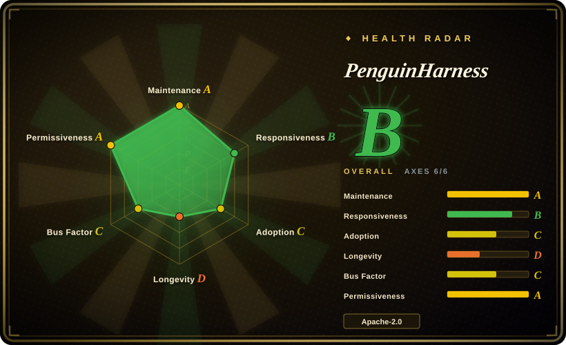
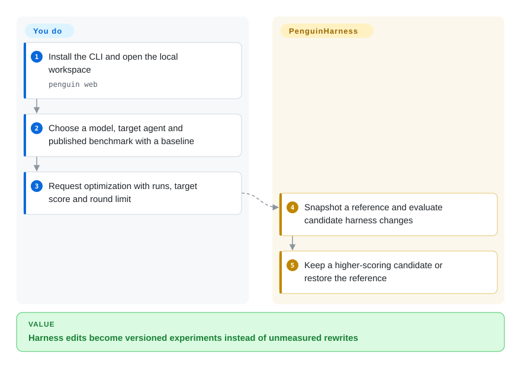
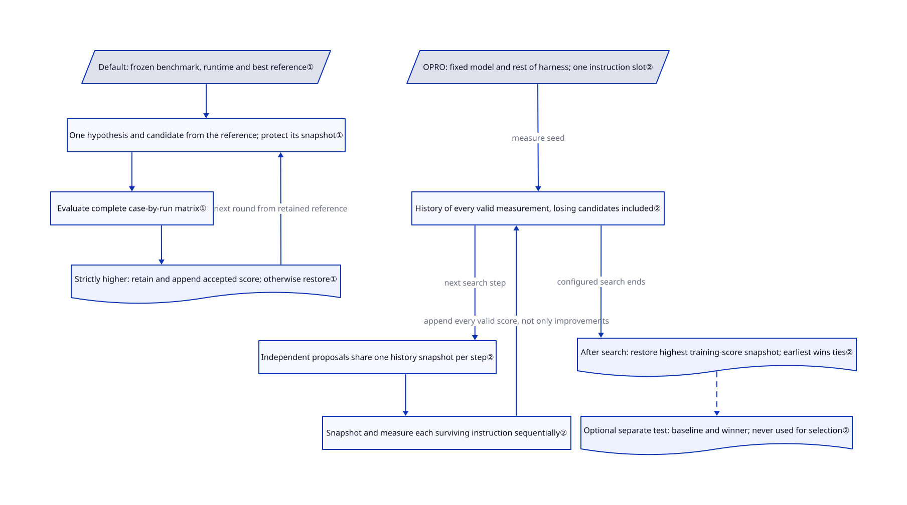

# PenguinHarness

Your agent rewrites its instructions, but you cannot tell whether the new version helped. PenguinHarness evaluates versioned harness changes against a frozen benchmark and retains a scored reference.

## When to use

You maintain an agent that repeatedly fails the same document or coding tasks. You want to test changes to its instructions, skills, tools or hooks while holding the target model fixed. Choose PenguinHarness when you also want a runnable agent, a web evaluation center and several optimization methods in one workspace, rather than building experiment orchestration around a Python optimizer.

## When NOT to use

- For a Python pipeline compiled from typed inputs and outputs, choose [DSPy](dspy.md). PenguinHarness brings an entire agent runtime and project layout.
- For one deployable skill document with a separate validation gate, examine [SkillOpt](skillopt.md). The default Penguin toolkit accepts a strictly higher score on its frozen benchmark; that is not evidence of unseen-task improvement.
- For a CI regression matrix without an autonomous editor, use [promptfoo](../../llm-eval/promptfoo.md). Optimization adds model calls and a mutable target state.
- For model-weight training, use a training framework such as [Unsloth](../../llm-training/unsloth.md). Here self-improvement changes the harness, not the model weights.

## Comparison

| Alternative | In index | Our verdict | Tradeoff |
|---|---|---|---|
| [DSPy](dspy.md) | ✅ | Choose DSPy for Python program optimization; choose PenguinHarness for an interactive agent workspace with versioned evaluations. | A smaller embedded programming model versus an integrated CLI, server and UI. |
| [SkillOpt](skillopt.md) | ✅ | Choose SkillOpt when a portable skill file and held-out validation decide acceptance. | Narrower optimization artifact; Penguin can revise a broader harness surface. |
| [promptfoo](../../llm-eval/promptfoo.md) | ✅ | Choose promptfoo when CI must detect regressions rather than propose changes. | Explicit assertions and provider matrices without an autonomous candidate editor. |

## Quick start

Install the CLI with `npm install -g @prismshadow/penguin-cli` on Node 24 or newer, then run `penguin web`. Open the local address, set a password and configure a model provider on the Models page. Select an existing agent and a published benchmark with a formal baseline, then request optimization with a target score, run count and round limit. The toolkit proposes, evaluates and restores or retains versions; you supply trustworthy cases, provider credentials and the experiment budget. Built-in Harbor benchmarks additionally require Docker.

<!-- flow-steps:begin (generated from flows/penguin-harness.json by tools/flow_card.py — do not edit) -->

Text version of the flow

1. **You**: Install the CLI and open the local workspace — `penguin web`
2. **You**: Choose a model, target agent and published benchmark with a baseline
3. **You**: Request optimization with runs, target score and round limit
4. **PenguinHarness**: Snapshot a reference and evaluate candidate harness changes
5. **PenguinHarness**: Keep a higher-scoring candidate or restore the reference

**Value**: Harness edits become versioned experiments instead of unmeasured rewrites

<!-- flow-steps:end -->

## Key techniques

<!-- mechanism:begin (generated from mechanisms/penguin-harness.json by tools/mechanism_card.py; do not edit) -->

Text version of the mechanism

- Default: frozen benchmark, runtime and best reference①
- One hypothesis and candidate from the reference; protect its snapshot①
- Evaluate complete case-by-run matrix①
- Strictly higher: retain and append accepted score; otherwise restore①
- OPRO: fixed model and rest of harness; one instruction slot②
- History of every valid measurement, losing candidates included②
- Independent proposals share one history snapshot per step②
- Snapshot and measure each surviving instruction sequentially②
- After search: restore highest training-score snapshot; earliest wins ties②
- Optional separate test: baseline and winner; never used for selection②

- Default: frozen benchmark, runtime and best reference① → One hypothesis and candidate from the reference; protect its snapshot①
- One hypothesis and candidate from the reference; protect its snapshot① → Evaluate complete case-by-run matrix①
- Evaluate complete case-by-run matrix① → Strictly higher: retain and append accepted score; otherwise restore①
- Strictly higher: retain and append accepted score; otherwise restore① → One hypothesis and candidate from the reference; protect its snapshot① (next round from retained reference)
- OPRO: fixed model and rest of harness; one instruction slot② → History of every valid measurement, losing candidates included② (measure seed)
- History of every valid measurement, losing candidates included② → Independent proposals share one history snapshot per step② (next search step)
- Independent proposals share one history snapshot per step② → Snapshot and measure each surviving instruction sequentially②
- Snapshot and measure each surviving instruction sequentially② → History of every valid measurement, losing candidates included② (append every valid score, not only improvements)
- History of every valid measurement, losing candidates included② → After search: restore highest training-score snapshot; earliest wins ties② (configured search ends)
- After search: restore highest training-score snapshot; earliest wins ties② → Optional separate test: baseline and winner; never used for selection② [optional/fallback]

<!-- mechanism:end -->

### 1. Freeze evaluation while versioning the target

- **Problem:** An instruction change cannot be compared fairly if the model, cases or agent state also move.
- **How:** The default optimization skill freezes the reference runtime and case set, snapshots the prior state and delegates the case-by-run matrix to evaluation workers. It accepts only complete candidates with a strictly higher average score and appends only accepted candidate evaluations to the scoreboard; otherwise it restores the reference.
- **Limits:** These are agent-executed rules, not isolation guarantees. The agent calculates, writes and rereads the authoritative scoreboard averages; the default skill explicitly forbids adding server, frontend, script or consistency checks that recompute or validate them, so independent machine aggregation is not enforced. The formal baseline may use one run while candidates use more; repeated search can overfit the same benchmark.
- **Source:** [Optimization contract](https://github.com/Prism-Shadow/penguin-harness/blob/7e08d23f67e8f3945d37fbc793d398d55454b9bd/plugins/default-rsi-toolkit/skills/agent-optimization/SKILL.md#L15-L74), [scoreboard trust boundary](https://github.com/Prism-Shadow/penguin-harness/blob/7e08d23f67e8f3945d37fbc793d398d55454b9bd/plugins/default-rsi-toolkit/skills/agent-optimization/SKILL.md#L130-L134).

### 2. Search instructions from scored history

- **Problem:** A vague reflection loop hides which search method generated an improvement.
- **How:** OPRO keeps the model and the rest of the harness fixed and searches one instruction slot. Each step's independent proposals share a history snapshot; every complete valid measurement, including losing candidates, enters the history. The toolkit records parameters and hashes and restores the highest-training-score snapshot after search; its smoke profile uses two steps and two proposals per step.
- **Limits:** Ties retain the earliest measured instruction. A separate test benchmark is optional and never changes selection; this is not the default toolkit's accept-only-improvements loop. The toolkit documents adaptations rather than claiming exact reproduction of published results.
- **Source:** [OPRO experiment and selection](https://github.com/Prism-Shadow/penguin-harness/blob/7e08d23f67e8f3945d37fbc793d398d55454b9bd/plugins/opro-rsi-toolkit/skills/opro-rsi-toolkit/SKILL.md#L19-L166).

## Tech stack

TypeScript monorepo with Node 24+, an ESM core SDK, CLI, web/server packages and plugin skills. The core manifest includes MCP clients, YAML/TOML parsing and built-in toolkit packages.

## Dependencies

A configured model endpoint and credentials, a writable project/data directory and Node 24+ for npm installation. Docker is needed for the built-in Harbor tasks, not for every SDK call. External browser and remote-machine integrations add permissions and SSH access when enabled.

## Ops difficulty

**Medium.** A local web workspace is straightforward; safe experiments require frozen datasets, snapshots, credential handling and model-call budgets. Do not equate a model's workflow compliance with an OS sandbox. Review the README's auto-approving SDK example before adapting it.

## Health & viability

- On 2026-10-18, the repository was active; v0.2.16 shipped on 2026-10-14. It was created on 2026-07-19, so its Lindy history is only three months.
- The README names PrismShadow AI and Qinghe Dynamic and lists maintainers; contributor history is led by `hiyouga`. This is not neutral-foundation governance.
- Apache-2.0 is present as license text; third-party notices cover bundled components. The 2,808 stars show visibility, not measured production success.
- [推断：依据是短历史和频繁 0.x 发布] Treat it as a promising experiment platform, not a stable long-term harness interface.

## Caveats (unverified)

- [未验证：本任务禁止执行上游] Installation, rollback under interruption and benchmark isolation were inspected in sources, not reproduced.
- [未验证：未复跑作者评测] The README's cost and accuracy comparisons are not independently confirmed and are not selection evidence here.
- [推断：依据是短历史和频繁 0.x 发布] Interface stability remains unproven despite active development.
