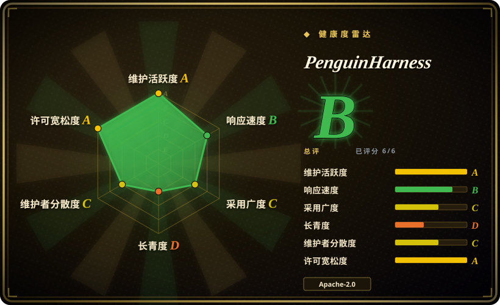
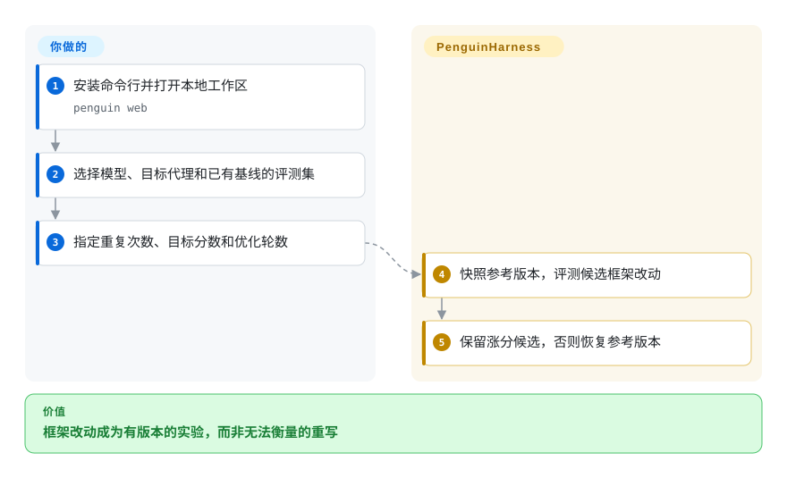
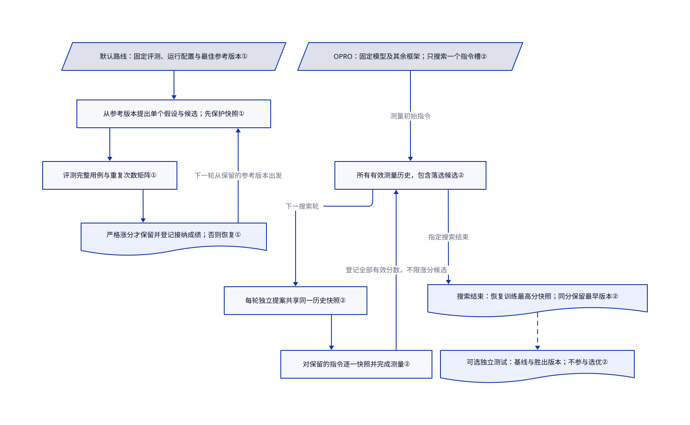

# PenguinHarness

代理改了自己的指令，你却不知道是否变好。PenguinHarness 固定评测任务，给每版运行框架评分，并保留有成绩的参考版本。

## 何时使用

你维护的代理总在相同文档或编码任务上失败。你想固定目标模型，只测试指令、技能、工具或 hook 的改动。若你还需要可运行的代理、网页评测中心和多种优化方法，选 PenguinHarness，而不是围绕 Python 优化器自己搭实验平台。

## 何时不用

- 要优化具有类型化输入输出的 Python 流水线，选 [DSPy](dspy.zh.md)。PenguinHarness 会带入整套代理运行时和项目目录。
- 要交付单份技能文件，并用独立验证集决定接纳，先看 [SkillOpt](skillopt.zh.md)。Penguin 默认工具包按固定评测集上的严格涨分接纳，不证明新任务也会变好。
- 只要持续集成中的回归矩阵，不需要自动改指令，选 [promptfoo](../../llm-eval/promptfoo.zh.md)。优化会增加模型调用和可变状态。
- 要训练模型权重，选 [Unsloth](../../llm-training/unsloth.zh.md) 等训练框架。这里改的是运行框架，不是权重。

## 横向对比

| 替代品 | 是否收录 | 我们的评价 | 取舍 |
|---|---|---|---|
| [DSPy](dspy.zh.md) | ✅ | 优化 Python 程序选 DSPy；要交互式代理工作区和版本评测选 PenguinHarness。 | 嵌入式编程模型更轻；本项目整合命令行、服务端和网页。 |
| [SkillOpt](skillopt.zh.md) | ✅ | 交付可移植技能文件，且独立验证集决定接纳时，选 SkillOpt。 | 优化产物更窄；Penguin 可修改更多运行框架组件。 |
| [promptfoo](../../llm-eval/promptfoo.zh.md) | ✅ | 持续集成只需发现退化，不需提出改动时，选 promptfoo。 | 提供显式断言和模型矩阵，不带自动候选编辑器。 |

## 快速上手

在 Node 24 以上运行 `npm install -g @prismshadow/penguin-cli`，再运行 `penguin web`。打开本地地址，设置密码，并在模型页配置服务商。选择现有代理，以及已有正式基线的已发布评测集，再指定目标分数、重复次数和轮数上限。工具包负责提出候选、评测、恢复或保留版本；你负责可信用例、模型凭据和实验预算。内置 Harbor 评测还需要 Docker。

<!-- flow-steps:begin (generated from flows/penguin-harness.json by tools/flow_card.py — do not edit) -->

流程文字版

1. **你**：安装命令行并打开本地工作区 — `penguin web`
2. **你**：选择模型、目标代理和已有基线的评测集
3. **你**：指定重复次数、目标分数和优化轮数
4. **PenguinHarness**：快照参考版本，评测候选框架改动
5. **PenguinHarness**：保留涨分候选，否则恢复参考版本

**价值**：框架改动成为有版本的实验，而非无法衡量的重写

<!-- flow-steps:end -->

## 技术要点

<!-- mechanism:begin (generated from mechanisms/penguin-harness.json by tools/mechanism_card.py; do not edit) -->

机制文字版

- 默认路线：固定评测、运行配置与最佳参考版本①
- 从参考版本提出单个假设与候选；先保护快照①
- 评测完整用例与重复次数矩阵①
- 严格涨分才保留并登记接纳成绩；否则恢复①
- OPRO：固定模型及其余框架；只搜索一个指令槽②
- 所有有效测量历史，包含落选候选②
- 每轮独立提案共享同一历史快照②
- 对保留的指令逐一快照并完成测量②
- 搜索结束：恢复训练最高分快照；同分保留最早版本②
- 可选独立测试：基线与胜出版本；不参与选优②

- 默认路线：固定评测、运行配置与最佳参考版本① → 从参考版本提出单个假设与候选；先保护快照①
- 从参考版本提出单个假设与候选；先保护快照① → 评测完整用例与重复次数矩阵①
- 评测完整用例与重复次数矩阵① → 严格涨分才保留并登记接纳成绩；否则恢复①
- 严格涨分才保留并登记接纳成绩；否则恢复① → 从参考版本提出单个假设与候选；先保护快照①（下一轮从保留的参考版本出发）
- OPRO：固定模型及其余框架；只搜索一个指令槽② → 所有有效测量历史，包含落选候选②（测量初始指令）
- 所有有效测量历史，包含落选候选② → 每轮独立提案共享同一历史快照②（下一搜索轮）
- 每轮独立提案共享同一历史快照② → 对保留的指令逐一快照并完成测量②
- 对保留的指令逐一快照并完成测量② → 所有有效测量历史，包含落选候选②（登记全部有效分数，不限涨分候选）
- 所有有效测量历史，包含落选候选② → 搜索结束：恢复训练最高分快照；同分保留最早版本②（指定搜索结束）
- 搜索结束：恢复训练最高分快照；同分保留最早版本② → 可选独立测试：基线与胜出版本；不参与选优②〔可选／兜底〕

<!-- mechanism:end -->

### 1. 固定评测，给目标状态分版本

- **解决：** 模型、用例和状态同时改变，就无法判断指令改动是否有效。
- **做法：** 默认优化技能固定参考运行配置和用例，先快照旧状态，再把用例与重复次数的矩阵交给评测代理。只有完整且平均分严格提高的候选才接纳，正式成绩账本只追加接纳候选的评测，否则恢复参考版本。
- **边界：** 这是代理执行的规则，不是隔离保证。权威汇总均分由代理计算、写入并回读；默认技能明确禁止另加服务端、前端、脚本或一致性检查来重算或校验，不能说成强制独立机算。正式基线可能只跑一次，候选却重复多次；同一评测集反复搜索也可能过拟合。
- **源码：** [优化协议](https://github.com/Prism-Shadow/penguin-harness/blob/7e08d23f67e8f3945d37fbc793d398d55454b9bd/plugins/default-rsi-toolkit/skills/agent-optimization/SKILL.md#L15-L74)、[成绩账本信任边界](https://github.com/Prism-Shadow/penguin-harness/blob/7e08d23f67e8f3945d37fbc793d398d55454b9bd/plugins/default-rsi-toolkit/skills/agent-optimization/SKILL.md#L130-L134)。

### 2. 根据历史分数搜索指令

- **解决：** 只有笼统反思循环，就看不出哪种搜索方法带来提升。
- **做法：** OPRO 固定模型及其余运行框架，只搜索一个指令槽。每轮独立提案共享同一历史快照，所有完整有效测量都进入历史，包括落选候选。工具包记录参数和哈希，搜索结束后恢复训练最高分快照；轻量配置使用两轮，每轮两个提案。
- **边界：** 同分保留最早测量的指令。独立测试集可选，且不改变选优；这不同于默认工具包只接纳涨分候选的循环。工具包列明自身适配，不声称复现论文的原始成绩。
- **源码：** [OPRO 实验与选优](https://github.com/Prism-Shadow/penguin-harness/blob/7e08d23f67e8f3945d37fbc793d398d55454b9bd/plugins/opro-rsi-toolkit/skills/opro-rsi-toolkit/SKILL.md#L19-L166)。

## 技术栈

TypeScript 单仓库，包含 Node 24 以上的 ESM 核心开发包、命令行、网页、服务端和技能插件。核心清单包含 MCP 客户端、YAML／TOML 解析和内置优化包。

## 依赖

需要模型接口与凭据、可写数据目录，以及 npm 路线所需的 Node 24 以上版本。内置 Harbor 任务需要 Docker，并非所有开发包调用都需要。浏览器和远程机器集成还需要相应权限及 SSH 访问。

## 运维难度

**中等。** 本地网页容易启动；可信实验仍需固定数据集、快照、凭据管理和调用预算。代理遵守工作流不等于操作系统沙箱。改用 README 中自动批准工具的示例前，应审查授权逻辑。

## 健康度与可持续性

- 截至 2026-10-18，仓库仍活跃，v0.2.16 于 2026-10-14 发布。仓库创建于 2026-07-19，仅有三个月的存续历史。
- README 列出 PrismShadow AI、Qinghe Dynamic 和维护者名单；提交贡献由 `hiyouga` 领衔，并非中立基金会治理。
- 实读许可为 Apache-2.0，并保留第三方声明。2,808 颗星体现关注度，不证明生产效果。
- [推断：依据是短历史和频繁 0.x 发布] 可用于实验，但不宜把当前接口视为长期稳定合同。

## 存疑（未验证）

- [未验证：本任务禁止执行上游] 已阅读安装、回滚和评测隔离规则，未复现安装及中断恢复。
- [未验证：未复跑作者评测] README 的费用与准确率对比未经独立确认，本页不以其作为选型依据。
- [推断：依据是短历史和频繁 0.x 发布] 活跃维护尚不能证明接口稳定。
