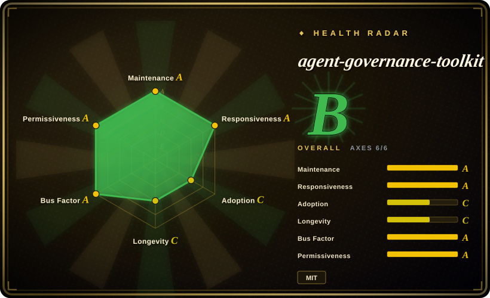
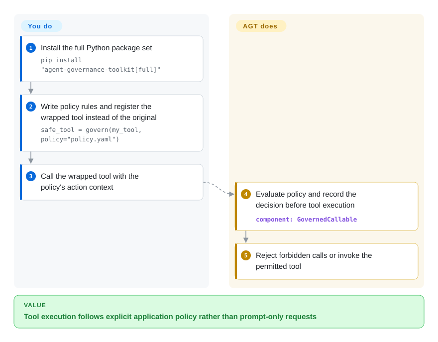
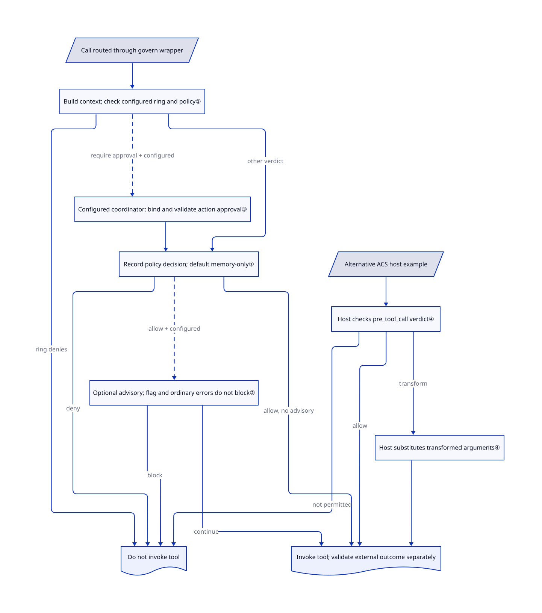

# agent-governance-toolkit

Your agent can call both a database and a messaging tool, but a prompt saying “do not leak data” cannot stop a bad tool invocation. AGT places policy checks before wrapped actions and records their decisions; you still own the enforcement points and data-flow rules.

## When to use

You are deploying an agent with `query_database` and `send_email`, and need to reject a forbidden operation before either tool runs, then explain the decision to an operator. Choose AGT over prompt-only rules when you can insert a callable wrapper or framework adapter at every action boundary and maintain explicit policy plus audit retention. It packages agent-oriented identity, approval, audit and adapters around policy decisions, rather than leaving all those integration concerns to a general-purpose authorization engine.

Adopt only the layers you need: Python `govern()` for a tool boundary, or the ACS host API for explicit allow/deny/transform decisions; framework and language adapters have their own surfaces. The [reviewed README](https://github.com/microsoft/agent-governance-toolkit/blob/8b2c96473742e8506e4052e2b0d38ac5a631966e/README.md#L59-L86) moves the main policy path to upstream Agent Control Specification and warns about package migration. Public Preview and a main manifest version ahead of the latest GitHub Release mean you must distinguish reviewed source from an installed wheel.

## When NOT to use

- **You need a stable authorization engine but not an agent-governance stack.** Choose Open Policy Agent or Cedar and own a smaller integration; AGT still declares Public Preview with possible breaking changes before GA.
- **OS-level containment is the primary control.** Use containers or a separately isolated sandbox alongside your agent; AGT's application middleware shares the process boundary and does not replace that isolation.
- **You cannot cover every tool execution path.** First centralize dispatch in your own middleware; wrapping one callable does not govern direct calls to the original function or unrelated external processes.
- **Your goal is detecting hallucinations, malicious action sequences or confidential-data flow.** Add result validation and content/data-classification controls; the [limitations](https://github.com/microsoft/agent-governance-toolkit/blob/8b2c96473742e8506e4052e2b0d38ac5a631966e/docs/LIMITATIONS.md#L12-L67) explicitly say individually allowed actions can still form a harmful workflow, and audits do not verify external outcomes.
- **You need approval annotations or default audit logging to be a durable blocking control.** Use an explicit approval coordinator and persistent sink, or a custom enforcement service. `flag_for_review` is annotation-only and default wrapper audit entries live in memory; neither is a merge gate or durable compliance record by itself.

## Comparison

| Alternative | In index | Our verdict | Tradeoff |
|---|---|---|---|
| [Open Policy Agent](https://github.com/open-policy-agent/opa) | not indexed | Choose OPA when general policy evaluation is enough and you already control dispatch; choose AGT when agent-specific wrappers, approval and audit reduce your integration work. | OPA supplies the policy engine; agent action context, identity mapping and decision retention stay with your application. |
| [Cedar](https://github.com/cedar-policy/cedar) | not indexed | Choose Cedar when fine-grained authorization is the main problem; choose AGT when enforcement must attach to agent tools and framework lifecycle. | An authorization language/runtime has less agent-specific surface, but does not install the agent's enforcement points for you. |
| [Cedarling (Janssen)](https://github.com/JanssenProject/jans) | not indexed | Choose Cedarling for a Cedar policy decision point in an identity-oriented system; choose AGT for its agent integration stack, optionally using its Cedarling adapter. | Cedarling belongs to a real multi-component IAM repository; it is a decision backend, not a substitute for action dispatch wiring. |
| Custom middleware | not a repo | Write a small dispatcher when one service has only a few tools; choose AGT when reusable policy, approval and audit infrastructure outweigh package complexity. | This is an implementation strategy, not a missing repository; you own failure semantics and audit integrity. |

## Quick start

The [README](https://github.com/microsoft/agent-governance-toolkit/blob/8b2c96473742e8506e4052e2b0d38ac5a631966e/README.md#L59-L129) installs `pip install "agent-governance-toolkit[full]"`; the base wheel provides compliance tooling rather than all wrapper modules, and the reviewed main core manifest requires Python 3.11+. Import `govern` from `agentmesh.governance`, write `policy.yaml` with explicit rules, and replace your tool registration with `safe_tool = govern(my_tool, policy="policy.yaml")`. Call that wrapper with the action/context your policy expects; it evaluates and logs the decision before allowing execution, or raises `GovernanceDenied` by default. For async callables use its documented `acall()` path, and configure `audit_file` plus an audit signing key if records must survive process exit. You own all dispatch wiring, conservative policy defaults, approval handling, secret management and result validation; no Azure account or model API is required for the basic local policy wrapper, while optional cloud/model adapters have their own costs. Pin a compatible package set and check its installed API: the source reviewed here and latest GitHub release do not have the same version number.

<!-- flow-steps:begin (generated from flows/agent-governance-toolkit.json by tools/flow_card.py — do not edit) -->

Text version of the flow

1. **You**: Install the full Python package set — `pip install "agent-governance-toolkit[full]"`
2. **You**: Write policy rules and register the wrapped tool instead of the original — `safe_tool = govern(my_tool, policy="policy.yaml")`
3. **You**: Call the wrapped tool with the policy's action context
4. **agent-governance-toolkit**: Evaluate policy and record the decision before tool execution — component: `GovernedCallable`
5. **agent-governance-toolkit**: Reject forbidden calls or invoke the permitted tool

**Value**: Tool execution follows explicit application policy rather than prompt-only requests

<!-- flow-steps:end -->

## Key techniques

<!-- mechanism:begin (generated from mechanisms/agent-governance-toolkit.json by tools/mechanism_card.py; do not edit) -->

Text version of the mechanism

- Call routed through govern wrapper
- Build context; check configured ring and policy①
- Configured coordinator: bind and validate action approval③
- Record policy decision; default memory-only①
- Optional advisory; flag and ordinary errors do not block②
- Do not invoke tool
- Invoke tool; validate external outcome separately
- Alternative ACS host example
- Host checks pre_tool_call verdict④
- Host substitutes transformed arguments④

- Call routed through govern wrapper → Build context; check configured ring and policy①
- Build context; check configured ring and policy① → Do not invoke tool (ring denies)
- Build context; check configured ring and policy① → Configured coordinator: bind and validate action approval③ (require approval + configured) [optional/fallback]
- Configured coordinator: bind and validate action approval③ → Record policy decision; default memory-only①
- Build context; check configured ring and policy① → Record policy decision; default memory-only① (other verdict)
- Record policy decision; default memory-only① → Do not invoke tool (deny)
- Record policy decision; default memory-only① → Optional advisory; flag and ordinary errors do not block② (allow + configured) [optional/fallback]
- Record policy decision; default memory-only① → Invoke tool; validate external outcome separately (allow, no advisory)
- Optional advisory; flag and ordinary errors do not block② → Do not invoke tool (block)
- Optional advisory; flag and ordinary errors do not block② → Invoke tool; validate external outcome separately (continue)
- Alternative ACS host example → Host checks pre_tool_call verdict④
- Host checks pre_tool_call verdict④ → Do not invoke tool (not permitted)
- Host checks pre_tool_call verdict④ → Invoke tool; validate external outcome separately (allow)
- Host checks pre_tool_call verdict④ → Host substitutes transformed arguments④ (transform)
- Host substitutes transformed arguments④ → Invoke tool; validate external outcome separately

<!-- mechanism:end -->

### 1. Put policy evaluation before the wrapped call

- **Problem:** A policy verdict is useless if the original tool can execute before the application checks it.
- **How:** `GovernedCallable` loads policy at construction, builds the call context, checks any configured execution ring, then evaluates and audits the policy decision before calling `_fn`. Denial raises `GovernanceDenied` unless a supplied denial callback handles it.
- **Limits:** Only calls routed through the wrapper are covered, not the whole process. Default audit is memory-only; durable records require a configured sink and signing key.
- **Source:** [`govern.py:243–270`](https://github.com/microsoft/agent-governance-toolkit/blob/8b2c96473742e8506e4052e2b0d38ac5a631966e/agent-governance-python/agent-mesh/src/agentmesh/governance/govern.py#L243-L270), [`govern.py:319–505`](https://github.com/microsoft/agent-governance-toolkit/blob/8b2c96473742e8506e4052e2b0d38ac5a631966e/agent-governance-python/agent-mesh/src/agentmesh/governance/govern.py#L319-L505).

### 2. Keep advisory classification distinct from deterministic denial

- **Problem:** An optional classifier has different failure and review semantics from the application's policy engine.
- **How:** Run advisory classification only after deterministic allow; its `block` result can tighten that decision. `flag_for_review` annotates the call and optionally invokes a notification callback, but does not withhold execution.
- **Limits:** Ordinary classifier exceptions fail open, whereas misconfiguration and audit-write errors propagate. A review flag is not an approval queue that blocks the tool.
- **Source:** [`govern.py:458–505`](https://github.com/microsoft/agent-governance-toolkit/blob/8b2c96473742e8506e4052e2b0d38ac5a631966e/agent-governance-python/agent-mesh/src/agentmesh/governance/govern.py#L458-L505), [`govern.py:965–1011`](https://github.com/microsoft/agent-governance-toolkit/blob/8b2c96473742e8506e4052e2b0d38ac5a631966e/agent-governance-python/agent-mesh/src/agentmesh/governance/govern.py#L965-L1011).

### 3. Bind coordinated approval to an action digest

- **Problem:** A vote approving one tool action must not automatically authorize a different action or an expired request.
- **How:** The configured coordinator binds the agent, tool, resource and parameters into an action digest—a stable summary of that request. It checks that digest, policy and approval-chain versions, permitted approver and expiry, then records the linked request and resolution IDs in audit.
- **Limits:** This path requires a coordinator and chain configuration. An expired, unauthorized or non-terminal approval denies; the legacy handler-only path does not inherit all these guarantees.
- **Source:** [`govern.py:780–917`](https://github.com/microsoft/agent-governance-toolkit/blob/8b2c96473742e8506e4052e2b0d38ac5a631966e/agent-governance-python/agent-mesh/src/agentmesh/governance/govern.py#L780-L917), [`govern.py:258–270`](https://github.com/microsoft/agent-governance-toolkit/blob/8b2c96473742e8506e4052e2b0d38ac5a631966e/agent-governance-python/agent-mesh/src/agentmesh/governance/govern.py#L258-L270), [`coordinator.py:205–364`](https://github.com/microsoft/agent-governance-toolkit/blob/8b2c96473742e8506e4052e2b0d38ac5a631966e/agent-governance-python/agent-mesh/src/agentmesh/governance/approval_protocol/coordinator.py#L205-L364).

### 4. Make the ACS host apply the verdict explicitly

- **Problem:** Returning allow, deny or transform does not itself control the application's tool dispatcher.
- **How:** The email example calls `pre_tool_call`, returns without executing on denial, and replaces arguments for a transform verdict before calling the tool. The host owns that decision-to-call branch.
- **Limits:** Its email function only returns the supplied arguments with `sent=True`; it does not send a real message. Every relevant execution path still needs host wiring and result validation.
- **Source:** [`run.py:22–52`](https://github.com/microsoft/agent-governance-toolkit/blob/8b2c96473742e8506e4052e2b0d38ac5a631966e/examples/acs-email-tool/run.py#L22-L52).

## Tech stack

- **Python-first monorepo** — wrapper/governance code plus consolidated runtime, integration and CLI distributions; the current main core manifest is `5.0.0`. The policy host path delegates to upstream ACS via the `agent-control-specification` dependency and a Rust-core runtime.
- **CLI and SDKs** — README documents `agt doctor`, `agt verify`, `agt red-team scan`, `agt lint-policy`, Python `govern()`, TypeScript `PolicyEngine`, .NET MCP integration, Rust, and Go examples.
- **Agent framework adapters** — documented integrations include Microsoft Agent Framework, Semantic Kernel, AutoGen, LangGraph/LangChain, CrewAI, OpenAI Agents SDK, Claude Code, Google ADK, LlamaIndex, Haystack, Mastra, Dify, and MCP.

## Dependencies

- **Python 3.11+** for the reviewed main core/compliance manifests and README quick start; the generic prerequisites table still says 3.10+, so do not use that lower value for these packages. Other language minimums are adapter-specific and do not establish functional parity.
- **Package registries** — PyPI (`agent-governance-toolkit`), npm (`@microsoft/agent-governance-sdk` and related packages), NuGet, crates.io, plus source packages in the monorepo.
- **Optional Azure credentials** — README lists `AZURE_CLIENT_ID`, `AZURE_TENANT_ID`, and `AZURE_CLIENT_SECRET` for Azure-integrated features.
- **Framework-specific hooks** — real deployment depends on where you insert AGT into dispatch. Main core depends on `agent-control-specification`, Pydantic, PyYAML and cryptographic/HTTP/logging packages; Rego integration additionally needs the OPA CLI. Persistent wrapper audit requires a caller-managed HMAC key, not merely `audit=True`.

## Ops difficulty

**Medium to high.** `pip install agent-governance-toolkit[full]` and a two-line `govern()` wrapper are easy to try, but production rollout means defining policies, enforcement points, audit retention, identity/trust model, framework adapters, and OS/container boundaries.

## Health & viability

- **Maintenance snapshot (2026-10-17):** unarchived; reviewed main `8b2c964` was committed on 2026-10-16. Maintenance and responsiveness score A; latest GitHub Release remains `v4.1.0` from 2026-06-09, while reviewed main core manifests say `5.0.0`.
- **Adoption snapshot:** 6434 stars; this scorer run measured 125645 last-month PyPI downloads for `agent_governance_toolkit`, with adoption C. Stars and downloads do not prove enforcement coverage in your application.
- **License snapshot:** MIT verified from GitHub metadata and root `LICENSE` in the read-only upstream check.
- **Lindy / governance:** created 2026-03-02, with longevity C at 228 days, not D. The Microsoft-owned repository publishes governance/maintainer documents naming Microsoft and other organizations; contributor statistics yield governance A. Foundation-style charter language is not independent proof of foundation hosting or a support SLA.
- **Risk flags:** Public Preview status, broad package surface, and middleware-level security boundary are the main practical risks.

## Caveats (unverified)

- [未验证：no package resolver run] The reviewed core manifest [marks its optional `migrate` extra as unresolvable](https://github.com/microsoft/agent-governance-toolkit/blob/8b2c96473742e8506e4052e2b0d38ac5a631966e/agent-governance-python/agent-governance-toolkit-core/pyproject.toml#L106-L111) because its `agt-policies>=5.1.0` dependency is unpublished. This is separate from the `govern()` runtime; registry resolution was not independently reproduced.

- [未验证：no package installation or conformance run] Installed wheel contents, multi-language equivalence, the full conformance suite and real framework enforcement were not reproduced; this review read source, manifests and examples.
- [未验证：no production attack simulation or audit-retention deployment] Source-level deny branches do not establish end-to-end containment, classifier quality, persistent audit durability or external action success.
- [推断：Public Preview plus source/release version divergence] Pin and verify a compatible package set; the main migration surface cannot be assumed identical to the latest GitHub release or a registry wheel.
