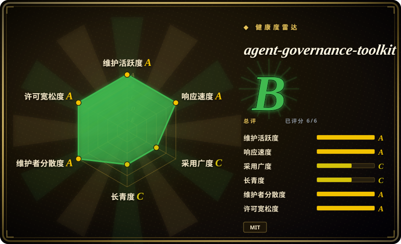
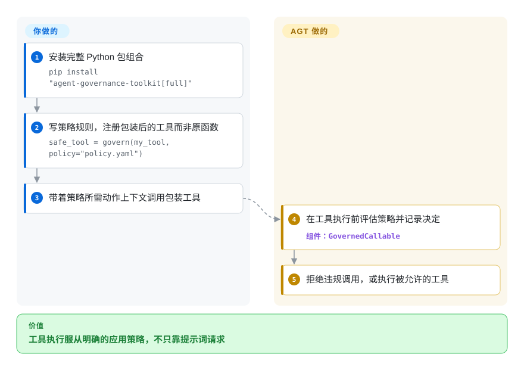

# agent-governance-toolkit

助手同时能查数据库和发消息，一句“不要泄露数据”却拦不住错误的工具调用。AGT 在被包装的动作前检查策略、记录决定，执行入口和数据流规则仍由你负责。

## 何时使用

你在部署能调用 `query_database`、`send_email` 的助手，需要在工具执行前拒绝违规操作，并向运维解释决定。能在每个动作边界插入函数包装器或框架适配器、维护明确策略和审计保留时，才选 AGT 而非只写提示词规则。它在策略决定之外打包面向助手的身份、审批、审计和适配器，不像通用授权引擎那样把这些集成问题全留给应用。

只采用需要的层：Python `govern()` 包装工具边界，或 ACS 宿主 API 返回明确的允许、拒绝、转换决定；各框架和语言适配器有自己的接口。[所读 README](https://github.com/microsoft/agent-governance-toolkit/blob/47abed7446d47e74cfa76d01a5913bb873ffcad9/README.md#L59-L86) 已把主策略路径移到上游 Agent Control Specification，并提醒包迁移。Public Preview 和领先于最新 GitHub Release 的 main manifest 版本要求你区分所读源码与实际安装的 wheel。

## 何时不用

- **你需要稳定授权引擎，而非助手治理全栈。**选 Open Policy Agent 或 Cedar，自己承担较小的集成；AGT 仍标 Public Preview，GA 前可能有破坏性变更。
- **OS 级隔离是主要控制。**搭配容器或独立隔离沙箱；AGT 应用中间件共享进程边界，不能替代那层隔离。
- **你不能覆盖全部工具执行入口。**先用自有中间件集中调度；包装一个函数不会管住对原函数的直接调用，也不管无关外部进程。
- **你要检测幻觉、恶意动作序列或机密数据流。**增加结果校验、内容和数据分类控制；[限制文档](https://github.com/microsoft/agent-governance-toolkit/blob/47abed7446d47e74cfa76d01a5913bb873ffcad9/docs/LIMITATIONS.md#L12-L67) 明确指出分别允许的动作仍可组成有害流程，审计也不验证外部结果。
- **你希望审批标记或默认审计就是持久阻断控制。**采用明确的审批协调器、持久审计接收器，或自建执行服务。`flag_for_review` 只做标注，包装器默认审计存在内存；都不自动成为合并闸门或持久合规记录。

## 横向对比

| 替代品 | 是否收录 | 我们的评价 | 取舍 |
|---|---|---|---|
| [Open Policy Agent](https://github.com/open-policy-agent/opa) | 未收录 | 通用策略评估足够且已掌控调度时选 OPA；助手包装器、审批和审计能减少集成工作时选 AGT。 | OPA 提供策略引擎，动作上下文、身份映射和决定保留仍由应用负责。 |
| [Cedar](https://github.com/cedar-policy/cedar) | 未收录 | 细粒度授权是核心问题时选 Cedar；控制要挂到助手工具和框架生命周期时选 AGT。 | 授权语言与运行时的助手专用接口更少，但不会替你接好执行入口。 |
| [Cedarling（Janssen）](https://github.com/JanssenProject/jans) | 未收录 | 身份系统需要 Cedar 策略决定点时选 Cedarling；需要助手集成全栈时选 AGT，也可使用它的 Cedarling 适配器。 | Cedarling 属于真实的多组件 IAM 仓库，是决定后端，不代替动作调度接线。 |
| 自研中间件 | 非仓库 | 单服务只有少量工具时自己写小调度器；可复用策略、审批和审计设施抵消包复杂度时选 AGT。 | 这是实现策略，不是未收录仓库；失败语义和审计完整性都由你负责。 |

## 快速上手

[README](https://github.com/microsoft/agent-governance-toolkit/blob/47abed7446d47e74cfa76d01a5913bb873ffcad9/README.md#L59-L129) 用 `pip install "agent-governance-toolkit[full]"` 安装；基础 wheel 提供合规工具，不含全部包装器模块，所读 main 的 core manifest 要求 Python 3.11 以上。从 `agentmesh.governance` 导入 `govern`，在 `policy.yaml` 写明确规则，用 `safe_tool = govern(my_tool, policy="policy.yaml")` 替换实际注册的工具。调用包装器时传入策略所需动作和上下文；它先评估、记录决定，再允许执行，否则默认抛 `GovernanceDenied`。异步函数使用文档记录的 `acall()` 路径；记录要在进程退出后保留，必须配置 `audit_file` 和审计签名密钥。你负责接好全部调度入口、保守的默认策略、审批处理、密钥管理和结果校验；本地基本包装器不要求 Azure 账号或模型 API，可选云、模型适配器另有费用。固定兼容包组合并核实际安装 API，本文所读源码与最新 GitHub 发布版不是同一个版本号。

<!-- flow-steps:begin (generated from flows/agent-governance-toolkit.json by tools/flow_card.py — do not edit) -->

流程文字版

1. **你**：安装完整 Python 包组合 — `pip install "agent-governance-toolkit[full]"`
2. **你**：写策略规则，注册包装后的工具而非原函数 — `safe_tool = govern(my_tool, policy="policy.yaml")`
3. **你**：带着策略所需动作上下文调用包装工具
4. **agent-governance-toolkit**：在工具执行前评估策略并记录决定 — 组件：`GovernedCallable`
5. **agent-governance-toolkit**：拒绝违规调用，或执行被允许的工具

**价值**：工具执行服从明确的应用策略，不只靠提示词请求

<!-- flow-steps:end -->

## 技术要点

- **先决定和审计，再调用工具。**[`agent-governance-python/agent-mesh/src/agentmesh/governance/govern.py:319–505`](https://github.com/microsoft/agent-governance-toolkit/blob/47abed7446d47e74cfa76d01a5913bb873ffcad9/agent-governance-python/agent-mesh/src/agentmesh/governance/govern.py#L319-L505) 在构造时加载策略，再构建调用上下文、检查配置的权限环、评估策略、记录决定，最后才调用 `_fn`。拒绝默认抛 `GovernanceDenied`，也可交给调用方的拒绝回调处理。可选建议式检查在确定性允许后执行；[`govern.py:965–1004`](https://github.com/microsoft/agent-governance-toolkit/blob/47abed7446d47e74cfa76d01a5913bb873ffcad9/agent-governance-python/agent-mesh/src/agentmesh/governance/govern.py#L965-L1004) 显示普通分类器错误会放行。待审标记也不阻断。这只保护经过包装器的调用，不覆盖进程里的任意活动。
- **协调审批绑定到确切动作。**[`govern.py:780–917`](https://github.com/microsoft/agent-governance-toolkit/blob/47abed7446d47e74cfa76d01a5913bb873ffcad9/agent-governance-python/agent-mesh/src/agentmesh/governance/govern.py#L780-L917) 构造规范动作绑定，记录请求 ID、策略版本、审批链版本和到期时间。协调器路径在执行前重校动作摘要，并写入审计关联；过期、身份未授权或未到最终允许状态都拒绝。这条更强路径需要配置，不能据此推导所有旧审批处理器都有相同语义。
- **决定不会自动执行，宿主要接好分支。**[`examples/acs-email-tool/run.py:27–52`](https://github.com/microsoft/agent-governance-toolkit/blob/47abed7446d47e74cfa76d01a5913bb873ffcad9/examples/acs-email-tool/run.py#L27-L52) 调用 `pre_tool_call`，拒绝时不执行就返回，转换决定则在工具调用前替换参数。示例用占位邮件函数演示决定到副作用的交接，不是实际邮件送达测试；宿主必须为每个相关动作接好这个分支。

## 技术栈

- **Python 优先的 monorepo**——包装器与治理代码，以及合并后的运行时、集成和 CLI 发行包；当前 main core manifest 为 `5.0.0`。策略宿主路径通过 `agent-control-specification` 依赖使用上游 ACS 和 Rust 核心运行时。
- **CLI 和 SDK**——README 文档包含 `agt doctor`、`agt verify`、`agt red-team scan`、`agt lint-policy`、Python `govern()`、TypeScript `PolicyEngine`、.NET MCP integration、Rust 和 Go 示例。
- **Agent framework adapters**——文档列出 Microsoft Agent Framework、Semantic Kernel、AutoGen、LangGraph / LangChain、CrewAI、OpenAI Agents SDK、Claude Code、Google ADK、LlamaIndex、Haystack、Mastra、Dify 和 MCP。

## 依赖

- **Python 3.11 以上**是所读 main core、compliance manifests 和 README 快速开始的要求；通用前置条件表仍写 3.10 以上，不应用于这些包。其它语言的最低版本由适配器决定，不证明功能对等。
- **Package registries**——PyPI（`agent-governance-toolkit`）、npm（`@microsoft/agent-governance-sdk` 及相关包）、NuGet、crates.io，以及 monorepo 源码包。
- **可选 Azure credentials**——README 列出 `AZURE_CLIENT_ID`、`AZURE_TENANT_ID`、`AZURE_CLIENT_SECRET`，用于 Azure integrated features。
- **框架级 hook**——真实部署取决于 AGT 插入调度的位置。main core 依赖 `agent-control-specification`、Pydantic、PyYAML、加密、HTTP 和日志包；Rego 集成还需要 OPA CLI。包装器持久审计需要调用方管理 HMAC 密钥，不能只设 `audit=True`。

## 运维难度

**中到高。** `pip install agent-governance-toolkit[full]` 和两行 `govern()` 很容易试，但生产 rollout 需要定义 policy、enforcement point、audit retention、identity / trust model、framework adapter，以及 OS / container 边界。

## 健康度与可持续性

- **维护快照（2026-10-13）：**未归档，main 提交 `47abed7` 来自当天。维护和响应轴为 A；最新 GitHub Release 是 2026-06-09 的 `v4.1.0`，所读 main core manifest 则为 `5.0.0`。
- **采用快照：**6423 stars；本次评分测得 `agent_governance_toolkit` 过去一个月 125645 次 PyPI 下载，采用轴 C。stars 和下载量不证明应用中的执行覆盖完整。
- **许可证快照：** 只读上游核验确认 GitHub metadata 和根目录 `LICENSE` 均为 MIT。
- **Lindy 与治理：**创建于 2026-03-02，225 天时长青度为 C，不是 D。Microsoft 所有的仓库公开治理、维护者文档，列出 Microsoft 和其它组织；贡献统计给出治理 A。基金会风格章程措辞不等于独立确认已被基金会托管或有支持 SLA。
- **风险信号：** Public Preview 状态、宽 package surface 和 middleware-level security boundary 是主要实践风险。

## 存疑（未验证）

- [未验证：没有安装包或运行符合性套件] 未复现已安装 wheel 的内容、多语言对等性、完整符合性套件或真实框架执行；本次读了源码、manifest 和示例。
- [未验证：没有生产攻击模拟或审计保留部署] 源码中的拒绝分支不证明端到端隔离、分类器质量、持久审计耐久性或外部动作成功。
- [推断：依据是 Public Preview 和源码发布版分流] 应固定并验证兼容包组合，不能假设 main 的迁移接口与最新 GitHub 发布版或 registry wheel 完全相同。
