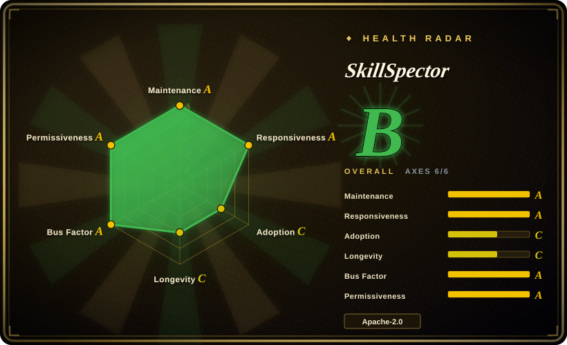
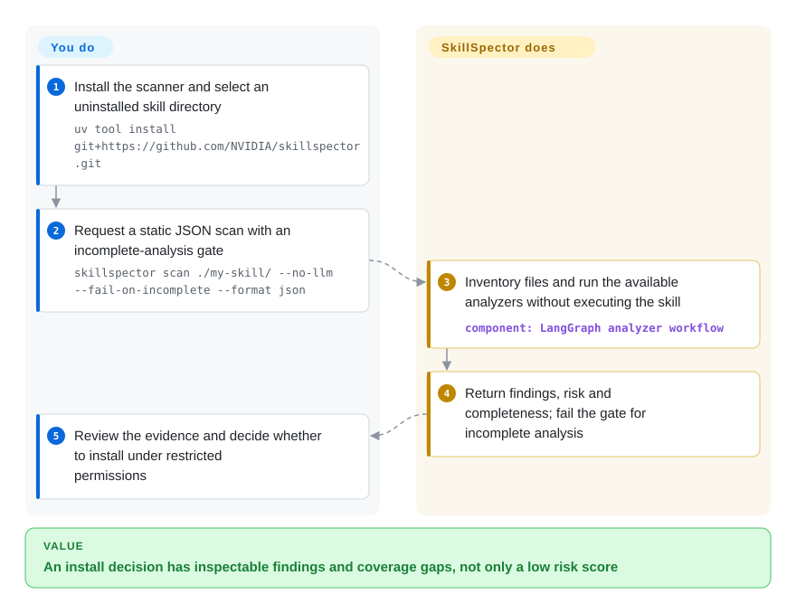

# SkillSpector

You are about to install a third-party skill that asks to read secrets or run a shell script. SkillSpector inspects its files without executing the skill, and reports suspicious instructions, code and uninspected content before you grant it access.

## When to use

You maintain an agent skill catalog or an install hook, and a new `SKILL.md` bundles scripts alongside instructions such as reading environment variables or fetching remote code. Choose SkillSpector when you need repeatable file-level findings and a JSON/SARIF report before installation, rather than trusting a marketplace description or repeating a manual review.

Compared with general source scanners, its rules target agent instructions, tool descriptions, excessive agency and skill dependencies. Compared with runtime governance middleware, it evaluates the installable artifact rather than governing later tool calls. A low risk score is triage evidence, not permission to ignore incomplete analysis.

## When NOT to use

- **You need runtime policy enforcement around live agent tool calls.** Use [agent-governance-toolkit](agent-governance-toolkit.md) when the problem is policy-gating actions, identity, audit trails, and framework adapters at runtime; SkillSpector is an install-time/static scanner.
- **You need an isolation boundary.** Use containers, sandboxes, restricted permissions, or OS-level controls when untrusted skills may execute; SkillSpector's README states it never executes scanned skills and does not sandbox the host.
- **Skill contents or dependency names cannot leave your environment.** Use `--no-llm` plus an outbound-network policy, or an offline manual/code review workflow. Disabling the model does not disable OSV requests containing dependency names and versions; offline fallback covers fewer vulnerabilities.
- **You need a proof of safety across images, binaries or runtime behavior.** Add manual source review and isolated execution tests. Static checks have blind spots, and a default CLI exit 0 can coexist with partial coverage; use the completeness fields and `--fail-on-incomplete` for a strict gate.
- **You only need broad cybersecurity playbooks.** Use [Anthropic Cybersecurity Skills](../agent-skills/security/anthropic-cybersecurity-skills.md) for security runbooks; SkillSpector is a scanner, not an analyst playbook pack.
- **You only need a small hand review of one trusted skill.** A manual source review may be cheaper for a single internal skill; SkillSpector pays off when scanning is repeated, automated, or needs JSON/SARIF evidence.

## Comparison

| Alternative | In index | Our verdict | Tradeoff |
|---|---|---|---|
| [agent-governance-toolkit](agent-governance-toolkit.md) | ✅ | Choose AGT when runtime governance and policy/audit integration are required; choose SkillSpector when the immediate question is whether a skill is safe to install. | AGT is broader and heavier at runtime; SkillSpector is narrower, scanner-first, and easier to wire into install gates. |
| [Anthropic Cybersecurity Skills](../agent-skills/security/anthropic-cybersecurity-skills.md) | ✅ | Choose Anthropic Cybersecurity Skills for agent-loaded cybersecurity runbooks; choose SkillSpector to inspect skills for malicious or risky patterns. | One teaches an agent security work; the other evaluates the safety of the skill artifact itself. |
| [Semgrep](https://github.com/semgrep/semgrep) | not indexed | Choose Semgrep for reusable source-code rules across applications; choose SkillSpector when the artifact includes agent instructions and tool metadata. | Code-pattern coverage versus skill-specific threat categories; neither replaces runtime containment. |
| [OpenSSF Scorecard](https://github.com/ossf/scorecard) | not indexed | Choose Scorecard to assess repository supply-chain practices; choose SkillSpector to inspect the actual skill files before installation. | Repository posture does not establish that an individual prompt or script is harmless. |
| Manual review checklist | not a repo | Review one small trusted bundle by hand; choose SkillSpector for repeated install decisions needing comparable machine evidence. | An implementation strategy, not a missing repository; human context costs reviewer time. |

## Quick start

Install with `uv tool install git+https://github.com/NVIDIA/skillspector.git` using Python `>=3.12,<3.15`, as documented in the [README](https://github.com/NVIDIA/SkillSpector/blob/b07f181d9138878c3827de0947a9fd2c6a84a66c/README.md#L34-L47). Keep the candidate skill in a directory before installation, then run `skillspector scan ./my-skill/ --no-llm --fail-on-incomplete --format json --output report.json`. The scanner returns findings, risk and analysis completeness without running that skill; inspect all three before deciding whether to install. You own the install policy, exception review and permissions of anything subsequently executed. This static path avoids model-token charges but still queries OSV with dependency coordinates; optional model review sends eligible file contents to your configured provider and incurs its costs. Default exit 0 alone is not a complete-scan verdict, as the [CLI branch](https://github.com/NVIDIA/SkillSpector/blob/b07f181d9138878c3827de0947a9fd2c6a84a66c/src/skillspector/cli.py#L871-L888) shows.

<!-- flow-steps:begin (generated from flows/skillspector.json by tools/flow_card.py — do not edit) -->

Text version of the flow

1. **You**: Install the scanner and select an uninstalled skill directory — `uv tool install git+https://github.com/NVIDIA/skillspector.git`
2. **You**: Request a static JSON scan with an incomplete-analysis gate — `skillspector scan ./my-skill/ --no-llm --fail-on-incomplete --format json`
3. **SkillSpector**: Inventory files and run the available analyzers without executing the skill — component: `LangGraph analyzer workflow`
4. **SkillSpector**: Return findings, risk and completeness; fail the gate for incomplete analysis
5. **You**: Review the evidence and decide whether to install under restricted permissions

**Value**: An install decision has inspectable findings and coverage gaps, not only a low risk score

<!-- flow-steps:end -->

## Key techniques

- **Fan out analysis from a shared context.** [`graph.py:46–87`](https://github.com/NVIDIA/SkillSpector/blob/b07f181d9138878c3827de0947a9fd2c6a84a66c/src/skillspector/graph.py#L46-L87) resolves the input, builds context, wires available analyzers through guarded nodes, then runs meta analysis, ledger finalization and reporting. This separates file acquisition from complementary checks; an unavailable analyzer is not evidence that its checks passed.
- **Keep coverage failures separate from risk findings.** [`finalize_inspection_ledger.py:734–843`](https://github.com/NVIDIA/SkillSpector/blob/b07f181d9138878c3827de0947a9fd2c6a84a66c/src/skillspector/nodes/finalize_inspection_ledger.py#L734-L843) adds reference/size findings and registry/runtime/output-limit events before deriving completeness. Consumers can distinguish a clean finding list from missing inspection. These bounded checks still cannot prove arbitrary runtime behavior safe.
- **Bind exact suppressions to evidence.** [`suppression.py:216–280`](https://github.com/NVIDIA/SkillSpector/blob/b07f181d9138878c3827de0947a9fd2c6a84a66c/src/skillspector/suppression.py#L216-L280) hashes complete source content, scanner version and finding details into a SHA-256 fingerprint. Source or version changes require renewing exact acceptance instead of silently inheriting it; broader glob suppressions remain a reviewer-controlled exception.

## Tech stack

- **Python 3.12+ package** with a Typer CLI entry point named `skillspector` and a LangGraph workflow engine.
- **Analyzers** include static regex/pattern checks, Python AST behavioral analysis, taint tracking, YARA signatures, OSV.dev dependency lookup, MCP least-privilege/tool-poisoning checks, and optional LLM semantic analysis.
- **Outputs** include terminal, JSON, Markdown, and SARIF; baseline suppression is documented through `.skillspector-baseline.yaml`.
- **Integrations** include a Dockerfile, an MCP server (`skillspector mcp`), and a Pi extension tool wrapper.

## Dependencies

- **Runtime:** Python `>=3.12,<3.15`; `uv` is the documented quick install path, with source installs through `make install` or `make install-dev`.
- **Python dependencies:** README/`pyproject.toml` list Typer, Rich, HTTPX, PyYAML, Pydantic, OpenAI/LangChain/LangGraph/Anthropic/AWS/NVIDIA provider packages, boto3, LangSmith, and `yara-python`.
- **Network egress:** OSV.dev dependency lookup is used for live CVE data; LLM analysis sends file contents to the configured provider unless `--no-llm` is used.
- **Optional deployment:** Docker image for isolated CLI runs; `skillspector[mcp]` extra for MCP server mode.

## Ops difficulty

**Medium.** A local static CLI scan needs no service, but an install gate needs explicit incomplete-analysis handling, reviewed suppressions, pinned source/package versions and report retention. Model-assisted checks add credentials, latency, cost and data-egress review. The optional HTTP MCP endpoint has no built-in authentication and restricts binding to loopback; remote access needs an authenticating proxy, not a publicly exposed scanner port.

## Health & viability

- **Maintenance (2026-10-13):** unarchived NVIDIA repository, main committed that day; latest GitHub release v2.12.0 dates to 2026-09-23, matching the reviewed manifest version. Main has newer changes than the release, so pin the artifact you actually deploy.
- **Measured viability:** overall B (6/6 scored axes), maintenance/responsiveness/governance A, adoption/longevity C and license risk A. The former responsiveness API failure recovered; the scorer measured a 90.4-hour median first response across 24 qualifying issues.
- **Adoption / backing:** 20131 GitHub stars, 148 Homebrew installs over 90 days and 29498 release downloads in the scorer snapshot. NVIDIA ownership and multiple contributors are useful backing signals, not a support SLA or detection benchmark.
- **Age / risk:** created 2026-03-21, 207 days old; the manifest still marks Alpha. [推断：based on short history and the documented static-analysis limits] Treat it as a promising young triage component, not a long-proven safety authority. Apache-2.0 is verified from LICENSE and manifest; contents/coordinates can leave the host through model/OSV analysis.

## Caveats (unverified)

- [未验证：no upstream installation or scan was performed] Commands and mechanisms were checked against the pinned main source, not exercised locally; the latest release may differ from this main snapshot.
- [未验证：no detection benchmark was run] False-positive/false-negative rates and the README's research statistics were not independently established.
- [推断：207-day history, Alpha classifier and documented static-only limits] NVIDIA backing does not yet supply a long operational track record; retain independent review and isolation after scanning.
