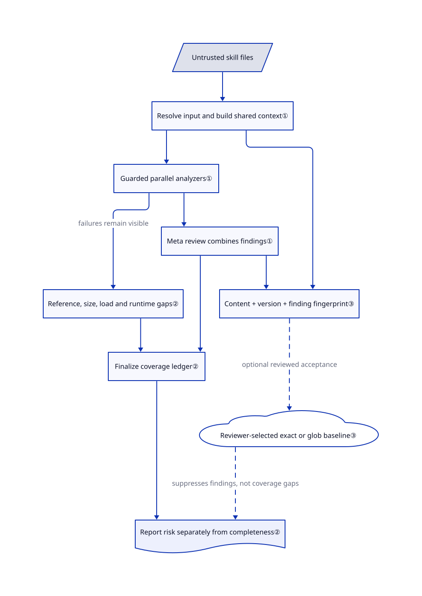

# SkillSpector

You are about to install a third-party skill that asks to read secrets or run a shell script. SkillSpector inspects its files without executing the skill, and reports suspicious instructions, code and uninspected content before you grant it access.

## When to use

You maintain an agent skill catalog or an install hook, and a new `SKILL.md` bundles scripts alongside instructions such as reading environment variables or fetching remote code. Choose SkillSpector when you need repeatable file-level findings and a JSON/SARIF report before installation, rather than trusting a marketplace description or repeating a manual review.

Compared with general source scanners, its rules target agent instructions, tool descriptions, excessive agency and skill dependencies. Compared with runtime governance middleware, it evaluates the installable artifact rather than governing later tool calls. A low risk score is triage evidence, not permission to ignore incomplete analysis.

## When NOT to use

- **You need runtime policy enforcement around live agent tool calls.** Use [agent-governance-toolkit](agent-governance-toolkit.md) when the problem is policy-gating actions, identity, audit trails, and framework adapters at runtime; SkillSpector is an install-time/static scanner.
- **You need an isolation boundary.** Use containers, sandboxes, restricted permissions, or OS-level controls when untrusted skills may execute; SkillSpector's README states it never executes scanned skills and does not sandbox the host.
- **Skill contents or dependency names cannot leave your environment.** Use `--no-llm` plus an outbound-network policy, or an offline manual/code review workflow. Disabling the model does not disable OSV requests containing dependency names and versions; offline fallback covers fewer vulnerabilities.
- **You need a proof of safety across images, binaries or runtime behavior.** Add manual source review and isolated execution tests. Static checks have blind spots, and a default CLI exit 0 can coexist with partial coverage; use the completeness fields and `--fail-on-incomplete` for a strict gate.
- **You only need broad cybersecurity playbooks.** Use [Anthropic Cybersecurity Skills](../agent-skills/security/anthropic-cybersecurity-skills.md) for security runbooks; SkillSpector is a scanner, not an analyst playbook pack.
- **You only need a small hand review of one trusted skill.** A manual source review may be cheaper for a single internal skill; SkillSpector pays off when scanning is repeated, automated, or needs JSON/SARIF evidence.

## Comparison

| Alternative | In index | Our verdict | Tradeoff |
|---|---|---|---|
| [agent-governance-toolkit](agent-governance-toolkit.md) | ✅ | Choose AGT when runtime governance and policy/audit integration are required; choose SkillSpector when the immediate question is whether a skill is safe to install. | AGT is broader and heavier at runtime; SkillSpector is narrower, scanner-first, and easier to wire into install gates. |
| [Anthropic Cybersecurity Skills](../agent-skills/security/anthropic-cybersecurity-skills.md) | ✅ | Choose Anthropic Cybersecurity Skills for agent-loaded cybersecurity runbooks; choose SkillSpector to inspect skills for malicious or risky patterns. | One teaches an agent security work; the other evaluates the safety of the skill artifact itself. |
| [Semgrep](https://github.com/semgrep/semgrep) | not indexed | Choose Semgrep for reusable source-code rules across applications; choose SkillSpector when the artifact includes agent instructions and tool metadata. | Code-pattern coverage versus skill-specific threat categories; neither replaces runtime containment. |
| [OpenSSF Scorecard](https://github.com/ossf/scorecard) | not indexed | Choose Scorecard to assess repository supply-chain practices; choose SkillSpector to inspect the actual skill files before installation. | Repository posture does not establish that an individual prompt or script is harmless. |
| Manual review checklist | not a repo | Review one small trusted bundle by hand; choose SkillSpector for repeated install decisions needing comparable machine evidence. | An implementation strategy, not a missing repository; human context costs reviewer time. |

## Quick start

Install with `uv tool install git+https://github.com/NVIDIA/skillspector.git` using Python `>=3.12,<3.15`, as documented in the [README](https://github.com/NVIDIA/SkillSpector/blob/cf5cac7ba5c756a6e0ebf52dc9763f49422f889f/README.md#L34-L71). This command follows main, not the selected-backport v2.13.0 release; pin the revision you audit. Keep the candidate skill in a directory before installation, then run `skillspector scan ./my-skill/ --no-llm --fail-on-incomplete --format json --output report.json`. The scanner returns findings, risk and analysis completeness without running that skill; inspect all three before deciding whether to install. You own the install policy, exception review and permissions of anything subsequently executed. Static mode avoids model-token charges but still sends dependency coordinates to OSV; optional model review sends eligible contents to your provider. The [CLI](https://github.com/NVIDIA/SkillSpector/blob/cf5cac7ba5c756a6e0ebf52dc9763f49422f889f/src/skillspector/cli.py#L878-L905) returns 2 for execution failure and 1 for requested completeness/findings/coverage gates or excessive risk; default exit 0 alone does not mean complete or finding-free.

<!-- flow-steps:begin (generated from flows/skillspector.json by tools/flow_card.py — do not edit) -->

Text version of the flow

1. **You**: Install the scanner and select an uninstalled skill directory — `uv tool install git+https://github.com/NVIDIA/skillspector.git`
2. **You**: Request a static JSON scan with an incomplete-analysis gate — `skillspector scan ./my-skill/ --no-llm --fail-on-incomplete --format json`
3. **SkillSpector**: Inventory files and run the available analyzers without executing the skill — component: `LangGraph analyzer workflow`
4. **SkillSpector**: Return findings, risk and completeness; fail the gate for incomplete analysis
5. **You**: Review the evidence and decide whether to install under restricted permissions

**Value**: An install decision has inspectable findings and coverage gaps, not only a low risk score

<!-- flow-steps:end -->

## Key techniques

<!-- mechanism:begin (generated from mechanisms/skillspector.json by tools/mechanism_card.py; do not edit) -->

Text version of the mechanism

- Untrusted skill files
- Resolve input and build shared context①
- Guarded parallel analyzers①
- Meta review combines findings①
- Reference, size, load and runtime gaps②
- Finalize coverage ledger②
- Content + version + finding fingerprint③
- Reviewer-selected exact or glob baseline③
- Report risk separately from completeness②

- Untrusted skill files → Resolve input and build shared context①
- Resolve input and build shared context① → Guarded parallel analyzers①
- Guarded parallel analyzers① → Meta review combines findings①
- Guarded parallel analyzers① → Reference, size, load and runtime gaps② (failures remain visible)
- Meta review combines findings① → Finalize coverage ledger②
- Reference, size, load and runtime gaps② → Finalize coverage ledger②
- Resolve input and build shared context① → Content + version + finding fingerprint③
- Meta review combines findings① → Content + version + finding fingerprint③
- Content + version + finding fingerprint③ → Reviewer-selected exact or glob baseline③ (optional reviewed acceptance) [optional/fallback]
- Reviewer-selected exact or glob baseline③ → Report risk separately from completeness② (suppresses findings, not coverage gaps) [optional/fallback]
- Finalize coverage ledger② → Report risk separately from completeness②

<!-- mechanism:end -->

### 1. Share file context across guarded analyzers

- **Problem:** Reacquiring the same files for each check duplicates work, while one broken check can hide missing inspection.
- **How:** LangGraph, the workflow engine, resolves input and builds shared context, fans out to available guarded analyzers, then runs meta review, ledger finalization and reporting. Guards turn analyzer exceptions into explicit failed-work records.
- **Limits:** Unavailable analyzers are not passed checks; discovery or runtime gaps need coverage review. Scanned skill code is not executed or contained by this graph.
- **Source:** [`graph.py:46–87`](https://github.com/NVIDIA/SkillSpector/blob/cf5cac7ba5c756a6e0ebf52dc9763f49422f889f/src/skillspector/graph.py#L46-L87), [`inspection_ledger.py:1143–1197`](https://github.com/NVIDIA/SkillSpector/blob/cf5cac7ba5c756a6e0ebf52dc9763f49422f889f/src/skillspector/inspection_ledger.py#L1143-L1197).

### 2. Account for inspection gaps separately from risk

- **Problem:** An empty finding list can mean either nothing suspicious was found or relevant content was never inspected.
- **How:** The inspection ledger records checked and missed work; finalization adds reference/size findings plus analyzer-load, semantic-runtime and output-limit events before deriving completeness. The CLI can reject incomplete work with `--fail-on-incomplete` independently of risk scoring.
- **Limits:** Bounded static checks do not prove arbitrary runtime behavior safe. Execution failure returns 2; a successful process can still return 0 with partial coverage when no stricter gate was requested.
- **Source:** [`finalize_inspection_ledger.py:713–843`](https://github.com/NVIDIA/SkillSpector/blob/cf5cac7ba5c756a6e0ebf52dc9763f49422f889f/src/skillspector/nodes/finalize_inspection_ledger.py#L713-L843), [`cli.py:878–895`](https://github.com/NVIDIA/SkillSpector/blob/cf5cac7ba5c756a6e0ebf52dc9763f49422f889f/src/skillspector/cli.py#L878-L895).

### 3. Make exact exceptions expire when evidence changes

- **Problem:** A previously accepted finding should not silently exempt altered source or a different scanner version.
- **How:** An exact baseline, the saved list of accepted findings, uses a full SHA-256 fingerprint of complete component content, scanner version and finding identity/evidence. A changed input needs renewed review and baseline generation.
- **Limits:** Handwritten glob rules can deliberately match more broadly; they are reviewer-owned exceptions, not equally strict evidence binding. Suppressing a finding does not establish complete inspection.
- **Source:** [`suppression.py:216–308`](https://github.com/NVIDIA/SkillSpector/blob/cf5cac7ba5c756a6e0ebf52dc9763f49422f889f/src/skillspector/suppression.py#L216-L308), [`README.md:231–255`](https://github.com/NVIDIA/SkillSpector/blob/cf5cac7ba5c756a6e0ebf52dc9763f49422f889f/README.md#L231-L255).

## Tech stack

- **Python 3.12+ package** with a Typer CLI entry point named `skillspector` and a LangGraph workflow engine.
- **Analyzers** include static regex/pattern checks, Python AST behavioral analysis, taint tracking, YARA signatures, OSV.dev dependency lookup, MCP least-privilege/tool-poisoning checks, and optional LLM semantic analysis.
- **Outputs** include terminal, JSON, Markdown, and SARIF; baseline suppression is documented through `.skillspector-baseline.yaml`.
- **Integrations** include a Dockerfile, an MCP server (`skillspector mcp`), and Pi/OpenCode extension tool wrappers.

## Dependencies

- **Runtime:** Python `>=3.12,<3.15`; `uv` is the documented quick install path, with source installs through `make install` or `make install-dev`.
- **Python dependencies:** the [manifest](https://github.com/NVIDIA/SkillSpector/blob/cf5cac7ba5c756a6e0ebf52dc9763f49422f889f/pyproject.toml#L32-L57) lists Typer, Rich, HTTPX, PyYAML, Pydantic, OpenAI/LangChain/LangGraph provider packages, boto3, LangSmith, `yara-python`, `pywhatwgurl`, `regex`, `packaging` and Google Auth.
- **Network egress:** OSV.dev dependency lookup is used for live CVE data; LLM analysis sends file contents to the configured provider unless `--no-llm` is used.
- **Optional deployment:** Docker image for isolated CLI runs; `skillspector[mcp]` extra for MCP server mode.

## Ops difficulty

**Medium.** A local static CLI scan needs no service, but an install gate needs explicit incomplete-analysis handling, reviewed suppressions, pinned source/package versions and report retention. Model-assisted checks add credentials, latency, cost and data-egress review. The optional HTTP MCP endpoint has no built-in authentication and restricts binding to loopback; remote access needs an authenticating proxy, not a publicly exposed scanner port.

## Health & viability

- **Maintenance (2026-10-17):** unarchived NVIDIA repository; reviewed main committed on October 16 UTC. The [v2.13.0 release](https://github.com/NVIDIA/SkillSpector/releases/tag/v2.13.0), published October 16, selectively backports fixes and explicitly does not contain every main change; the reviewed main manifest remains 2.12.0. Do not infer artifact contents from the version number alone.
- **Measured viability:** overall B (6/6 scored axes), maintenance/responsiveness/governance A, adoption/longevity C and license risk A; 80.7-hour median first response across 23 qualifying issues, with no new unknown axis.
- **Adoption / backing:** 20391 GitHub stars, 158 Homebrew installs over 90 days and 31051 release downloads in the scorer snapshot. NVIDIA ownership and multiple contributors are backing signals, not a support SLA or detection benchmark.
- **Age / risk:** created 2026-03-21, 210 days old in the scorer; the manifest still marks Alpha. [推断：based on short history and documented static-analysis limits] Treat it as young triage infrastructure, not a long-proven safety authority. Apache-2.0 is verified; model/OSV analysis still has data-egress boundaries. The release disables the Codex CLI provider over host-secret access concerns; this is a provider-specific warning, not proof that other providers are isolated.

## Caveats (unverified)

- [未验证：no upstream installation or scan was performed] Commands and mechanisms were checked against the pinned main source, not exercised locally; the latest release may differ from this main snapshot.
- [未验证：no detection benchmark was run] False-positive/false-negative rates and the README's research statistics were not independently established.
- [推断：210-day scorer age, Alpha classifier and documented static-only limits] NVIDIA backing does not yet supply a long operational track record; retain independent review and isolation after scanning.
