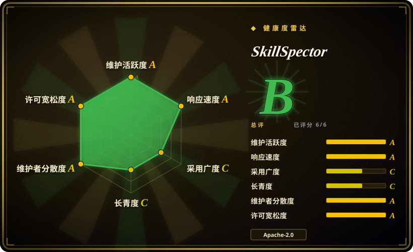
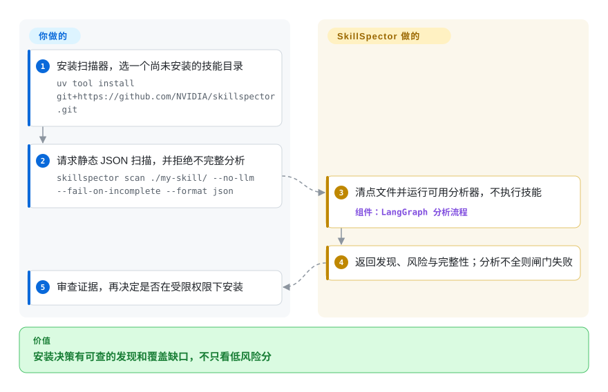

# SkillSpector

你准备安装一个第三方技能，它却要求读取密钥或运行脚本。SkillSpector 不执行技能，先检查文件，报告可疑指令、代码和未检查内容，再由你决定是否授权。

## 何时使用

你维护技能目录或安装钩子，新来的 `SKILL.md` 附带脚本，指令里还有读取环境变量、拉取远端代码等操作。需要在安装前拿到可重复的文件级发现和 JSON／SARIF 报告时，选 SkillSpector，而不是相信商店介绍，或每次重新手审。

它比通用代码扫描器更关注智能体指令、工具描述、过度自主和技能依赖；比运行时治理中间件更关注待安装的文件，而非之后的工具调用。低风险分只供分诊，不能替代分析完整性检查。

## 何时不用

- **你需要 live agent tool call 的运行时策略执行。** 问题是运行时 action policy、身份、审计和 framework adapter 时，用 [agent-governance-toolkit](agent-governance-toolkit.zh.md)；SkillSpector 是安装前／静态 scanner。
- **你需要隔离边界。** 未受信 skill 可能执行时，用容器、沙箱、受限权限或 OS 级控制；SkillSpector README 说明它不会执行被扫描 skill，也不隔离 host。
- **技能内容或依赖名称不能外传。** 使用 `--no-llm` 加出网限制，或离线手审／代码检查。关掉模型不会关掉包含依赖名和版本的 OSV 请求；离线回退只覆盖更少的漏洞。
- **你要证明图片、二进制或运行时行为都安全。** 加上手动源码审查和隔离执行测试。静态检查存在盲区，默认 CLI 返回 0 仍可能是部分覆盖；严格闸门应检查完整性字段并用 `--fail-on-incomplete`。
- **你只需要宽泛网络安全 playbook。** 安全 runbook 用 [Anthropic Cybersecurity Skills](../agent-skills/security/anthropic-cybersecurity-skills.zh.md)；SkillSpector 是 scanner，不是 analyst playbook 包。
- **你只要手动审一个可信内部 skill。** 单个内部 skill 手审可能更便宜；当扫描要重复、自动化，或需要 JSON/SARIF 证据时，SkillSpector 更有价值。

## 横向对比

| 替代品 | 是否收录 | 我们的评价 | 取舍 |
|---|---|---|---|
| [agent-governance-toolkit](agent-governance-toolkit.zh.md) | ✅ | 需要运行时治理和 policy/audit 集成时选 AGT；眼前问题是 skill 是否安全可安装时选 SkillSpector。 | AGT 更宽、更重、偏运行时；SkillSpector 更窄，scanner-first，更容易接到安装闸门。 |
| [Anthropic Cybersecurity Skills](../agent-skills/security/anthropic-cybersecurity-skills.zh.md) | ✅ | 需要 agent 加载的网络安全 runbook 时选 Anthropic Cybersecurity Skills；要检查 skill artifact 是否有恶意或风险模式时选 SkillSpector。 | 一个教 agent 做安全工作；另一个评估 skill artifact 本身的安全性。 |
| [Semgrep](https://github.com/semgrep/semgrep) | 未收录 | 要复用应用源码规则时选 Semgrep；文件包含智能体指令与工具元数据时选 SkillSpector。 | 代码模式覆盖与技能专项威胁各有侧重，都不替代运行时隔离。 |
| [OpenSSF Scorecard](https://github.com/ossf/scorecard) | 未收录 | 评估仓库供应链实践时选 Scorecard；检查待安装技能文件时选 SkillSpector。 | 仓库姿态不能证明某条提示词或脚本无害。 |
| 手动评审清单 | 非仓库 | 小型可信技能可以手审；重复安装决策需要可比机器证据时选 SkillSpector。 | 这是实施策略，不是缺失仓库；人工上下文判断需要审查时间。 |

## 快速上手

按 [README](https://github.com/NVIDIA/SkillSpector/blob/b07f181d9138878c3827de0947a9fd2c6a84a66c/README.md#L34-L47)，在 Python `>=3.12,<3.15` 环境用 `uv tool install git+https://github.com/NVIDIA/skillspector.git` 安装。先把候选技能放在目录里，不安装它，再运行 `skillspector scan ./my-skill/ --no-llm --fail-on-incomplete --format json --output report.json`。扫描器不执行技能，返回发现、风险和分析完整性，你应同时看这三项再决定是否安装。安装策略、例外审查和后续执行权限由你负责。静态路径不花模型 token，但仍向 OSV 发送依赖坐标；可选模型审查会发送适用文件内容并产生提供方费用。[CLI 分支](https://github.com/NVIDIA/SkillSpector/blob/b07f181d9138878c3827de0947a9fd2c6a84a66c/src/skillspector/cli.py#L871-L888) 说明默认返回 0 不等于扫描完整。

<!-- flow-steps:begin (generated from flows/skillspector.json by tools/flow_card.py — do not edit) -->

流程文字版

1. **你**：安装扫描器，选一个尚未安装的技能目录 — `uv tool install git+https://github.com/NVIDIA/skillspector.git`
2. **你**：请求静态 JSON 扫描，并拒绝不完整分析 — `skillspector scan ./my-skill/ --no-llm --fail-on-incomplete --format json`
3. **SkillSpector**：清点文件并运行可用分析器，不执行技能 — 组件：`LangGraph 分析流程`
4. **SkillSpector**：返回发现、风险与完整性；分析不全则闸门失败
5. **你**：审查证据，再决定是否在受限权限下安装

**价值**：安装决策有可查的发现和覆盖缺口，不只看低风险分

<!-- flow-steps:end -->

## 技术要点

- **从共享上下文分派分析。** [`graph.py:46–87`](https://github.com/NVIDIA/SkillSpector/blob/b07f181d9138878c3827de0947a9fd2c6a84a66c/src/skillspector/graph.py#L46-L87) 解析输入、建立上下文，通过受保护节点接入可用分析器，再做汇总、账本定稿与报告。文件获取和互补检查因此分开；某分析器不可用不等于它的检查通过。
- **把覆盖失败和风险发现分开。** [`finalize_inspection_ledger.py:734–843`](https://github.com/NVIDIA/SkillSpector/blob/b07f181d9138878c3827de0947a9fd2c6a84a66c/src/skillspector/nodes/finalize_inspection_ledger.py#L734-L843) 先补引用／大小发现和加载／运行时／输出上限事件，再推导完整性。调用方能区分“没有发现”和“没有检查完”，但有界静态检查仍不能证明任意运行时行为安全。
- **让精确豁免绑定证据。** [`suppression.py:216–280`](https://github.com/NVIDIA/SkillSpector/blob/b07f181d9138878c3827de0947a9fd2c6a84a66c/src/skillspector/suppression.py#L216-L280) 把完整源内容、扫描器版本和发现细节做成 SHA-256 指纹。源内容或版本变了，就需要重新确认精确豁免；更宽的通配规则仍是审查者负责的例外。

## 技术栈

- **Python 3.12+ package**，Typer CLI 入口为 `skillspector`，核心是 LangGraph workflow engine。
- **分析器**包括静态 regex/pattern 检查、Python AST 行为分析、taint tracking、YARA signature、OSV.dev 依赖漏洞查询、MCP least-privilege/tool-poisoning 检查，以及可选 LLM 语义分析。
- **输出**包括 terminal、JSON、Markdown 和 SARIF；通过 `.skillspector-baseline.yaml` 做 baseline suppression。
- **集成**包括 Dockerfile、MCP server（`skillspector mcp`）和 Pi extension tool wrapper。

## 依赖

- **运行时：** Python `>=3.12,<3.15`；文档推荐用 `uv` 快速安装，也可源码 `make install` 或 `make install-dev`。
- **Python 依赖：** README/`pyproject.toml` 列出 Typer、Rich、HTTPX、PyYAML、Pydantic、OpenAI/LangChain/LangGraph/Anthropic/AWS/NVIDIA provider 包、boto3、LangSmith 和 `yara-python`。
- **网络外连：** OSV.dev 依赖查询用于实时 CVE 数据；除非使用 `--no-llm`，LLM analysis 会把文件内容发送给配置的 provider。
- **可选部署：** Docker image 用于隔离 CLI 运行；MCP server 模式需要 `skillspector[mcp]` extra。

## 运维难度

**中等。** 本地静态 CLI 不需要服务，但安装闸门需要处理分析不完整、审查豁免、固定版本并留存报告。模型检查另需凭据、延迟、费用和外传审查。可选 HTTP MCP 端点不内置认证，只允许绑定回环地址；远程访问要加认证代理，不能直接公开扫描端口。

## 健康度与可持续性

- **维护（2026-10-13）：** NVIDIA 仓库未归档，main 当天有提交；最新 GitHub release v2.12.0 发布于 2026-09-23，与所读 manifest 版本相同。main 还有发布后变动，部署应固定实际使用的产物。
- **实测可持续性：** 综合 B（6/6 轴有分），维护／响应／治理 A，采用／长青度 C，许可风险 A。原响应 API 失败已恢复；本轮 24 个合格 issue 的首次响应中位数为 90.4 小时。
- **采用与支持：** GitHub 20131 个 star；评分快照有 90 天 Homebrew 安装 148 次、release 下载 29498 次。NVIDIA 归属和多人贡献是支持信号，不是支持承诺或检出基准。
- **年龄与风险：** 创建于 2026-03-21，已有 207 天，manifest 仍标 Alpha。[推断：依据是短历史和文档静态分析限制] 可把它当年轻的分诊组件，不当长期验证的安全权威。LICENSE 与 manifest 确认 Apache-2.0；模型／OSV 分析仍有内容或坐标外传边界。

## 存疑（未验证）

- [未验证：未安装或运行上游扫描器] 命令和机制对照的是固定 main 源码，没有本机执行；最新 release 与 main 快照可能不同。
- [未验证：未跑检出基准] 本页未独立测量误报／漏报率，也未核验 README 的论文统计。
- [推断：依据是 207 天历史、Alpha 标记和静态检查限制] NVIDIA 支持尚不构成长运行记录；扫描之后仍应独立审查和隔离。
