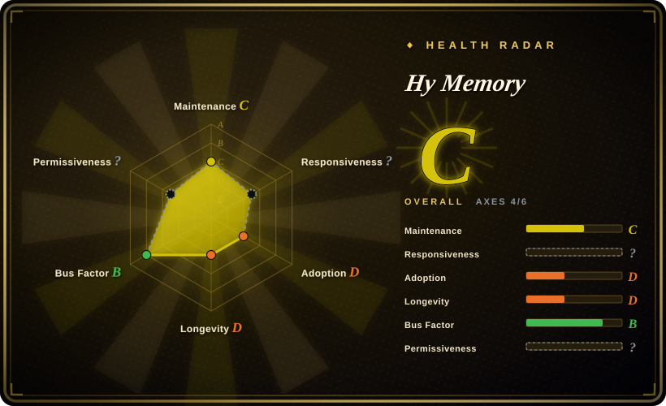
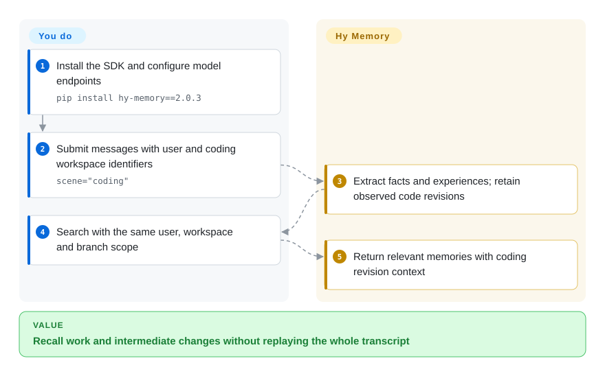
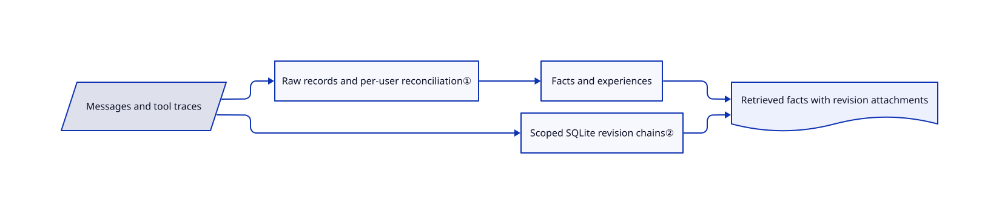

# Hy Memory

Your agent remembers changing a function, but forgets which discarded patch you meant by “the second version.” Hy Memory keeps extracted facts and observed code revisions separately, alongside general conversation memory.

## When to use

You build an assistant that alternates between conversations and tool-driven work. Replaying yesterday's transcript costs too much, while a summary loses reverted patches. You can instrument `add()` and `search()`, provide user/workspace identifiers, and pay for extraction. Pick Hy Memory over a generic fact store when separate chat/working/coding scenes and attached revision chains decide the choice.

The repository also contains MemHub, a desktop/CLI product for importing authorized application histories. It is not installed automatically with the Python SDK; adopting its host integrations requires a separate permissions decision.

## When NOT to use

- **You only need authoritative settings.** Use SQLite with your own schema; known keys and values do not need probabilistic extraction.
- **You require an established public maintenance history.** Evaluate [Mem0](mem0.md) instead. This repository was created on 2026-10-15; vendor backing cannot replace years of compatibility evidence.
- **You already standardized on LangGraph storage.** Consider [LangMem](langmem.md), accepting its release-cadence caveat, rather than adding Hy Memory's vector, metadata and optional graph stores.
- **Working/coding memory cannot call models.** Use raw SQLite records or Git history. `lite` ignores scene/layer routing; structured work extraction needs `pro` or `ultra` and tool-call traces.
- **Concurrent shutdown must already be proven.** Evaluate [Mem0](mem0.md) or a separately managed memory service before deployment. Open issue #45 reports a shared-SQLite shutdown race and intermittent crashes; this was not reproduced here.

## Comparison

| Alternative | In index | Our verdict | Tradeoff |
|---|---|---|---|
| [Mem0](mem0.md) | ✅ | Pick Mem0 for an older, broader SDK ecosystem; pick Hy Memory when scene separation and coding revisions decide. | Specialized work traces versus only days of public repository history. |
| [LangMem](langmem.md) | ✅ | Pick LangMem for memory inside an existing LangGraph store; pick Hy Memory for framework-independent application integration. | Infrastructure reuse versus explicit scenes and another storage stack. |
| [SimpleMem](simplemem.md) | ✅ | Pick SimpleMem for dialogue-compression experiments; pick Hy Memory when intermediate code patches must survive summarization. | Both need model services; research-release gaps contrast with a very young public launch. |

## Quick start

Install `pip install hy-memory==2.0.3` and configure a language-model endpoint plus an embedding endpoint, which converts text into searchable numeric vectors. Create `HyMemoryClient(mode="pro")` and submit messages with `client.add(..., user_id=...)`. Search with `client.search(..., user_ids=[...])`; for coding, supply tool-call messages and `scene="coding"`, with consistent `workspace_id` and `branch` on writes and searches. The SDK extracts and stores memories; you own consent, identity scoping, model bills, backups and prompt integration. Finish outstanding operations before closing the client and test the shutdown path in your environment.

<!-- flow-steps:begin (generated from flows/hy-memory.json by tools/flow_card.py — do not edit) -->

Text version of the flow

1. **You**: Install the SDK and configure model endpoints — `pip install hy-memory==2.0.3`
2. **You**: Submit messages with user and coding workspace identifiers — `scene="coding"`
3. **Hy Memory**: Extract facts and experiences; retain observed code revisions
4. **You**: Search with the same user, workspace and branch scope
5. **Hy Memory**: Return relevant memories with coding revision context

**Value**: Recall work and intermediate changes without replaying the whole transcript

<!-- flow-steps:end -->

## Key techniques

<!-- mechanism:begin (generated from mechanisms/hy-memory.json by tools/mechanism_card.py; do not edit) -->

Text version of the mechanism

- Messages and tool traces
- Raw records and per-user reconciliation①
- Facts and experiences
- Scoped SQLite revision chains②
- Retrieved facts with revision attachments

- Messages and tool traces → Raw records and per-user reconciliation①
- Raw records and per-user reconciliation① → Facts and experiences
- Messages and tool traces → Scoped SQLite revision chains②
- Facts and experiences → Retrieved facts with revision attachments
- Scoped SQLite revision chains② → Retrieved facts with revision attachments

<!-- mechanism:end -->

### 1. Separate raw records from reconciled facts

- **Problem:** Repeated or contradictory snippets cannot directly serve as one current user profile.
- **How:** The writer retains raw input, extracts higher-level memories, and serializes reconciliation per user before applying additions, updates or supersession. Modes select raw-only writes or model extraction; `ultra` adds explicit evolution.
- **Limits:** An in-process per-user lock is not cross-process transaction isolation; extraction can still be wrong, and several stores need coordinated backups. In `ultra`, default `create_graph_node` does not enforce per-node evidence that is non-empty, exists and belongs to the current user/agent. `revise_schema` separately checks supplied new evidence for existence and ownership and enables strict linking; that is not the default create contract. For audit-grade profiles, the application must validate evidence rather than treating evolved abstractions as authoritative facts.
- **Source:** [Writer reconciliation](https://github.com/Tencent-Hunyuan/Hy-Memory/blob/0c59413ad81158a3bd4748beb7bdda354659b3af/hy_memory/pipelines/writer.py#L1201-L1297), [mode routing](https://github.com/Tencent-Hunyuan/Hy-Memory/blob/0c59413ad81158a3bd4748beb7bdda354659b3af/hy_memory/client.py#L2630-L2694), [evidence-list schema](https://github.com/Tencent-Hunyuan/Hy-Memory/blob/0c59413ad81158a3bd4748beb7bdda354659b3af/hy_memory/pipelines/system2_tools.py#L298-L310), [default creation and linking](https://github.com/Tencent-Hunyuan/Hy-Memory/blob/0c59413ad81158a3bd4748beb7bdda354659b3af/hy_memory/pipelines/system2_tools.py#L596-L765), [separate revision checks](https://github.com/Tencent-Hunyuan/Hy-Memory/blob/0c59413ad81158a3bd4748beb7bdda354659b3af/hy_memory/pipelines/system2_tools.py#L800-L829).

### 2. Decorate retrieved facts with revision chains

- **Problem:** Summaries omit intermediate versions absent from the current checkout.
- **How:** SQLite threads store observed real diffs and user instructions, scoped by owner, branch, file and region. Retrieval chooses facts first; revision chains attach context rather than choosing a winning version.
- **Limits:** It needs observable Git diffs or recognizable deterministic replacements. Display budgets truncate attachments, and unobserved history cannot be reconstructed from summaries.
- **Source:** [Chain schema and budgets](https://github.com/Tencent-Hunyuan/Hy-Memory/blob/0c59413ad81158a3bd4748beb7bdda354659b3af/hy_memory/coding/chain_store.py#L1-L167), [owner scoping](https://github.com/Tencent-Hunyuan/Hy-Memory/blob/0c59413ad81158a3bd4748beb7bdda354659b3af/hy_memory/client.py#L1072-L1181).

## Tech stack

Python, Pydantic, OpenAI client, NumPy and token-counting utilities. Default vector storage is ChromaDB; Kuzu provides embedded graphs. Working/coding metadata and revision chains use SQLite. MemHub's separate desktop/CLI code is outside the SDK package-discovery rule.

## Dependencies

- Python 3.9+ declared by `pyproject.toml`; minimum-interpreter compatibility of all transitive dependencies was not exercised.
- An embedding endpoint; `pro`/`ultra` also need a language-model endpoint. Self-hosted compatible services are supported; Tencent models are not mandatory.
- Writable persistent storage. Optional extras add Qdrant, FAISS, Neo4j, MySQL or local PyTorch/Transformers reranking. `ultra` always enables graph use.

## Ops difficulty

**Medium.** Embedded defaults avoid a mandatory database server, but models, multiple stores, scoping and shutdown remain yours. Remote stores and evolution add components. “Local-first” storage does not eliminate outbound model calls; choose endpoints for the sensitivity of conversations and code.

## Health & viability

- **2026-10-18 — active launch.** SDK source declares 2.0.3; GitHub release v1.0.2 is the separate MemHub product line. Do not conflate versions.
- **Backing and governance.** Tencent-Hunyuan owns the repository; the snapshot shows three contributors led by `txfei`. Vendor ownership is clear, but independent governance is not established.
- **Age and Lindy.** The public repository is three days old. An earlier research timeline is not a long public maintenance record; treat this as a pilot dependency.
- **Risk signals.** LICENSE grants Apache-2.0 without extra restrictions for the covered release. Issues #45 and #46 report a shutdown race and dropped `lite` metadata; popularity does not resolve correctness concerns.

## Caveats (unverified)

- [未验证] Installation, model compatibility and concurrent shutdown were not exercised because this review was read-only; #45 remains a report rather than a reproduced defect here.
- [推断] Based on repository age and contributor snapshots, three days of public history cannot establish long-term API stability despite Tencent backing.
- [未验证] No model/storage environment was deployed, so recall accuracy, extraction cost and revision coverage on real multi-agent traces were not benchmarked.
