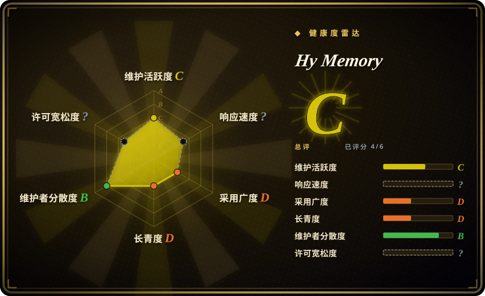
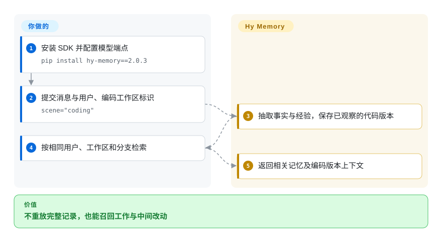
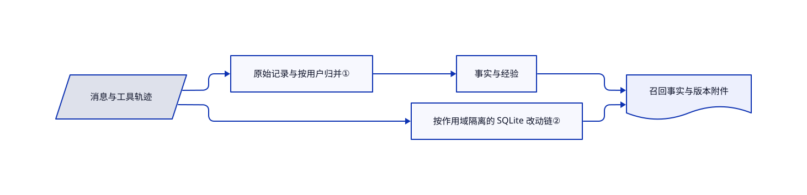

# Hy Memory

你问“保留第二版改法”，助手却只记得改过函数，不记得撤回哪些补丁。Hy Memory 把抽取事实与已观察的代码改动链分开保存，同时提供通用对话记忆。

## 何时使用

你在开发既聊天、又调用工具办事的助手。重放昨天的完整记录太贵，短摘要又丢掉已撤回的补丁。你愿意接入 `add()` 和 `search()`，提供用户与工作区标识，并承担抽取费用。相比通用事实库，聊天、工作、编码分场景处理和编码版本附件更重要时，考虑 Hy Memory。

仓库还包含 MemHub，用桌面端和命令行导入用户授权的应用历史。它不会随 Python SDK 自动安装；采用宿主集成还要单独裁决权限。

## 何时不用

- **只保存权威设置。** 直接使用 SQLite 自定义表；已知键和值不必交给模型抽取。
- **需要长期公开维护记录。** 评估 [Mem0](mem0.zh.md)。本仓库创建于 2026-10-15，厂商背书不能代替多年兼容记录。
- **已经统一采用 LangGraph 存储。** 可考虑 [LangMem](langmem.zh.md)，同时接受其发布节奏风险，避免再加 Hy Memory 的向量、元数据和可选图存储。
- **工作与编码记忆不能调用模型。** 用 SQLite 原始记录或 Git 历史。`lite` 忽略场景和层级；结构化工作抽取需要 `pro` 或 `ultra`，并且输入须含工具调用轨迹。
- **并发关闭必须已经可靠。** 部署前评估 [Mem0](mem0.zh.md) 或独立管理的记忆服务。开放问题 #45 报告共享 SQLite 关闭竞态与偶发崩溃，本次未复现。

## 横向对比

| 替代品 | 是否收录 | 我们的评价 | 取舍 |
|---|---|---|---|
| [Mem0](mem0.zh.md) | ✅ | 需要更老、更广的 SDK 生态选 Mem0；需要分场景结构和编码改动链选 Hy Memory。 | 专用工作轨迹换来价值，但公开维护记录只有几天。 |
| [LangMem](langmem.zh.md) | ✅ | 记忆要留在既有 LangGraph 存储时选 LangMem；要独立于框架接入时选 Hy Memory。 | 复用基础设施，或增加一套存储换取显式场景。 |
| [SimpleMem](simplemem.zh.md) | ✅ | 对话压缩实验选 SimpleMem；中间代码补丁不能丢时选 Hy Memory。 | 两者都依赖模型，前者有研究发布断层，后者刚公开首发。 |

## 快速上手

运行 `pip install hy-memory==2.0.3`，配置语言模型与嵌入服务，后者把文本变成可检索的数值向量。创建 `HyMemoryClient(mode="pro")`，用 `client.add(..., user_id=...)` 写入消息。通过 `client.search(..., user_ids=[...])` 召回；编码输入须包含工具调用和 `scene="coding"`，读写一致传入 `workspace_id` 与 `branch`。SDK 负责抽取和存储，你负责授权、标识隔离、模型费用、备份与提示词接入。等在途操作结束后关闭客户端，并在自己的环境测试关闭路径。

<!-- flow-steps:begin (generated from flows/hy-memory.json by tools/flow_card.py — do not edit) -->

流程文字版

1. **你**：安装 SDK 并配置模型端点 — `pip install hy-memory==2.0.3`
2. **你**：提交消息与用户、编码工作区标识 — `scene="coding"`
3. **Hy Memory**：抽取事实与经验，保存已观察的代码版本
4. **你**：按相同用户、工作区和分支检索
5. **Hy Memory**：返回相关记忆及编码版本上下文

**价值**：不重放完整记录，也能召回工作与中间改动

<!-- flow-steps:end -->

## 技术要点

<!-- mechanism:begin (generated from mechanisms/hy-memory.json by tools/mechanism_card.py; do not edit) -->

机制文字版

- 消息与工具轨迹
- 原始记录与按用户归并①
- 事实与经验
- 按作用域隔离的 SQLite 改动链②
- 召回事实与版本附件

- 消息与工具轨迹 → 原始记录与按用户归并①
- 原始记录与按用户归并① → 事实与经验
- 消息与工具轨迹 → 按作用域隔离的 SQLite 改动链②
- 事实与经验 → 召回事实与版本附件
- 按作用域隔离的 SQLite 改动链② → 召回事实与版本附件

<!-- mechanism:end -->

### 1. 原始记录与归并事实分层

- **解决：** 重复、矛盾的片段不能直接充当当前用户资料。
- **做法：** 写入器保留原始输入，再抽取高层记忆；按用户串行归并，执行新增、更新或替代。模式控制原始写入和模型抽取，`ultra` 再提供显式演化。
- **边界：** 进程内按用户加锁不等于跨进程事务隔离，模型仍可能抽错，多种存储需要协调备份。`ultra` 默认的 `create_graph_node` 不会逐节点强制校验证据非空、存在及属于当前用户和助手。`revise_schema` 另行核对所提供新证据的存在与归属，并启用严格链接，不能把它的契约当作默认新建的保证。需要审计级画像时，应用必须自行校验证据，不能把演化出的抽象心智结构直接当权威事实。
- **源码：** [写入归并](https://github.com/Tencent-Hunyuan/Hy-Memory/blob/0c59413ad81158a3bd4748beb7bdda354659b3af/hy_memory/pipelines/writer.py#L1201-L1297)、[模式路由](https://github.com/Tencent-Hunyuan/Hy-Memory/blob/0c59413ad81158a3bd4748beb7bdda354659b3af/hy_memory/client.py#L2630-L2694)、[证据列表参数](https://github.com/Tencent-Hunyuan/Hy-Memory/blob/0c59413ad81158a3bd4748beb7bdda354659b3af/hy_memory/pipelines/system2_tools.py#L298-L310)、[默认新建与证据链接](https://github.com/Tencent-Hunyuan/Hy-Memory/blob/0c59413ad81158a3bd4748beb7bdda354659b3af/hy_memory/pipelines/system2_tools.py#L596-L765)、[独立的修订校验](https://github.com/Tencent-Hunyuan/Hy-Memory/blob/0c59413ad81158a3bd4748beb7bdda354659b3af/hy_memory/pipelines/system2_tools.py#L800-L829)。

### 2. 用改动链装饰召回事实

- **解决：** 摘要会丢掉已经不在当前工作区的中间版本。
- **做法：** SQLite 按顺序存真实差异和用户指令，以所有者、分支、文件和代码区域隔离。检索先选事实，改动链再附加版本上下文，不自行判断最终胜出版本。
- **边界：** 需要可观测的 Git 差异或可识别的确定性替换。展示预算会截断附件，未观察过的历史不能从摘要恢复。
- **源码：** [改动链表结构与预算](https://github.com/Tencent-Hunyuan/Hy-Memory/blob/0c59413ad81158a3bd4748beb7bdda354659b3af/hy_memory/coding/chain_store.py#L1-L167)、[所有者隔离](https://github.com/Tencent-Hunyuan/Hy-Memory/blob/0c59413ad81158a3bd4748beb7bdda354659b3af/hy_memory/client.py#L1072-L1181)。

## 技术栈

Python、Pydantic、OpenAI 客户端、NumPy 和词元统计工具。默认向量存储是 ChromaDB，嵌入式图存储使用 Kuzu。工作、编码元数据和改动链使用 SQLite。独立的 MemHub 桌面与命令行代码不在 SDK 包发现范围内。

## 依赖

- `pyproject.toml` 声明 Python 3.9+，全部间接依赖能否兼容最低解释器，本次未运行验证。
- 嵌入服务必需，`pro` 和 `ultra` 另需语言模型服务。可自行托管兼容接口，不强制腾讯模型。
- 可写持久化目录。可选扩展提供 Qdrant、FAISS、Neo4j、MySQL 与本地 PyTorch、Transformers 重排。`ultra` 始终启用图。

## 运维难度

**中。** 嵌入式默认后端不要求独立数据库服务器，但模型接口、多种存储、标识隔离和关闭时序仍由你负责。远程存储与演化会增加组件。“本地优先”存储不代表没有外部模型请求，应按对话和代码敏感度选择端点。

## 健康度与可持续性

- **2026-10-18：活跃首发。** SDK 源码版本是 2.0.3，GitHub 的 v1.0.2 属于独立 MemHub 产品线，不能混用。
- **背书与治理。** 仓库属于 Tencent-Hunyuan，快照包含三位贡献者，以 `txfei` 为主。厂商归属明确，独立治理尚未建立。
- **年龄与林迪判断。** 公开仓库只有三天。更早研究时间线不等于长期公开维护记录，宜先作为试点依赖。
- **风险信号。** LICENSE 按 Apache-2.0 授权，并声明无额外限制。#45 和 #46 分别报告关闭竞态和 `lite` 元数据丢失，热度不能替代正确性验证。

## 存疑（未验证）

- [未验证：本次只读调研，未运行上游] 未执行安装、模型兼容和并发关闭测试；#45 仍是报告，不是本次复现结论。
- [推断：依据是仓库年龄与贡献快照] 公开三天不足以证明长期接口稳定，即使已有腾讯背书。
- [未验证：未搭建模型与存储环境] 未测真实多助手轨迹的召回准确率、抽取费用和版本覆盖率。
