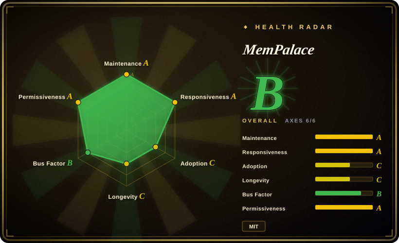
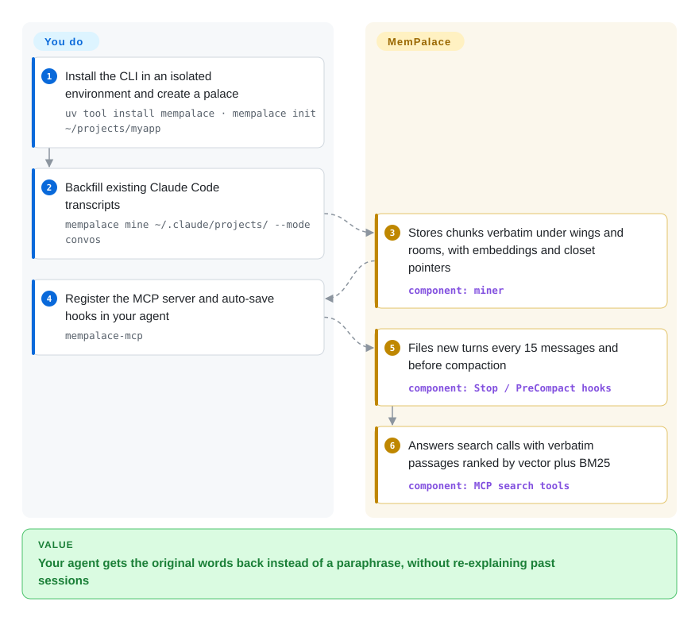
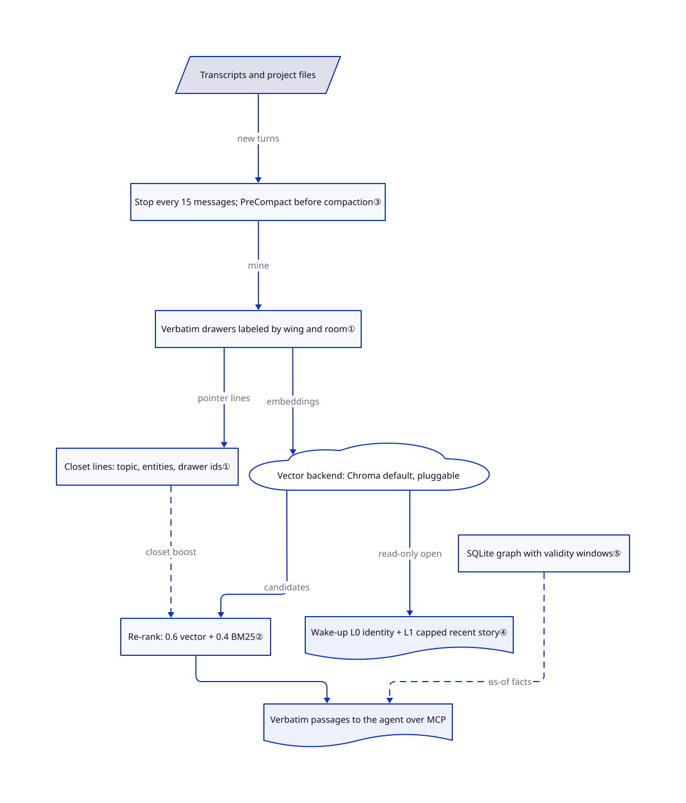

# MemPalace

When old transcripts disappear under a retention policy, a summary alone cannot recover what was actually said. MemPalace mines your transcripts and project files into a local store word for word, then finds the right passage with semantic plus keyword search.

## When to use

You have months of Claude Code sessions under `~/.claude/projects/`, and you keep asking "why did we switch to GraphQL?" only to get a confident guess. A summarizing memory tool would hand back "team chose GraphQL for flexibility", which loses the actual objection someone raised. You want the original exchange back, searchable from the agent over MCP, saved automatically before compaction, and kept on your own disk. MemPalace stores each chunk verbatim with project ("wing") and topic ("room") labels, and its Stop and PreCompact hooks file new turns in the background.

Choose it over [claude-mem](claude-mem.md) when exact wording matters more than compressed observations, and over [Engram](engram.md) when you want automatic capture and semantic search rather than agent-written notes in one Go binary. The price is a heavier Python stack (ChromaDB plus an embedding model), a palace that can be damaged by concurrent writers on the default backend, and headline benchmark numbers that measure retrieval recall, not answer quality.

## When NOT to use

- **Several writers will hit one palace at once on the default backend.** An open epic (#1963) and issue #1092 track ChromaDB index corruption when hooks, the MCP server and the CLI write concurrently. Use the `sqlite_exact` or a server backend, a single writer, or [Engram](engram.md), whose SQLite file is simpler to reason about.
- **You want compact distilled facts injected into the prompt.** Verbatim drawers are large and need a search step; that is by design. Use [Mem0](../app-memory/mem0.md) for extracted user facts, or [claude-mem](claude-mem.md) for compressed session observations injected at start.
- **You need facts that retire automatically when they change.** The SQLite knowledge graph stores validity windows, but a stale fact ends only when something calls `invalidate`; the separate `fact_checker.py` contradiction utility is not called from graph writes. Use [Graphiti](../graph-memory/graphiti.md), which closes old facts as new episodes arrive.
- **You are choosing on the 96.6% LongMemEval figure.** The project's benchmark identifies that R@5 retrieval recall as its raw ChromaDB baseline: default embeddings and one document per session, without palace postprocessing. It does not measure arbitrary vector stores or answer quality. The project's HISTORY retracted "+34% palace boost", "30x lossless" and competitor tables. Benchmark your own corpus.
- **You want a zero-dependency install or Android-native use.** ChromaDB, ONNX Runtime and a 30–300 MB embedding model are required, and native Termux is unsupported. Use [Engram](engram.md) or [deja-vu](deja-vu.md) for a single local binary.

## Comparison

| Alternative | In index | Our verdict | Tradeoff |
|---|---|---|---|
| [claude-mem](claude-mem.md) | ✅ | Choose claude-mem when you want compressed observations injected at session start; choose MemPalace when you need the exact original turns back on demand. | claude-mem spends model calls to compress and keeps context small; MemPalace keeps every word and pays in storage and a search step. |
| [Engram](engram.md) | ✅ | Choose Engram for agent-written notes in one Go binary and one SQLite file across many harnesses; choose MemPalace for automatic transcript capture with semantic search. | Engram has no background capture and only keyword search, but almost no ops; MemPalace captures more and needs Python, ChromaDB and an embedder. |
| [Mem0](../app-memory/mem0.md) | ✅ | Choose Mem0 when your own product needs distilled user facts; choose MemPalace when the corpus is your coding-agent transcripts and paraphrase is unacceptable. | Mem0 runs an LLM extraction pass per turn; MemPalace runs no LLM by default but returns longer raw passages. |
| [Graphiti](../graph-memory/graphiti.md) | ✅ | Choose Graphiti when facts must supersede each other over time; choose MemPalace when verbatim recall matters and a manual-invalidation graph is enough. | Graphiti needs a graph database and LLM extraction; MemPalace's local SQLite graph is cheaper but does not retire facts by itself. |

## Quick start

Install the package in an isolated environment with `uv tool install mempalace` (or `pipx install mempalace`; a Docker image also exists), then run `mempalace init` on a project to create a palace — the local store — and choose an embedding model. Feed it content: `mempalace mine ~/.claude/projects/ --mode convos` backfills Claude Code transcripts, and `mempalace mine <dir>` indexes project files. Wire it into your agent as an MCP server (the `mempalace-mcp` command) and install the Claude Code, Codex or Cursor hooks so new turns are saved every 15 messages and before compaction. From then on the agent calls search tools, or you run `mempalace search "…"`, and gets back verbatim passages with their wing and room. You own backend choice, backups, which directories get mined, and keeping a single writer; MemPalace owns chunking, embedding, ranking and hook-driven filing. No upstream command was run for this entry.

<!-- flow-steps:begin (generated from flows/mempalace.json by tools/flow_card.py — do not edit) -->

Text version of the flow

1. **You**: Install the CLI in an isolated environment and create a palace — `uv tool install mempalace · mempalace init ~/projects/myapp`
2. **You**: Backfill existing Claude Code transcripts — `mempalace mine ~/.claude/projects/ --mode convos`
3. **MemPalace**: Stores chunks verbatim under wings and rooms, with embeddings and closet pointers — component: `miner`
4. **You**: Register the MCP server and auto-save hooks in your agent — `mempalace-mcp`
5. **MemPalace**: Files new turns every 15 messages and before compaction — component: `Stop / PreCompact hooks`
6. **MemPalace**: Answers search calls with verbatim passages ranked by vector plus BM25 — component: `MCP search tools`

**Value**: Your agent gets the original words back instead of a paraphrase, without re-explaining past sessions

<!-- flow-steps:end -->

## Key techniques

<!-- mechanism:begin (generated from mechanisms/mempalace.json by tools/mechanism_card.py; do not edit) -->

Text version of the mechanism

- Transcripts and project files
- Stop every 15 messages; PreCompact before compaction③
- Verbatim drawers labeled by wing and room①
- Closet lines: topic, entities, drawer ids①
- Vector backend: Chroma default, pluggable
- Re-rank: 0.6 vector + 0.4 BM25②
- Wake-up L0 identity + L1 capped recent story④
- SQLite graph with validity windows⑤
- Verbatim passages to the agent over MCP

- Transcripts and project files → Stop every 15 messages; PreCompact before compaction③ (new turns)
- Stop every 15 messages; PreCompact before compaction③ → Verbatim drawers labeled by wing and room① (mine)
- Verbatim drawers labeled by wing and room① → Closet lines: topic, entities, drawer ids① (pointer lines)
- Verbatim drawers labeled by wing and room① → Vector backend: Chroma default, pluggable (embeddings)
- Vector backend: Chroma default, pluggable → Re-rank: 0.6 vector + 0.4 BM25② (candidates)
- Closet lines: topic, entities, drawer ids① → Re-rank: 0.6 vector + 0.4 BM25② (closet boost) [optional/fallback]
- Re-rank: 0.6 vector + 0.4 BM25② → Verbatim passages to the agent over MCP
- Vector backend: Chroma default, pluggable → Wake-up L0 identity + L1 capped recent story④ (read-only open)
- SQLite graph with validity windows⑤ → Verbatim passages to the agent over MCP (as-of facts) [optional/fallback]

<!-- mechanism:end -->

### 1. Verbatim drawers with closet pointer lines

- **Problem:** Summaries lose the exact objection or number someone wrote, so a recall answer can sound right and still be wrong.
- **How:** Mining stores original text in "drawers" labeled by wing and room. A separate "closet" collection holds compact lines such as `topic|entities|→drawer_ids`, capped at about 1,500 characters each. A closet hit boosts its drawer's rank and returns the drawer text plus neighboring chunks; it never replaces the drawer.
- **Limits:** Closet entities come from capitalized-word heuristics over the first 5,000 characters, so lowercase or non-Latin names are weak signals. Wing and room filters are ordinary metadata filters; the project retracted its "+34% palace boost" claim.
- **Source:** [closet constants:6–7](https://github.com/MemPalace/mempalace/blob/4f7745afbd9d0197c6475b4c7ac846d4932eaeda/mempalace/palace/closets.py#L6-L7), [closet line format:101–177](https://github.com/MemPalace/mempalace/blob/4f7745afbd9d0197c6475b4c7ac846d4932eaeda/mempalace/palace/closets.py#L101-L177), [closet hit enrichment:123–140](https://github.com/MemPalace/mempalace/blob/4f7745afbd9d0197c6475b4c7ac846d4932eaeda/mempalace/searcher/candidates.py#L123-L140).

### 2. Hybrid re-rank of vector and BM25 scores

- **Problem:** Pure embeddings miss exact identifiers and vocabulary mismatches, such as an error code or a library name.
- **How:** Candidates from the vector search are re-scored as 0.6 × vector similarity + 0.4 × Okapi BM25, a keyword relevance score, min-max normalized within the candidate set. Ties break by raw distance, then by most recent authored time. Weights come from config or `MEMPALACE_HYBRID_*` environment variables.
- **Limits:** BM25 only re-ranks candidates already retrieved (or union-mode lexical hits), so a passage missed by both passes stays missed. The benchmark's hybrid v4 extras (temporal and preference boosts) live in benchmark scripts, not this product path.
- **Source:** [weight resolution:85–101](https://github.com/MemPalace/mempalace/blob/4f7745afbd9d0197c6475b4c7ac846d4932eaeda/mempalace/searcher/ranking.py#L85-L101), [hybrid rank:170–238](https://github.com/MemPalace/mempalace/blob/4f7745afbd9d0197c6475b4c7ac846d4932eaeda/mempalace/searcher/ranking.py#L170-L238), [raw baseline description:212–222](https://github.com/MemPalace/mempalace/blob/4f7745afbd9d0197c6475b4c7ac846d4932eaeda/benchmarks/BENCHMARKS.md#L212-L222).

### 3. Hook-driven checkpoints before context is lost

- **Problem:** Memory that depends on the agent remembering to save will miss the turns just before compaction or exit.
- **How:** The Stop hook counts human messages in the transcript and files a checkpoint once 15 have accumulated since the last save, storing the counter per session. The PreCompact handler invokes synchronous transcript mining; this is a checkpoint attempt, not proof that the host prevents compaction after a failed save. Silent mode saves through the Python API.
- **Limits:** Hooks re-read transcripts and can contend with a running hub or daemon; open issues report re-mining loops (#2403) and hook-spawned mines that never exit (#2917). A disabled `hooks.auto_save` switch skips all of it.
- **Source:** [save interval:43](https://github.com/MemPalace/mempalace/blob/4f7745afbd9d0197c6475b4c7ac846d4932eaeda/mempalace/hooks_cli.py#L43-L43), [stop hook:1528–1600](https://github.com/MemPalace/mempalace/blob/4f7745afbd9d0197c6475b4c7ac846d4932eaeda/mempalace/hooks_cli.py#L1528-L1600), [precompact hook:1797–1815](https://github.com/MemPalace/mempalace/blob/4f7745afbd9d0197c6475b4c7ac846d4932eaeda/mempalace/hooks_cli.py#L1797-L1815), [plugin hook wiring](https://github.com/MemPalace/mempalace/blob/4f7745afbd9d0197c6475b4c7ac846d4932eaeda/.claude-plugin/hooks/hooks.json).

### 4. Small wake-up context, deep search on demand

- **Problem:** Loading a whole memory store into each new session wastes most of the context window.
- **How:** `wake-up` builds Layer 0 (an identity file, about 100 tokens) and Layer 1 (top recent drawers, hard-capped at 3,200 characters from a 2,000-drawer window). Topic-scoped Layer 2 and full semantic Layer 3 load only when asked. The stack opens backends read-only so it does not take the mine lock.
- **Limits:** Layer 1 favors recently filed drawers, so an important old decision appears only if the agent searches for it. `read_only` is a request that ChromaDB ignores.
- **Source:** [layer design:1–20](https://github.com/MemPalace/mempalace/blob/4f7745afbd9d0197c6475b4c7ac846d4932eaeda/mempalace/layers.py#L1-L20), [read-only open:47–65](https://github.com/MemPalace/mempalace/blob/4f7745afbd9d0197c6475b4c7ac846d4932eaeda/mempalace/layers.py#L47-L65), [Layer 1 caps:335–345](https://github.com/MemPalace/mempalace/blob/4f7745afbd9d0197c6475b4c7ac846d4932eaeda/mempalace/layers.py#L335-L345).

### 5. Temporal knowledge graph in local SQLite

- **Problem:** A fact like "Max does swimming" may be true only for a period, and plain search returns old and new statements side by side.
- **How:** Triples carry `valid_from` and `valid_to`; `query_entity(name, as_of=…)` filters to facts valid at that instant, and inverted intervals are rejected. `invalidate` sets the end date on open triples, and imports report conflicting open facts.
- **Limits:** Ending a fact is an explicit call, not automatic contradiction resolution. Graph population depends on adapters or the agent calling the tools.
- **Source:** [module overview:1–30](https://github.com/MemPalace/mempalace/blob/4f7745afbd9d0197c6475b4c7ac846d4932eaeda/mempalace/knowledge_graph.py#L1-L30), [add triple:464–500](https://github.com/MemPalace/mempalace/blob/4f7745afbd9d0197c6475b4c7ac846d4932eaeda/mempalace/knowledge_graph.py#L464-L500), [invalidate:584–600](https://github.com/MemPalace/mempalace/blob/4f7745afbd9d0197c6475b4c7ac846d4932eaeda/mempalace/knowledge_graph.py#L584-L600), [as-of query:843–860](https://github.com/MemPalace/mempalace/blob/4f7745afbd9d0197c6475b4c7ac846d4932eaeda/mempalace/knowledge_graph.py#L843-L860).

## Tech stack

- Python ≥3.10 package with CLI and MCP server entry points declared in the [pyproject](https://github.com/MemPalace/mempalace/blob/4f7745afbd9d0197c6475b4c7ac846d4932eaeda/pyproject.toml); `chromadb>=1.5.4,<2` is the core dependency, with ONNX Runtime embeddings (all-MiniLM-L6-v2 or EmbeddingGemma-300m).
- Backends behind one contract ([`backends/base.py`](https://github.com/MemPalace/mempalace/blob/4f7745afbd9d0197c6475b4c7ac846d4932eaeda/mempalace/backends/base.py)): Chroma (default), `sqlite_exact`, `rust_exact` (Rust crates via PyO3), Milvus, Qdrant and pgvector as opt-ins.
- SQLite for the knowledge graph and BM25 lexical index; plugins for Claude Code, Codex, Cursor and DeepSeek Harness under dot-directories.

## Dependencies

- **Local:** Python 3.10+, about 30–300 MB of embedding model downloaded on first use, and disk for the palace. No API key for the core path.
- **Optional services:** a Qdrant, Milvus or Postgres/pgvector server for those backends; an OpenAI-compatible embeddings endpoint; any LLM for reranking or refinement (BYOK, off by default).
- **Agent side:** an MCP-capable client and, for auto-save, a supported hook system (Claude Code, Codex CLI, Cursor).

## Ops difficulty

**Low for a single user with one writer; medium once hooks, a daemon and the MCP server share a palace.** Installing and mining are one command each. The real work is keeping writers from colliding on the default ChromaDB backend, backing up the palace, and running `mempalace repair` when an index diverges — the repair tooling exists because this happens. Changing embedding models requires re-embedding. To retire it, remove the hooks and MCP entry first, then delete the palace directory after export; uninstalling the package leaves data in place. Only install from GitHub, PyPI or the official docs domain; impostor sites have distributed malware.

## Health & viability

- **Maintenance, 2026-11-01:** active. The reviewed `develop` commit `4f7745af` landed 2026-10-31; [v3.11.0](https://github.com/MemPalace/mempalace/releases/tag/v3.11.0) shipped 2026-10-14 and 3.12.0 is being finalized on `develop`. Releases have arrived roughly every two to four weeks.
- **Governance:** organization repository, MIT license held by "MemPalace Contributors". One maintainer (igorls) authored most commits by a wide margin, so the bus factor is low despite a broad contributor list.
- **Age and Lindy:** about seven months old. Its launch drew fast attention and public corrections; Lindy gives no durability prior yet. [推断：based on age and commit concentration]
- **Adoption and risk:** 60.2k stars and 7.6k forks; the automatic snapshot records 53,048 PyPI downloads in the last month (2026-11-01). Stars alone do not establish production use. Risk flags are retracted benchmark claims, open Chroma corruption issues and impostor domains.

## Caveats (unverified)

- [未验证：no benchmark or palace was run] The 96.6% R@5 and 98.4% held-out figures are the project's numbers; `docs/HISTORY.md` cites independent reproductions that this entry did not repeat.
- [未验证：no concurrency test] The severity and current frequency of Chroma concurrent-writer corruption were read from open issues, not reproduced.
- [推断：benchmark scripts and product search were read as separate code paths] Product search may not reach the benchmark's hybrid v4 scores on your data.
- [未验证：adoption signals] Star and download counts were not traced to production users.
- [推断：commit concentration, not a governance document] Continuity depends heavily on one maintainer.
