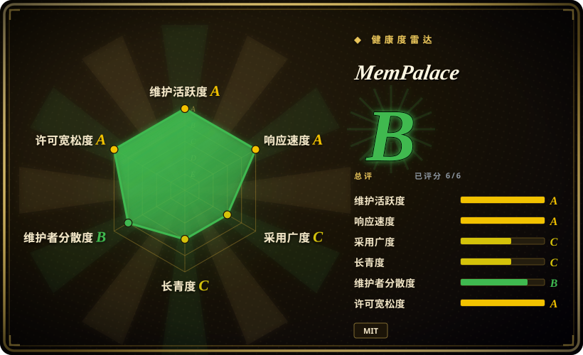
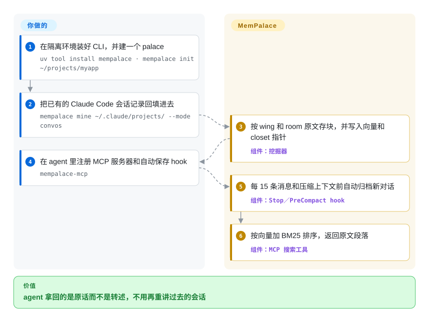
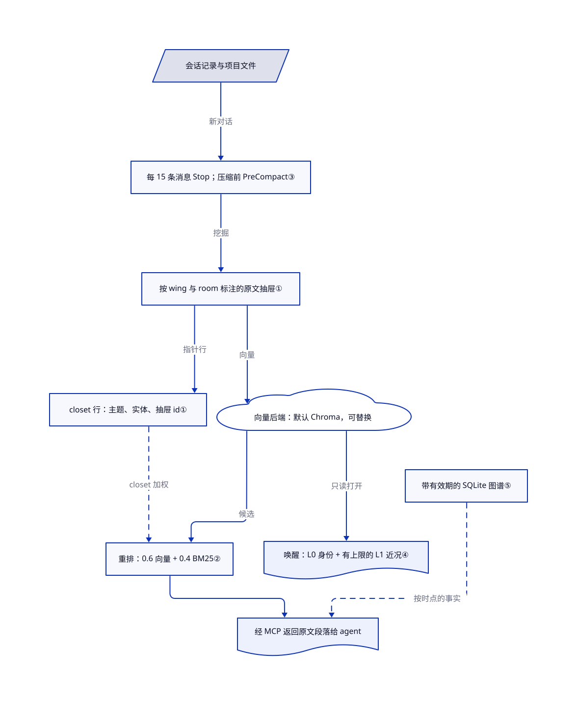

# MemPalace

保留策略清掉旧会话后，只剩摘要就找不回当时的原话。MemPalace 把你的会话记录和项目文件原样归档到本地存储，再用语义加关键词检索找回需要的那一段。

## 何时使用

你的 `~/.claude/projects/` 里攒了几个月的 Claude Code 会话，每次问“当初为什么改用 GraphQL？”，得到的都是一个很笃定的猜测。摘要式记忆工具会还给你一句“团队为了灵活性选择了 GraphQL”，当时真正提出的反对意见早就丢了。你想把原始对话找回来，让 agent 经 MCP 检索，在压缩上下文前自动保存，而且数据留在自己的硬盘上。MemPalace 把每个块原样存下，打上项目（wing）和话题（room）标签，它的 Stop 与 PreCompact hook 在后台归档新对话。

和 [claude-mem](claude-mem.zh.md) 比，原话比压缩后的观察更重要时选 MemPalace；和 [Engram](engram.zh.md) 比，你要自动捕获和语义检索，而不是 agent 自己写笔记、一个 Go 二进制搞定时选 MemPalace。代价是更重的 Python 栈（ChromaDB 加嵌入模型），默认后端在多个写入方并发时可能损坏 palace，以及头条基准数字衡量的是检索召回，不是回答质量。

## 何时不用

- **默认后端上会有多个写入方同时写同一个 palace。** 未关闭的总追踪 issue（#1963）和 #1092 记录了 hook、MCP 服务器和 CLI 并发写入时 ChromaDB 索引损坏的问题。改用 `sqlite_exact` 或服务端后端、保证单一写入方，或者用 SQLite 单文件、更好推理的 [Engram](engram.zh.md)。
- **你要的是注入提示词的精炼事实。** 原文抽屉体积大、需要一次检索，这是设计使然。要提炼用户事实用 [Mem0](../app-memory/mem0.zh.md)；要在会话开头注入压缩后的观察用 [claude-mem](claude-mem.zh.md)。
- **你需要事实变化时自动失效。** SQLite 知识图谱存了有效期，但旧事实只有在有人调用 `invalidate` 时才结束；独立的 `fact_checker.py` 矛盾检测并没有接入图谱写入。用 [Graphiti](../graph-memory/graphiti.zh.md)，它会在新事件到来时关闭旧事实。
- **你是冲着 LongMemEval 的 96.6% 来选的。** 项目基准把这个 R@5 检索召回标为原始 ChromaDB 基线：默认嵌入，每个会话一份文档，不加 palace 后处理。它没有测任意向量库或回答质量。项目 HISTORY 已撤回“+34% palace 提升”“30 倍无损压缩”和竞品表。先测自己的语料。
- **你要零依赖安装或在 Android 上原生运行。** 必须装 ChromaDB、ONNX Runtime 和 30–300 MB 的嵌入模型，原生 Termux 不支持。要单个本地二进制，用 [Engram](engram.zh.md) 或 [deja-vu](deja-vu.zh.md)。

## 横向对比

| 替代品 | 是否收录 | 我们的评价 | 取舍 |
|---|---|---|---|
| [claude-mem](claude-mem.zh.md) | ✅ | 想在会话开头注入压缩后的观察，选 claude-mem；需要按需找回原始对话的每个字，选 MemPalace。 | claude-mem 花模型调用做压缩，上下文占用小；MemPalace 留下每个字，代价是存储和一次检索。 |
| [Engram](engram.zh.md) | ✅ | 想让多个 harness 共用 agent 自写的笔记、一个 Go 二进制加一个 SQLite 文件，选 Engram；要自动捕获会话记录并语义检索，选 MemPalace。 | Engram 没有后台捕获、只有关键词检索，但几乎不用运维；MemPalace 捕获得更全，需要 Python、ChromaDB 和嵌入模型。 |
| [Mem0](../app-memory/mem0.zh.md) | ✅ | 你自己的产品需要提炼后的用户事实，选 Mem0；语料是编码 agent 的会话记录、不接受转述，选 MemPalace。 | Mem0 每轮跑一次 LLM 抽取；MemPalace 默认不调用 LLM，但返回的原文段落更长。 |
| [Graphiti](../graph-memory/graphiti.zh.md) | ✅ | 事实需要随时间相互取代，选 Graphiti；原文召回更重要、手动失效的图谱就够用，选 MemPalace。 | Graphiti 需要图数据库和 LLM 抽取；MemPalace 的本地 SQLite 图谱更便宜，但不会自己让事实失效。 |

## 快速上手

在隔离环境里安装：`uv tool install mempalace`（或 `pipx install mempalace`，也有 Docker 镜像），然后对一个项目运行 `mempalace init`，创建 palace（本地存储）并选嵌入模型。往里喂内容：`mempalace mine ~/.claude/projects/ --mode convos` 回填 Claude Code 会话记录，`mempalace mine <dir>` 索引项目文件。把它作为 MCP 服务器（`mempalace-mcp` 命令）接进 agent，并装上 Claude Code、Codex 或 Cursor 的 hook，让新对话每 15 条消息、以及压缩上下文前自动保存。之后 agent 调用检索工具，或你自己运行 `mempalace search "…"`，拿回的是带 wing 和 room 的原文段落。后端选择、备份、挖哪些目录、保证单一写入方由你负责；分块、嵌入、排序和 hook 触发的归档由 MemPalace 负责。本条目没有运行任何上游命令。

<!-- flow-steps:begin (generated from flows/mempalace.json by tools/flow_card.py — do not edit) -->

流程文字版

1. **你**：在隔离环境装好 CLI，并建一个 palace — `uv tool install mempalace · mempalace init ~/projects/myapp`
2. **你**：把已有的 Claude Code 会话记录回填进去 — `mempalace mine ~/.claude/projects/ --mode convos`
3. **MemPalace**：按 wing 和 room 原文存块，并写入向量和 closet 指针 — 组件：`挖掘器`
4. **你**：在 agent 里注册 MCP 服务器和自动保存 hook — `mempalace-mcp`
5. **MemPalace**：每 15 条消息和压缩上下文前自动归档新对话 — 组件：`Stop／PreCompact hook`
6. **MemPalace**：按向量加 BM25 排序，返回原文段落 — 组件：`MCP 搜索工具`

**价值**：agent 拿回的是原话而不是转述，不用再重讲过去的会话

<!-- flow-steps:end -->

## 技术要点

<!-- mechanism:begin (generated from mechanisms/mempalace.json by tools/mechanism_card.py; do not edit) -->

机制文字版

- 会话记录与项目文件
- 每 15 条消息 Stop；压缩前 PreCompact③
- 按 wing 与 room 标注的原文抽屉①
- closet 行：主题、实体、抽屉 id①
- 向量后端：默认 Chroma，可替换
- 重排：0.6 向量 + 0.4 BM25②
- 唤醒：L0 身份 + 有上限的 L1 近况④
- 带有效期的 SQLite 图谱⑤
- 经 MCP 返回原文段落给 agent

- 会话记录与项目文件 → 每 15 条消息 Stop；压缩前 PreCompact③（新对话）
- 每 15 条消息 Stop；压缩前 PreCompact③ → 按 wing 与 room 标注的原文抽屉①（挖掘）
- 按 wing 与 room 标注的原文抽屉① → closet 行：主题、实体、抽屉 id①（指针行）
- 按 wing 与 room 标注的原文抽屉① → 向量后端：默认 Chroma，可替换（向量）
- 向量后端：默认 Chroma，可替换 → 重排：0.6 向量 + 0.4 BM25②（候选）
- closet 行：主题、实体、抽屉 id① → 重排：0.6 向量 + 0.4 BM25②（closet 加权）〔可选／兜底〕
- 重排：0.6 向量 + 0.4 BM25② → 经 MCP 返回原文段落给 agent
- 向量后端：默认 Chroma，可替换 → 唤醒：L0 身份 + 有上限的 L1 近况④（只读打开）
- 带有效期的 SQLite 图谱⑤ → 经 MCP 返回原文段落给 agent（按时点的事实）〔可选／兜底〕

<!-- mechanism:end -->

### 1. 原文抽屉加 closet 指针行

- **解决：** 摘要会丢掉某人写下的具体反对意见或数字，召回的答案听起来对，实际上错了。
- **做法：** 挖掘时把原文存进按 wing 和 room 标注的“抽屉”。另一个“closet”集合保存 `topic|entities|→drawer_ids` 这样的紧凑行，每个约 1,500 字符封顶。closet 命中会给对应抽屉加权，并返回抽屉原文和相邻块；它从不替代抽屉本身。
- **边界：** closet 里的实体来自对前 5,000 字符的大写词启发式，小写或非拉丁文字的名字信号很弱。wing 和 room 过滤只是普通的元数据过滤；项目已撤回“+34% palace 提升”的说法。
- **源码：** [closet 常量第 6–7 行](https://github.com/MemPalace/mempalace/blob/4f7745afbd9d0197c6475b4c7ac846d4932eaeda/mempalace/palace/closets.py#L6-L7)、[closet 行格式第 101–177 行](https://github.com/MemPalace/mempalace/blob/4f7745afbd9d0197c6475b4c7ac846d4932eaeda/mempalace/palace/closets.py#L101-L177)、[closet 命中补全第 123–140 行](https://github.com/MemPalace/mempalace/blob/4f7745afbd9d0197c6475b4c7ac846d4932eaeda/mempalace/searcher/candidates.py#L123-L140)。

### 2. 向量分与 BM25 分混合重排

- **解决：** 纯向量检索会漏掉精确标识符和用词不一致的情况，比如错误码或库名。
- **做法：** 向量检索得到的候选重新打分：0.6 × 向量相似度 + 0.4 × Okapi BM25（关键词相关度），BM25 在候选集内做最小—最大归一化。同分时先按原始距离，再按最近的写作时间排序。权重来自配置或 `MEMPALACE_HYBRID_*` 环境变量。
- **边界：** BM25 只重排已经取回的候选（或并集模式下的词法命中），两条路都没取到的段落仍然取不到。基准里 hybrid v4 的额外加权（时间和偏好）在基准脚本里，不在这条产品检索路径上。
- **源码：** [权重解析第 85–101 行](https://github.com/MemPalace/mempalace/blob/4f7745afbd9d0197c6475b4c7ac846d4932eaeda/mempalace/searcher/ranking.py#L85-L101)、[混合重排第 170–238 行](https://github.com/MemPalace/mempalace/blob/4f7745afbd9d0197c6475b4c7ac846d4932eaeda/mempalace/searcher/ranking.py#L170-L238)、[原始基线说明第 212–222 行](https://github.com/MemPalace/mempalace/blob/4f7745afbd9d0197c6475b4c7ac846d4932eaeda/benchmarks/BENCHMARKS.md#L212-L222)。

### 3. 在上下文丢失前由 hook 打检查点

- **解决：** 靠 agent 自己记得保存的记忆，会漏掉压缩或退出前的最后几轮。
- **做法：** Stop hook 数会话记录里的人类消息，距上次保存累计到 15 条就归档一次，并按会话保存计数。PreCompact 处理器同步调用会话挖掘；这是一次检查点尝试，不证明宿主会在保存失败后阻止压缩。静默模式通过 Python API 保存。
- **边界：** hook 会反复读记录，可能和正在运行的 hub 或守护进程争用；未关闭的 issue 报告了重复挖掘循环（#2403）和 hook 拉起的挖掘进程不退出（#2917）。关掉 `hooks.auto_save` 开关就全部跳过。
- **源码：** [保存间隔第 43 行](https://github.com/MemPalace/mempalace/blob/4f7745afbd9d0197c6475b4c7ac846d4932eaeda/mempalace/hooks_cli.py#L43-L43)、[Stop hook 第 1528–1600 行](https://github.com/MemPalace/mempalace/blob/4f7745afbd9d0197c6475b4c7ac846d4932eaeda/mempalace/hooks_cli.py#L1528-L1600)、[PreCompact hook 第 1797–1815 行](https://github.com/MemPalace/mempalace/blob/4f7745afbd9d0197c6475b4c7ac846d4932eaeda/mempalace/hooks_cli.py#L1797-L1815)、[插件 hook 配置](https://github.com/MemPalace/mempalace/blob/4f7745afbd9d0197c6475b4c7ac846d4932eaeda/.claude-plugin/hooks/hooks.json)。

### 4. 唤醒时只给小上下文，深度检索按需进行

- **解决：** 每个新会话都把整个记忆库塞进来，会浪费大部分上下文窗口。
- **做法：** `wake-up` 生成第 0 层（身份文件，约 100 token）和第 1 层（最近抽屉中的重点，从 2,000 个抽屉的窗口里取，硬上限 3,200 字符）。按话题的第 2 层和完整语义检索的第 3 层只在请求时加载。这套分层以只读方式打开后端，不占挖掘锁。
- **边界：** 第 1 层偏向最近归档的抽屉，重要的旧决定只有在 agent 主动检索时才会出现。`read_only` 只是请求，ChromaDB 会忽略它。
- **源码：** [分层设计第 1–20 行](https://github.com/MemPalace/mempalace/blob/4f7745afbd9d0197c6475b4c7ac846d4932eaeda/mempalace/layers.py#L1-L20)、[只读打开第 47–65 行](https://github.com/MemPalace/mempalace/blob/4f7745afbd9d0197c6475b4c7ac846d4932eaeda/mempalace/layers.py#L47-L65)、[第 1 层上限第 335–345 行](https://github.com/MemPalace/mempalace/blob/4f7745afbd9d0197c6475b4c7ac846d4932eaeda/mempalace/layers.py#L335-L345)。

### 5. 本地 SQLite 时序知识图谱

- **解决：** “Max 在学游泳”这类事实可能只在一段时间内成立，普通检索会把新旧说法并排返回。
- **做法：** 三元组带 `valid_from` 和 `valid_to`；`query_entity(name, as_of=…)` 只返回该时刻有效的事实，起止颠倒的区间会被拒绝。`invalidate` 给仍有效的三元组写上结束时间，导入时会报告相互冲突的有效事实。
- **边界：** 结束一个事实需要显式调用，不是自动的矛盾消解。图谱里有什么，取决于适配器或 agent 是否调用这些工具。
- **源码：** [模块概述第 1–30 行](https://github.com/MemPalace/mempalace/blob/4f7745afbd9d0197c6475b4c7ac846d4932eaeda/mempalace/knowledge_graph.py#L1-L30)、[添加三元组第 464–500 行](https://github.com/MemPalace/mempalace/blob/4f7745afbd9d0197c6475b4c7ac846d4932eaeda/mempalace/knowledge_graph.py#L464-L500)、[失效处理第 584–600 行](https://github.com/MemPalace/mempalace/blob/4f7745afbd9d0197c6475b4c7ac846d4932eaeda/mempalace/knowledge_graph.py#L584-L600)、[按时点查询第 843–860 行](https://github.com/MemPalace/mempalace/blob/4f7745afbd9d0197c6475b4c7ac846d4932eaeda/mempalace/knowledge_graph.py#L843-L860)。

## 技术栈

- Python ≥3.10 包，[pyproject](https://github.com/MemPalace/mempalace/blob/4f7745afbd9d0197c6475b4c7ac846d4932eaeda/pyproject.toml) 声明了 CLI 和 MCP 服务器入口；核心依赖是 `chromadb>=1.5.4,<2`，嵌入走 ONNX Runtime（all-MiniLM-L6-v2 或 EmbeddingGemma-300m）。
- 后端遵循同一份契约（[`backends/base.py`](https://github.com/MemPalace/mempalace/blob/4f7745afbd9d0197c6475b4c7ac846d4932eaeda/mempalace/backends/base.py)）：Chroma（默认）、`sqlite_exact`、`rust_exact`（经 PyO3 调用 Rust crate），Milvus、Qdrant、pgvector 为可选。
- 知识图谱和 BM25 词法索引用 SQLite；Claude Code、Codex、Cursor 和 DeepSeek Harness 的插件放在各自的点目录里。

## 依赖

- **本地：** Python 3.10+，首次使用时下载约 30–300 MB 的嵌入模型，以及存放 palace 的磁盘。核心路径不需要 API key。
- **可选服务：** 对应后端的 Qdrant、Milvus 或 Postgres／pgvector 服务器；兼容 OpenAI 的嵌入端点；用于重排或精修的任意 LLM（自带 key，默认关闭）。
- **agent 侧：** 支持 MCP 的客户端；要自动保存，还需要受支持的 hook 系统（Claude Code、Codex CLI、Cursor）。

## 运维难度

**单用户、单一写入方：低；hook、守护进程和 MCP 服务器共用一个 palace 时：中。** 安装和挖掘各一条命令。真正的工作是避免多个写入方在默认 ChromaDB 后端上冲突、备份 palace，以及在索引出现分歧时运行 `mempalace repair`——修复工具之所以存在，是因为这种事确实会发生。换嵌入模型需要重新嵌入。退役时先移除 hook 和 MCP 配置，导出后再删除 palace 目录；卸载包不会删数据。只从 GitHub、PyPI 或官方文档域名安装；冒充站点曾分发恶意软件。

## 健康度与可持续性

- **维护（2026-11-01）：** 活跃。本次审阅的 `develop` 提交 `4f7745af` 于 2026-10-31 合入；[v3.11.0](https://github.com/MemPalace/mempalace/releases/tag/v3.11.0) 于 2026-10-14 发布，3.12.0 正在 `develop` 上收尾。大约每两到四周发一次版。
- **治理：** 组织仓库，MIT 许可，版权人写的是“MemPalace Contributors”。一位维护者（igorls）的提交量遥遥领先，尽管贡献者名单很长，总线因子仍然偏低。
- **年龄与 Lindy：** 大约七个月。发布时迅速走红，也随即公开更正；Lindy 先验还给不出持久性信号。[推断：依据是年龄和提交集中度]
- **采用与风险：** 6.02 万星、7.6k fork；自动快照记录 PyPI 近一个月 53048 次下载（2026-11-01）。星数本身不证明生产使用。风险点是撤回的基准说法、未关闭的 Chroma 损坏问题和冒充域名。

## 存疑（未验证）

- [未验证：没有运行基准或 palace] 96.6% R@5 和 98.4% 留出集数字是项目自己的结果；`docs/HISTORY.md` 引用的独立复现本条目没有重做。
- [未验证：没有做并发测试] Chroma 并发写入损坏的严重程度和当前发生频率只读了未关闭的 issue，没有复现。
- [推断：基准脚本和产品检索按两条代码路径阅读] 产品检索在你的数据上未必达到基准里 hybrid v4 的分数。
- [未验证：采用信号] 星数和下载量没有追溯到具体生产用户。
- [推断：依据是提交集中度，不是治理文件] 项目能否延续在很大程度上取决于一位维护者。
