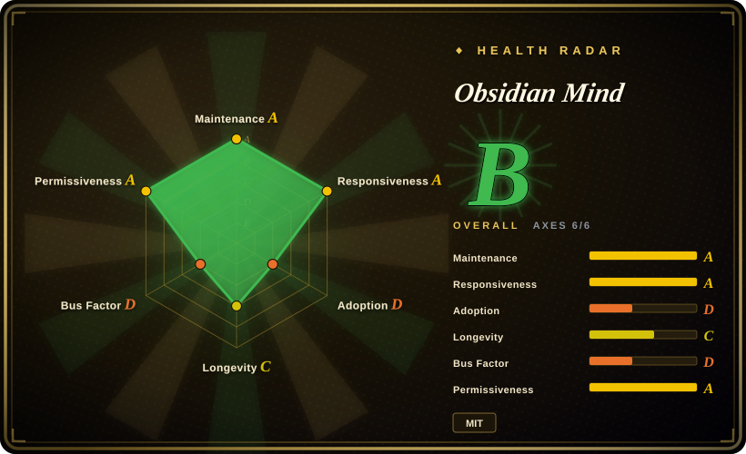
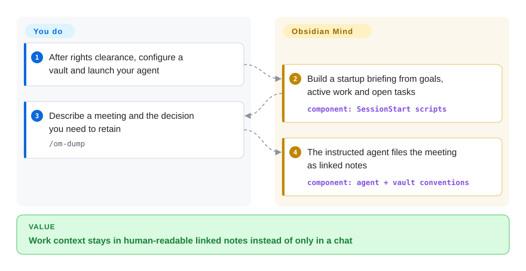
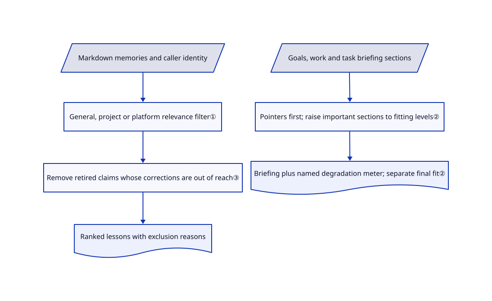

# Obsidian Mind

Yesterday's project decision and meeting notes disappear from your next coding session. Obsidian Mind keeps them in linked Markdown notes and feeds a small briefing into the next session.

> **WARNING — information listing, not installation or redistribution clearance.** The [root MIT declaration](https://github.com/breferrari/obsidian-mind/blob/fae7be467fc5e23bf9d51df7207d41f0c07e2754/LICENSE#L1-L13) names Brenno Ferrari. The bundle includes content from `kepano/obsidian-skills`; prior fixed-tree research found ten identical blobs and no retained Steph Ango MIT notice in 325 scanned text files. That source requires retaining its [copyright and permission notice](https://github.com/kepano/obsidian-skills/blob/3ccff5338ea700537839b21900aa5358a0402c98/LICENSE#L1-L13). The reviewed target SHA is unchanged. `NOASSERTION` describes unresolved whole-bundle rights, not absence of the root declaration. Do not directly install, copy or redistribute this bundle without resolving the gap. The automated radar measures root-file signals, not third-party authorization.

## When to use

You keep work decisions, colleagues' context and incident notes in Obsidian, but tomorrow's coding agent asks again why you rejected the cache migration. Study this project when you want the human-readable vault itself to remain the record, rather than a second opaque observation database. Its hooks build session briefings; its `om` server lets another repository search notes and save explicitly scoped lessons.

The distinguishing tradeoff is a browsable work notebook with executable maintenance machinery, not just a memory API. This entry supports evaluation only while the notice gap remains. If your goal is immediate deployment, prefer an alternative below after reviewing its own terms.

## When NOT to use

- **You need a rights-cleared install or redistributable starter today.** Do not treat the root MIT badge as clearance for copied skills. Evaluate [Engram](engram.md) for a separate memory store instead; repairing the notice chain requires evidence, not an index maintainer's approval.
- **You want one binary without a vault convention.** Choose [Engram](engram.md): its SQLite keyword store avoids Node hooks, Obsidian setup and the work/people/performance folder model.
- **You want automatic transcript compression, not agent-authored notes.** Choose [claude-mem](claude-mem.md), accepting its compression-provider and local-service costs. Here, hooks supply hints and checks; a model still chooses what to write.
- **Lessons must enter reuse only after human approval.** Choose [Beacon](agent-beacon.md) for its candidate-review workflow. This project's `remember` validates fields, not a human's acceptance of the claim.
- **You need tenant isolation or a confidentiality boundary.** Use a separately permissioned store or keep sensitive notes out. `scope` controls relevance, not filesystem access; even Engram's scopes are not an access-control substitute. MCP exposure policy cannot stop a session that already has direct vault access.

## Comparison

| Alternative | In index | Our verdict | Tradeoff |
|---|---|---|---|
| [Engram](engram.md) | ✅ | Choose Engram for a small, agent-agnostic store without a vault; study Obsidian Mind when people must browse and edit the same linked work notes. | One Go binary and SQLite keyword search versus Markdown conventions, Node hooks and optional local semantic indexing; Obsidian Mind's bundle rights remain unresolved. |
| [claude-mem](claude-mem.md) | ✅ | Choose claude-mem when automatic capture and compression matter more than controlling a work notebook's structure. | It adds compression calls and a local worker stack; Obsidian Mind delegates note-writing judgments to the existing session and needs those judgments to happen. |
| [Beacon](agent-beacon.md) | ✅ | Choose Beacon when cross-harness traces and approving a lesson before reuse are mandatory; study Obsidian Mind for a vault-first work record. | Beacon retains session telemetry and has an explicit learning review step; the vault path keeps editable notes but does not impose that review gate. |

## Quick start

The following is the documented workflow, **not a recommendation to execute it before resolving the notice gap**. Upstream offers ShardMind installation or a direct clone; it then asks you to open the folder as an Obsidian vault, enable the Obsidian CLI, fill `brain/North Star.md`, and start a supported agent there. You supply goals and meeting details; hooks provide a briefing, and `/om-dump` asks the agent to file linked notes. `/om-wrap-up` reviews those notes and runs maintenance while tools are available. You own model charges, backups, hook trust and upgrades; no installation, hook execution or private-note access was performed for this entry. See the [setup and worked example](https://github.com/breferrari/obsidian-mind/blob/fae7be467fc5e23bf9d51df7207d41f0c07e2754/README.md#L51-L184) and [wrap-up procedure](https://github.com/breferrari/obsidian-mind/blob/fae7be467fc5e23bf9d51df7207d41f0c07e2754/.claude/commands/om-wrap-up.md#L19-L58).

<!-- flow-steps:begin (generated from flows/obsidian-mind.json by tools/flow_card.py — do not edit) -->

Text version of the flow

1. **You**: After rights clearance, configure a vault and launch your agent
2. **Obsidian Mind**: Build a startup briefing from goals, active work and open tasks — component: `SessionStart scripts`
3. **You**: Describe a meeting and the decision you need to retain — `/om-dump`
4. **Obsidian Mind**: The instructed agent files the meeting as linked notes — component: `agent + vault conventions`

**Value**: Work context stays in human-readable linked notes instead of only in a chat

<!-- flow-steps:end -->

## Key techniques

<!-- mechanism:begin (generated from mechanisms/obsidian-mind.json by tools/mechanism_card.py; do not edit) -->

Text version of the mechanism

- Markdown memories and caller identity
- General, project or platform relevance filter①
- Remove retired claims whose corrections are out of reach③
- Ranked lessons with exclusion reasons
- Goals, work and task briefing sections
- Pointers first; raise important sections to fitting levels②
- Briefing plus named degradation meter; separate final fit②

- Markdown memories and caller identity → General, project or platform relevance filter①
- General, project or platform relevance filter① → Remove retired claims whose corrections are out of reach③
- Remove retired claims whose corrections are out of reach③ → Ranked lessons with exclusion reasons
- Goals, work and task briefing sections → Pointers first; raise important sections to fitting levels②
- Pointers first; raise important sections to fitting levels② → Briefing plus named degradation meter; separate final fit②

<!-- mechanism:end -->

### 1. Declare memory reach before recall

- **Problem:** A lesson from one repository can become a false constraint in another.
- **How:** Recall accepts general lessons, explicit project matches, or platform-scoped lessons sharing a platform. The explanation path distinguishes scope exclusion from replacement exclusion.
- **Limits:** Anonymous callers see general lessons only. Folder-name identity can collide; `.om-project` distinguishes names. This is relevance selection, not authentication or an access-control boundary.
- **Source:** [Visibility and reasons:216–269](https://github.com/breferrari/obsidian-mind/blob/fae7be467fc5e23bf9d51df7207d41f0c07e2754/.claude/scripts/lib/memory-recall.ts#L216-L269), [identity and relevance boundary](https://github.com/breferrari/obsidian-mind/blob/fae7be467fc5e23bf9d51df7207d41f0c07e2754/ARCHITECTURE.md#L87-L93), [identity collision](https://github.com/breferrari/obsidian-mind/blob/fae7be467fc5e23bf9d51df7207d41f0c07e2754/README.md#L396-L405).

### 2. Allocate briefing space through named degradation levels

- **Problem:** A growing file listing consumes the room needed for current goals.
- **How:** When the full briefing does not fit, degradable sections start at pointers. The allocator raises higher-priority sections to their richest fitting level, then reports collapsed, degraded and source-cut sections in its size meter.
- **Limits:** The allocator returns full text for nonpositive or nonfinite budgets; sections without fallback can still exceed it. The entry path separately clamps hook budgets and fits final output, while the instruction-file path has another budget. Do not describe this helper alone as an unconditional hard cap.
- **Source:** [Allocator:130–209](https://github.com/breferrari/obsidian-mind/blob/fae7be467fc5e23bf9d51df7207d41f0c07e2754/.claude/scripts/lib/session-start.ts#L130-L209), [meter:28–64](https://github.com/breferrari/obsidian-mind/blob/fae7be467fc5e23bf9d51df7207d41f0c07e2754/.claude/scripts/lib/session-start.ts#L28-L64), [budget paths:269–333](https://github.com/breferrari/obsidian-mind/blob/fae7be467fc5e23bf9d51df7207d41f0c07e2754/.claude/scripts/lib/session-start.ts#L269-L333), [entry-path final fit:680–717](https://github.com/breferrari/obsidian-mind/blob/fae7be467fc5e23bf9d51df7207d41f0c07e2754/.claude/scripts/session-start.ts#L680-L717).

### 3. Withdraw stale lessons when a correction narrows reach

- **Problem:** A general lesson remains visible after its correction becomes project-specific, leaving unrelated readers with only the retired claim.
- **How:** Recall starts with scope-visible memories, resolves replacement claims once, and repeatedly removes entries whose resolved replacements are all outside the served set. Ranking then puts unreplaced, more-specific and newer notes first.
- **Limits:** Unresolved replacement titles leave the original visible; replacement cycles retain their members. These are explicit preservation choices, not a proof that every contradiction is resolved.
- **Source:** [Replacement fixed point:275–387](https://github.com/breferrari/obsidian-mind/blob/fae7be467fc5e23bf9d51df7207d41f0c07e2754/.claude/scripts/lib/memory-recall.ts#L275-L387), [ranking:393–429](https://github.com/breferrari/obsidian-mind/blob/fae7be467fc5e23bf9d51df7207d41f0c07e2754/.claude/scripts/lib/memory-recall.ts#L393-L429).

## Tech stack

- TypeScript scripts run directly through Node's type-stripping flag; the [hook package](https://github.com/breferrari/obsidian-mind/blob/fae7be467fc5e23bf9d51df7207d41f0c07e2754/.claude/scripts/package.json#L1-L9) declares no runtime package dependencies.
- Markdown, YAML frontmatter, wikilinks and Obsidian Bases hold the work record. Lifecycle hooks and an MCP server connect it to coding agents; optional QMD adds a named SQLite search index and local models.

## Dependencies

- Upstream documents Node 22+, Git, Obsidian 1.12+ with CLI enabled, and Claude Code, Codex CLI or Gemini CLI. Hook approval and feature depth differ by host.
- Optional QMD adds model downloads, local compute and index maintenance. The README and architecture document disagree on the default embedder; do not budget a single verified model size from them.
- The main coding agent still needs its own model access and budget. Optional `reason` spawns another Claude session under the user's CLI authentication; local retrieval is not the same as an offline end-to-end workflow.

## Ops difficulty

**Medium on one workstation.** Plain files are easy to inspect and back up, but hooks, an unsandboxed Claude Code mod, per-agent trust, optional QMD and template upgrades all add moving parts. Review executable configuration before trusting the folder; pin a revision and separate private content from infrastructure. The reviewed issue sample includes open frontmatter-validation and caller-platform-discovery reports, so presence of tests is not evidence that those edge cases are fixed.

## Health & viability

- **Verdict as of 2026-10-24: information/reference only until rights are clarified.** Root MIT names Brenno Ferrari; copied Obsidian skills lack the upstream notice in prior fixed-tree research. Maintainer approval to list the project does not authorize installation, copying or redistribution. Radar license scoring reads root signals and does not clear that third-party gap.
- **Maintenance:** not archived; latest sampled release is v10.0.0 on 2026-10-12, with default-branch push on 2026-10-17. The target commit matches the earlier provenance review. Releases and hook changes warrant revision pinning.
- **Governance:** user-owned, with 237 contributions from the owner against 30 from a release bot and seven from the next sampled contributor. Contribution rules require maintainer assignment before substantive PR review; this is concentrated roadmap control, not foundation governance.
- **Age and adoption:** created 2026-02-28, under eight months old; 5,418 stars and 612 forks are attention counts, not deployment evidence. Active but too young for a strong longevity prior; production reliability was not exercised in this authorized read-only review.

## Caveats (unverified)

- [未验证：prior fixed-tree evidence is reused, not a new full-archive scan] Ten matching blobs and the missing Steph Ango notice were recorded in the 2026-10-21 provenance review at this same target SHA. Root MIT and the upstream MIT text were reread; separate permission or a cured notice chain was not established. No legal infringement determination is made.
- [未验证：installation and upstream execution are outside authorization] Agent parity, actual hook delivery and end-to-end recall effectiveness were not reproduced. Source reading and upstream test files do not establish a measured improvement.
- [未验证：upstream docs conflict] README names `embeddinggemma-300M`; ARCHITECTURE describes replacing that default with `Qwen3-Embedding-0.6B`. Optional QMD's deployed model, download total and latency were not measured.
- [推断：based on the reviewed allocator] A degradation report improves visibility into omitted context, but does not establish better model decisions. Generalizing this mechanism requires comparison with the receiving harness's existing scope and budget rules.
