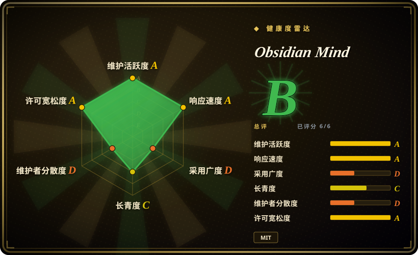
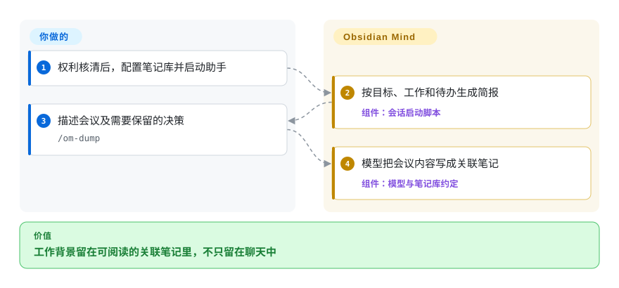
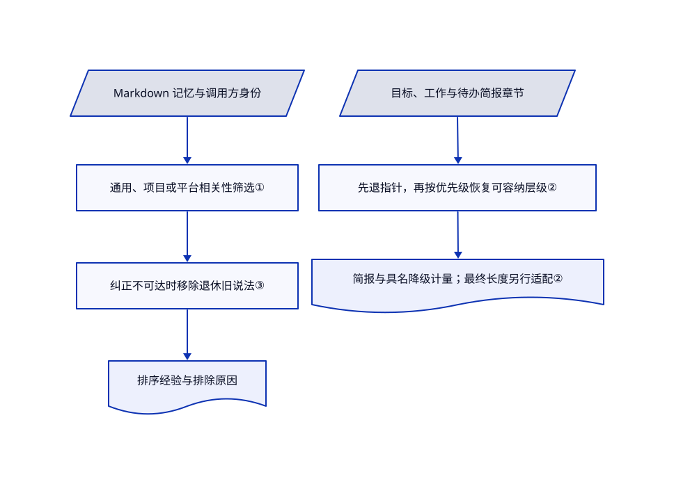

# Obsidian Mind

昨天讨论的项目决策，今天的编程会话又要重讲。Obsidian Mind 把它们留在互相链接的笔记里，再给下次会话一份简报。

> **WARNING｜仅作信息收录，不代表允许安装或复制分发。** [根 MIT 声明](https://github.com/breferrari/obsidian-mind/blob/fae7be467fc5e23bf9d51df7207d41f0c07e2754/LICENSE#L1-L13)署名 Brenno Ferrari。仓库带有 `kepano/obsidian-skills` 内容；既有固定树取证发现十个同 blob 文件，扫描的 325 个文本文件未保留 Steph Ango 的 MIT 声明。该来源要求保留[版权与许可声明](https://github.com/kepano/obsidian-skills/blob/3ccff5338ea700537839b21900aa5358a0402c98/LICENSE#L1-L13)。本次目标提交未变。`NOASSERTION` 表示整包权利范围未核清，不是否认根许可存在。缺口解决前，不建议直接安装、复制或再分发整包。自动健康分只测根文件信号，不代表第三方授权已核。

## 何时使用

你用 Obsidian 记项目决策、同事背景和事故记录，编程助手却仍追问为什么放弃缓存迁移。当你希望人能阅读的笔记库就是唯一记录，而不是再养一个隐藏的观察数据库，可以研究这个项目。它用生命周期脚本准备会话简报，再用 `om` 服务让其他仓库检索笔记、保存明确限定范围的经验。

它的差别是可浏览的工作笔记加可执行维护机制，不只是记忆接口。许可声明缺口仍在，本页只支持了解与评估。若要立即部署，先评估下列替代品及其自身条款。

## 何时不用

- **今天就需要权利链清楚的安装包或可分发模板。** 别把根 MIT 标记当作复制技能的授权证明。可评估 [Engram](engram.zh.md) 的独立记忆库；补齐声明链需要证据，不是索引维护者一句放行。
- **只想要一个二进制，不想维护笔记库约定。** 选 [Engram](engram.zh.md)。它用 SQLite 关键词库，省去 Node 脚本、Obsidian 配置及工作、人物、绩效目录模型。
- **想自动压缩会话，不想让模型编写笔记。** 选 [claude-mem](claude-mem.zh.md)，同时接受压缩模型与本地服务成本。本项目的脚本给提示和检查，记什么仍由模型决定。
- **经验复用前必须由人批准。** 选 [Beacon](agent-beacon.zh.md) 的候选审核流程。本项目的 `remember` 校验字段，不等于有人批准事实入库。
- **需要租户隔离或保密边界。** 用独立权限隔离的存储，或不放敏感笔记。`scope` 只筛相关性，不限制文件读取；Engram 的范围也不能替代权限。会话若已有笔记库直读权限，MCP 暴露规则拦不住它。

## 横向对比

| 替代品 | 是否收录 | 我们的评价 | 取舍 |
|---|---|---|---|
| [Engram](engram.zh.md) | ✅ | 不需要笔记库、只要轻量跨助手存储时选 Engram；需要人编辑同一套关联工作笔记时研究 Obsidian Mind。 | 前者是 Go 二进制与 SQLite 关键词库；后者要维护 Markdown 约定、Node 脚本及可选语义索引，整包授权仍有缺口。 |
| [claude-mem](claude-mem.zh.md) | ✅ | 自动捕获和压缩比控制笔记结构更重要时选 claude-mem。 | 前者增加压缩调用和本地服务栈；Obsidian Mind 把写笔记判断交给当前会话，也依赖模型真的去写。 |
| [Beacon](agent-beacon.zh.md) | ✅ | 要跨助手轨迹及入库前人工批准时选 Beacon；想让工作记录留在笔记库时研究 Obsidian Mind。 | Beacon 保留会话遥测并有显式学习审核；笔记库方便人编辑，却没有同样的批准门槛。 |

## 快速上手

以下只解释上游流程，**不建议在补齐声明前执行**。上游提供 ShardMind 安装或直接克隆，再要求把目录打开为 Obsidian 笔记库、启用命令行功能、填写 `brain/North Star.md`，并在库里启动支持的助手。你提供目标与会议内容；脚本准备简报，`/om-dump` 让模型把内容写成关联笔记。结束时 `/om-wrap-up` 在工具仍可用时审核并维护笔记。模型费用、备份、脚本信任和升级由你承担；本次没有安装、执行脚本或读取私人笔记。见[配置与使用样例](https://github.com/breferrari/obsidian-mind/blob/fae7be467fc5e23bf9d51df7207d41f0c07e2754/README.md#L51-L184)及[收尾流程](https://github.com/breferrari/obsidian-mind/blob/fae7be467fc5e23bf9d51df7207d41f0c07e2754/.claude/commands/om-wrap-up.md#L19-L58)。

<!-- flow-steps:begin (generated from flows/obsidian-mind.json by tools/flow_card.py — do not edit) -->

流程文字版

1. **你**：权利核清后，配置笔记库并启动助手
2. **Obsidian Mind**：按目标、工作和待办生成简报 — 组件：`会话启动脚本`
3. **你**：描述会议及需要保留的决策 — `/om-dump`
4. **Obsidian Mind**：模型把会议内容写成关联笔记 — 组件：`模型与笔记库约定`

**价值**：工作背景留在可阅读的关联笔记里，不只留在聊天中

<!-- flow-steps:end -->

## 技术要点

<!-- mechanism:begin (generated from mechanisms/obsidian-mind.json by tools/mechanism_card.py; do not edit) -->

机制文字版

- Markdown 记忆与调用方身份
- 通用、项目或平台相关性筛选①
- 纠正不可达时移除退休旧说法③
- 排序经验与排除原因
- 目标、工作与待办简报章节
- 先退指针，再按优先级恢复可容纳层级②
- 简报与具名降级计量；最终长度另行适配②

- Markdown 记忆与调用方身份 → 通用、项目或平台相关性筛选①
- 通用、项目或平台相关性筛选① → 纠正不可达时移除退休旧说法③
- 纠正不可达时移除退休旧说法③ → 排序经验与排除原因
- 目标、工作与待办简报章节 → 先退指针，再按优先级恢复可容纳层级②
- 先退指针，再按优先级恢复可容纳层级② → 简报与具名降级计量；最终长度另行适配②

<!-- mechanism:end -->

### 1. 先声明记忆范围，再做召回

- **解决：** 一个仓库的经验，可能变成另一个仓库的错误约束。
- **做法：** 召回接受通用经验、显式项目匹配，或共享平台的平台级经验。解释路径区分范围不匹配和替代关系导致的排除。
- **边界：** 无身份调用方只看通用经验。目录同名会碰撞，可用 `.om-project` 区分。这是相关性筛选，不是身份认证或访问控制。
- **源码：** [可见性与原因第 216–269 行](https://github.com/breferrari/obsidian-mind/blob/fae7be467fc5e23bf9d51df7207d41f0c07e2754/.claude/scripts/lib/memory-recall.ts#L216-L269)、[相关性边界](https://github.com/breferrari/obsidian-mind/blob/fae7be467fc5e23bf9d51df7207d41f0c07e2754/ARCHITECTURE.md#L87-L93)、[身份碰撞](https://github.com/breferrari/obsidian-mind/blob/fae7be467fc5e23bf9d51df7207d41f0c07e2754/README.md#L396-L405)。

### 2. 按有名称的降级层分配简报空间

- **解决：** 文件清单越长，越容易挤掉当前目标。
- **做法：** 完整简报放不下时，可降级章节先退到指针。分配器按优先级逐个恢复最丰富的可容纳层级，再用计量行列出折叠、降级和源内容截取。
- **边界：** 非正数或非有限预算会返回全文，没有回退项的章节也可能超预算。入口另外钳制脚本输出并适配最终长度，指令文件路径另有预算。不能只凭这个助手函数称其无条件硬上限。
- **源码：** [分配器第 130–209 行](https://github.com/breferrari/obsidian-mind/blob/fae7be467fc5e23bf9d51df7207d41f0c07e2754/.claude/scripts/lib/session-start.ts#L130-L209)、[计量行第 28–64 行](https://github.com/breferrari/obsidian-mind/blob/fae7be467fc5e23bf9d51df7207d41f0c07e2754/.claude/scripts/lib/session-start.ts#L28-L64)、[预算路径第 269–333 行](https://github.com/breferrari/obsidian-mind/blob/fae7be467fc5e23bf9d51df7207d41f0c07e2754/.claude/scripts/lib/session-start.ts#L269-L333)、[入口最终长度适配第 680–717 行](https://github.com/breferrari/obsidian-mind/blob/fae7be467fc5e23bf9d51df7207d41f0c07e2754/.claude/scripts/session-start.ts#L680-L717)。

### 3. 纠正缩小范围时，不单独返回旧结论

- **解决：** 通用经验被项目级纠正替代后，其他项目可能只能看到已退休的旧说法。
- **做法：** 召回先取范围可见集合，一次解析替代声明，再反复移除全部替代项均不在返回集合的旧项。排序随后优先未替代、范围更具体及更新的记录。
- **边界：** 替代标题无法解析时保留旧项，循环替代保留环内成员。这是明确的保留策略，不证明所有矛盾已解决。
- **源码：** [替代关系收敛第 275–387 行](https://github.com/breferrari/obsidian-mind/blob/fae7be467fc5e23bf9d51df7207d41f0c07e2754/.claude/scripts/lib/memory-recall.ts#L275-L387)、[排序第 393–429 行](https://github.com/breferrari/obsidian-mind/blob/fae7be467fc5e23bf9d51df7207d41f0c07e2754/.claude/scripts/lib/memory-recall.ts#L393-L429)。

## 技术栈

- TypeScript 脚本由 Node 直接擦除类型后运行；[脚本包](https://github.com/breferrari/obsidian-mind/blob/fae7be467fc5e23bf9d51df7207d41f0c07e2754/.claude/scripts/package.json#L1-L9)未声明运行时包依赖。
- 工作记录使用 Markdown、YAML 元数据、双向链接和 Obsidian 数据视图。生命周期脚本和 MCP 服务连接编程助手；可选 QMD 增加具名 SQLite 搜索索引及本地模型。

## 依赖

- 上游列出 Node 22+、Git、启用命令行功能的 Obsidian 1.12+，以及 Claude Code、Codex CLI 或 Gemini CLI。各宿主的脚本批准和功能深度不同。
- 可选 QMD 增加模型下载、本地计算和索引维护。README 与架构文档对默认嵌入模型说法不同，不能据此报一个已核实的总下载量。
- 编程助手仍需自己的模型访问和费用预算。可选 `reason` 会沿用用户 CLI 认证启动另一场 Claude 会话；本地检索不等于全流程离线。

## 运维难度

**单机中等。** 纯文件容易查看和备份，但脚本、非沙箱 Claude Code 插件、各助手信任设置、可选 QMD 和模板升级都有维护成本。信任目录前先审可执行配置，固定版本，并区分私人内容与基础设施。抽样议题仍有未关闭的元数据校验和调用方平台识别报告，有测试不代表这些边界已修好。

## 健康度与可持续性

- **截至 2026-10-24 的判断：权利范围澄清前，只作信息与机制参考。** 根 MIT 署 Brenno Ferrari；既有固定树取证发现复制的 Obsidian 技能缺上游声明。维护者同意收录，不是安装、复制或再分发授权。雷达许可轴读取根信号，不消除第三方缺口。
- **维护：** 未归档；抽样最新发布为 2026-10-12 的 v10.0.0，默认分支推送于 2026-10-17。目标提交与此前来源审查一致。发布与脚本变动要求使用者固定版本。
- **治理：** 个人所有，贡献样本中作者有 237 次，发布机器人 30 次，下一位贡献者七次。实质 PR 要先获维护者分派议题，路线集中，不是基金会治理。
- **年龄与采用：** 创建于 2026-02-28，未满八个月。5,418 星与 612 个分叉只代表关注，不是部署证据。仍活跃但缺长期存续样本，本次授权只读审查未运行生产可靠性验证。

## 存疑（未验证）

- [未验证：复用既有固定树证据，未重新扫描整包] 十个同 blob 和缺 Steph Ango 声明的结论来自 2026-10-21 对同一目标提交的来源取证。本次重读双方 MIT 正文，未建立额外许可或声明已补齐的证据，也不作侵权法律判断。
- [未验证：授权排除安装和上游执行] 各助手支持深度、实际上下文送达和召回效果未复现。读源码与上游测试文件，不等于已测得效果提升。
- [未验证：上游文档冲突] README 写 `embeddinggemma-300M`，架构文档描述把默认模型换成 `Qwen3-Embedding-0.6B`。本次未测部署模型、总下载量和延迟。
- [推断：依据所读分配器] 降级清单能揭示上下文遗漏，但不证明模型决策更好。借鉴前应先与接收方现有范围和预算规则对照。
