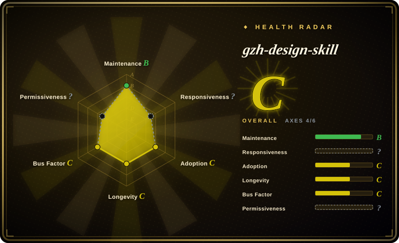
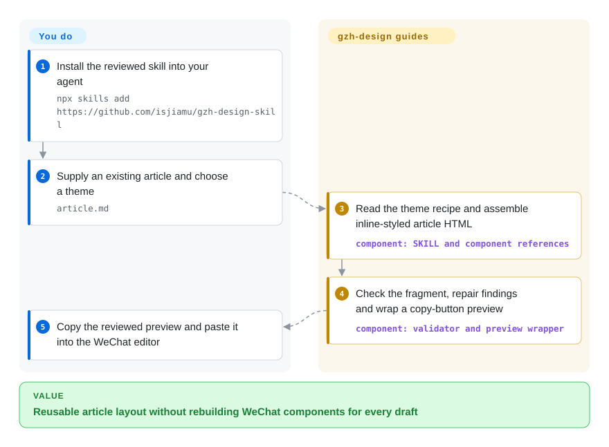
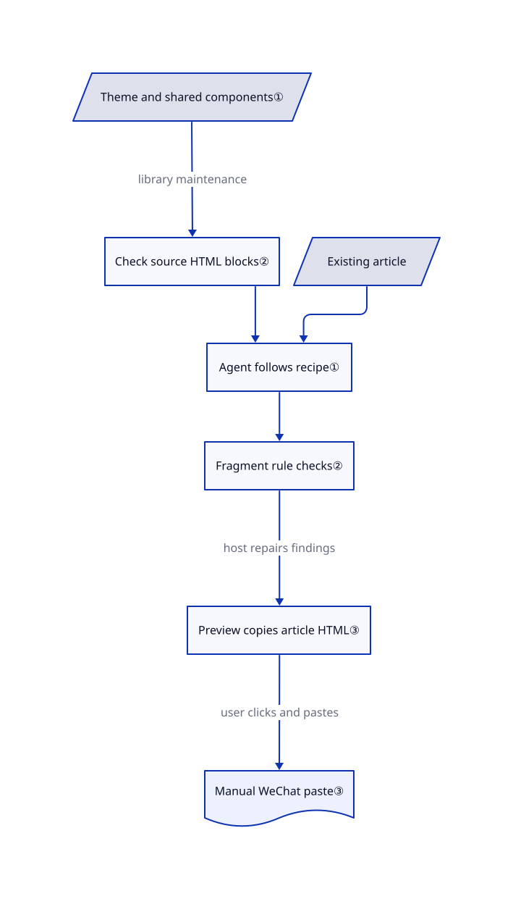

# gzh-design-skill

Your finished article needs numbered sections and readable code, but pasting browser HTML into WeChat can change its formatting. This skill guides your agent through theme-specific HTML assembly, rule checks and a rich-text copy preview.

## When to use

You write a Chinese tutorial in Markdown through a coding agent. After pasting it into a WeChat Official Account editor, code spacing changes and the section cards no longer match. You want six reusable visual themes, article-type recipes and explicit checks rather than another unrestricted “make it beautiful” prompt. Pick this when your agent should assemble an existing article from local component references and you will handle the final paste yourself; pick a publishing CLI instead when account uploads and draft creation are the actual bottleneck.

The repository supplies instructions, HTML components and Python helpers, not a model or a deterministic Markdown renderer. Your host agent reads the selected theme and shared components, generates the article fragment, and runs the checks. Custom-theme generation can persist an approved component library for later articles.

## When NOT to use

- **You need automatic image upload or WeChat draft creation.** Choose [md2wechat](../../../social-media-management/md2wechat-skill.md) if its paid formatting API and commercial-use terms fit. This reviewed tree stops at local files and manual copying; closed [PR #9](https://github.com/isjiamu/gzh-design-skill/pull/9) was not merged and its upload scripts are absent.
- **You want immediate, repeatable rendering without a generative agent.** Choose the [doocs/md](https://github.com/doocs/md) editor for direct Markdown editing, theme/CSS controls and copy/export. Here component selection, keyword emphasis and content preservation remain model-mediated; the checks do not compare the article against its source.
- **Your acceptance criterion is a correct mobile/dark-mode WeChat result, not a clean local check.** Use WeChat's own editor and phone preview as the final authority. [Issue #8](https://github.com/isjiamu/gzh-design-skill/issues/8) reports desktop/mobile differences; the reviewed validator does not check fixed-width layout, font-family or `text-align:start/end`. [PR #25](https://github.com/isjiamu/gzh-design-skill/pull/25) proposes broader checks but was open and unmerged on 2026-10-22.
- **You need translation, writing and image workflows more than this specific layout language.** Choose [Baoyu Skills](baoyu-skills.md) for the broader content toolkit. gzh-design assumes an existing article and deliberately adds numbering, emphasis and a signature section; it is not a writing pipeline.
- **You need permissively licensed reusable assets for a proprietary derivative.** Evaluate the MIT-licensed Baoyu Skills instead. The actual [LICENSE](https://github.com/isjiamu/gzh-design-skill/blob/750a50dffdc4abb5e853b98136dad13a57e64ce3/LICENSE#L1-L7) grants AGPL-3.0-or-later, with copyleft obligations; follow its text rather than the README's overbroad “no paid distribution” summary.

## Comparison

| Alternative | In index | Our verdict | Tradeoff |
|---|---|---|---|
| [md2wechat](../../../social-media-management/md2wechat-skill.md) | ✅ | Choose md2wechat when approved account uploads and draft creation matter; choose gzh-design for agent-guided local layout followed by manual pasting. | md2wechat adds a Go CLI and target-specific inspection but its main renderer is a paid service under commercial-use restrictions; gzh-design needs no bundled publishing credential or formatting-service key. |
| [Baoyu Skills](baoyu-skills.md) | ✅ | Choose Baoyu when translation, image production and reusable publishing utilities must accompany formatting; choose gzh-design when six opinionated WeChat component libraries are the desired constraint. | A broader MIT toolkit versus one AGPL skill with theme recipes and two static checking surfaces; neither makes model-generated content automatically faithful. |
| [doocs/md](https://github.com/doocs/md) | not indexed | Choose doocs/md when a human wants to edit Markdown and adjust CSS directly; choose gzh-design when an existing coding agent should select article-specific component combinations. | An interactive editor with themes, custom CSS and self-hosting versus model-mediated layout and explicit Python checks. Real repository; not added in this tab batch. |

## Quick start

The documented install is `npx skills add https://github.com/isjiamu/gzh-design-skill`; inspect the selected version before registering its instructions with your agent. Give the agent your existing `article.md` and a theme, or confirm its recommendation. The host must be able to read/write files and run Python 3; the helpers use Python's standard library and the repository has no dependency manifest. The agent assembles a clean `<section>` fragment, runs `validate_gzh_html.py`, repairs errors and punctuation warnings, then uses `wrap_preview.py` to produce a copy-button preview. You provide model access and its costs, review content and assets, open the preview, and paste into WeChat for phone/dark-mode review; the repository supplies neither an inference engine nor a publishing service. This intake checked sources only: no installation, upstream execution or account operation was performed.

<!-- flow-steps:begin (generated from flows/gzh-design-skill.json by tools/flow_card.py — do not edit) -->

Text version of the flow

1. **You**: Install the reviewed skill into your agent — `npx skills add https://github.com/isjiamu/gzh-design-skill`
2. **You**: Supply an existing article and choose a theme — `article.md`
3. **gzh-design-skill**: Read the theme recipe and assemble inline-styled article HTML — component: `SKILL and component references`
4. **gzh-design-skill**: Check the fragment, repair findings and wrap a copy-button preview — component: `validator and preview wrapper`
5. **You**: Copy the reviewed preview and paste it into the WeChat editor

**Value**: Reusable article layout without rebuilding WeChat components for every draft

<!-- flow-steps:end -->

## Key techniques

<!-- mechanism:begin (generated from mechanisms/gzh-design-skill.json by tools/mechanism_card.py; do not edit) -->

Text version of the mechanism

- Theme and shared components①
- Check source HTML blocks②
- Existing article
- Agent follows recipe①
- Fragment rule checks②
- Preview copies article HTML③
- Manual WeChat paste③

- Theme and shared components① → Check source HTML blocks② (library maintenance)
- Check source HTML blocks② → Agent follows recipe①
- Existing article → Agent follows recipe①
- Agent follows recipe① → Fragment rule checks②
- Fragment rule checks② → Preview copies article HTML③ (host repairs findings)
- Preview copies article HTML③ → Manual WeChat paste③ (user clicks and pastes)

<!-- mechanism:end -->

### 1. Select a recipe before assembling components

- **Problem:** Generating each paragraph independently produces inconsistent styling and hierarchy.
- **How:** The theme index names the component file and authoritative underline style. SKILL instructs the agent to read that theme plus shared code/image components, classify the article, and use the theme's recipe, skeleton and Markdown mappings; an approved custom library can join the same registry.
- **Limits:** These are prompt instructions, not an executable renderer. Theme selection and content preservation depend on the host; normalization docs even disagree with the main workflow about the automatic fallback theme, so specify one explicitly.
- **Source:** [Theme registry:7–26](https://github.com/isjiamu/gzh-design-skill/blob/750a50dffdc4abb5e853b98136dad13a57e64ce3/references/theme-index.md#L7-L26), [assembly instructions:39–72](https://github.com/isjiamu/gzh-design-skill/blob/750a50dffdc4abb5e853b98136dad13a57e64ce3/SKILL.md#L39-L72), [recipes and mappings:886–936](https://github.com/isjiamu/gzh-design-skill/blob/750a50dffdc4abb5e853b98136dad13a57e64ce3/references/theme-moyu-green.md#L886-L936), [custom-library conversion:42–56](https://github.com/isjiamu/gzh-design-skill/blob/750a50dffdc4abb5e853b98136dad13a57e64ce3/references/theme-generator.md#L42-L56), [conflicting fallback:61–69](https://github.com/isjiamu/gzh-design-skill/blob/750a50dffdc4abb5e853b98136dad13a57e64ce3/references/format-normalize.md#L61-L69).

### 2. Check component sources and generated fragments separately

- **Problem:** A defective template can spread through articles, while a model can introduce new defects during assembly.
- **How:** `component_lint.py` scans fenced HTML in reference files for known anti-patterns. `validate_gzh_html.py` scans the final fragment for forbidden markup/CSS, then uses HTMLParser to inspect Chinese text wrapping, punctuation and inline gradients.
- **Limits:** With at least one leaf span present, other unwrapped Chinese text produces a warning, not an error; English-only text is skipped by that check. Parse interruptions and gradients also become warnings, and the CLI exits nonzero only for errors. Neither check establishes full platform compliance, visual quality or source-text fidelity; the host must enforce the stricter workflow's repair rules.
- **Source:** [Component scan:22–63](https://github.com/isjiamu/gzh-design-skill/blob/750a50dffdc4abb5e853b98136dad13a57e64ce3/scripts/component_lint.py#L22-L63), [text-node selection:96–109](https://github.com/isjiamu/gzh-design-skill/blob/750a50dffdc4abb5e853b98136dad13a57e64ce3/scripts/validate_gzh_html.py#L96-L109), [severity and exit semantics:112–186](https://github.com/isjiamu/gzh-design-skill/blob/750a50dffdc4abb5e853b98136dad13a57e64ce3/scripts/validate_gzh_html.py#L112-L186), [workflow requirements:75–98](https://github.com/isjiamu/gzh-design-skill/blob/750a50dffdc4abb5e853b98136dad13a57e64ce3/SKILL.md#L75-L98).

### 3. Put only the article HTML on the clipboard

- **Problem:** Copying a browser selection can introduce serialized styles not present in the source fragment.
- **How:** The wrapper injects the fragment into a preview template. Its copy event explicitly writes the article container's HTML and plain text to the clipboard, using a hidden textarea and `execCommand('copy')`; toolbar styles and scripts remain outside the copied container.
- **Limits:** The user must click and paste; no account API is called. Browser copy permissions can fail, and the wrapper interpolates HTML without sanitization, so preview only trusted, reviewed fragments. Successful copying does not prove WeChat retained the formatting.
- **Source:** [Preview construction:29–38](https://github.com/isjiamu/gzh-design-skill/blob/750a50dffdc4abb5e853b98136dad13a57e64ce3/scripts/wrap_preview.py#L29-L38), [copy payload and failure handling:39–78](https://github.com/isjiamu/gzh-design-skill/blob/750a50dffdc4abb5e853b98136dad13a57e64ce3/assets/preview-template.html#L39-L78), [merged copy fix](https://github.com/isjiamu/gzh-design-skill/pull/19).

## Health & viability

- **Maintenance, 2026-10-22:** Created 2026-07-01; not archived. The latest product release is v1.0.0 on 2026-07-06; `assets-v1` is image hosting, not a second software release. Main last changed on 2026-10-21, with copy and gradient fixes merged during October. Pin the reviewed commit rather than assuming the July tag contains those fixes.
- **Governance/backing:** User-owned, with joint authorship credited to Jiamu and Moyu Xiaoli in README and LICENSE. The contributor endpoint lists two accounts, with 9 versus 1 attributed commits; CONTRIBUTING requires source and output checks. This is not evidence of foundation governance or contractual support.
- **Age/adoption:** 4070 stars and 465 forks at verification, but only about four months of repository history. [推断：based on creation date, concentrated authorship and recent merges] It offers reusable present-day layout assets, not a demonstrated long-term maintenance guarantee; popularity does not establish consistent output across models.
- **Compatibility evidence:** [Issue #21](https://github.com/isjiamu/gzh-design-skill/issues/21) documents a gradient warning after a previously clean local check. [Merged PR #22](https://github.com/isjiamu/gzh-design-skill/pull/22) adds gradient warnings and default solid backgrounds, but explicitly leaves real mobile/dark-mode verification open. PR #25's additional platform rules are not in this snapshot.
- **License/provenance:** The full license names the same joint authors as README and grants AGPL-3.0-or-later. The generator retains references to an absent `wpwexin` theme system; its adaptation note says to use this repository's components instead. Searches found distributed copies, not an identified earlier canonical source; this is not proof of either originality or a licensing defect.
- **Machine-score limits:** The generated aggregate is C with 4/6 scored axes. `type_na` leaves responsiveness unknown, while `license_unparsed` leaves the license axis unknown despite the readable AGPL grant; neither grade was changed manually. Adoption counts 247109 release-asset downloads across seven images, not verified skill installations or active users.

## Caveats (unverified)

- [未验证：authorization limited this intake to static reading, without installation, upstream execution or account access] Activation across agent hosts, model-to-model consistency, complete content preservation and real WeChat mobile/dark-mode fidelity were not exercised. Static rule checks are not acceptance evidence for those claims.
- [推断：based on creation date, concentrated authorship and recent merges] Current activity and popularity do not establish durable maintenance or support.
- [未验证：GitHub repository/code searches and web search did not identify the original wpwexin reference] The generator prompt's earlier provenance cannot be established from the reviewed tree; no concrete conflicting copyright holder or mostly copied source was established.
