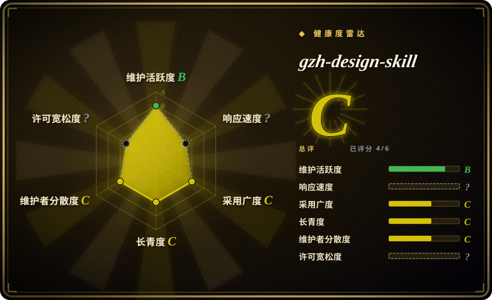
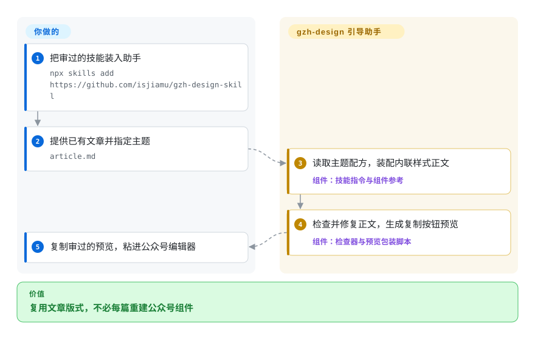
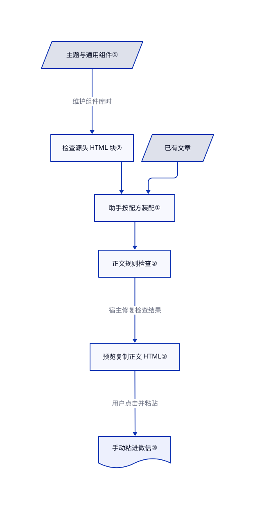

# gzh-design-skill

文章写好了，粘进公众号后代码间距和章节卡片却变了样。这个技能让助手按主题组件装配 HTML，运行规则检查，再交付带富文本复制按钮的预览页。

## 何时使用

你通过编码助手写中文教程，原稿是 Markdown。粘进微信公众号编辑器后，代码多出空白，章节卡片也不再统一。你希望复用六套主题、文章类型配方和明确检查，而不是反复要求模型“做得好看”。如果你要让现有助手按本地组件库排版，最后自己复制粘贴，就考虑它；如果真正费事的是上传图片和创建草稿，应选发布命令行工具。

仓库提供指令、HTML 组件和 Python 辅助脚本，不提供模型或确定性的 Markdown 渲染器。宿主助手读取所选主题与通用组件，生成正文片段并运行检查。自定义主题流程还可把确认过的组件库保存下来，供以后文章复用。

## 何时不用

- **你需要自动上传图片或创建公众号草稿。** 如果能接受付费排版 API 和商用条款，可选 [md2wechat](../../../social-media-management/md2wechat-skill.zh.md)。本次源码止于本地文件和手动复制；已关闭的 [PR #9](https://github.com/isjiamu/gzh-design-skill/pull/9) 未合并，树中没有其上传脚本。
- **你要不经过生成式助手的即时、可重复渲染。** 选 [doocs/md](https://github.com/doocs/md)，直接编辑 Markdown、调整主题和 CSS，再复制或导出。本项目的组件选择、关键词强调和内容保真仍经过模型，检查器不对照原稿查遗漏。
- **你的验收目标是手机和暗色模式下正确显示，而非本地检查全绿。** 用微信自带编辑器和手机预览作最终依据。[Issue #8](https://github.com/isjiamu/gzh-design-skill/issues/8) 报告桌面与手机差异；本次检查器不查固定宽度布局、字体族和 `text-align:start/end`。补充这些规则的 [PR #25](https://github.com/isjiamu/gzh-design-skill/pull/25) 在 2026-10-22 仍未合并。
- **你更需要翻译、写作和配图流程。** 选覆盖更宽内容链的 [Baoyu Skills](baoyu-skills.zh.md)。gzh-design 假定文章已经存在，会主动添加编号、强调和署名区，不是写作流水线。
- **你需要宽松许可的资产来构建专有衍生品。** 先评估 MIT 许可的 Baoyu Skills。实际 [LICENSE](https://github.com/isjiamu/gzh-design-skill/blob/750a50dffdc4abb5e853b98136dad13a57e64ce3/LICENSE#L1-L7) 授予 AGPL-3.0-or-later，带有 copyleft 义务；以许可正文为准，不应照搬 README 中过宽的“禁止仅付费分发”概括。

## 横向对比

| 替代品 | 是否收录 | 我们的评价 | 取舍 |
|---|---|---|---|
| [md2wechat](../../../social-media-management/md2wechat-skill.zh.md) | ✅ | 重点是经授权上传账号素材和创建草稿时选 md2wechat；只要助手本地排版再手动粘贴时选 gzh-design。 | 前者增加 Go CLI 和按目标检查，但主要渲染器是付费服务，许可限制商用；后者无需配套的发布凭据或排版服务密钥。 |
| [Baoyu Skills](baoyu-skills.zh.md) | ✅ | 翻译、配图和发布工具需要一起用时选 Baoyu；六套公众号组件库正是所需约束时选 gzh-design。 | 较宽的 MIT 工具箱，对比一个 AGPL 技能及其主题配方、两处静态检查；两者都不能自动证明模型忠实保留原文。 |
| [doocs/md](https://github.com/doocs/md) | 未收录 | 人要直接编辑 Markdown 和调整 CSS 时选 doocs/md；现有助手需要按文章选择组件组合时选 gzh-design。 | 交互式编辑器提供主题、自定义 CSS 和自托管；本项目依赖模型排版，并提供显式 Python 检查。真实仓库；not added in this tab batch。 |

## 快速上手

文档安装方式是 `npx skills add https://github.com/isjiamu/gzh-design-skill`；先审查所选版本，再把指令注册到助手。给助手已有的 `article.md` 和主题，或确认它的推荐。宿主需要读写文件并运行 Python 3；辅助脚本只用标准库，树中没有依赖清单。助手装配纯 `<section>` 正文，运行 `validate_gzh_html.py`，修复错误与标点警告，再用 `wrap_preview.py` 生成复制按钮预览页。你负责模型访问和费用、审阅正文与素材、打开预览并粘进微信，最后检查手机及暗色模式；仓库不提供推理引擎或发布服务。本次仅核对源码，没有安装、执行上游或操作账号。

<!-- flow-steps:begin (generated from flows/gzh-design-skill.json by tools/flow_card.py — do not edit) -->

流程文字版

1. **你**：把审过的技能装入助手 — `npx skills add https://github.com/isjiamu/gzh-design-skill`
2. **你**：提供已有文章并指定主题 — `article.md`
3. **gzh-design-skill**：读取主题配方，装配内联样式正文 — 组件：`技能指令与组件参考`
4. **gzh-design-skill**：检查并修复正文，生成复制按钮预览 — 组件：`检查器与预览包装脚本`
5. **你**：复制审过的预览，粘进公众号编辑器

**价值**：复用文章版式，不必每篇重建公众号组件

<!-- flow-steps:end -->

## 技术要点

<!-- mechanism:begin (generated from mechanisms/gzh-design-skill.json by tools/mechanism_card.py; do not edit) -->

机制文字版

- 主题与通用组件①
- 检查源头 HTML 块②
- 已有文章
- 助手按配方装配①
- 正文规则检查②
- 预览复制正文 HTML③
- 手动粘进微信③

- 主题与通用组件① → 检查源头 HTML 块②（维护组件库时）
- 检查源头 HTML 块② → 助手按配方装配①
- 已有文章 → 助手按配方装配①
- 助手按配方装配① → 正文规则检查②
- 正文规则检查② → 预览复制正文 HTML③（宿主修复检查结果）
- 预览复制正文 HTML③ → 手动粘进微信③（用户点击并粘贴）

<!-- mechanism:end -->

### 1. 先选配方，再装配组件

- **解决：** 每段临时生成样式，会让整篇层级与视觉不统一。
- **做法：** 主题索引指定组件文件和正文下划线样式。主指令要求读取所选主题及通用代码／图片组件，判断文章类型，再用主题配方、骨架和 Markdown 映射装配；确认后的自定义库可加入同一索引。
- **边界：** 这是提示词流程，不是可执行渲染器。主题选择和内容保真仍由宿主决定；格式归一化文档甚至与主流程的自动兜底主题不一致，使用时宜明确指定主题。
- **源码：** [主题索引第 7–26 行](https://github.com/isjiamu/gzh-design-skill/blob/750a50dffdc4abb5e853b98136dad13a57e64ce3/references/theme-index.md#L7-L26)、[装配指令第 39–72 行](https://github.com/isjiamu/gzh-design-skill/blob/750a50dffdc4abb5e853b98136dad13a57e64ce3/SKILL.md#L39-L72)、[配方与映射第 886–936 行](https://github.com/isjiamu/gzh-design-skill/blob/750a50dffdc4abb5e853b98136dad13a57e64ce3/references/theme-moyu-green.md#L886-L936)、[自定义库转换第 42–56 行](https://github.com/isjiamu/gzh-design-skill/blob/750a50dffdc4abb5e853b98136dad13a57e64ce3/references/theme-generator.md#L42-L56)、[冲突的兜底第 61–69 行](https://github.com/isjiamu/gzh-design-skill/blob/750a50dffdc4abb5e853b98136dad13a57e64ce3/references/format-normalize.md#L61-L69)。

### 2. 分开检查组件源头和最终正文

- **解决：** 模板缺陷会传播到多篇文章，模型装配时又可能引入新缺陷。
- **做法：** `component_lint.py` 扫参考文件里的 HTML 代码块，查已知反模式。`validate_gzh_html.py` 先扫最终正文的禁用标签与 CSS，再用 HTMLParser 检查中文文字包裹、标点和内联渐变。
- **边界：** 已有一个 leaf 包裹时，其余未包裹中文只报警告；纯英文文本不参与该检查。解析中断和渐变也只报警告，CLI 仅遇错误才非零退出。两关都不证明平台完整兼容、视觉质量或原文保真；宿主必须落实工作流更严格的修复要求。
- **源码：** [组件扫描第 22–63 行](https://github.com/isjiamu/gzh-design-skill/blob/750a50dffdc4abb5e853b98136dad13a57e64ce3/scripts/component_lint.py#L22-L63)、[文字筛选第 96–109 行](https://github.com/isjiamu/gzh-design-skill/blob/750a50dffdc4abb5e853b98136dad13a57e64ce3/scripts/validate_gzh_html.py#L96-L109)、[级别与退出语义第 112–186 行](https://github.com/isjiamu/gzh-design-skill/blob/750a50dffdc4abb5e853b98136dad13a57e64ce3/scripts/validate_gzh_html.py#L112-L186)、[工作流要求第 75–98 行](https://github.com/isjiamu/gzh-design-skill/blob/750a50dffdc4abb5e853b98136dad13a57e64ce3/SKILL.md#L75-L98)。

### 3. 剪贴板只接收正文 HTML

- **解决：** 浏览器复制选区时，可能补入原正文中没有的序列化样式。
- **做法：** 包装脚本把正文插入预览模板。复制事件明确写入正文容器的 HTML 和纯文本，用隐藏文本框与 `execCommand('copy')` 触发复制；工具栏样式和脚本留在被复制容器外。
- **边界：** 用户仍要点击和粘贴，不调用账号 API。浏览器可能拒绝复制；包装脚本直接插入 HTML，不做净化，只应预览可信且审过的正文。复制成功不等于微信保留了样式。
- **源码：** [构建预览第 29–38 行](https://github.com/isjiamu/gzh-design-skill/blob/750a50dffdc4abb5e853b98136dad13a57e64ce3/scripts/wrap_preview.py#L29-L38)、[复制载荷与失败处理第 39–78 行](https://github.com/isjiamu/gzh-design-skill/blob/750a50dffdc4abb5e853b98136dad13a57e64ce3/assets/preview-template.html#L39-L78)、[已合并的复制修复](https://github.com/isjiamu/gzh-design-skill/pull/19)。

## 健康度与可持续性

- **维护，截至 2026-10-22：** 仓库创建于 2026-07-01，未归档。最新产品版是 2026-07-06 的 v1.0.0；`assets-v1` 托管图片，不是第二个软件版本。主干最后更新于 2026-10-21，十月已合并复制和渐变修复。应固定审过的提交，不能假定七月标签含这些修复。
- **治理与背书：** 个人账号持有，README 与许可共同署名甲木、摸鱼小李。贡献者接口列出两个账号，归属提交数为 9 与 1；贡献指南要求源头和产物检查。这不代表基金会治理或有合同支持。
- **年龄与采用：** 核验时为 4070 星、465 个 fork，但公开仓库历史只有约四个月。[推断：依据创建日、集中署名和近期合并记录] 它已有可复用排版资产，尚无长期维护保证；热度不证明不同模型输出一致。
- **兼容性证据：** [Issue #21](https://github.com/isjiamu/gzh-design-skill/issues/21) 记录了本地检查全绿后，微信仍提示渐变问题。[已合并 PR #22](https://github.com/isjiamu/gzh-design-skill/pull/22) 增加渐变警告和默认纯色背景，但明确保留真实手机及暗色模式验证缺口。PR #25 提出的更多平台规则尚未进入本次快照。
- **许可与来源：** 完整许可与 README 署名一致，授予 AGPL-3.0-or-later。主题生成器保留了不存在于树中的 `wpwexin` 主题系统引用，适配说明要求改用本仓组件。搜索找到分发副本，未定位更早的权威来源；这既不证明原创，也不构成许可缺陷的证据。
- **机器评分边界：** 自动总评为 C，已评分 4/6 轴。响应度因 `type_na` 保持未知；许可轴因 `license_unparsed` 保持未知，尽管人工可读到 AGPL 授权。没有手改档位。采用度计算的是七张发布图片共 247109 次下载，不是已验证的技能安装量或活跃用户数。

## 存疑（未验证）

- [未验证：本次仅获静态阅读授权，未安装、执行上游或访问账号] 未实测各宿主激活、模型间效果一致性、完整内容保真，以及真实微信手机与暗色模式显示。静态规则检查不能作为这些目标的验收证据。
- [推断：依据创建日、集中署名和近期合并记录] 当前活跃与热度不等于长期维护或支持保证。
- [未验证：GitHub 仓库／代码搜索和网页搜索未定位最初的 wpwexin 引用来源] 无法从本次树中确定生成提示词更早的出处；未发现具体冲突权利人或主要内容复制自另一来源的证据。
