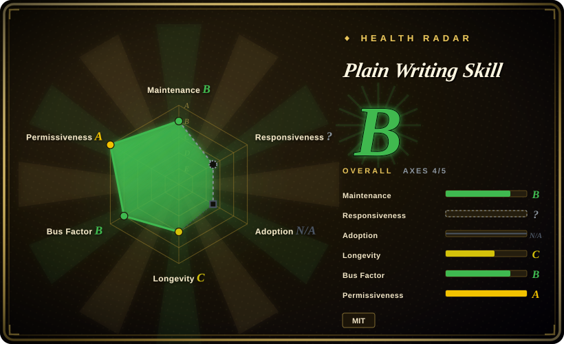
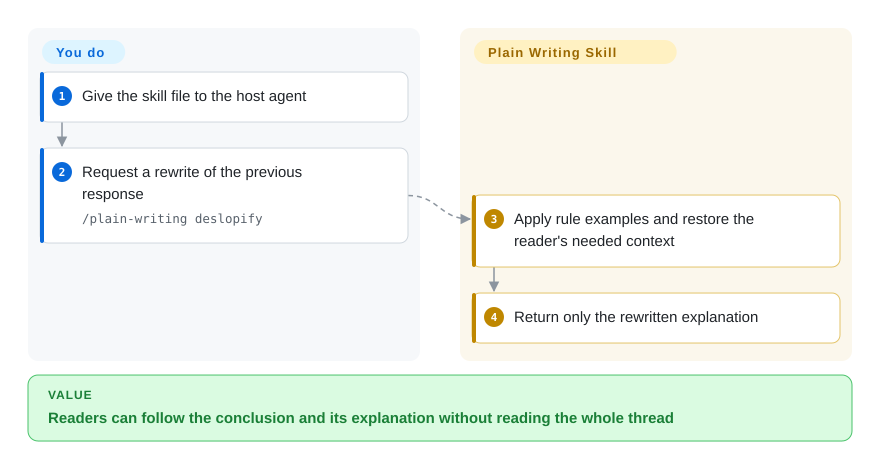
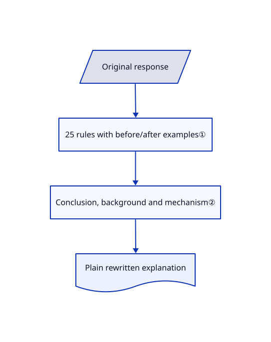

# Plain Writing Skill

An agent's wrap-up names internal mechanisms but never explains what changed for its reader. This skill supplies before/after rules and a command that rewrites the reply for someone without project context.

## When to use

You are handing an engineering update to someone who has not read the thread, and phrases such as “calibrated proxy” hide the actual result. Choose this skill when you want a consistently literal English explanation, including ordinary vocabulary, defined technical terms and conclusion-first rewrites. Unlike a detector of AI authorship, it instructs the writer; unlike a voice-preserving editor, it deliberately imposes a plain, restrained house style.

## When NOT to use

- **The author's distinctive voice must survive.** Choose [no-ai-slop](no-ai-slop.md), whose editing contract prioritizes voice preservation; this skill bans analogies and many rhetorical forms.
- **The output is Chinese prose.** Choose [Humanizer-zh](humanizer-zh.md) for localized examples rather than importing English punctuation and vocabulary rules unchanged.
- **You need a machine gate with a finding count.** Choose [avoid-ai-writing](avoid-ai-writing.md); plain-writing is Markdown guidance, not a deterministic prose checker.

## Comparison

| Alternative | In index | Our verdict | Tradeoff |
|---|---|---|---|
| [humanizer](humanizer.md) | ✅ | Choose humanizer for broader English AI-pattern cleanup; choose plain-writing for a deliberately literal house style and reader-context repair. | Pattern-oriented editing versus tighter restrictions on vocabulary, imagery and punctuation. |
| [no-ai-slop](no-ai-slop.md) | ✅ | Choose no-ai-slop when the draft must retain its author's voice; choose plain-writing when consistent explanatory tone outranks voice. | Minimal intervention versus imposed style. |
| [avoid-ai-writing](avoid-ai-writing.md) | ✅ | Choose avoid-ai-writing for CI-detectable findings; choose plain-writing for instructions that explain how to rewrite the whole response. | Executable detector versus model-followed examples; neither establishes authorship. |

## Quick start

Read and copy only `skills/plain-writing/SKILL.md` into the instruction location used by your agent, or use the documented `gh skill install docwriter-org/plain-writing-skill plain-writing`. Ask for a draft or revision, or invoke `/plain-writing deslopify` to rewrite the previous response. The skill asks the model to lead with the conclusion, restore needed background and define unfamiliar terms. You provide the original facts and approve changes; model costs belong to the host agent. The optional Python eval directory is not needed for ordinary use.

<!-- flow-steps:begin (generated from flows/plain-writing-skill.json by tools/flow_card.py — do not edit) -->

Text version of the flow

1. **You**: Give the skill file to the host agent
2. **You**: Request a rewrite of the previous response — `/plain-writing deslopify`
3. **Plain Writing Skill**: Apply rule examples and restore the reader's needed context
4. **Plain Writing Skill**: Return only the rewritten explanation

**Value**: Readers can follow the conclusion and its explanation without reading the whole thread

<!-- flow-steps:end -->

## Key techniques

<!-- mechanism:begin (generated from mechanisms/plain-writing-skill.json by tools/mechanism_card.py; do not edit) -->

Text version of the mechanism

- Original response
- 25 rules with before/after examples①
- Conclusion, background and mechanism②
- Plain rewritten explanation

- Original response → 25 rules with before/after examples①
- 25 rules with before/after examples① → Conclusion, background and mechanism②
- Conclusion, background and mechanism② → Plain rewritten explanation

<!-- mechanism:end -->

### 1. Rules paired with concrete rewrites

- **Problem:** “Make it clearer” does not tell a model which phrasing to replace.
- **How:** The skill pairs 25 rules with before/after examples, covering vocabulary, complete sentences, paragraph support and rhetorical patterns. Technical terms remain permitted when precise and explained.
- **Limits:** Restrictions such as no analogies, no dashes and straight quotes encode one English style; they are not universal correctness rules or mechanical enforcement.
- **Source:** [Rule examples](https://github.com/docwriter-org/plain-writing-skill/blob/f0d3630983ac7a82aa580f1c1509d72df739ee12/skills/plain-writing/SKILL.md#L24-L262).

### 2. Reconstruct context rather than merely shorten

- **Problem:** A concise engineering reply can still be unreadable to someone outside the project.
- **How:** The deslopify instruction targets the previous response or explicit text, asks for only the rewrite, then orders conclusion, background and mechanism. The optional eval compares identical tasks with and without the skill using a blind rule-level judge.
- **Limits:** No tool proves fact preservation; the published eval measures agreement with its own style rules, not independent reader comprehension.
- **Source:** [Rewrite command](https://github.com/docwriter-org/plain-writing-skill/blob/f0d3630983ac7a82aa580f1c1509d72df739ee12/skills/plain-writing/SKILL.md#L264-L275), [eval procedure](https://github.com/docwriter-org/plain-writing-skill/blob/f0d3630983ac7a82aa580f1c1509d72df739ee12/evals/README.md#L7-L43).

## Health & viability

- **2026-10-18:** created June 2026 under docwriter-org; MIT LICENSE names Shreya Shankar. The reusable surface is one Markdown skill plus optional evaluation scripts, not a hosted dependency.
- **Judgment:** four months of history give weak Lindy evidence, but the small text-only core is easy to inspect and vendor. Evaluate rule fit before applying it globally.
- **Evidence scope:** eval source attribution distinguishes public-domain excerpts, synthetic drafts and third-party conversation datasets. Installing only the skill avoids coupling normal use to those eval assets and API costs.

## Caveats (unverified)

- [未验证：未复跑付费评测] Published evaluation results were read, not reproduced; they do not establish comprehension gains or fact preservation across models.
