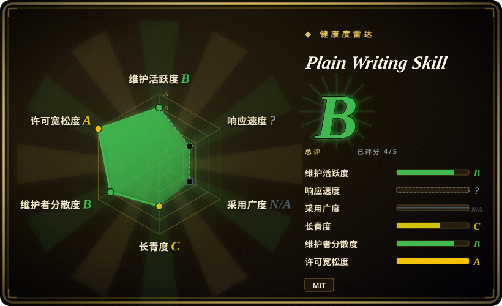
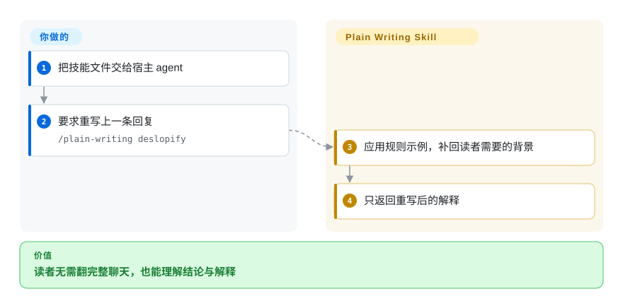
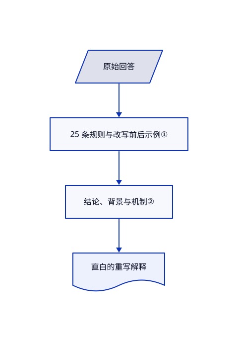

# Plain Writing Skill

agent 的总结写满内部机制，却没解释读者能感知的变化。此技能提供改写前后示例，并把上一条回答重写给没有项目背景的人。

## 何时使用

你要把工程进展交给没读过聊天的人，“校准代理指标”等措辞却遮住了实际结果。你需要稳定、直白的英文解释，普通词汇、技术术语释义和结论先行都要统一时，选此技能。它不是判断作者身份的检测器，而是写作指令；也不同于保留个人声音的编辑器，它会主动施加克制、平实的统一文风。

## 何时不用

- **必须保留作者独特声音。** 选优先保留原文声音的 [no-ai-slop](no-ai-slop.zh.md)；本技能禁止类比与多种修辞形式。
- **产出是中文正文。** 选有中文示例的 [Humanizer-zh](humanizer-zh.zh.md)，不要原样照搬英文标点与词汇规则。
- **需要带问题计数的机器门禁。** 选 [avoid-ai-writing](avoid-ai-writing.zh.md)；本技能是 Markdown 指令，不是确定性文稿检查器。

## 横向对比

| 替代品 | 是否收录 | 我们的评价 | 取舍 |
|---|---|---|---|
| [humanizer](humanizer.zh.md) | ✅ | 广泛清理英文 AI 模式选 humanizer；要字面化统一文风并补齐读者背景，选 plain-writing。 | 模式编辑对比更严的词汇、意象和标点限制。 |
| [no-ai-slop](no-ai-slop.zh.md) | ✅ | 原稿必须仍像作者本人，选 no-ai-slop；统一解释口吻更重要，选 plain-writing。 | 最少干预对比主动统一文风。 |
| [avoid-ai-writing](avoid-ai-writing.zh.md) | ✅ | 要持续集成可检测的问题，选 avoid-ai-writing；要指导整条回答重写，选 plain-writing。 | 可执行检测器对比模型遵循的示例；两者都不能证明作者身份。 |

## 快速上手

阅读并只复制 `skills/plain-writing/SKILL.md` 到 agent 使用的指令位置，或采用文档中的 `gh skill install docwriter-org/plain-writing-skill plain-writing`。提出写稿或改稿要求，也可用 `/plain-writing deslopify` 重写上一条回答。技能要求模型先说结论，再补必要背景并解释陌生术语。原始事实与改写审批由你提供，模型费用由宿主 agent 承担。正常使用不需要可选的 Python 评测目录。

<!-- flow-steps:begin (generated from flows/plain-writing-skill.json by tools/flow_card.py — do not edit) -->

流程文字版

1. **你**：把技能文件交给宿主 agent
2. **你**：要求重写上一条回复 — `/plain-writing deslopify`
3. **Plain Writing Skill**：应用规则示例，补回读者需要的背景
4. **Plain Writing Skill**：只返回重写后的解释

**价值**：读者无需翻完整聊天，也能理解结论与解释

<!-- flow-steps:end -->

## 技术要点

<!-- mechanism:begin (generated from mechanisms/plain-writing-skill.json by tools/mechanism_card.py; do not edit) -->

机制文字版

- 原始回答
- 25 条规则与改写前后示例①
- 结论、背景与机制②
- 直白的重写解释

- 原始回答 → 25 条规则与改写前后示例①
- 25 条规则与改写前后示例① → 结论、背景与机制②
- 结论、背景与机制② → 直白的重写解释

<!-- mechanism:end -->

### 1. 用具体改写配合规则

- **解决：** “写清楚一点”没有告诉模型具体该替换什么措辞。
- **做法：** 技能为 25 条规则配上前后示例，覆盖词汇、完整句、段落支持和修辞模式。准确且有解释的技术术语仍可保留。
- **边界：** 禁类比、禁破折号、使用直引号，是特定英文文风，不是普遍正确性规则，也没有机器强制执行。
- **源码：** [规则与示例](https://github.com/docwriter-org/plain-writing-skill/blob/f0d3630983ac7a82aa580f1c1509d72df739ee12/skills/plain-writing/SKILL.md#L24-L262)。

### 2. 重建背景，而不只是缩短

- **解决：** 工程回复即使简短，对项目外的人仍可能看不懂。
- **做法：** deslopify 接收上一条回答或指定正文，只返回改写，按结论、背景和机制排列。可选评测用相同任务比较有无技能，再由不知道条件的模型逐规则判分。
- **边界：** 没有工具证明事实未变；公开评测衡量是否符合自身文风规则，并非独立读者理解测试。
- **源码：** [改写命令](https://github.com/docwriter-org/plain-writing-skill/blob/f0d3630983ac7a82aa580f1c1509d72df739ee12/skills/plain-writing/SKILL.md#L264-L275)、[评测流程](https://github.com/docwriter-org/plain-writing-skill/blob/f0d3630983ac7a82aa580f1c1509d72df739ee12/evals/README.md#L7-L43)。

## 健康度与可持续性

- **截至 2026-10-18：** docwriter-org 在 2026 年 6 月创建仓库；MIT 实文署名 Shreya Shankar。复用核心是单份 Markdown 技能和可选评测脚本，不依赖托管服务。
- **判断：** 四个月历史尚无强长期存续证据，但纯文本核心很小，便于阅读和固定副本。全局启用前先判断规则是否合适。
- **证据范围：** 评测归属文件区分公版片段、合成初稿和第三方会话数据集。只安装技能可避免普通使用绑定这些评测资产与接口费用。

## 存疑（未验证）

- [未验证：未复跑付费评测] 已读公开评测，未复现；它不能证明跨模型的理解收益或事实保真。
