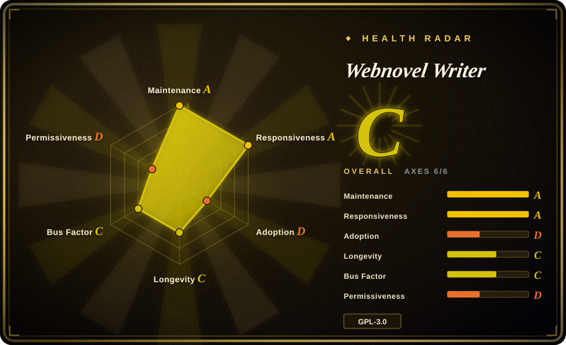
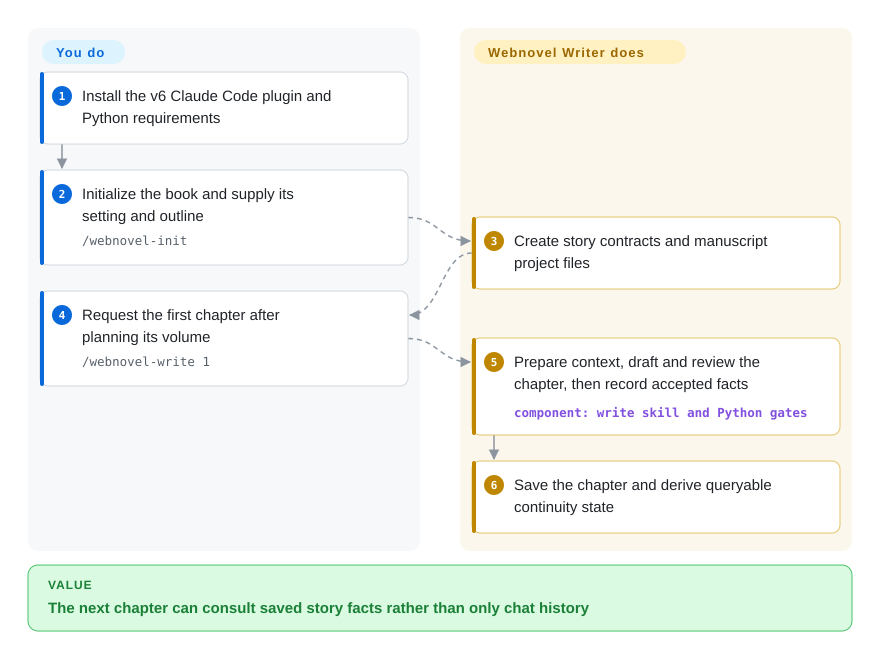
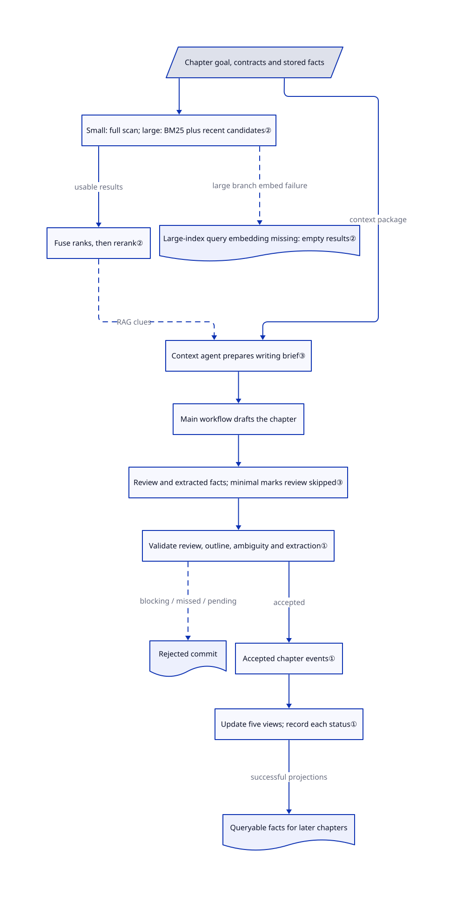

# Webnovel Writer

Chapter 80 forgets a clue planted in chapter 12, and your next prompt cannot reconstruct the book's facts. Webnovel Writer's Claude Code branch records chapter facts and derives searchable continuity state instead of relying on chat history alone.

## When to use

You're a serial-fiction author already working in Claude Code, and after dozens of chapters your model starts contradicting character motives, timelines, world rules, and planted clues. You need each chapter to pass through context preparation, drafting, review, fact extraction, a chapter commit, and derived state/index/summary projections. Pick Webnovel Writer over a generic writing prompt because it keeps an auditable project-side story system and queryable continuity state instead of treating every chapter as an isolated chat.

This page's source review covers default branch `master`, the v6 Claude Code plugin. The [version policy](https://github.com/lingfengQAQ/webnovel-writer/blob/86e617ee7f4f04be9d3f8575f90c38f879ed80ed/README.md#L21-L29) now limits v6 maintenance to critical bugs, freezes v7, and names the separate DeepSeek Harness v8 branch as the current stable workbench. Choose v6 for an existing Claude Code manuscript that needs its continuity chain, not as the actively developed newest product; no validated direct migration of an old book to v8 is documented. Semantic retrieval is optional; README documents a BM25 keyword path when embedding credentials are absent.

## When NOT to use

- **You need an independent desktop novel editor or do not use Claude Code.** Pick [novelWriter](https://github.com/saga-soft/novelWriter) or [Manuskript](https://github.com/olivierkes/manuskript) instead; both target standalone long-form writing, while this project's reviewed master branch is a Claude Code plugin.
- **You are drafting a short story, one article, or one-off marketing copy.** Use a focused drafting prompt or a smaller writing skill instead; story contracts, chapter commits, SQLite indexes, projections, and review gates add setup that only pays off when continuity is the real problem.
- **Your policy forbids prose context from reaching external embedding or reranking APIs.** Use a fully local retrieval stack or accept this project's BM25 fallback; its documented semantic-RAG setup uses compatible external embedding and rerank endpoints.
- **You need to distribute a combined proprietary derivative without a GPL review.** Choose a permissively licensed alternative or obtain legal advice first. The reviewed LICENSE is GPL-3.0: distributing covered copies triggers source-disclosure obligations, not AGPL's network-use disclosure rule. The health field `strong_network_copyleft` is the scorer's combined strong/network-copyleft bucket, not evidence that this project is AGPL.
- **You want ongoing feature development or automatic migration to the current workbench.** Evaluate the same repository's v8 branch for a new DeepSeek Harness workflow, or use novelWriter for an independent editor; master v6 now receives critical-bug fixes only, and v6/v8 installation and migration are not interchangeable.
- **You need independently benchmarked proof that it handles a particular novel length.** Treat the project's 2-million-character-scale claim as unverified and validate with a representative manuscript; no public benchmark was found in this review.

## Comparison

| Alternative | In index | Our verdict | Tradeoff |
|---|---|---|---|
| [Humanizer-zh](../de-ai-writing/humanizer-zh.md) | ✅ | Choose Webnovel Writer when long-running story facts and chapter continuity are the failure mode; choose Humanizer-zh when polishing Chinese prose is the only job. | Webnovel Writer maintains project state and runs a multi-stage writing workflow; Humanizer-zh is a lightweight advisory rewrite skill. |
| [Baoyu Skills](../content-production/baoyu-skills.md) | ✅ | Choose Webnovel Writer for a novel-specific, stateful serial workflow; choose Baoyu Skills for a broad collection of writing and formatting tasks. | The focused plugin brings contracts, indexes, and review overhead; the general pack is lighter but does not provide a novel continuity system. |
| novelWriter | not indexed | Choose novelWriter when a cross-platform, local desktop editor is required; choose this page when Claude Code should actively plan, draft, and reconcile a serial. | novelWriter avoids model/provider and plugin coupling; Webnovel Writer adds agent-driven retrieval and review. |
| Manuskript | not indexed | Choose Manuskript when you want a standalone outlining and writing application; choose this page when chapter facts must feed an agent-readable state system. | Manuskript keeps the author in a desktop workflow; Webnovel Writer depends on Claude Code and Python tooling. |

## Quick start

For the reviewed v6 branch, install the Claude Code marketplace with `claude plugin marketplace add lingfengQAQ/webnovel-writer --scope user`, then `claude plugin install webnovel-writer@webnovel-writer-marketplace --scope user`, and install the Python requirements as shown in the [master README](https://github.com/lingfengQAQ/webnovel-writer/blob/86e617ee7f4f04be9d3f8575f90c38f879ed80ed/README.md#L129-L199). Run `/webnovel-init` and answer the book-setting questions; it creates the outline, manuscript directories and story-state files. Use `/webnovel-plan 1` and `/webnovel-write 1` to plan the first volume and draft its first chapter, then consult the saved chapter and review output. The plugin organizes context, review and fact projections; you decide the story, resolve blocking issues, keep backups and pay for Claude Code/model usage. Optional semantic retrieval sends text to embedding/rerank endpoints you configure; BM25 means keyword ranking, not a guarantee that arbitrary API failures silently fall back. These are v6 commands, not v8 installation or a validated book-migration procedure.

<!-- flow-steps:begin (generated from flows/webnovel-writer.json by tools/flow_card.py — do not edit) -->

Text version of the flow

1. **You**: Install the v6 Claude Code plugin and Python requirements
2. **You**: Initialize the book and supply its setting and outline — `/webnovel-init`
3. **Webnovel Writer**: Create story contracts and manuscript project files
4. **You**: Request the first chapter after planning its volume — `/webnovel-write 1`
5. **Webnovel Writer**: Prepare context, draft and review the chapter, then record accepted facts — component: `write skill and Python gates`
6. **Webnovel Writer**: Save the chapter and derive queryable continuity state

**Value**: The next chapter can consult saved story facts rather than only chat history

<!-- flow-steps:end -->

## Key techniques

<!-- mechanism:begin (generated from mechanisms/webnovel-writer.json by tools/mechanism_card.py; do not edit) -->

Text version of the mechanism

- Chapter goal, contracts and stored facts
- Small: full scan; large: BM25 plus recent candidates②
- Fuse ranks, then rerank②
- Large-index query embedding missing: empty results②
- Context agent prepares writing brief③
- Main workflow drafts the chapter
- Review and extracted facts; minimal marks review skipped③
- Validate review, outline, ambiguity and extraction①
- Rejected commit
- Accepted chapter events①
- Update five views; record each status①
- Queryable facts for later chapters

- Chapter goal, contracts and stored facts → Small: full scan; large: BM25 plus recent candidates②
- Small: full scan; large: BM25 plus recent candidates② → Fuse ranks, then rerank② (usable results)
- Small: full scan; large: BM25 plus recent candidates② → Large-index query embedding missing: empty results② (large branch embed failure) [optional/fallback]
- Chapter goal, contracts and stored facts → Context agent prepares writing brief③ (context package)
- Fuse ranks, then rerank② → Context agent prepares writing brief③ (RAG clues) [optional/fallback]
- Context agent prepares writing brief③ → Main workflow drafts the chapter
- Main workflow drafts the chapter → Review and extracted facts; minimal marks review skipped③
- Review and extracted facts; minimal marks review skipped③ → Validate review, outline, ambiguity and extraction①
- Validate review, outline, ambiguity and extraction① → Rejected commit (blocking / missed / pending) [optional/fallback]
- Validate review, outline, ambiguity and extraction① → Accepted chapter events① (accepted)
- Accepted chapter events① → Update five views; record each status①
- Update five views; record each status① → Queryable facts for later chapters (successful projections)

<!-- mechanism:end -->

### 1. Accept chapter facts before building derived views

- **Problem:** Updating the character state, search index and summaries independently could make them disagree about what happened in a chapter.
- **How:** Validate review, outline coverage, resolved ambiguities and extracted facts, then mark the chapter commit accepted or rejected. Accepted events feed the state, index, summary, memory and vector writers; each writer records its own result.
- **Limits:** Blocking review issues, missed outline nodes or pending ambiguities reject the commit. A saved commit is not proof that every view was updated, and the facts still depend on trustworthy agent artifacts.
- **Source:** [`chapter_commit_service.py:33–190`](https://github.com/lingfengQAQ/webnovel-writer/blob/86e617ee7f4f04be9d3f8575f90c38f879ed80ed/webnovel-writer/scripts/data_modules/chapter_commit_service.py#L33-L190).

### 2. Limit vector scoring to candidates when the index grows

- **Problem:** Scoring every stored passage against each query becomes expensive as the manuscript grows.
- **How:** Small indexes get a full vector scan; larger ones score a union of BM25 keyword candidates and recent passages. Combine keyword and vector ranks using reciprocal-rank scores, then rerank the candidates.
- **Limits:** Filtering can miss relevant passages. In the larger-index branch, no query embedding means an empty result, not universal BM25 outage recovery; an empty rerank response instead retains the fused ranking.
- **Source:** [`rag_adapter.py:1156–1287`](https://github.com/lingfengQAQ/webnovel-writer/blob/86e617ee7f4f04be9d3f8575f90c38f879ed80ed/webnovel-writer/scripts/data_modules/rag_adapter.py#L1156-L1287).

### 3. Give agents distinct jobs and check their saved artifacts

- **Problem:** A single drafting assistant could claim it reviewed and remembered a chapter without producing usable evidence.
- **How:** The write skill assigns context preparation, review and fact extraction to different agents, then invokes Python precommit and postcommit checks. If only a projection fails, its recovery instructions retry that projection rather than draft the chapter again.
- **Limits:** This is a prompted workflow plus artifact checks, not an independent literary-quality detector. User-selected `--minimal` skips the reviewer and explicitly writes a fresh no-review artifact.
- **Source:** [`SKILL.md:82–168`](https://github.com/lingfengQAQ/webnovel-writer/blob/86e617ee7f4f04be9d3f8575f90c38f879ed80ed/webnovel-writer/skills/webnovel-write/SKILL.md#L82-L168), [`SKILL.md:178–265`](https://github.com/lingfengQAQ/webnovel-writer/blob/86e617ee7f4f04be9d3f8575f90c38f879ed80ed/webnovel-writer/skills/webnovel-write/SKILL.md#L178-L265).

## Tech stack

- **Core:** Python 3.10+ Claude Code plugin with Skills, Agents, Hooks, and a Python CLI.
- **State:** `.story-system` contracts and chapter commits; JSON plus SQLite indexes, vectors, summaries, and memory projections.
- **Dashboard:** FastAPI, Uvicorn, Watchdog, SSE, and a bundled React/Vite frontend.
- **Retrieval:** BM25 plus optional vector, rerank, hybrid, and graph-hybrid paths through OpenAI-compatible endpoints.

## Dependencies

- **Required:** Claude Code plugin runtime and Python 3.10+.
- **Python packages:** `aiohttp`, `filelock`, and `pydantic`; the dashboard additionally uses FastAPI, Uvicorn, HTTPX, and Watchdog.
- **Optional semantic RAG:** compatible embedding and reranking services plus their API credentials. With no embedding key, documented behavior falls back to BM25.
- **Frontend development only:** Node.js/npm; the released dashboard bundle includes built assets for ordinary use.

## Ops difficulty

**Medium.** Installation is a Claude Code Marketplace plugin plus Python dependencies, but a real book project owns contracts, generated SQLite/JSON state, backups, and optional external RAG credentials. The local dashboard binds to loopback by default, yet maintaining a large manuscript still requires backup and upgrade discipline.

## Health & viability

- **Maintenance snapshot (2026-10-17):** unarchived; reviewed master HEAD `86e617e` dates to 2026-10-14. The master version policy still says v6 critical bugs only; the latest repository release is the separate workbench's `scriptor-v8.2.2` (2026-10-12). A maintenance A does not override that support policy.
- **Governance / bus factor:** the current machine block measures two active maintainers with almost all commits from one contributor. README describes spare-time maintenance and lists sponsorships, not a foundation-backed support guarantee. [推断：concentrated contributions and the stated maintenance policy indicate key-maintainer risk]
- **Age / Lindy:** created 2026-01, with less than one year of history; continued commits are useful signals but do not establish long-term durability.
- **Adoption and risk:** 7526 stars are attention, not verified manuscript-scale performance. GPL-3.0 is a distribution constraint. Risk/license D retains the existing combined strong/network-copyleft bucket; it does not add AGPL network-use obligations to GPL.

## Caveats (unverified)

- [未验证：no representative manuscript was run] Continuity at the claimed 2-million-character scale, writing quality and external retrieval performance were not benchmarked; the plugin and providers were not run end to end.
- [未验证：no validated migration procedure in the reviewed version policy] v6/v8 use different installation paths; direct migration of an existing manuscript has not been established by this review.
- [推断：the scorer and rubric combine GPL and AGPL categories] The bucket name `strong_network_copyleft` is ambiguous. Its retained D grade is not a legal claim that GPL requires network-use source disclosure; assess covered-copy distribution under the actual GPL text.
- [推断：concentrated contributions and stated critical-bug support] Keep local backups and a pinned, forkable v6 copy for an existing serial rather than treating stars as a durability guarantee.
