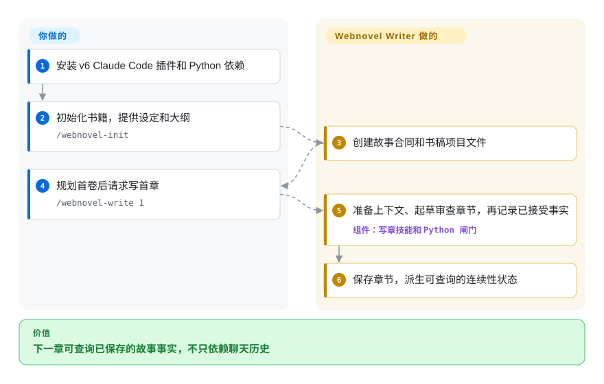
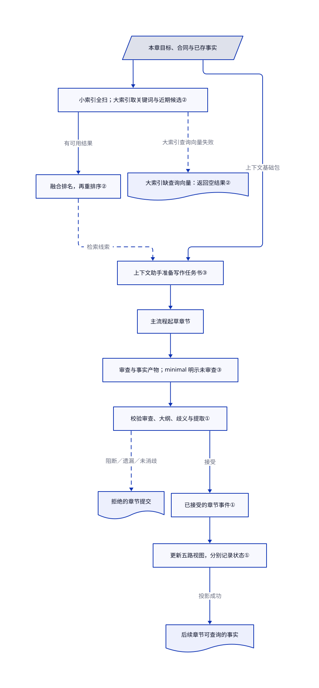

# Webnovel Writer

写到第 80 章，助手忘了第 12 章埋下的伏笔，新提示词又拼不回整本书的事实。Webnovel Writer 的 Claude Code 分支记录每章事实，派生可检索的连续性状态，不只依靠聊天历史。

## 何时使用

你是已在 Claude Code 写连载小说的作者，写到几十章后模型开始让人物动机、时间线、世界规则和伏笔互相矛盾。你需要每章都经过上下文准备、起草、审查、事实提取、章节提交，以及派生状态、索引和摘要投影。此时选 Webnovel Writer，而不是通用写作提示词，因为它在项目内保存可追溯的故事系统和可查询的连续性状态，不会把每章当成孤立对话。

本页源码复核覆盖默认 `master` 分支，即 v6 Claude Code 插件。[版本政策](https://github.com/lingfengQAQ/webnovel-writer/blob/86e617ee7f4f04be9d3f8575f90c38f879ed80ed/README.md#L21-L29) 已改为 v6 只修致命 bug、v7 冻结，另一个 DeepSeek Harness v8 分支才是当前正式工作台。已有 Claude Code 书稿需要这套事实链时才选 v6，不把它当成持续开发的新产品；文档没有经过验证的旧书直接迁移到 v8 方案。语义检索可选，README 记录了缺少 embedding 凭据时的 BM25 关键词路径。

## 何时不用

- **你需要独立桌面小说编辑器，或根本不用 Claude Code。**改选 [novelWriter](https://github.com/saga-soft/novelWriter) 或 [Manuskript](https://github.com/olivierkes/manuskript)：它们面向独立长篇写作，本次所读 master 分支则是 Claude Code 插件。
- **你只写短篇、单篇文章或一次性营销文案。**改用聚焦的起草提示词或小型写作技能；故事合同、章节提交、SQLite 索引、投影与审查闸门只有在“连贯性”真是核心问题时才值得这份配置成本。
- **你的政策不允许正文上下文发送给外部 embedding 或 rerank API。**改用纯本地检索栈，或接受本项目的 BM25 回退；其文档里的语义 RAG 配置使用兼容接口的外部 embedding 和 rerank 端点。
- **你要分发未经 GPL 评估的专有组合衍生品。**改选宽松许可替代品或先取得法务意见。所读 LICENSE 是 GPL-3.0，分发受覆盖副本时触发源码披露义务，不套用 AGPL 的网络使用披露规则。健康字段 `strong_network_copyleft` 是评分器现有的“强 copyleft／网络 copyleft”合并桶，不代表项目使用 AGPL。
- **你需要持续新增功能，或自动迁移到当前工作台。**新 DeepSeek Harness 工作流应评估同仓库的 v8 分支，独立编辑器则选 novelWriter；master v6 现在只修致命 bug，v6/v8 的安装与书稿迁移不能混用。
- **你需要独立基准证明它能处理某个具体篇幅。**把项目宣称的 200 万字体量标为未验证，并用代表性书稿试跑；本次调研未发现公开基准。

## 横向对比

| 替代品 | 是否收录 | 我们的评价 | 取舍 |
|---|---|---|---|
| [Humanizer-zh](../de-ai-writing/humanizer-zh.zh.md) | ✅ | 长篇故事事实和章节连续性失控时选 Webnovel Writer；只需润色中文文案时选 Humanizer-zh。 | Webnovel Writer 维护项目状态并跑多阶段写作流程；Humanizer-zh 是轻量的建议式改写技能。 |
| [Baoyu Skills](../content-production/baoyu-skills.zh.md) | ✅ | 要小说专用、带状态的连载流程时选 Webnovel Writer；要宽泛的写作与排版技能集合时选 Baoyu Skills。 | 聚焦插件带来合同、索引与审查开销；通用技能包更轻，但不提供小说连续性系统。 |
| novelWriter | 未收录 | 必须使用跨平台、本地桌面编辑器时选 novelWriter；希望 Claude Code 主动规划、起草并核对连载时选本页项目。 | novelWriter 避开模型、提供商和插件耦合；Webnovel Writer 加入 agent 驱动的检索与审查。 |
| Manuskript | 未收录 | 想要独立大纲与写作应用时选 Manuskript；章节事实必须进入 agent 可读状态系统时选本页项目。 | Manuskript 保持桌面作者工作流；Webnovel Writer 依赖 Claude Code 与 Python 工具。 |

## 快速上手

针对所读 v6 分支，在 Claude Code 执行 `claude plugin marketplace add lingfengQAQ/webnovel-writer --scope user`，再执行 `claude plugin install webnovel-writer@webnovel-writer-marketplace --scope user`，并按 [master README](https://github.com/lingfengQAQ/webnovel-writer/blob/86e617ee7f4f04be9d3f8575f90c38f879ed80ed/README.md#L129-L199) 安装 Python 依赖。运行 `/webnovel-init` 回答书籍设定问题，插件创建大纲、正文目录和故事状态文件。用 `/webnovel-plan 1` 规划首卷，再用 `/webnovel-write 1` 写首章，查看保存的章节和审查输出。插件整理上下文、审查和事实投影，你决定剧情、裁决阻断问题、保留备份，并承担 Claude Code 和模型费用。可选语义检索会把正文送到你配置的 embedding、rerank 端点；BM25 是关键词排序，不表示任意 API 故障都会静默回退。这些是 v6 命令，不是 v8 安装方式或已验证的迁移流程。

<!-- flow-steps:begin (generated from flows/webnovel-writer.json by tools/flow_card.py — do not edit) -->

流程文字版

1. **你**：安装 v6 Claude Code 插件和 Python 依赖
2. **你**：初始化书籍，提供设定和大纲 — `/webnovel-init`
3. **Webnovel Writer**：创建故事合同和书稿项目文件
4. **你**：规划首卷后请求写首章 — `/webnovel-write 1`
5. **Webnovel Writer**：准备上下文、起草审查章节，再记录已接受事实 — 组件：`写章技能和 Python 闸门`
6. **Webnovel Writer**：保存章节，派生可查询的连续性状态

**价值**：下一章可查询已保存的故事事实，不只依赖聊天历史

<!-- flow-steps:end -->

## 技术要点

<!-- mechanism:begin (generated from mechanisms/webnovel-writer.json by tools/mechanism_card.py; do not edit) -->

机制文字版

- 本章目标、合同与已存事实
- 小索引全扫；大索引取关键词与近期候选②
- 融合排名，再重排序②
- 大索引缺查询向量：返回空结果②
- 上下文助手准备写作任务书③
- 主流程起草章节
- 审查与事实产物；minimal 明示未审查③
- 校验审查、大纲、歧义与提取①
- 拒绝的章节提交
- 已接受的章节事件①
- 更新五路视图，分别记录状态①
- 后续章节可查询的事实

- 本章目标、合同与已存事实 → 小索引全扫；大索引取关键词与近期候选②
- 小索引全扫；大索引取关键词与近期候选② → 融合排名，再重排序②（有可用结果）
- 小索引全扫；大索引取关键词与近期候选② → 大索引缺查询向量：返回空结果②（大索引查询向量失败）〔可选／兜底〕
- 本章目标、合同与已存事实 → 上下文助手准备写作任务书③（上下文基础包）
- 融合排名，再重排序② → 上下文助手准备写作任务书③（检索线索）〔可选／兜底〕
- 上下文助手准备写作任务书③ → 主流程起草章节
- 主流程起草章节 → 审查与事实产物；minimal 明示未审查③
- 审查与事实产物；minimal 明示未审查③ → 校验审查、大纲、歧义与提取①
- 校验审查、大纲、歧义与提取① → 拒绝的章节提交（阻断／遗漏／未消歧）〔可选／兜底〕
- 校验审查、大纲、歧义与提取① → 已接受的章节事件①（接受）
- 已接受的章节事件① → 更新五路视图，分别记录状态①
- 更新五路视图，分别记录状态① → 后续章节可查询的事实（投影成功）

<!-- mechanism:end -->

### 1. 先接受章节事实，再更新各路视图

- **解决：**人物状态、搜索索引和摘要若各自更新，可能对同一章发生的事说法不一。
- **做法：**先校验审查结果、大纲覆盖、歧义处理和提取事实，再把章节提交标为接受或拒绝。已接受事件供给状态、索引、摘要、记忆和向量写入器，每一路分别记录更新结果。
- **边界：**阻断审查问题、遗漏的大纲节点或未解决歧义都会拒绝提交。提交文件存在不等于每路视图都更新成功，事实本身也仍依赖可信的助手产物。
- **源码：**[`chapter_commit_service.py:33–190`](https://github.com/lingfengQAQ/webnovel-writer/blob/86e617ee7f4f04be9d3f8575f90c38f879ed80ed/webnovel-writer/scripts/data_modules/chapter_commit_service.py#L33-L190)。

### 2. 索引变大后，只给候选片段算向量

- **解决：**书稿越长，每次查询都与全部片段计算相似度的成本越高。
- **做法：**小索引全量扫描向量，大索引只处理 BM25 关键词候选与近期片段的并集。把关键词排名和向量排名按名次倒数合成分数，再对候选重新排序。
- **边界：**候选过滤可能漏掉相关片段。大索引分支拿不到查询向量时返回空结果，不是通用的 BM25 故障兜底；重排序返回空时则保留融合后的排名。
- **源码：**[`rag_adapter.py:1156–1287`](https://github.com/lingfengQAQ/webnovel-writer/blob/86e617ee7f4f04be9d3f8575f90c38f879ed80ed/webnovel-writer/scripts/data_modules/rag_adapter.py#L1156-L1287)。

### 3. 助手分别干活，脚本检查落盘产物

- **解决：**只让一个起草助手口头说“检查过、记住了”，未必留下可用证据。
- **做法：**写章技能把上下文准备、审查和事实提取交给不同助手，再调用 Python 提交前、提交后检查。只有某路投影失败时，恢复指令要求单独补跑，不重新起草整章。
- **边界：**这是提示词流程加产物校验，不是独立的文学质量检测器。用户选 `--minimal` 时会跳过 reviewer，并明确写一份新的“未审查”产物。
- **源码：**[`SKILL.md:82–168`](https://github.com/lingfengQAQ/webnovel-writer/blob/86e617ee7f4f04be9d3f8575f90c38f879ed80ed/webnovel-writer/skills/webnovel-write/SKILL.md#L82-L168)、[`SKILL.md:178–265`](https://github.com/lingfengQAQ/webnovel-writer/blob/86e617ee7f4f04be9d3f8575f90c38f879ed80ed/webnovel-writer/skills/webnovel-write/SKILL.md#L178-L265)。

## 技术栈

- **核心：**Python 3.10 以上的 Claude Code 插件，包含 Skills、Agents、Hooks 和 Python CLI。
- **状态：**`.story-system` 合同与章节提交，配合 JSON、SQLite 索引、向量、摘要和记忆投影。
- **面板：**FastAPI、Uvicorn、Watchdog、SSE，以及随包提供的 React/Vite 前端。
- **检索：**BM25，加上通过 OpenAI 兼容端点提供的可选向量、rerank、混合和图混合路径。

## 依赖

- **必需：**Claude Code 插件运行环境和 Python 3.10 以上。
- **Python 包：**`aiohttp`、`filelock`、`pydantic`；面板额外使用 FastAPI、Uvicorn、HTTPX 和 Watchdog。
- **可选语义 RAG：**兼容的 embedding 与 rerank 服务，以及对应 API 凭据。没有 embedding key 时，文档说明会回退到 BM25。
- **仅前端开发：**Node.js/npm；日常使用时发布包已带构建后的面板资源。

## 运维难度

**中。**安装本身是 Claude Code Marketplace 插件加 Python 依赖，但一本实际书稿会持有合同、生成的 SQLite/JSON 状态、备份与可选外部 RAG 凭据。本地面板默认绑定 loopback，不过维护长篇书稿仍要有备份和升级纪律。

## 健康度与可持续性

- **维护快照（2026-10-17）：**未归档，所读 master 提交 `86e617e` 来自 2026-10-14。master 版本政策仍明确 v6 只修致命 bug；仓库最新发布是另一工作台的 `scriptor-v8.2.2`（2026-10-12）。维护轴 A 不能覆盖这条支持政策。
- **治理与 bus factor：**当前机器块测得两位活跃维护者，但几乎全部提交来自一人。README 自述业余维护并列出赞助，不等于基金会支持保证。[推断：依据是贡献集中和既定维护政策，关键维护者风险仍在]
- **年龄与 Lindy：**创建于 2026-01，不到一年；持续提交有价值，但不能证明长期耐久性。
- **采用与风险：**7526 stars 说明关注度，不证明实际书稿规模性能。GPL-3.0 是分发约束；许可风险 D 保留现有“强 copyleft／网络 copyleft”合并桶，不向 GPL 增添 AGPL 的网络使用披露义务。

## 存疑（未验证）

- [未验证：没有运行代表性书稿] 200 万字体量的连续性、写作质量和外部检索性能未做基准测试，插件及提供商没有端到端运行。
- [未验证：所读版本政策没有验证过的迁移流程] v6/v8 安装不同，本次没有证明已有书稿可直接迁移。
- [推断：评分器与规则合并 GPL、AGPL 分类] `strong_network_copyleft` 桶名有歧义。保留 D 分数不代表 GPL 有网络使用披露义务，分发受覆盖副本的约束应以实际 GPL 文本判断。
- [推断：依据是贡献集中和致命 bug 支持政策] 已有连载应保留本地备份和固定、可 fork 的 v6 副本，不以 stars 当耐久性保证。
