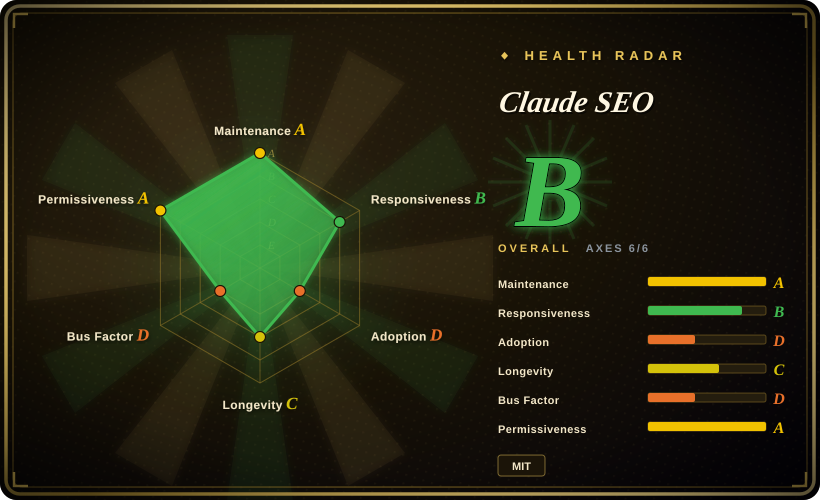
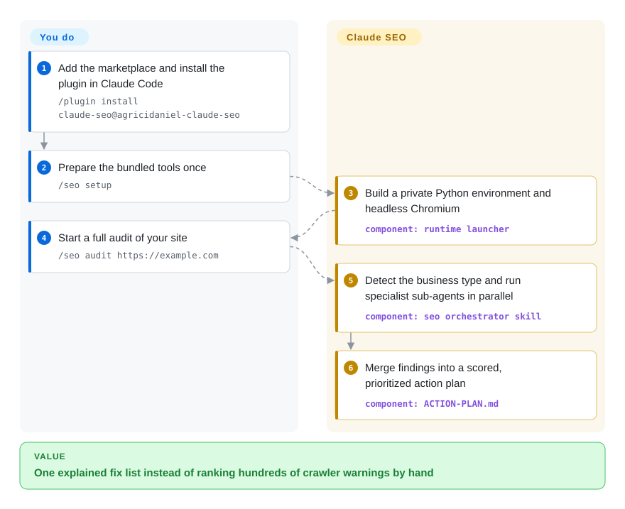
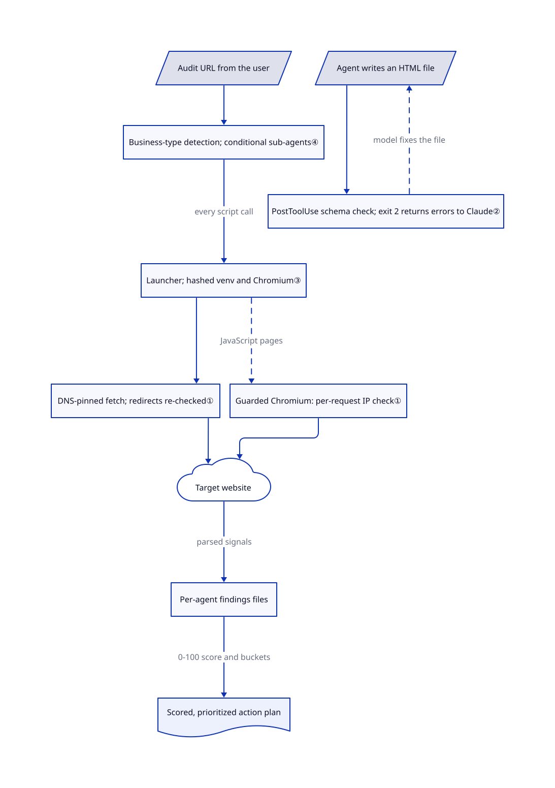

# Claude SEO

A site audit usually ends as a 400-row crawler export — "missing H1", "LCP 4.1 s", "invalid JSON-LD" — that someone still has to rank and explain. Claude SEO runs the audit inside Claude Code: it spins up specialist sub-agents that fetch your pages through safety-checked scripts and merge their findings into one prioritized action plan.

## When to use

You are an in-house SEO or a freelance consultant who already works in Claude Code. A client's Next.js site lost traffic; you need crawlability, Schema.org markup, Core Web Vitals, local and AI-search signals checked in one sitting and turned into "fix this first, because…". Choose Claude SEO when you want that depth as a Claude Code plugin: one `/seo audit` fans out to a technical, content, schema, sitemap, performance, visual, GEO (AI-search citation) and agent-readiness sub-agent, adds Google, backlink, local or e-commerce agents when it detects their credentials or business type, and writes Markdown reports you keep. Its edge over a lighter SEO skill is the bundled Python toolchain — a JavaScript-rendering fetcher, schema validator, drift baselines, Google API reporters — running in an isolated environment. [Orchestration](https://github.com/AgriciDaniel/claude-seo/blob/6be93f45064ffbadced572b5d5c95f55fd263af0/skills/seo/SKILL.md#L80-L101).

The tradeoff is that the reasoning is your Claude plan: pages you audit are sent to the model, and a full audit runs five Opus agents plus Sonnet agents. It does not own a crawl index or backlink database; it explains and prioritizes what scripts and your connected APIs return.

## When NOT to use

- **You need a deep, fast crawl of a large site.** The audit skill caps a crawl at 500 pages with 5 concurrent requests and a 1-second delay. For a 50,000-URL site use a dedicated crawler such as Screaming Frog, then ask an agent about its export. [Crawl configuration](https://github.com/AgriciDaniel/claude-seo/blob/6be93f45064ffbadced572b5d5c95f55fd263af0/skills/seo-audit/SKILL.md#L42-L51).
- **You need stored rank tracking, competitor history or a team dashboard.** Claude SEO writes files per run; its only built-in history is the local SQLite drift store. Use [open-seo](open-seo.md), a self-hosted app with stored keyword and competitor data.
- **SEO is one launch chore among several.** Installing 26 skills and 19 agents for a meta-tag check is heavy. Use [OPC Skills](opc-skills.md) or [marketingskills](marketingskills.md), which cover SEO in a few files beside other marketing work.
- **You may not send client pages to a model provider.** The FAQ states audited pages and data go to Claude like any other Claude Code input. Use a local crawler and keep the analysis offline. [Data FAQ](https://github.com/AgriciDaniel/claude-seo/blob/6be93f45064ffbadced572b5d5c95f55fd263af0/README.md#L315-L320).
- **You need a fixed per-audit cost.** Five agents run on Opus and the rest on Sonnet; usage scales with site size and agent count. A crawler licence or open-seo's API-based costs are easier to budget. [Cost note](https://github.com/AgriciDaniel/claude-seo/blob/6be93f45064ffbadced572b5d5c95f55fd263af0/README.md#L326-L330).
- **Your global `~/.claude` must stay curated.** The manual installer copies every skill into `~/.claude/skills/<name>` and every agent into `~/.claude/agents`, overwriting same-named entries; the plugin also registers a hook on every Edit/Write. Prefer the plugin path, which uninstalls as a unit, or a smaller skill pack. [Installer copy loop](https://github.com/AgriciDaniel/claude-seo/blob/6be93f45064ffbadced572b5d5c95f55fd263af0/install.sh#L39-L51).
- **You require public-first development and predictable contribution handling.** Development happens in a separate private repository, and paying community members get early-access features. All 13 merged PRs among the sampled last 50 closed were the author's own. Public-first governance would need separate evaluation; this sample does not establish that an alternative has it. [Public/private topology](https://github.com/AgriciDaniel/claude-seo/blob/6be93f45064ffbadced572b5d5c95f55fd263af0/docs/WORKFLOW-public-private.md#L8-L28), [two versions](https://github.com/AgriciDaniel/claude-seo/blob/6be93f45064ffbadced572b5d5c95f55fd263af0/README.md#L244-L250).

## Comparison

| Alternative | In index | Our verdict | Tradeoff |
|---|---|---|---|
| [open-seo](open-seo.md) | ✅ | Choose open-seo when you need a stored, self-hosted SEO workspace with rank tracking; choose Claude SEO for an explained, multi-specialist audit run from Claude Code. | open-seo keeps data across runs but needs an app deployment and paid DataForSEO data; Claude SEO needs only Claude Code and Python, but keeps no project database beyond drift baselines. |
| [OPC Skills](opc-skills.md) | ✅ | Choose OPC Skills when SEO is one of several solo-founder launch chores; choose Claude SEO when technical, schema, local and international SEO depth is the job. | OPC Skills is a few files and API-key scripts; Claude SEO adds a managed Python runtime, Chromium and a hook in exchange for far more checks. |
| [marketingskills](marketingskills.md) | ✅ | Choose marketingskills to guide copy, CRO and growth work with SEO as one topic; choose Claude SEO to inspect real pages with fetchers and validators. | marketingskills is prompt-only and light to install; Claude SEO executes scripts against live sites and consumes more model usage per run. |
| Screaming Frog SEO Spider | not a repo | Choose Screaming Frog for exhaustive crawls of large sites; choose Claude SEO to interpret a smaller sample and draft prioritized fixes. | Closed commercial desktop crawler with no agent loop; much faster and deeper crawling, but you write the prioritization yourself. |

## Quick start

Inside Claude Code 1.0.33 or newer, add the marketplace — the plugin catalogue your Claude Code reads — and install the plugin with `/plugin marketplace add AgriciDaniel/claude-seo` and `/plugin install claude-seo@agricidaniel-claude-seo`. Then run `/seo setup`: it creates a separate Python virtual environment (a private package folder) and a headless Chromium browser in Claude's plugin data directory, without installing packages globally. Next, type `/seo audit https://example.com` with your own site. The plugin detects the business type, starts the specialist agents, and writes `FULL-AUDIT-REPORT.md`, `ACTION-PLAN.md` and per-area findings into a `{domain}-audit/` folder. You supply the target URL, optional Google/Moz/Bing/DataForSEO credentials, and the Claude usage; you decide which fixes to ship. [Install path](https://github.com/AgriciDaniel/claude-seo/blob/6be93f45064ffbadced572b5d5c95f55fd263af0/README.md#L197-L205), [output files](https://github.com/AgriciDaniel/claude-seo/blob/6be93f45064ffbadced572b5d5c95f55fd263af0/skills/seo-audit/SKILL.md#L53-L60).

<!-- flow-steps:begin (generated from flows/claude-seo.json by tools/flow_card.py — do not edit) -->

Text version of the flow

1. **You**: Add the marketplace and install the plugin in Claude Code — `/plugin install claude-seo@agricidaniel-claude-seo`
2. **You**: Prepare the bundled tools once — `/seo setup`
3. **Claude SEO**: Build a private Python environment and headless Chromium — component: `runtime launcher`
4. **You**: Start a full audit of your site — `/seo audit https://example.com`
5. **Claude SEO**: Detect the business type and run specialist sub-agents in parallel — component: `seo orchestrator skill`
6. **Claude SEO**: Merge findings into a scored, prioritized action plan — component: `ACTION-PLAN.md`

**Value**: One explained fix list instead of ranking hundreds of crawler warnings by hand

<!-- flow-steps:end -->

## Key techniques

<!-- mechanism:begin (generated from mechanisms/claude-seo.json by tools/mechanism_card.py; do not edit) -->

Text version of the mechanism

- Audit URL from the user
- Business-type detection; conditional sub-agents④
- Launcher; hashed venv and Chromium③
- DNS-pinned fetch; redirects re-checked①
- Guarded Chromium: per-request IP check①
- Target website
- Per-agent findings files
- Scored, prioritized action plan
- Agent writes an HTML file
- PostToolUse schema check; exit 2 returns errors to Claude②

- Audit URL from the user → Business-type detection; conditional sub-agents④
- Business-type detection; conditional sub-agents④ → Launcher; hashed venv and Chromium③ (every script call)
- Launcher; hashed venv and Chromium③ → DNS-pinned fetch; redirects re-checked①
- Launcher; hashed venv and Chromium③ → Guarded Chromium: per-request IP check① (JavaScript pages) [optional/fallback]
- DNS-pinned fetch; redirects re-checked① → Target website
- Guarded Chromium: per-request IP check① → Target website
- Target website → Per-agent findings files (parsed signals)
- Per-agent findings files → Scored, prioritized action plan (0-100 score and buckets)
- Agent writes an HTML file → PostToolUse schema check; exit 2 returns errors to Claude②
- PostToolUse schema check; exit 2 returns errors to Claude② → Agent writes an HTML file (model fixes the file) [optional/fallback]

<!-- mechanism:end -->

### 1. Pin DNS so a fetched URL cannot be swapped for a private address

- **Problem:** An audit URL, or a redirect from it, can resolve to `127.0.0.1` or a cloud metadata address and turn the fetcher into a probe of your own network.
- **How:** `validate_url_strict` resolves the host and refuses it if any IPv4 record is non-public, then returns one pinned address. During the request, `socket.getaddrinfo` is temporarily replaced so the original host resolves only to that address and every other host — redirect targets included — is re-checked. Browser renders use a Playwright route handler and a context that blocks service workers and never connects WebSockets.
- **Limits:** The pin is process-global and guarded by a non-blocking lock, so concurrent pinned fetches in one process fail rather than run. IPv6-only targets fail closed, and Chromium resolves DNS itself, so browser fetches rely on per-request re-validation.
- **Source:** [Strict validation:467–537](https://github.com/AgriciDaniel/claude-seo/blob/6be93f45064ffbadced572b5d5c95f55fd263af0/scripts/url_safety.py#L467-L537), [DNS pin:641–751](https://github.com/AgriciDaniel/claude-seo/blob/6be93f45064ffbadced572b5d5c95f55fd263af0/scripts/url_safety.py#L641-L751), [browser guard:1020–1133](https://github.com/AgriciDaniel/claude-seo/blob/6be93f45064ffbadced572b5d5c95f55fd263af0/scripts/url_safety.py#L1020-L1133), [IPv6 note:60](https://github.com/AgriciDaniel/claude-seo/blob/6be93f45064ffbadced572b5d5c95f55fd263af0/SECURITY.md#L60).

### 2. Feed schema errors back to the model through a post-edit hook

- **Problem:** An agent that writes JSON-LD can leave `[Business Name]` placeholders or deprecated types such as `HowTo` in the page it just edited.
- **How:** The plugin registers a PostToolUse hook on Edit and Write. A Node launcher finds a Python interpreter and runs `validate-schema.py`, which reads only HTML-like files under 10 MiB. Placeholders and deprecated or retired types exit with code 2, so Claude Code returns stderr to Claude; other problems exit 0 with `additionalContext` warnings.
- **Limits:** The file is already written; the hook asks for a fix but cannot undo it. A JSON-LD `@type` array reaches a dictionary lookup that raises `TypeError` (issue #382, open on 2026-11-01), and Markdown or JSON files are skipped.
- **Source:** [Hook registration:1–21](https://github.com/AgriciDaniel/claude-seo/blob/6be93f45064ffbadced572b5d5c95f55fd263af0/hooks/hooks.json#L1-L21), [type and placeholder rules:191–262](https://github.com/AgriciDaniel/claude-seo/blob/6be93f45064ffbadced572b5d5c95f55fd263af0/hooks/validate-schema.py#L191-L262), [exit-code routing:286–337](https://github.com/AgriciDaniel/claude-seo/blob/6be93f45064ffbadced572b5d5c95f55fd263af0/hooks/validate-schema.py#L286-L337).

### 3. Keep the script runtime in a hashed, swappable virtual environment

- **Problem:** Python tools that need Playwright, lxml and Google clients can break a user's global Python, or silently run with stale packages after an update.
- **How:** Every skill calls the `claude-seo` launcher, which picks Python 3.11–3.14 and hands off to `runtime.py`. Setup builds a staged venv, installs `requirements.txt` and Chromium, smoke-imports core modules, then swaps it into place with a rollback copy. Status compares a SHA-256 of `requirements.txt`, the Python version and a schema number with stored state.
- **Limits:** Setup still downloads PyPI packages and a Chromium build, unpinned beyond version ranges. Exit code 10 means the core works but Chromium failed, so JavaScript rendering and screenshots are unavailable.
- **Source:** [Data directory and status:122–215](https://github.com/AgriciDaniel/claude-seo/blob/6be93f45064ffbadced572b5d5c95f55fd263af0/scripts/runtime.py#L122-L215), [staged setup and swap:293–378](https://github.com/AgriciDaniel/claude-seo/blob/6be93f45064ffbadced572b5d5c95f55fd263af0/scripts/runtime.py#L293-L378), [launcher:1–74](https://github.com/AgriciDaniel/claude-seo/blob/6be93f45064ffbadced572b5d5c95f55fd263af0/scripts/claude-seo#L1-L74).

### 4. Spawn specialists conditionally, then synthesize one plan

- **Problem:** A single prompt that checks speed, schema, content, local and backlinks at once loses depth and runs out of context on real sites.
- **How:** The orchestrator always starts eight core sub-agents and adds Google, Matomo, local, maps, cluster, e-commerce or drift agents when a credential check, page signal or stored baseline triggers them. Each agent has its own model and turn budget and writes a findings file. The orchestrator scores them 0–100 and buckets recommendations, each with a "how would we know this failed" check.
- **Limits:** Business-type detection uses homepage keyword signals, so mixed sites can get the wrong agent set. Partial findings are merged when an agent hits its turn cap. Major deliverables end with a promotional community footer.
- **Source:** [Orchestration:80–101](https://github.com/AgriciDaniel/claude-seo/blob/6be93f45064ffbadced572b5d5c95f55fd263af0/skills/seo/SKILL.md#L80-L101), [footer rule:152–162](https://github.com/AgriciDaniel/claude-seo/blob/6be93f45064ffbadced572b5d5c95f55fd263af0/skills/seo/SKILL.md#L152-L162), [agent budget:1–7](https://github.com/AgriciDaniel/claude-seo/blob/6be93f45064ffbadced572b5d5c95f55fd263af0/agents/seo-technical.md#L1-L7).

## Tech stack

Markdown skills and agent definitions for Claude Code, plus 61 Python scripts under `scripts/` (requests, BeautifulSoup/lxml, trafilatura, Playwright, matplotlib/WeasyPrint for PDF, openpyxl, Google API clients and google-ads). A Bash/PowerShell launcher selects Python; a Node wrapper runs the hook. Drift baselines live in SQLite. [requirements.txt](https://github.com/AgriciDaniel/claude-seo/blob/6be93f45064ffbadced572b5d5c95f55fd263af0/requirements.txt).

## Dependencies

Claude Code 1.0.33+ with a plan that covers Opus and Sonnet usage; Python 3.11–3.14; Node for the hook launcher; network access to PyPI and the Playwright Chromium download during setup. Optional credentials: Google Search Console/GA4/PageSpeed, Moz, Bing Webmaster, and extensions for DataForSEO, Firecrawl, SE Ranking, Profound, Ahrefs and Matomo, which send your queried domains to those vendors. [Privacy](https://github.com/AgriciDaniel/claude-seo/blob/6be93f45064ffbadced572b5d5c95f55fd263af0/PRIVACY.md#L5-L20).

## Ops difficulty

**Low to medium.** The plugin install and `/seo setup` are short, and `/seo doctor` checks the runtime without changes. Ongoing work is re-running setup after updates change `requirements.txt`, managing API credentials, and reviewing what the 26 skills and global hook do in every project. Manual installs are harder to remove cleanly than the plugin. The installer does not yet verify a signed release manifest; the security policy defers that to v2.6.0 and recommends verifying the SSH-signed tag yourself. [Release verification status](https://github.com/AgriciDaniel/claude-seo/blob/6be93f45064ffbadced572b5d5c95f55fd263af0/SECURITY.md#L48-L50).

## Health & viability

- **2026-11-01:** created 2026-02-07, unarchived, with ten releases from v2.2.3 (2026-07-20) to v2.5.0 (2026-10-22). Main had no commit after 2026-10-22, though bots and PRs kept the repository active.
- **Governance:** single-owner. AgriciDaniel holds 348 contributions; the next human has 13. Development runs in a private repository and is promoted to the public one at release, so public issues and PRs are not where changes are made.
- **Business model:** a free MIT public version beside a paid Skool community with early-access features — an open-core-like cadence risk rather than a feature gate in this code.
- **Judgment:** nine months old with heavy attention (25.4k stars, 3.3k forks). Lindy gives little support yet; frequent releases and a large test suite are positives, but the bus factor is one person.
- **License:** root MIT, copyright agricidaniel; the bundled FLOW prompts are the same author's CC BY 4.0 content with attribution retained. [FLOW attribution](https://github.com/AgriciDaniel/claude-seo/blob/6be93f45064ffbadced572b5d5c95f55fd263af0/skills/seo-flow/SKILL.md#L20-L26).

## Caveats (unverified)

- [未验证: upstream not installed or executed] Audit quality, the 10–15 minute audit time and the README's search-traffic results were not reproduced; this page is based on source reading.
- [未验证: private development source unavailable] The contents and lead time of the private early-access version, and whether public fixes lag it, could not be checked.
- [推断: issue #382 and the dictionary lookup at line 222; not reproduced] A JSON-LD `@type` array makes the schema hook raise `TypeError` instead of reporting a validation result.
- [未验证: usage not measured] Claude usage per full audit depends on site size and agent count; this research did not obtain a measured cost figure.
