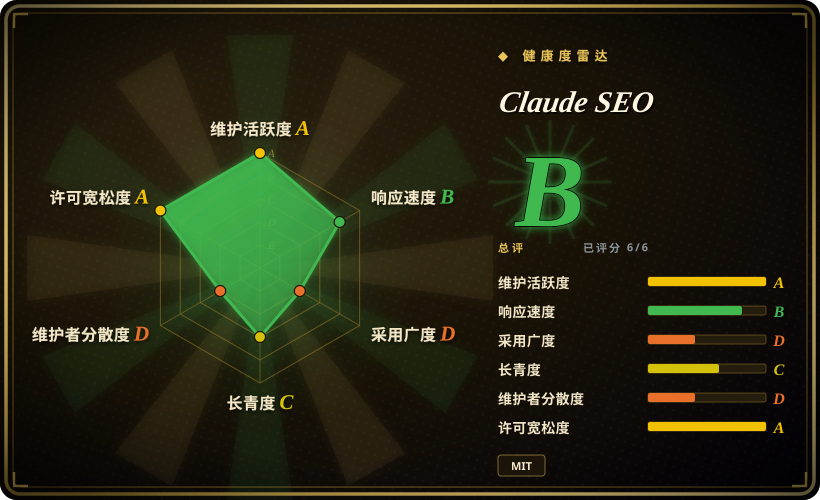
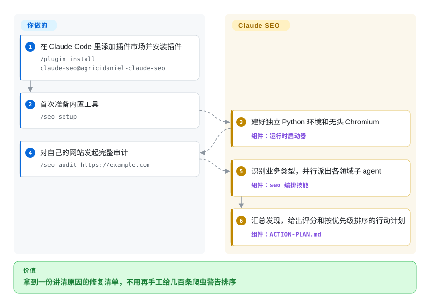
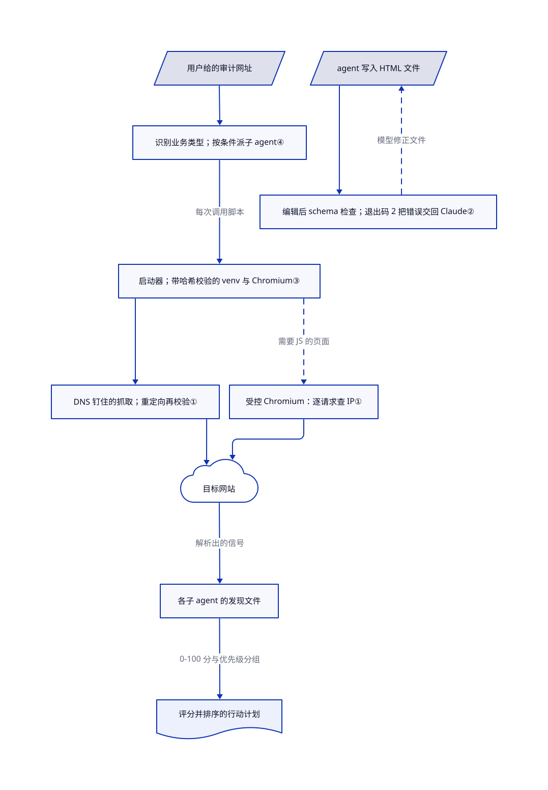

# Claude SEO

网站审计常常只产出一张四百行的爬虫导出表——“缺 H1”“LCP 4.1 秒”“JSON-LD 无效”——还得有人逐条排序、解释。Claude SEO 把审计搬进 Claude Code：派出各领域子 agent，用带安全检查的脚本抓页面，再把发现合成一份按优先级排好的行动计划。

## 何时使用

你是企业内部的 SEO，或者自由职业顾问，平时就在 Claude Code 里干活。客户的 Next.js 网站流量掉了，你要一起检查可抓取性、Schema.org 标记、Core Web Vitals、本地 SEO 和 AI 搜索信号，再排修复顺序。一条 `/seo audit` 启动八个核心专项 agent，加上外链和搜索体验 agent，再按凭据或业务条件增加其他专项，写出能留存的 Markdown 报告。它比轻量技能强在自带的 Python 工具链：能渲染 JavaScript 的抓取器、schema 校验器、漂移基线和 Google API 报表，都在隔离环境里运行。[编排逻辑](https://github.com/AgriciDaniel/claude-seo/blob/6be93f45064ffbadced572b5d5c95f55fd263af0/skills/seo/SKILL.md#L80-L101)。

代价是推理使用你的 Claude 额度：被审页面会发给模型，完整审计可能调用多个 Opus 和 Sonnet agent，可选专项取决于触发条件。它没有自己的爬取索引或外链数据库，只负责解释和排序脚本与你接入的 API 返回的内容。

## 何时不用

- **要对大站做又深又快的全量爬取。** 审计技能把爬取上限定在 500 页、并发 5、每次请求间隔 1 秒。五万个 URL 的站点请用 Screaming Frog 这类专用爬虫，再让 agent 读它的导出。[爬取配置](https://github.com/AgriciDaniel/claude-seo/blob/6be93f45064ffbadced572b5d5c95f55fd263af0/skills/seo-audit/SKILL.md#L42-L51)。
- **要长期的排名跟踪、竞品历史或团队看板。** Claude SEO 每次运行只写文件，唯一内建的历史是本地 SQLite 漂移库。请用 [open-seo](open-seo.zh.md)，它是能存关键词和竞品数据的自托管应用。
- **SEO 只是上线杂活中的一件。** 为了查个 meta 标签装 26 个技能和 19 个 agent 太重。请用 [OPC Skills](opc-skills.zh.md) 或 [marketingskills](marketingskills.zh.md)，它们用几个文件覆盖 SEO，旁边还有别的营销工作。
- **客户页面不能发给模型厂商。** FAQ 写明被审计的页面和数据会像其他 Claude Code 输入一样发给 Claude。请用本地爬虫，分析也留在本地。[数据说明](https://github.com/AgriciDaniel/claude-seo/blob/6be93f45064ffbadced572b5d5c95f55fd263af0/README.md#L315-L320)。
- **要固定的单次审计成本。** 五个 agent 跑 Opus，其余跑 Sonnet，用量随站点大小和 agent 数增长。爬虫授权费或 open-seo 的按 API 计费更好做预算。[成本说明](https://github.com/AgriciDaniel/claude-seo/blob/6be93f45064ffbadced572b5d5c95f55fd263af0/README.md#L326-L330)。
- **全局 `~/.claude` 必须保持干净。** 手动安装脚本会把每个技能复制到 `~/.claude/skills/<name>`，把每个 agent 复制到 `~/.claude/agents`，同名项直接覆盖；插件还会在每次 Edit／Write 后挂一个 hook。优先走插件安装，能整体卸载；或者换更小的技能包。[安装脚本复制循环](https://github.com/AgriciDaniel/claude-seo/blob/6be93f45064ffbadced572b5d5c95f55fd263af0/install.sh#L39-L51)。
- **要求开发过程优先公开，贡献处理也可预期。** 开发在另一个私有仓库进行，付费社群成员能提前用到新功能。抽样最近关闭的 50 个 PR，中间合并的 13 个全是作者本人的。若要求公开优先的治理，需要另行比较；这份样本不证明替代品已经满足。[公开／私有仓库拓扑](https://github.com/AgriciDaniel/claude-seo/blob/6be93f45064ffbadced572b5d5c95f55fd263af0/docs/WORKFLOW-public-private.md#L8-L28)、[两个版本](https://github.com/AgriciDaniel/claude-seo/blob/6be93f45064ffbadced572b5d5c95f55fd263af0/README.md#L244-L250)。

## 横向对比

| 替代品 | 是否收录 | 我们的评价 | 取舍 |
|---|---|---|---|
| [open-seo](open-seo.zh.md) | ✅ | 要能存数据、带排名跟踪的自托管 SEO 工作台，选 open-seo；要在 Claude Code 里跑一次讲清原因的多专家审计，选 Claude SEO。 | open-seo 跨次保存数据，但要部署应用并购买 DataForSEO 数据；Claude SEO 只要 Claude Code 和 Python，但除漂移基线外不留项目数据库。 |
| [OPC Skills](opc-skills.zh.md) | ✅ | SEO 只是独立创业者上线杂活之一时选 OPC Skills；技术、schema、本地和国际化 SEO 的深度本身就是任务时选 Claude SEO。 | OPC Skills 只有几个文件和需要 API key 的脚本；Claude SEO 多了托管的 Python 运行时、Chromium 和一个 hook，换来多得多的检查项。 |
| [marketingskills](marketingskills.zh.md) | ✅ | 要指导文案、转化优化和增长工作、SEO 只是其中一个话题时选 marketingskills；要用抓取器和校验器检查真实页面时选 Claude SEO。 | marketingskills 只有提示词，装起来轻；Claude SEO 会对线上站点执行脚本，每次运行的模型用量也更多。 |
| Screaming Frog SEO Spider | 非仓库 | 要对大站穷尽式爬取选 Screaming Frog；要解读较小样本并起草排好优先级的修复建议选 Claude SEO。 | 闭源商业桌面爬虫，没有 agent 循环；爬得快得多也深得多，但优先级得你自己排。 |

## 快速上手

在 Claude Code 1.0.33 或更新版本里，先添加插件市场（Claude Code 读取插件的目录），再安装插件：`/plugin marketplace add AgriciDaniel/claude-seo` 和 `/plugin install claude-seo@agricidaniel-claude-seo`。然后运行 `/seo setup`：它在 Claude 的插件数据目录里建一个独立的 Python 虚拟环境（专属的包文件夹）和一个无头 Chromium 浏览器，不往全局装包。接着输入 `/seo audit https://example.com`，换成你自己的网站。插件会识别业务类型、启动各专家 agent，并在 `{domain}-audit/` 目录写出 `FULL-AUDIT-REPORT.md`、`ACTION-PLAN.md` 和分领域的发现文件。你负责提供目标网址、可选的 Google／Moz／Bing／DataForSEO 凭据和 Claude 用量，也由你决定上线哪些修复。[安装路径](https://github.com/AgriciDaniel/claude-seo/blob/6be93f45064ffbadced572b5d5c95f55fd263af0/README.md#L197-L205)、[输出文件](https://github.com/AgriciDaniel/claude-seo/blob/6be93f45064ffbadced572b5d5c95f55fd263af0/skills/seo-audit/SKILL.md#L53-L60)。

<!-- flow-steps:begin (generated from flows/claude-seo.json by tools/flow_card.py — do not edit) -->

流程文字版

1. **你**：在 Claude Code 里添加插件市场并安装插件 — `/plugin install claude-seo@agricidaniel-claude-seo`
2. **你**：首次准备内置工具 — `/seo setup`
3. **Claude SEO**：建好独立 Python 环境和无头 Chromium — 组件：`运行时启动器`
4. **你**：对自己的网站发起完整审计 — `/seo audit https://example.com`
5. **Claude SEO**：识别业务类型，并行派出各领域子 agent — 组件：`seo 编排技能`
6. **Claude SEO**：汇总发现，给出评分和按优先级排序的行动计划 — 组件：`ACTION-PLAN.md`

**价值**：拿到一份讲清原因的修复清单，不用再手工给几百条爬虫警告排序

<!-- flow-steps:end -->

## 技术要点

<!-- mechanism:begin (generated from mechanisms/claude-seo.json by tools/mechanism_card.py; do not edit) -->

机制文字版

- 用户给的审计网址
- 识别业务类型；按条件派子 agent④
- 启动器；带哈希校验的 venv 与 Chromium③
- DNS 钉住的抓取；重定向再校验①
- 受控 Chromium：逐请求查 IP①
- 目标网站
- 各子 agent 的发现文件
- 评分并排序的行动计划
- agent 写入 HTML 文件
- 编辑后 schema 检查；退出码 2 把错误交回 Claude②

- 用户给的审计网址 → 识别业务类型；按条件派子 agent④
- 识别业务类型；按条件派子 agent④ → 启动器；带哈希校验的 venv 与 Chromium③（每次调用脚本）
- 启动器；带哈希校验的 venv 与 Chromium③ → DNS 钉住的抓取；重定向再校验①
- 启动器；带哈希校验的 venv 与 Chromium③ → 受控 Chromium：逐请求查 IP①（需要 JS 的页面）〔可选／兜底〕
- DNS 钉住的抓取；重定向再校验① → 目标网站
- 受控 Chromium：逐请求查 IP① → 目标网站
- 目标网站 → 各子 agent 的发现文件（解析出的信号）
- 各子 agent 的发现文件 → 评分并排序的行动计划（0-100 分与优先级分组）
- agent 写入 HTML 文件 → 编辑后 schema 检查；退出码 2 把错误交回 Claude②
- 编辑后 schema 检查；退出码 2 把错误交回 Claude② → agent 写入 HTML 文件（模型修正文件）〔可选／兜底〕

<!-- mechanism:end -->

### 1. 钉住 DNS，抓取的网址不会被换成内网地址

- **解决：** 审计网址或它的重定向可能解析到 `127.0.0.1` 或云元数据地址，把抓取器变成探测你自己内网的工具。
- **做法：** `validate_url_strict` 先解析主机名，只要有一条 IPv4 记录不是公网地址就拒绝，然后返回一个钉住的地址。请求期间临时替换 `socket.getaddrinfo`：原主机只解析到这个地址，其他主机（包括重定向目标）都要再校验一次。浏览器渲染则用 Playwright 路由处理器逐请求检查，并在上下文里禁用 service worker、永不真正连接 WebSocket。
- **边界：** 这个替换是进程全局的，用非阻塞锁保护，所以同一进程里并发的钉住抓取会直接报错而不是排队。只有 IPv6 记录的目标会被拒绝；Chromium 自己解析 DNS，浏览器抓取只能靠逐请求再校验。
- **源码：** [严格校验第 467–537 行](https://github.com/AgriciDaniel/claude-seo/blob/6be93f45064ffbadced572b5d5c95f55fd263af0/scripts/url_safety.py#L467-L537)、[DNS 钉住第 641–751 行](https://github.com/AgriciDaniel/claude-seo/blob/6be93f45064ffbadced572b5d5c95f55fd263af0/scripts/url_safety.py#L641-L751)、[浏览器防护第 1020–1133 行](https://github.com/AgriciDaniel/claude-seo/blob/6be93f45064ffbadced572b5d5c95f55fd263af0/scripts/url_safety.py#L1020-L1133)、[IPv6 说明第 60 行](https://github.com/AgriciDaniel/claude-seo/blob/6be93f45064ffbadced572b5d5c95f55fd263af0/SECURITY.md#L60)。

### 2. 用编辑后 hook 把 schema 错误交回模型

- **解决：** agent 写 JSON-LD 时，可能在刚改完的页面里留下 `[Business Name]` 这类占位符，或用了 `HowTo` 这类已废弃类型。
- **做法：** 插件在 Edit 和 Write 后注册一个 PostToolUse hook。Node 启动器先找到 Python 解释器，再运行 `validate-schema.py`；它只读 10 MiB 以内的类 HTML 文件。遇到占位符、已废弃或已下线的类型就以退出码 2 结束，Claude Code 会把 stderr 交回 Claude；其他问题以退出码 0 结束，并作为 `additionalContext` 警告提供给模型。
- **边界：** 文件已经写进去了，hook 只能要求修正，不能撤销。JSON-LD 的 `@type` 写成数组时会走到字典查找并抛出 `TypeError`（issue #382，2026-11-01 仍未关闭）；Markdown 和 JSON 文件不会被检查。
- **源码：** [hook 注册第 1–21 行](https://github.com/AgriciDaniel/claude-seo/blob/6be93f45064ffbadced572b5d5c95f55fd263af0/hooks/hooks.json#L1-L21)、[类型与占位符规则第 191–262 行](https://github.com/AgriciDaniel/claude-seo/blob/6be93f45064ffbadced572b5d5c95f55fd263af0/hooks/validate-schema.py#L191-L262)、[退出码分流第 286–337 行](https://github.com/AgriciDaniel/claude-seo/blob/6be93f45064ffbadced572b5d5c95f55fd263af0/hooks/validate-schema.py#L286-L337)。

### 3. 脚本运行时放进带哈希校验、可整体替换的虚拟环境

- **解决：** 依赖 Playwright、lxml 和 Google 客户端的 Python 工具，可能弄坏用户的全局 Python，或者更新后悄悄用着旧包继续跑。
- **做法：** 每个技能都通过 `claude-seo` 启动器调用脚本；启动器挑选 Python 3.11–3.14，再交给 `runtime.py`。setup 先建一个临时 venv，装好 `requirements.txt` 和 Chromium，试导入核心模块，再换到正式位置并保留回滚副本。状态检查会把 `requirements.txt` 的 SHA-256、Python 版本和结构版本号与已存状态比对。
- **边界：** setup 仍要从 PyPI 下载包、下载 Chromium，除版本区间外没有锁定。退出码 10 表示核心可用但 Chromium 装失败，此时无法渲染 JavaScript 页面或截图。
- **源码：** [数据目录与状态第 122–215 行](https://github.com/AgriciDaniel/claude-seo/blob/6be93f45064ffbadced572b5d5c95f55fd263af0/scripts/runtime.py#L122-L215)、[临时构建与替换第 293–378 行](https://github.com/AgriciDaniel/claude-seo/blob/6be93f45064ffbadced572b5d5c95f55fd263af0/scripts/runtime.py#L293-L378)、[启动器第 1–74 行](https://github.com/AgriciDaniel/claude-seo/blob/6be93f45064ffbadced572b5d5c95f55fd263af0/scripts/claude-seo#L1-L74)。

### 4. 按条件派出专家，再合成一份计划

- **解决：** 用一个提示词同时查速度、schema、内容、本地和外链，在真实站点上会丢深度、撑爆上下文。
- **做法：** 编排器总包含八个核心子 agent，加上外链和搜索体验，再按条件增加 Google、Matomo、本地、地图、主题聚类、电商或漂移专项。每个 agent 有独立模型和轮次预算，并写出发现。编排器打 0–100 分，把建议按优先级分组，并附上可证伪的检查。
- **边界：** 业务类型靠首页关键词判断，混合型网站可能派错 agent。agent 用完轮次时，会合并不完整的发现。主要交付物末尾会附上推广社群的页脚。
- **源码：** [编排逻辑第 80–101 行](https://github.com/AgriciDaniel/claude-seo/blob/6be93f45064ffbadced572b5d5c95f55fd263af0/skills/seo/SKILL.md#L80-L101)、[页脚规则第 152–162 行](https://github.com/AgriciDaniel/claude-seo/blob/6be93f45064ffbadced572b5d5c95f55fd263af0/skills/seo/SKILL.md#L152-L162)、[agent 预算第 1–7 行](https://github.com/AgriciDaniel/claude-seo/blob/6be93f45064ffbadced572b5d5c95f55fd263af0/agents/seo-technical.md#L1-L7)。

## 技术栈

面向 Claude Code 的 Markdown 技能和 agent 定义，加上 `scripts/` 下的 Python 脚本及启动器（requests、BeautifulSoup／lxml、trafilatura、Playwright、生成 PDF 的 matplotlib／WeasyPrint、openpyxl、Google API 客户端和 google-ads）。Bash／PowerShell 启动器负责挑选 Python；Node 包装器运行 hook。漂移基线存在 SQLite 里。[requirements.txt](https://github.com/AgriciDaniel/claude-seo/blob/6be93f45064ffbadced572b5d5c95f55fd263af0/requirements.txt)。

## 依赖

Claude Code 1.0.33 及以上，套餐要覆盖 Opus 和 Sonnet 用量；Python 3.11–3.14；hook 启动器需要 Node；setup 期间要能访问 PyPI 和 Playwright 的 Chromium 下载源。可选凭据：Google Search Console／GA4／PageSpeed、Moz、Bing Webmaster，以及 DataForSEO、Firecrawl、SE Ranking、Profound、Ahrefs、Matomo 扩展——用这些扩展时，你查询的域名会发给对应厂商。[隐私说明](https://github.com/AgriciDaniel/claude-seo/blob/6be93f45064ffbadced572b5d5c95f55fd263af0/PRIVACY.md#L5-L20)。

## 运维难度

**低到中。** 插件安装和 `/seo setup` 都很短，`/seo doctor` 能在不改动系统的前提下检查运行时。日常工作是：更新改了 `requirements.txt` 后重跑 setup、管理 API 凭据、审查这 26 个技能和全局 hook 在每个项目里会做什么。手动安装比插件安装更难干净卸载。安装脚本还不校验签名的发布清单；安全策略把这件事推到 v2.6.0，建议你自己校验 SSH 签名的标签。[发布校验现状](https://github.com/AgriciDaniel/claude-seo/blob/6be93f45064ffbadced572b5d5c95f55fd263af0/SECURITY.md#L48-L50)。

## 健康度与可持续性

- **2026-11-01：** 创建于 2026-02-07，未归档；从 v2.2.3（2026-07-20）到 v2.5.0（2026-10-22）共十个版本。2026-10-22 之后主分支没有新提交，但机器人和 PR 仍让仓库保持活跃。
- **治理：** 单一所有者。AgriciDaniel 有 348 次贡献，第二名真人只有 13 次。开发在私有仓库进行、发布时才推到公开仓库，所以公开的 issue 和 PR 并不是改动发生的地方。
- **商业模式：** 免费的 MIT 公开版，旁边是付费的 Skool 社群，成员能提前用新功能——这是类似 open-core 的发布节奏风险，而不是本仓库代码里的功能门槛。
- **判断：** 九个月大，关注度很高（2.54 万星、3.3 千 fork）。Lindy 先验还撑不起来；发布频繁、测试量大是加分项，但总线因子只有一个人。
- **许可：** 根目录 MIT，版权人 agricidaniel；内置的 FLOW 提示词是同一作者的 CC BY 4.0 内容，保留了署名。[FLOW 署名](https://github.com/AgriciDaniel/claude-seo/blob/6be93f45064ffbadced572b5d5c95f55fd263af0/skills/seo-flow/SKILL.md#L20-L26)。

## 存疑（未验证）

- [未验证：未安装或运行上游] 审计质量、10–15 分钟的审计耗时和 README 里的搜索流量成果都没有复现；本页基于源码阅读。
- [未验证：私有仓库不可读] 私有提前体验版的内容、领先多久，以及公开版修复是否滞后，都无法核实。
- [推断：依据是 issue #382 与第 222 行字典查找，没复现] JSON-LD 的 `@type` 写成数组时，schema hook 会抛出 `TypeError`，而不是给出校验结果。
- [未验证：未测量用量] 单次完整审计的 Claude 用量取决于站点大小和 agent 数量，本次研究没有取得实测费用数字。
