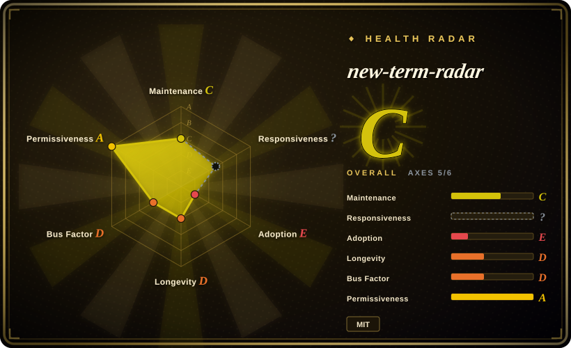
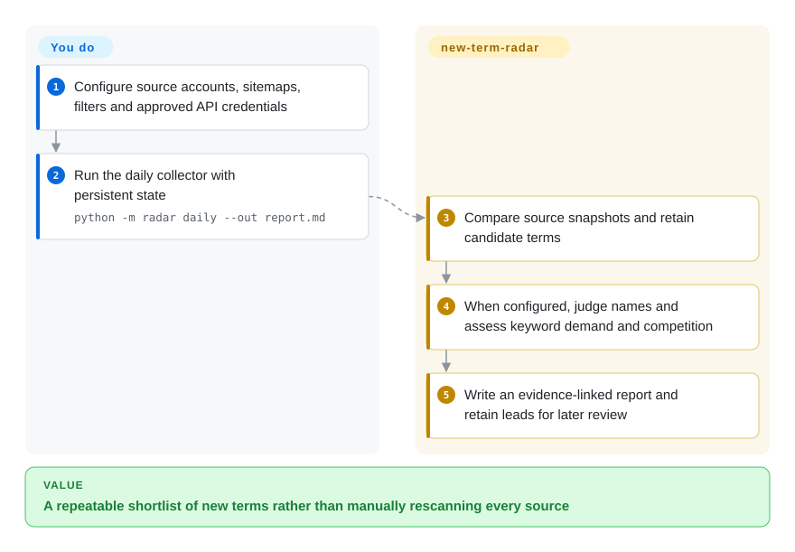
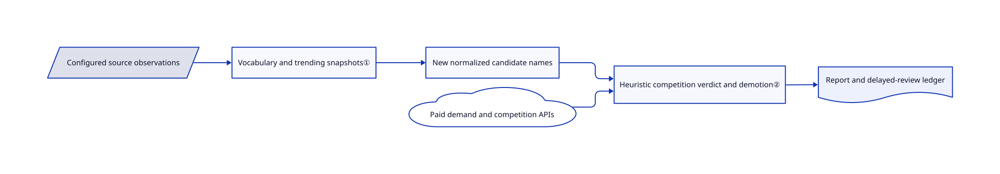

# new-term-radar

By the time a new AI product appears in your keyword dashboard, you may have missed its first mentions; this tool compares source snapshots and produces a daily, evidence-linked keyword shortlist.

## When to use

You run an AI directory, newsletter or niche product site and want to notice new names from selected X accounts, Hugging Face, GitHub and sitemap changes. Choose this scheduled collector when a local history of signals and a keyword decision table matter more than a broad SEO dashboard. The output is a research lead: you still read the evidence and test demand before building pages or products.

## When NOT to use

- Need rank tracking, backlinks and ongoing site operations? Choose [OpenSEO](open-seo.md), not a name-discovery radar.
- Need positioning, copy and conversion work after choosing a market? Choose [marketingskills](marketingskills.md); the radar collects signals rather than writing a marketing plan.
- Need a one-off launch audit? Choose [OPC Skills](opc-skills.md), not a stateful recurring collector.
- Cannot send queries to paid third-party services? Use only the documented free signals, or manually inspect source feeds. Full judging and keyword sizing rely on AIsa; MCP descriptions warn about cost but do not enforce spending approval.

## Comparison

| Alternative | In index | Our verdict | Tradeoff |
| --- | --- | --- | --- |
| [OpenSEO](open-seo.md) | ✅ | Choose OpenSEO for a persistent SEO operations dashboard; choose the radar for early names and change detection. | Broader site/competitor data versus a small local CLI with narrower signals. |
| [marketingskills](marketingskills.md) | ✅ | Choose marketingskills for marketing decisions and execution; choose the radar when those decisions first need fresh source evidence. | Prompt-led strategy versus executable collection and stateful review. |
| [OPC Skills](opc-skills.md) | ✅ | Choose OPC Skills for one launch's technical SEO chores; choose the radar for repeated discovery and later review of new terms. | Stateless checklists versus snapshots, SQLite history and recurring API spend. |

## Quick start

Review a pinned checkout, copy `config.example.json` to `config.json`, and select accounts, sitemap URLs and topic filters. Set an AIsa key only after approving paid API use, then run `python -m radar daily --out report.md`; documented free signals can run without that key but lose paid judging and keyword analysis. The first run establishes baselines, so an empty change list is not proof that nothing happened. The tool writes Markdown/JSON reports and local SQLite/snapshot state; you maintain the schedule, backups, account authorization and budget. MCP and three agent skills are optional interfaces, not replacements for scheduling. See [usage](https://github.com/zhuyansen/new-term-radar/blob/e2d33c335b7aface39e6c0eed29e61df5b5ff684/README.md#quick-start).

<!-- flow-steps:begin (generated from flows/new-term-radar.json by tools/flow_card.py — do not edit) -->

Text version of the flow

1. **You**: Configure source accounts, sitemaps, filters and approved API credentials
2. **You**: Run the daily collector with persistent state — `python -m radar daily --out report.md`
3. **new-term-radar**: Compare source snapshots and retain candidate terms
4. **new-term-radar**: When configured, judge names and assess keyword demand and competition
5. **new-term-radar**: Write an evidence-linked report and retain leads for later review

**Value**: A repeatable shortlist of new terms rather than manually rescanning every source

<!-- flow-steps:end -->

## Key techniques

<!-- mechanism:begin (generated from mechanisms/new-term-radar.json by tools/mechanism_card.py; do not edit) -->

Text version of the mechanism

- Configured source observations
- Vocabulary and trending snapshots①
- New normalized candidate names
- Paid demand and competition APIs
- Heuristic competition verdict and demotion②
- Report and delayed-review ledger

- Configured source observations → Vocabulary and trending snapshots①
- Vocabulary and trending snapshots① → New normalized candidate names
- New normalized candidate names → Heuristic competition verdict and demotion②
- Paid demand and competition APIs → Heuristic competition verdict and demotion②
- Heuristic competition verdict and demotion② → Report and delayed-review ledger

<!-- mechanism:end -->

### 1. Detect novelty against source-specific snapshots

- **Problem:** Trending lists contain repeated models, quantized copies and familiar names rather than only new opportunities.
- **How:** X collection keeps a dated vocabulary and requires multiple sources or a strong single-account signal. Hugging Face detection compares top entries with the prior snapshot and groups variants under a normalized base name.
- **Limits:** First runs only establish those baselines; naming heuristics can merge distinct products, and monitored sources are not the whole market.
- **Source:** [Novel-name filtering](https://github.com/zhuyansen/new-term-radar/blob/e2d33c335b7aface39e6c0eed29e61df5b5ff684/radar/sources.py#L43-L110), [model normalization and snapshots](https://github.com/zhuyansen/new-term-radar/blob/e2d33c335b7aface39e6c0eed29e61df5b5ff684/radar/sources.py#L113-L179).

### 2. Separate rising demand from search-result competition

- **Problem:** A rising keyword may still have a first page dominated by established sites.
- **How:** The competition module fetches organic results, keyword difficulty and optional domain ratings, then labels the opportunity open, mixed or crowded and demotes crowded priorities. SQLite retains leads for delayed review.
- **Limits:** These are heuristic thresholds, not ranking predictions. Missing difficulty and rating data can yield crowded; it must not be read as measured market saturation.
- **Source:** [Competition decision](https://github.com/zhuyansen/new-term-radar/blob/e2d33c335b7aface39e6c0eed29e61df5b5ff684/radar/competition.py#L118-L166), [review ledger](https://github.com/zhuyansen/new-term-radar/blob/e2d33c335b7aface39e6c0eed29e61df5b5ff684/radar/store.py#L51-L108).

## Tech stack

Python 3.10+ standard library, urllib HTTP clients, SQLite and compressed JSON snapshots. Optional MCP SDK and Markdown mail formatting; no required Python package dependencies in the core manifest.

## Dependencies

Full analysis needs AIsa; GoAnyAPI and TrustMRR add optional data. Search Console needs the user's OAuth authorization; email uses Resend. Free Hugging Face, GitHub and sitemap signals still need network access and API/rate-limit compliance.

## Ops difficulty

**Medium.** Persist state between runs and back it up: the supplied GitHub Actions workflow uses caches that can disappear and is disabled until explicitly enabled. Keep credentials in secrets, respect crawl delays and review incomplete-source warnings. Optional email sends report content off-machine. README documents restrictions on republishing TrustMRR data; check current provider terms before reuse.

## Health & viability

- Verified 2026-10-18: the manifest says 0.4.0, but GitHub has no releases and the contributor list has one author; the repository was created October 12.
- Tests and an opt-in scheduled workflow exist. [推断：依据是六天仓库历史与单作者记录] Treat it as a very young experiment, not established evidence that its leads outperform other research.
- MIT text names Yansen Zhu. Paid data vendors, referral links and changing API availability are practical dependencies independent of the code license.

## Caveats (unverified)

- [未验证：未授权付费 API 调用] Prices, lead time, search-volume estimates and keyword outcomes were not independently measured.
- [未验证：未登录数据服务] Current vendor terms and every source's live availability were not verified; quoted operational restrictions are documented by upstream.
- [推断：依据是六天仓库历史与单作者记录] Future maintenance and useful hit rates remain unproven.
