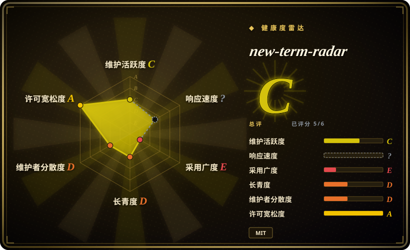
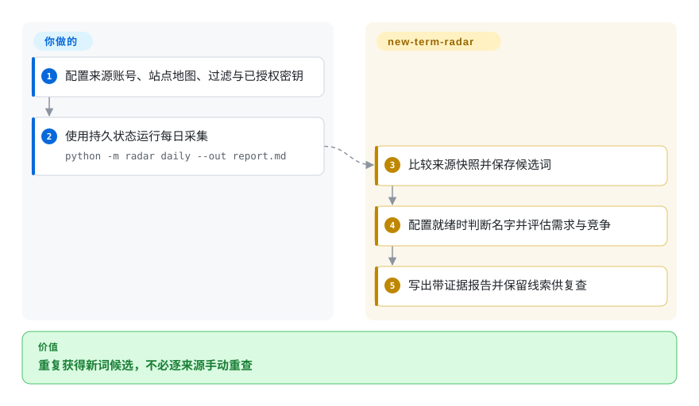
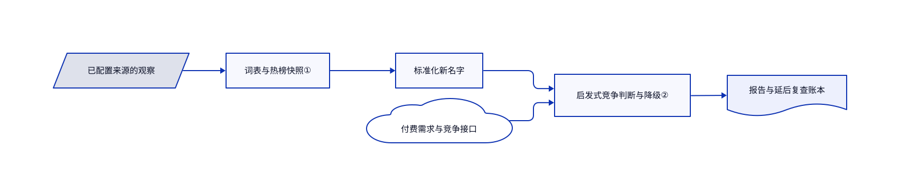

# new-term-radar

AI 新产品进入关键词面板时，你可能已错过首批讨论。这个工具比较来源快照，每日整理带证据的关键词候选。

## 何时使用

你运营 AI 目录、简报或细分产品站，想从指定 X 账号、Hugging Face、GitHub 和站点地图发现新名字。比起完整 SEO 面板，若更需要本地信号历史和关键词判断表，可以选这个定时采集器。输出只是研究线索，你仍须读原文、验证需求，再决定做页面或产品。

## 何时不用

- 要排名跟踪、外链与持续站点运营，选 [OpenSEO](open-seo.zh.md)，不是新词雷达。
- 选定市场后要定位、文案和转化，选 [marketingskills](marketingskills.zh.md)，雷达不代写营销方案。
- 只做一次上线审查，选 [OPC Skills](opc-skills.zh.md)，不必维护定时状态。
- 不接受第三方付费查询，就只开文档列出的免费信号，或手动看来源。完整命名判断与关键词规模依赖 AIsa；MCP 的费用提示不是支出授权硬门。

## 横向对比

| 替代品 | 是否收录 | 我们的评价 | 取舍 |
| --- | --- | --- | --- |
| [OpenSEO](open-seo.zh.md) | ✅ | 持续 SEO 运营面板选 OpenSEO；新名字和变化发现选雷达。 | 更广的站点与竞品数据，对比小型本地命令行和窄信号。 |
| [marketingskills](marketingskills.zh.md) | ✅ | 营销判断与执行选 marketingskills；判断前需要新鲜来源证据时选雷达。 | 提示词策略，对比可执行采集与有状态复查。 |
| [OPC Skills](opc-skills.zh.md) | ✅ | 单次上线的技术 SEO 杂务选 OPC Skills；反复发现和复查新词选雷达。 | 无状态清单，对比快照、SQLite 历史与持续 API 费用。 |

## 快速上手

先审阅固定版本，把 `config.example.json` 复制为 `config.json`，填写账号、站点地图和主题过滤。明确批准付费查询后再配 AIsa 密钥，运行 `python -m radar daily --out report.md`；不配密钥仍可跑免费信号，但没有完整命名判断和关键词分析。首次运行建立基线，空变化列表不证明什么都没发生。工具写 Markdown、JSON 和本地 SQLite、快照状态，你负责调度、备份、账号授权与预算。MCP 和三个技能是可选入口，不代替定时调度。来源为[使用说明](https://github.com/zhuyansen/new-term-radar/blob/e2d33c335b7aface39e6c0eed29e61df5b5ff684/README.md#quick-start)。

<!-- flow-steps:begin (generated from flows/new-term-radar.json by tools/flow_card.py — do not edit) -->

流程文字版

1. **你**：配置来源账号、站点地图、过滤与已授权密钥
2. **你**：使用持久状态运行每日采集 — `python -m radar daily --out report.md`
3. **new-term-radar**：比较来源快照并保存候选词
4. **new-term-radar**：配置就绪时判断名字并评估需求与竞争
5. **new-term-radar**：写出带证据报告并保留线索供复查

**价值**：重复获得新词候选，不必逐来源手动重查

<!-- flow-steps:end -->

## 技术要点

<!-- mechanism:begin (generated from mechanisms/new-term-radar.json by tools/mechanism_card.py; do not edit) -->

机制文字版

- 已配置来源的观察
- 词表与热榜快照①
- 标准化新名字
- 付费需求与竞争接口
- 启发式竞争判断与降级②
- 报告与延后复查账本

- 已配置来源的观察 → 词表与热榜快照①
- 词表与热榜快照① → 标准化新名字
- 标准化新名字 → 启发式竞争判断与降级②
- 付费需求与竞争接口 → 启发式竞争判断与降级②
- 启发式竞争判断与降级② → 报告与延后复查账本

<!-- mechanism:end -->

### 1. 对照各来源快照发现新名字

- **解决：** 热榜混有旧模型、量化副本和熟悉名字，未必都是新机会。
- **做法：** X 采集维护带日期词表，要求多来源或强单账号信号。Hugging Face 对比前次快照，并将模型变体归并到标准化名字。
- **边界：** 首轮只建立这些基线；命名规则可能误并不同产品，所监控来源也不代表全部市场。
- **源码：** [新名字过滤](https://github.com/zhuyansen/new-term-radar/blob/e2d33c335b7aface39e6c0eed29e61df5b5ff684/radar/sources.py#L43-L110)、[模型归并与快照](https://github.com/zhuyansen/new-term-radar/blob/e2d33c335b7aface39e6c0eed29e61df5b5ff684/radar/sources.py#L113-L179)。

### 2. 把需求上升与搜索结果竞争分开

- **解决：** 热度上升的词，首页可能仍由强站占据。
- **做法：** 竞争模块读取自然结果、关键词难度和可选域名评分，分成开放、混合、拥挤，并下调拥挤词优先级。SQLite 保留线索供延后复查。
- **边界：** 这些是启发式阈值，不是排名预测；难度和评分缺失也可能得到拥挤，不能当作实测市场饱和。
- **源码：** [竞争判断](https://github.com/zhuyansen/new-term-radar/blob/e2d33c335b7aface39e6c0eed29e61df5b5ff684/radar/competition.py#L118-L166)、[复查账本](https://github.com/zhuyansen/new-term-radar/blob/e2d33c335b7aface39e6c0eed29e61df5b5ff684/radar/store.py#L51-L108)。

## 技术栈

Python 3.10+ 标准库、urllib、SQLite 与压缩 JSON 快照。MCP SDK 和邮件 Markdown 格式化可选；核心清单没有必装 Python 包。

## 依赖

完整分析需要 AIsa，GoAnyAPI 与 TrustMRR 补可选数据。Search Console 需本人 OAuth，邮件依赖 Resend。免费的 Hugging Face、GitHub 和站点地图仍需联网，并遵守接口和速率限制。

## 运维难度

**中等。** 跨运行保留并备份状态；附带 GitHub Actions 使用可能被清除的缓存，且明确启用前不会调度。密钥放 secrets，遵守抓取间隔，并检查来源不全的警告。可选邮件会把报告发到外部。上游说明列出 TrustMRR 再发布限制，使用前应核对当前条款。

## 健康度与可持续性

- 2026-10-18 核验：清单版本为 0.4.0，但 GitHub 无发布版本，贡献者只有一位；仓库创建于 10 月 12 日。
- 有测试和默认关闭的定时流程。[推断：依据是六天仓库历史与单作者记录] 应当作年轻实验，不能假定线索质量优于其他研究方法。
- MIT 许可署名 Yansen Zhu。付费数据商、推荐链接和 API 可用性独立于代码许可。

## 存疑（未验证）

- [未验证：未授权付费 API 调用] 未独立测量费用、提前天数、搜索量估算和关键词成效。
- [未验证：未登录数据服务] 未核实当前服务条款和全部实时来源；相关限制来自上游文档。
- [推断：依据是六天仓库历史与单作者记录] 后续维护与有效命中率仍未获证明。
