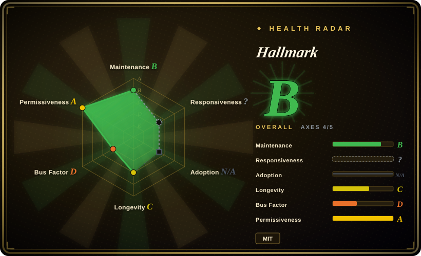
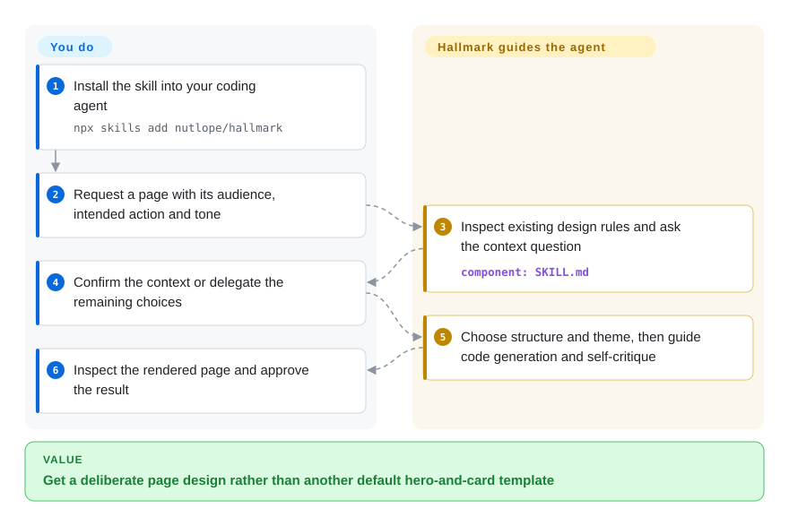

# Hallmark

Your agent keeps making the same hero-and-card page even after you ask for a different look. Hallmark makes it choose a page structure, remember earlier choices and critique the result before handing it back.

## When to use

You're using a supported coding agent to build or revise a web page, and technically correct output keeps collapsing into the same hero, card grid, type, and color defaults. You want one version-controlled Markdown skill that asks the agent to select a macrostructure and visual direction, check its own output against its anti-pattern rules, and leave a clearer design handoff. Pick Hallmark over a component library because it supplies an agent-facing design decision protocol, not a runtime UI kit.

Use its default build mode for a new page, `audit` for a no-edit critique, `redesign` to preserve content and information architecture while changing the visual fingerprint, or `study` to extract high-level design DNA from a screenshot or URL. It is a fit only when its opinionated visual direction is welcome.

## When NOT to use

- **You need accessible, composable production components.** Choose [shadcn/ui](https://github.com/shadcn-ui/ui) or your established design system; Hallmark ships Markdown rules, not React, Vue, or Svelte components.
- **You need a CSS compiler or utility framework.** Choose [Tailwind CSS](https://github.com/tailwindlabs/tailwindcss); Hallmark provides neither utility classes nor a CSS runtime.
- **You need deterministic visual regression or an enforceable quality gate.** Choose Playwright plus screenshot assertions, or a deterministic detector such as [Impeccable](../../../ai-design-generation/impeccable.md); Hallmark's self-critique and slop tests are advisory instructions interpreted by an agent.
- **Your agent cannot load custom skills or you do not use Claude Code, Cursor, or Codex.** Choose a framework-neutral design-system document instead; Hallmark's core asset is a harness-loaded `SKILL.md`.
- **A strict brand system already specifies tokens, templates, and approval flow.** Prefer that system as the authority; current Hallmark reads `design.md` first and defers to existing tokens, but agent interpretation is not deterministic policy enforcement.
- **Photographic art direction or finished image assets are the main job.** Pair it with an image-production workflow and human review; Hallmark can guide layout and asset choices, but its Markdown instructions do not themselves create licensed product photography.

## Comparison

| Alternative | In index | Our verdict | Tradeoff |
|---|---|---|---|
| [Taste-Skill](taste-skill.md) | ✅ | Choose Hallmark when its four explicit build, audit, redesign, and study verbs fit your workflow; choose Taste-Skill for a broader framework-agnostic taste pack. | Hallmark has a narrower, opinionated protocol and static demonstrations; Taste-Skill covers more aesthetic variants but remains advisory too. |
| [Designer Skills](designer-skills.md) | ✅ | Choose Designer Skills when research, UX strategy, design systems, and testing all need coverage; choose Hallmark when one compact anti-slop workflow is enough. | The broader pack has more surface area and routing complexity; Hallmark is easier to adopt but less complete. |
| [Impeccable](../../../ai-design-generation/impeccable.md) | ✅ | Choose Impeccable when deterministic detection of existing frontend artifacts is required; choose Hallmark when an agent needs a generative design brief and redesign process. | Impeccable offers a CLI/detectors; Hallmark offers taste guidance without deterministic enforcement. |
| [shadcn/ui](../../../web-ui/component-libraries/shadcn-ui.md) | ✅ | Choose shadcn/ui when the output must be an accessible component baseline; choose Hallmark when the missing layer is visual direction before component selection. | Components make implementation reusable; Hallmark affects the agent's design choices but supplies no component runtime. |

## Quick start

The [README](https://github.com/Nutlope/hallmark/blob/13ac0ec7e148655948100b6396439e481361d690/README.md#L94-L106) installs the skill with `npx skills add nutlope/hallmark`; alternatively copy `skills/hallmark/SKILL.md` and its references into the documented Claude Code or Codex skill folder, or adapt the body for Cursor rules. In a project, ask the agent to build a page and provide its audience, intended action and tone; the skill still asks its bundled context question, even when the brief contains those fields. It guides the agent through existing-design inspection, structure/theme selection, code output and self-critique, while you approve scope and verify the page in a browser. For an existing target, `hallmark audit <target>` is a prompt invocation that returns a no-edit punch list, not a standalone shell executable. You provide the coding agent/model and bear its usage cost; Hallmark supplies versioned instructions and examples, not a renderer, hosting or independent quality guarantee.

<!-- flow-steps:begin (generated from flows/hallmark.json by tools/flow_card.py — do not edit) -->

Text version of the flow

1. **You**: Install the skill into your coding agent — `npx skills add nutlope/hallmark`
2. **You**: Request a page with its audience, intended action and tone
3. **Hallmark**: Inspect existing design rules and ask the context question — component: `SKILL.md`
4. **You**: Confirm the context or delegate the remaining choices
5. **Hallmark**: Choose structure and theme, then guide code generation and self-critique
6. **You**: Inspect the rendered page and approve the result

**Value**: Get a deliberate page design rather than another default hero-and-card template

<!-- flow-steps:end -->

## Key techniques

- **Read the project's design before inventing one.** [`skills/hallmark/SKILL.md:147–201`](https://github.com/Nutlope/hallmark/blob/13ac0ec7e148655948100b6396439e481361d690/skills/hallmark/SKILL.md#L147-L201) prioritizes an existing `design.md`, then scans fonts, palette, motion, spacing and framework. It requests source citations and a `.hallmark/preflight.json` cache, preserving established tokens rather than applying a fresh aesthetic everywhere. Cache invalidation names specific manifest/config mtimes, so the prompt's cache is not a comprehensive filesystem change detector.
- **Rotate structure as well as color.** [`skills/hallmark/SKILL.md:264–331`](https://github.com/Nutlope/hallmark/blob/13ac0ec7e148655948100b6396439e481361d690/skills/hallmark/SKILL.md#L264-L331) uses CSS stamps and `.hallmark/log.json` to exclude recent macrostructures and vary theme/nav/footer choices. It reads a slim index and only the chosen reference files, reducing both repeated layouts and unnecessary context. With an authoritative `design.md`, consistency takes precedence over diversification; the agent must actually read and maintain the memory.
- **Separate small-component work and self-critique.** [`skills/hallmark/SKILL.md:42–89`](https://github.com/Nutlope/hallmark/blob/13ac0ec7e148655948100b6396439e481361d690/skills/hallmark/SKILL.md#L42-L89) asks for six 1–5 critique scores and revisions below 3, while the component path skips whole-page structures and requires eight interaction states. These are instructions interpreted by a model; a stamped score or checklist does not prove that browser states or accessibility passed.

## Health & viability

- **Maintenance snapshot (2026-10-13):** unarchived; main `13ac0ec` dates to 2026-08-06, and no GitHub Releases were returned. The manifest and skill version are both `1.1.0`; repository inactivity must not be hidden behind 29999 stars.
- **Governance / bus factor:** the repository is owned by a personal account. The contributor history has several contributors, but maintenance ownership and the stated Together AI relationship are not formally documented. [推断]
- **Age / Lindy:** created 2026-04-27, with less than six months of history and no long-term release record. Attention is not a durability proof.
- **Risk and adoption:** MIT lowers license friction. The core behavior is prompt instruction, so output quality and adherence depend on the host agent rather than a deterministic runtime.
- **Coverage limits:** responsiveness remains the scorer's existing `? / type_na`, because it treats skill-pack issues as outside that measurement channel; adoption is separately `N/A / no_install_channel`. These are different states, not evidence of good response times or zero users, and were not manually reclassified.

## Caveats (unverified)

- [未验证：no generation benchmark or browser run] The skill's effectiveness, host-specific loading and generated UI quality were not tested. README says 57 gates while SKILL.md also mentions 58; neither count is a reproduced deterministic test result.
- [未验证：no formal support agreement was reviewed] README's “Made by Together AI” attribution does not establish an organization-backed maintenance commitment.
- [推断：young history and no release artifacts] Pin a reviewed commit and independently verify rendered results rather than treating self-critique stamps as stable quality gates.
