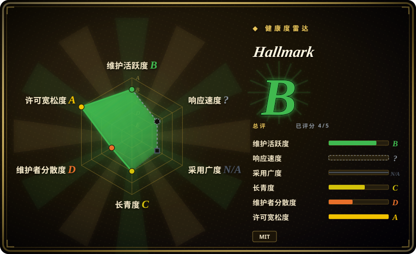
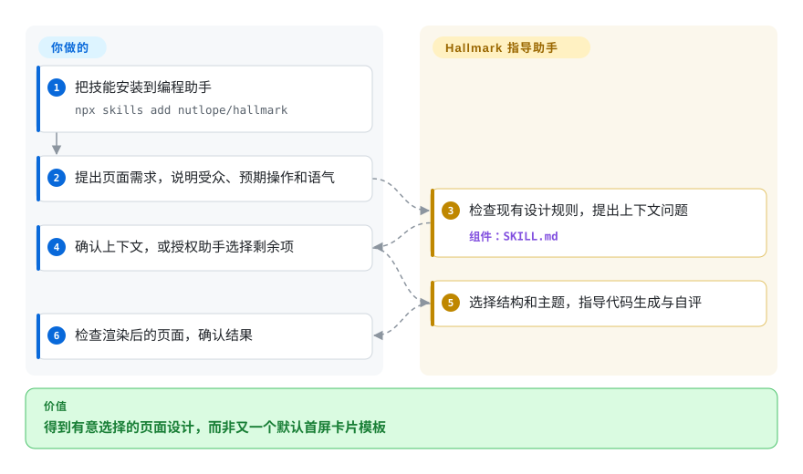
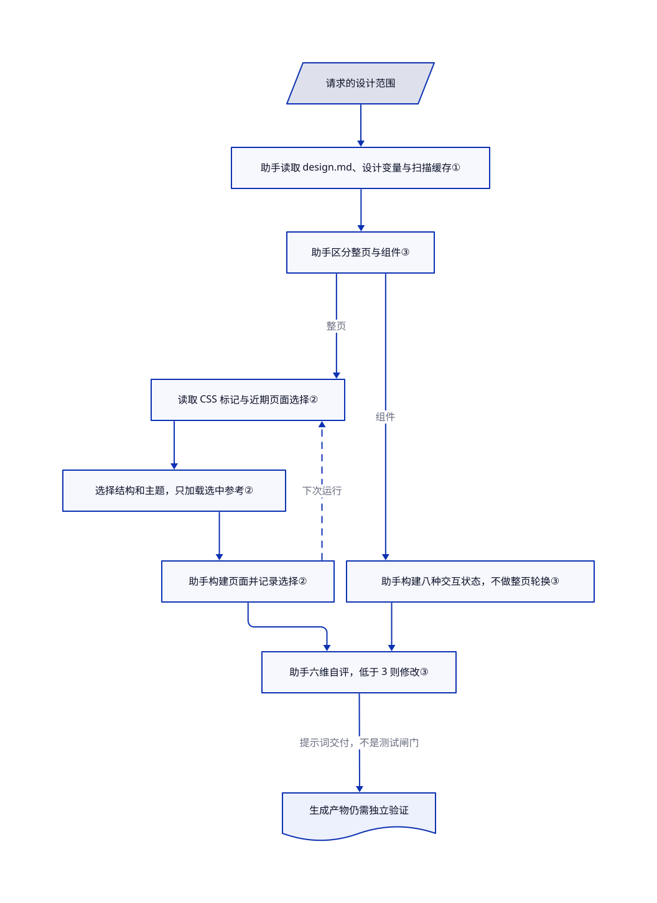

# Hallmark

让助手“换个样子”，它却总做出同一种首屏加卡片页面。Hallmark 要求它先选页面结构、记住之前的选择，再自评后交付。

## 何时使用

你用受支持的 coding agent 构建或改造网页，功能虽正确，产物却总坍缩为同一种 hero、卡片网格、字体和配色默认值。你需要一份可版本管理的 Markdown skill，让 agent 选择宏观结构和视觉方向，按反模式规则自查产物，并留下更清晰的设计交接。此时选 Hallmark，而不是组件库，因为它提供面向 agent 的设计决策协议，不是 UI 运行时套件。

新页面用默认 build 模式，`audit` 做只读批评，`redesign` 在保留内容和信息架构的前提下替换视觉指纹，`study` 则从截图或 URL 提取高层设计 DNA。前提是你欢迎它带有主张的视觉方向。

## 何时不用

- **你需要无障碍、可组合的生产组件。**改选 [shadcn/ui](https://github.com/shadcn-ui/ui) 或已有设计系统；Hallmark 提供 Markdown 规则，不提供 React、Vue 或 Svelte 组件。
- **你需要 CSS 编译器或原子化样式框架。**改选 [Tailwind CSS](https://github.com/tailwindlabs/tailwindcss)；Hallmark 不提供 utility class，也没有 CSS runtime。
- **你需要确定性的视觉回归或可强制执行的质量闸门。**改用 Playwright 加截图断言，或 [Impeccable](../../../ai-design-generation/impeccable.zh.md) 这样的确定性检测器；Hallmark 的自评与 slop test 是由 agent 解读的建议式指令。
- **你的 agent 无法加载自定义 skill，或你不使用 Claude Code、Cursor、Codex。**改用与 harness 无关的设计系统文档；Hallmark 的核心资产是由 harness 加载的 `SKILL.md`。
- **已有严格品牌系统，规定了 token、模板和审批流。**以该系统为权威；当前 Hallmark 会先读 `design.md` 并服从既有 token，但模型解释不能代替确定性的政策执行。
- **摄影美术指导或成品图片资产是主要工作。**搭配图片生产流程和人工审查；Hallmark 能指导布局、资产选择，Markdown 指令本身不会产出有许可的产品摄影。

## 横向对比

| 替代品 | 是否收录 | 我们的评价 | 取舍 |
|---|---|---|---|
| [Taste-Skill](taste-skill.zh.md) | ✅ | 工作流正好需要 build、audit、redesign、study 四个明确动词时选 Hallmark；需要更宽泛、框架无关的审美技能包时选 Taste-Skill。 | Hallmark 的协议更窄、更有主张，并带静态演示；Taste-Skill 覆盖更多美学变体，但同样只是建议式。 |
| [Designer Skills](designer-skills.zh.md) | ✅ | 研究、UX 策略、设计系统和测试都要覆盖时选 Designer Skills；一个紧凑的反 AI 味流程足够时选 Hallmark。 | 大型技能包的覆盖面和路由复杂度更高；Hallmark 更容易采用，但不够全面。 |
| [Impeccable](../../../ai-design-generation/impeccable.zh.md) | ✅ | 需要确定性检查既有前端产物时选 Impeccable；需要 agent 获得生成式设计 brief 与重设计流程时选 Hallmark。 | Impeccable 提供 CLI 与检测器；Hallmark 提供没有确定性执行力的审美指导。 |
| [shadcn/ui](../../../web-ui/component-libraries/shadcn-ui.zh.md) | ✅ | 产物必须有无障碍组件基线时选 shadcn/ui；组件选择之前缺的是视觉方向时选 Hallmark。 | 组件让实现可复用；Hallmark 影响 agent 的设计选择，但不提供组件运行时。 |

## 快速上手

[README](https://github.com/Nutlope/hallmark/blob/13ac0ec7e148655948100b6396439e481361d690/README.md#L94-L106) 用 `npx skills add nutlope/hallmark` 安装技能；也可把 `skills/hallmark/SKILL.md` 和 references 复制到文档指定的 Claude Code、Codex 技能目录，或把正文适配为 Cursor 规则。在项目中要求助手构建页面，并提供受众、预期操作和语气；即使需求已带这些信息，技能仍会发出合并的上下文提问。它指导助手检查现有设计、选结构和主题、输出代码并自评，你批准改动范围并在浏览器检查页面。已有页面可用 `hallmark audit <target>` 请求只读问题清单；这是对助手的调用语句，不是独立 shell 可执行程序。你提供编程助手和模型、承担使用费用，Hallmark 只提供版本化指令与示例，不提供渲染器、托管或独立质量保证。

<!-- flow-steps:begin (generated from flows/hallmark.json by tools/flow_card.py — do not edit) -->

流程文字版

1. **你**：把技能安装到编程助手 — `npx skills add nutlope/hallmark`
2. **你**：提出页面需求，说明受众、预期操作和语气
3. **Hallmark**：检查现有设计规则，提出上下文问题 — 组件：`SKILL.md`
4. **你**：确认上下文，或授权助手选择剩余项
5. **Hallmark**：选择结构和主题，指导代码生成与自评
6. **你**：检查渲染后的页面，确认结果

**价值**：得到有意选择的页面设计，而非又一个默认首屏卡片模板

<!-- flow-steps:end -->

## 技术要点

<!-- mechanism:begin (generated from mechanisms/hallmark.json by tools/mechanism_card.py; do not edit) -->

机制文字版

- 请求的设计范围
- 助手读取 design.md、设计变量与扫描缓存①
- 助手区分整页与组件③
- 读取 CSS 标记与近期页面选择②
- 选择结构和主题，只加载选中参考②
- 助手构建页面并记录选择②
- 助手构建八种交互状态，不做整页轮换③
- 助手六维自评，低于 3 则修改③
- 生成产物仍需独立验证

- 请求的设计范围 → 助手读取 design.md、设计变量与扫描缓存①
- 助手读取 design.md、设计变量与扫描缓存① → 助手区分整页与组件③
- 助手区分整页与组件③ → 读取 CSS 标记与近期页面选择②（整页）
- 读取 CSS 标记与近期页面选择② → 选择结构和主题，只加载选中参考②
- 选择结构和主题，只加载选中参考② → 助手构建页面并记录选择②
- 助手构建页面并记录选择② → 读取 CSS 标记与近期页面选择②（下次运行）〔可选／兜底〕
- 助手区分整页与组件③ → 助手构建八种交互状态，不做整页轮换③（组件）
- 助手构建页面并记录选择② → 助手六维自评，低于 3 则修改③
- 助手构建八种交互状态，不做整页轮换③ → 助手六维自评，低于 3 则修改③
- 助手六维自评，低于 3 则修改③ → 生成产物仍需独立验证（提示词交付，不是测试闸门）

<!-- mechanism:end -->

### 1. 先保留查到的设计规则，不急着换一套

- **解决：**每次任务都换配色和字体，会破坏项目已有的视觉系统。
- **做法：**提示词要求助手先读 `design.md`，再检查字体、配色、动效、间距和框架，并附文件行号。保留既有 token，也就是命名的设计变量，把发现存到 `.hallmark/preflight.json` 供下次复用。
- **边界：**缓存刷新只看点名的清单、配置文件修改时间或用户明确要求，不监测所有设计文件变化；助手还得实际遵循扫描指令。
- **源码：**[`SKILL.md:147–201`](https://github.com/Nutlope/hallmark/blob/13ac0ec7e148655948100b6396439e481361d690/skills/hallmark/SKILL.md#L147-L201)。

### 2. 记住页面形状，不只记住上次的颜色

- **解决：**换了颜色，却仍是同一种首屏加卡片网格，看起来还是套模板。
- **做法：**助手读取 CSS 标记和 `.hallmark/log.json`，排除近期页面结构，轮换主题、导航和页脚。先读精简目录，再只加载选中的参考文件；构建后记录选择，留给下次使用。
- **边界：**项目有权威 `design.md` 时，统一比轮换更重要。日志要被助手真正读取和更新才有用，小组件不参与整页轮换。
- **源码：**[`SKILL.md:264–331`](https://github.com/Nutlope/hallmark/blob/13ac0ec7e148655948100b6396439e481361d690/skills/hallmark/SKILL.md#L264-L331)、[`SKILL.md:443–462`](https://github.com/Nutlope/hallmark/blob/13ac0ec7e148655948100b6396439e481361d690/skills/hallmark/SKILL.md#L443-L462)、[`macrostructures.md:25–49`](https://github.com/Nutlope/hallmark/blob/13ac0ec7e148655948100b6396439e481361d690/skills/hallmark/references/macrostructures.md#L25-L49)。

### 3. 小组件单独走，自评也不冒充实测

- **解决：**一个按钮用不上整页布局，代码看着写完也可能漏了交互状态。
- **做法：**组件路径跳过整页结构，要求八种交互状态。各条路径交付前都要在六个维度按 1–5 自评，任何一项低于 3 就修改。
- **边界：**这些是由模型解释的指令，不是可执行的质量闸门。分数标记或状态清单不能证明浏览器行为、无障碍检查通过。
- **源码：**[`SKILL.md:42–89`](https://github.com/Nutlope/hallmark/blob/13ac0ec7e148655948100b6396439e481361d690/skills/hallmark/SKILL.md#L42-L89)、[`slop-test.md:9–24`](https://github.com/Nutlope/hallmark/blob/13ac0ec7e148655948100b6396439e481361d690/skills/hallmark/references/slop-test.md#L9-L24)。

## 健康度与可持续性

- **维护快照（2026-10-13）：**未归档，main 提交 `13ac0ec` 来自 2026-08-06，GitHub Releases 返回空。manifest 和技能版本均为 `1.1.0`，不能用 29999 stars 掩盖仓库近期停更。
- **治理与 bus factor：**仓库归个人账号所有。贡献历史中有多名贡献者，但维护归属和其所称 Together AI 关系都没有正式文档。[推断]
- **年龄与 Lindy：**创建于 2026-04-27，不足六个月，没有长期发布记录；关注度不是耐久性证明。
- **风险与采用：**MIT 降低许可摩擦。核心行为是提示词指令，产物质量与遵循程度取决于宿主 agent，而非确定性运行时。
- **覆盖限制：**响应轴保留评分器已有的 `? / type_na`，因为它将 skill-pack 的 issue 排除在该测量通道外；采用轴另为 `N/A / no_install_channel`。两者不是同一状态，不证明响应好或没有用户，本次未手动重分类。

## 存疑（未验证）

- [未验证：未做生成基准或浏览器运行] 未测试技能效果、各宿主加载和最终界面质量。README 称 57 个闸门，SKILL.md 也提到 58；都不是本次复现的确定性测试结果。
- [未验证：未读到正式支持协议] README 的“Made by Together AI”归属表述不能证明组织提供维护承诺。
- [推断：依据是年轻历史和无发布产物] 固定已读 commit，并独立检查渲染结果，不把自评分数标记当稳定质量闸门。
