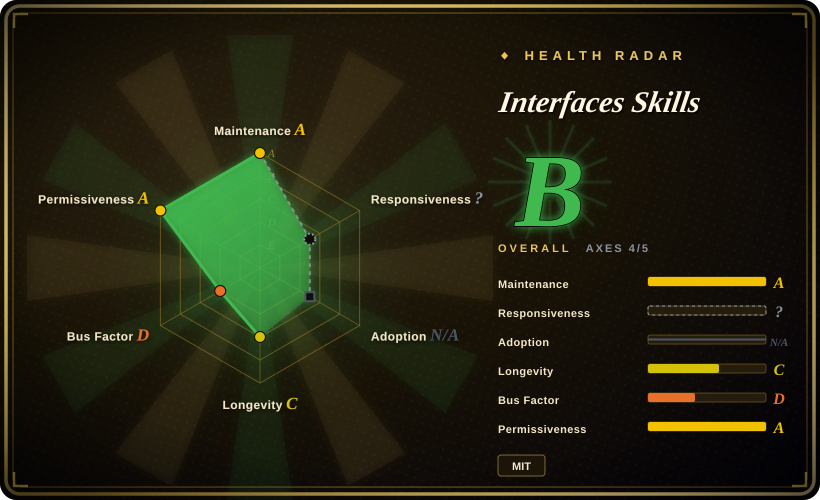
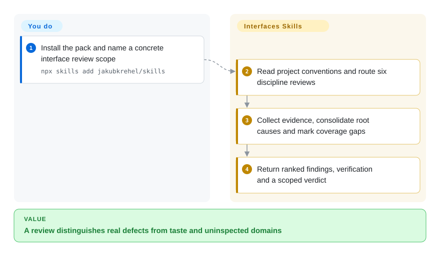
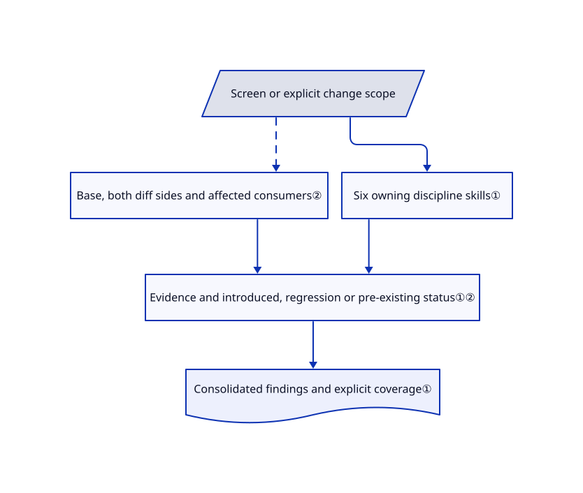

# Interfaces Skills

Your interface review catches shadows but misses a broken keyboard path or loading state. This pack routes one review through six design disciplines and reports evidence, coverage and change-caused regressions separately.

## When to use

You ship product UI with a coding agent and need a review that distinguishes an actual inaccessible control from a reviewer's taste. Choose this pack for coordinated accessibility, layout, writing, typography, color and polish checks, with read-only review defaults. It also supplies temporary component-state workbenches; these are development helpers, not the review itself.

## When NOT to use

- For a narrow polish checklist, [make-interfaces-feel-better](make-interfaces-feel-better.md) is a smaller same-author reference; the collection adds broader review and state workflows.
- For choosing a distinctive visual direction from scratch, use [Taste-Skill](taste-skill.md); this pack's review is anchored in project conventions and observed defects.
- For persistent cross-session design decisions, examine [Interface Design](interface-design.md). Evidence coverage tables are not a design-memory file.
- For a deterministic accessibility certification, use browser tests and a real accessibility testing process. These skills instruct a model; they do not prove compliance.

## Comparison

| Alternative | In index | Our verdict | Tradeoff |
|---|---|---|---|
| [make-interfaces-feel-better](make-interfaces-feel-better.md) | ✅ | Choose the smaller pack for mechanical polish; choose Interfaces Skills when a cross-domain review is the deliverable. | Less instruction surface versus coordinated scope and coverage reporting. |
| [Taste-Skill](taste-skill.md) | ✅ | Choose Taste-Skill to establish a new aesthetic; choose this when existing project conventions should constrain findings. | Opinionated generation direction versus evidence-driven interface review. |
| [Interface Design](interface-design.md) | ✅ | Choose Interface Design when design decisions keep vanishing between sessions; choose this to inspect current states and regressions. | Persistent direction protocol versus explicit review evidence and temporary state fixtures. |

## Quick start

Install with the README's `npx skills add jakubkrehel/skills`, or use its Claude Code plugin route. Ask `better-interface` to review a concrete screen or flow; explicitly invoke `interface-review` for a branch, PR or uncommitted change. The skills load domain references and consolidate findings, while you supply the project, preview environment and authority to run checks. Review does not authorize implementation. Use `state-machine` separately when you want a temporary route that renders the real component with controlled fixtures.

<!-- flow-steps:begin (generated from flows/jakubkrehel-skills.json by tools/flow_card.py — do not edit) -->

Text version of the flow

1. **You**: Install the pack and name a concrete interface review scope — `npx skills add jakubkrehel/skills`
2. **Interfaces Skills**: Read project conventions and route six discipline reviews
3. **Interfaces Skills**: Collect evidence, consolidate root causes and mark coverage gaps
4. **Interfaces Skills**: Return ranked findings, verification and a scoped verdict

**Value**: A review distinguishes real defects from taste and uninspected domains

<!-- flow-steps:end -->

## Key techniques

<!-- mechanism:begin (generated from mechanisms/jakubkrehel-skills.json by tools/mechanism_card.py; do not edit) -->

Text version of the mechanism

- Screen or explicit change scope
- Base, both diff sides and affected consumers②
- Six owning discipline skills①
- Evidence and introduced, regression or pre-existing status①②
- Consolidated findings and explicit coverage①

- Screen or explicit change scope → Base, both diff sides and affected consumers② [optional/fallback]
- Screen or explicit change scope → Six owning discipline skills①
- Base, both diff sides and affected consumers② → Evidence and introduced, regression or pre-existing status①②
- Six owning discipline skills① → Evidence and introduced, regression or pre-existing status①②
- Evidence and introduced, regression or pre-existing status①② → Consolidated findings and explicit coverage①

<!-- mechanism:end -->

### 1. Separate discipline rules from review orchestration

- **Problem:** Six overlapping checklists can duplicate findings or label uninspected domains as clear.
- **How:** better-interface loads each owning skill, applies one severity scale, consolidates systemic causes and records evidence per domain. Missing skills become Not reviewed; high-impact triggers cannot be averaged down.
- **Limits:** A model still performs and reports the checks. The report cap is 15 findings and must disclose excluded blockers; coverage is not exhaustive certification.
- **Source:** [Orchestration](https://github.com/jakubkrehel/skills/blob/4c66b1fa86e9ab70187b43d7da9b6fdb29f2ef63/skills/better-interface/SKILL.md#L36-L117), [coverage format](https://github.com/jakubkrehel/skills/blob/4c66b1fa86e9ab70187b43d7da9b6fdb29f2ef63/skills/better-interface/review-format.md).

### 2. Review the change's cause, not just touched lines

- **Problem:** A shared-token change breaks an untouched consumer, while pre-existing defects distract from the actual regression.
- **How:** interface-review resolves a base, reads both diff sides, expands affected consumers and classifies findings as introduced, regression or pre-existing. It forbids rewriting the author's checkout and refuses to guess a last-commit scope.
- **Limits:** Consumer expansion is capped at five and must disclose omissions. Rendered checks are conditional, so source-only review cannot claim visual verification.
- **Source:** [Change review](https://github.com/jakubkrehel/skills/blob/4c66b1fa86e9ab70187b43d7da9b6fdb29f2ef63/skills/interface-review/SKILL.md#L23-L105).

## Health & viability

- On 2026-10-18, main last changed on 2026-10-13; no GitHub release was listed. Created 2026-07-10, the collection has about three months of history.
- Jakub Krehel owns the repository and dominates contributions. The README links his design writing; there is no evidence here of foundation governance or guaranteed support.
- MIT text credits the same author. The 8,007 stars do not measure whether an agent followed the review protocol.
- [推断：依据是提示词实现与短历史] Useful review patterns can be vendored at a fixed commit, but installing the whole pack may overlap existing design skills.

## Caveats (unverified)

- [未验证：未安装或执行上游技能] Cross-host loading, rendered review quality and state-page cleanup were not tested.
- [推断：依据是提示词实现与短历史] Severity and coverage contracts remain advisory unless backed by actual tests.
