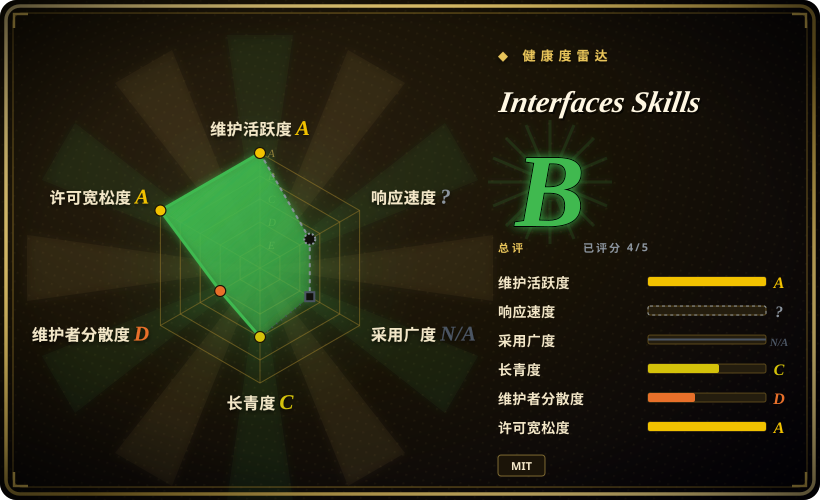
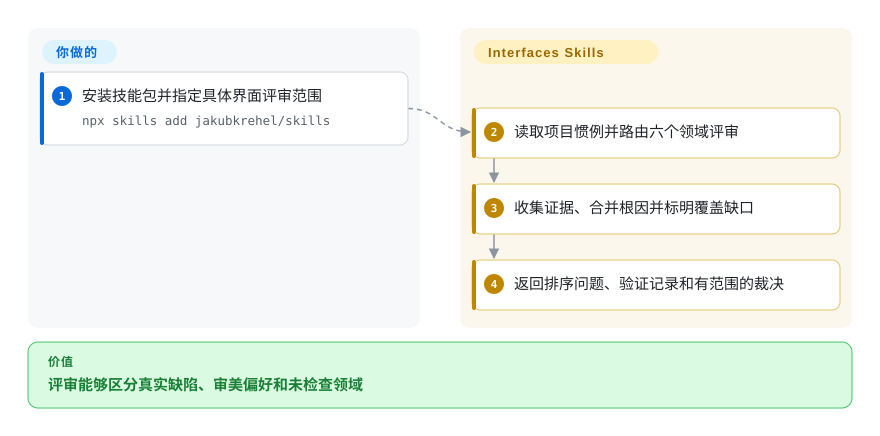
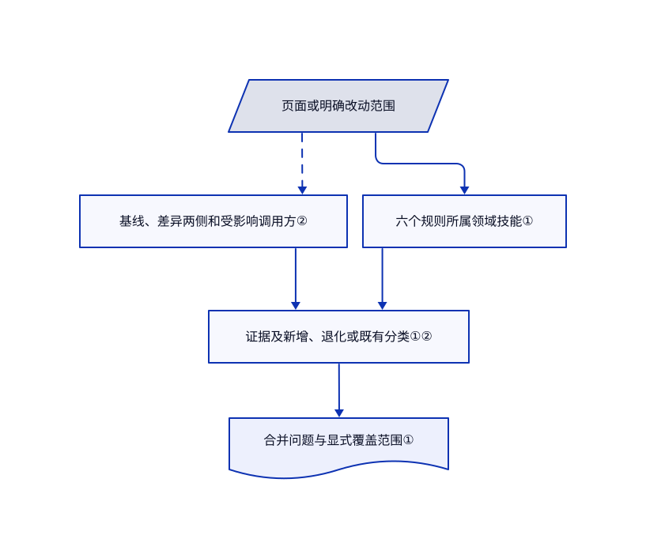

# Interfaces Skills

界面评审看到了阴影，却漏掉键盘走不通和加载状态。这个技能包按六个设计领域审查，并分开报告证据、覆盖范围和本次改动引起的退化。

## 何时使用

你让编码代理开发产品界面，希望评审区分真正的无障碍缺陷与个人审美。若需要协调无障碍、布局、文案、字体、颜色和细节检查，并默认只读评审，选这个包。它还提供临时组件状态工作台；那是开发助手，不是评审本身。

## 何时不用

- 只要窄范围细节清单，可参考同作者较小的 [make-interfaces-feel-better](make-interfaces-feel-better.zh.md)；本集合扩展了跨领域评审和状态流程。
- 从零确定鲜明视觉方向，选 [Taste-Skill](taste-skill.zh.md)。本包评审依照项目惯例和可观察缺陷。
- 要跨会话保存设计决策，先看 [Interface Design](interface-design.zh.md)。证据覆盖表不是设计记忆文件。
- 要确定性无障碍认证，使用浏览器测试和正式无障碍测试流程。技能指导模型，不证明合规。

## 横向对比

| 替代品 | 是否收录 | 我们的评价 | 取舍 |
|---|---|---|---|
| [make-interfaces-feel-better](make-interfaces-feel-better.zh.md) | ✅ | 机械细节打磨选小包；交付跨领域评审时选 Interfaces Skills。 | 指令负担更小，或获得统一范围与覆盖报告。 |
| [Taste-Skill](taste-skill.zh.md) | ✅ | 确立新审美选 Taste-Skill；既有项目惯例应约束问题判断时选本包。 | 生成时的审美方向，与有证据的界面评审不同。 |
| [Interface Design](interface-design.zh.md) | ✅ | 设计决策跨会话消失时选 Interface Design；检查当前状态和退化时选本包。 | 持久方向协议，与显式证据和临时状态样本不同。 |

## 快速上手

使用 README 的 `npx skills add jakubkrehel/skills`，或走 Claude Code 插件路线。让 `better-interface` 审查具体页面或完整流程；分支、PR 或未提交改动则显式调用 `interface-review`。技能加载各领域参考并合并问题；你提供项目、预览环境和检查授权。评审不等于授权实施。需要用受控样本展示真实组件时，另用 `state-machine` 建临时路由。

<!-- flow-steps:begin (generated from flows/jakubkrehel-skills.json by tools/flow_card.py — do not edit) -->

流程文字版

1. **你**：安装技能包并指定具体界面评审范围 — `npx skills add jakubkrehel/skills`
2. **Interfaces Skills**：读取项目惯例并路由六个领域评审
3. **Interfaces Skills**：收集证据、合并根因并标明覆盖缺口
4. **Interfaces Skills**：返回排序问题、验证记录和有范围的裁决

**价值**：评审能够区分真实缺陷、审美偏好和未检查领域

<!-- flow-steps:end -->

## 技术要点

<!-- mechanism:begin (generated from mechanisms/jakubkrehel-skills.json by tools/mechanism_card.py; do not edit) -->

机制文字版

- 页面或明确改动范围
- 基线、差异两侧和受影响调用方②
- 六个规则所属领域技能①
- 证据及新增、退化或既有分类①②
- 合并问题与显式覆盖范围①

- 页面或明确改动范围 → 基线、差异两侧和受影响调用方②〔可选／兜底〕
- 页面或明确改动范围 → 六个规则所属领域技能①
- 基线、差异两侧和受影响调用方② → 证据及新增、退化或既有分类①②
- 六个规则所属领域技能① → 证据及新增、退化或既有分类①②
- 证据及新增、退化或既有分类①② → 合并问题与显式覆盖范围①

<!-- mechanism:end -->

### 1. 分开领域规则与评审编排

- **解决：** 六套重叠清单容易重复报告，或把没检查的领域写成无问题。
- **做法：** better-interface 加载各规则所属技能，统一严重度，合并共同根因，并逐领域记录证据。缺技能就标明未审查，高影响触发项不得被平均降级。
- **边界：** 检查仍由模型执行和报告。报告上限为 15 项，必须说明被排除的阻断项；覆盖声明不是完整认证。
- **源码：** [编排](https://github.com/jakubkrehel/skills/blob/4c66b1fa86e9ab70187b43d7da9b6fdb29f2ef63/skills/better-interface/SKILL.md#L36-L117)、[覆盖格式](https://github.com/jakubkrehel/skills/blob/4c66b1fa86e9ab70187b43d7da9b6fdb29f2ef63/skills/better-interface/review-format.md)。

### 2. 按改动原因评审，不只看被碰的行

- **解决：** 共享变量改坏未修改的调用方，旧缺陷又分散了对本次退化的注意力。
- **做法：** interface-review 确定基线，读差异两侧，扩展受影响调用方，将问题分为新增、退化和既有。它禁止改写作者工作区，也拒绝擅自把最后一个提交当范围。
- **边界：** 调用方扩展最多五个，必须说明遗漏。渲染检查有条件进行，源码评审不能声称已经视觉验证。
- **源码：** [改动评审](https://github.com/jakubkrehel/skills/blob/4c66b1fa86e9ab70187b43d7da9b6fdb29f2ef63/skills/interface-review/SKILL.md#L23-L105)。

## 健康度与可持续性

- 截至 2026-10-18，主干最近提交为 2026-10-13，未列 GitHub 发布。集合创建于 2026-07-10，只有约三个月历史。
- Jakub Krehel 持有仓库并主导贡献，README 链接其设计写作。未见基金会治理或持续支持保证。
- MIT 实文署名同一作者。8,007 颗星不衡量代理是否遵守评审协议。
- [推断：依据是提示词实现与短历史] 可固定提交吸收评审模式，但整包安装可能与现有设计技能重叠。

## 存疑（未验证）

- [未验证：未安装或执行上游技能] 未测试跨宿主加载、渲染评审质量及临时页面清理。
- [推断：依据是提示词实现与短历史] 严重度和覆盖合同仍是建议，除非有真实测试支持。
