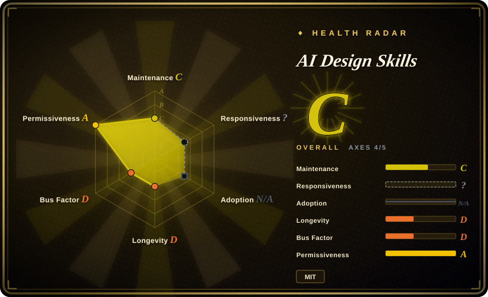
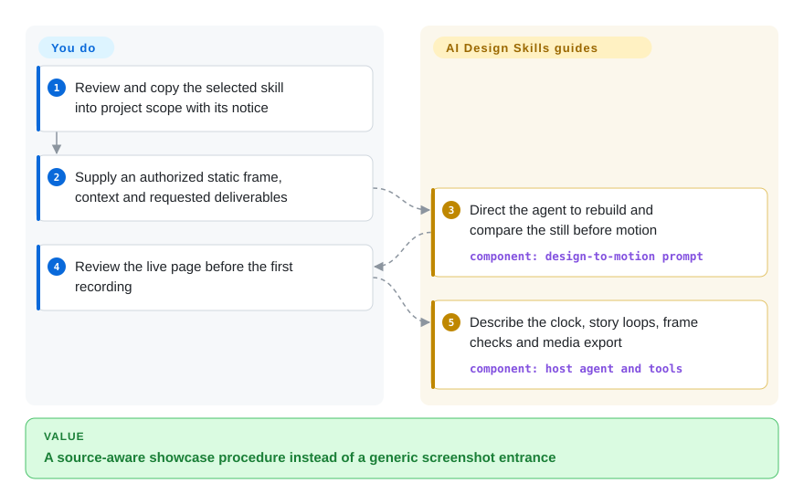
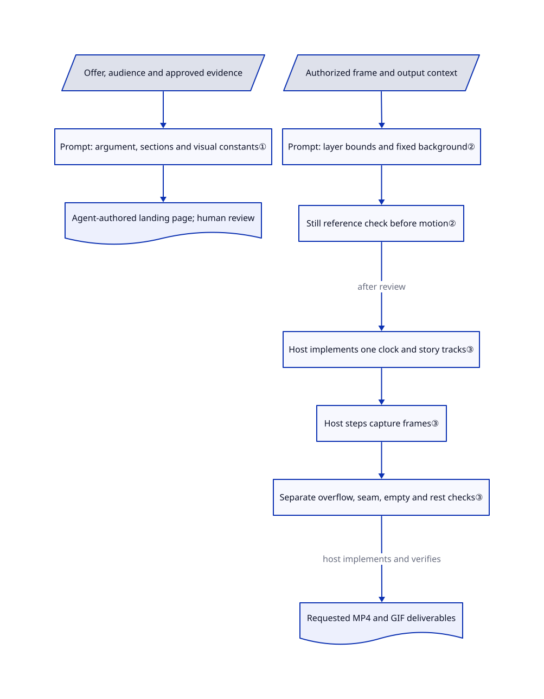

# AI Design Skills

Your agent makes a static mockup slide in, but the chart never does anything and the loop jumps at its seam. Elaya's two Markdown skills separate landing-page planning from source-matched motion, then describe still-frame checks and stepped video capture.

## When to use

You have an authorized Figma frame or screenshot and need a product showcase: the same background, a believable loading sequence, visible activity inside the cards, and MP4/GIF deliverables. Choose this collection when that source-to-showcase procedure matters more than tuning a product's hover or menu interaction. Its second entry can also plan a new landing page's offer, audience, primary action and visual values before the agent writes sections.

The repository contains two skill documents, not a renderer application or export service. You bring the coding agent, model access, design rights and execution tools. Its useful distinction is the explicit separation of showcase exports from production website sections; the former may use exported text layers, while the latter should retain live text and stop motion offscreen.

## When NOT to use

- **You are building dense product UI whose decisions must survive sessions.** Consider [Interface Design](../ui-taste/interface-design.md), or keep your governed project tokens directly. This collection's landing-page skill imposes font, size, spacing and mandatory reveal choices across a very broad UI trigger; do not let it silently replace an existing brand contract.
- **You need frequent product interactions to feel quick and interruptible.** Choose [Skills For Design Engineers](../ui-taste/emilkowalski-skills.md). This collection explicitly separates its slower showcase choreography from product interactions; its one-second entrances are not a menu latency recommendation.
- **The problem is invented statistics or testimonials, not visual polish.** Prefer [Anti Slop](../ui-taste/anti-slop.md) plus real business evidence. The landing skill asks for proof but also suggests realistic-looking names and non-round example numbers. Plausibility is not substantiation, and neither pack's agent-written checklist is a machine proof.
- **You need executable browser APIs and assertions rather than a capture recipe.** Use [Playwright](../../../web-automation/playwright-family/playwright.md) as the substrate for your own tested recorder/exporter. This repository supplies Markdown and inline snippets, no package manifest, complete runner, tests or sample exported files; installing it does not establish pixel fidelity. A flat screenshot cannot reliably provide every independently animated layer.

## Comparison

| Alternative | In index | Our verdict | Tradeoff |
|---|---|---|---|
| [Skills For Design Engineers](../ui-taste/emilkowalski-skills.md) | ✅ | Choose Emil's pack for product interaction frequency, interruption and motion review; choose this collection for reconstructing a supplied frame into a showcase loop and media deliverables. | Product motion can deliberately remove animation; this pack spends effort on source fidelity, visible story loops and capture instructions. Both rely on the host agent. |
| [Interface Design](../ui-taste/interface-design.md) | ✅ | Choose Interface Design for dashboards/settings with persistent project decisions; choose this collection for a new conversion landing or a supplied visual's export workflow. | A project design file and component checkpoints versus explicit landing rules and media choreography; neither is a deterministic build gate. |
| [Anti Slop](../ui-taste/anti-slop.md) | ✅ | Choose Anti Slop when preserving your visual system while rejecting unsupported claims and dead controls decides the work; choose this collection when you deliberately want its visual recipe and showcase structure. | Style-neutral completeness guidance avoids imposing this pack's font/spacing/reveal defaults, but does not supply its Figma-layer or video-clock recipe. |

## Quick start

Review the chosen folder under `skills/` and the root MIT notice at the pinned commit, then copy only that skill into your project's supported rules directory; the [README](https://github.com/elayadesign/ai-design-skills/blob/38bbe5765600b9178b5395a823c9f6c8d2b8e730/README.md#L20-L64) documents `.claude/skills`, Cursor rules and other host entry files. Ask in ordinary language for either the landing task or the static-design animation, rather than assuming a bundled command-line program exists. For the motion route, supply an authorized frame, desired context and deliverables; Figma extraction needs separately authorized API access, while a flat image has stated separation limits. The skill directs the agent to rebuild the still, show the live page before the first recording, add motion, and implement frame capture plus FFmpeg export. You provide the model, browser/capture toolchain, credentials when needed, output inspection and actual test evidence; none were installed or run for this entry. Keep copyright/permission notices when copying the skill text: the README's short “no attribution needed” line does not remove the actual [MIT notice condition](https://github.com/elayadesign/ai-design-skills/blob/38bbe5765600b9178b5395a823c9f6c8d2b8e730/LICENSE#L5-L13).

<!-- flow-steps:begin (generated from flows/ai-design-skills.json by tools/flow_card.py — do not edit) -->

Text version of the flow

1. **You**: Review and copy the selected skill into project scope with its notice
2. **You**: Supply an authorized static frame, context and requested deliverables
3. **AI Design Skills**: Direct the agent to rebuild and compare the still before motion — component: `design-to-motion prompt`
4. **You**: Review the live page before the first recording
5. **AI Design Skills**: Describe the clock, story loops, frame checks and media export — component: `host agent and tools`

**Value**: A source-aware showcase procedure instead of a generic screenshot entrance

<!-- flow-steps:end -->

## Key techniques

<!-- mechanism:begin (generated from mechanisms/ai-design-skills.json by tools/mechanism_card.py; do not edit) -->

Text version of the mechanism

- Offer, audience and approved evidence
- Prompt: argument, sections and visual constants①
- Agent-authored landing page; human review
- Authorized frame and output context
- Prompt: layer bounds and fixed background②
- Still reference check before motion②
- Host implements one clock and story tracks③
- Host steps capture frames③
- Separate overflow, seam, empty and rest checks③
- Requested MP4 and GIF deliverables

- Offer, audience and approved evidence → Prompt: argument, sections and visual constants①
- Prompt: argument, sections and visual constants① → Agent-authored landing page; human review
- Authorized frame and output context → Prompt: layer bounds and fixed background②
- Prompt: layer bounds and fixed background② → Still reference check before motion②
- Still reference check before motion② → Host implements one clock and story tracks③ (after review)
- Host implements one clock and story tracks③ → Host steps capture frames③
- Host steps capture frames③ → Separate overflow, seam, empty and rest checks③
- Separate overflow, seam, empty and rest checks③ → Requested MP4 and GIF deliverables (host implements and verifies)

<!-- mechanism:end -->

### 1. Decide the landing argument before applying visual constants

- **Problem:** A polished page can still lack a clear offer, audience or next action.
- **How:** The landing prompt collects those inputs, chooses a page structure, drafts copy and builds section by section before applying fixed typography/spacing/radius/motion rules.
- **Limits:** These are host-agent instructions, not an optimizer or rule engine. Broad UI activation and strong font/reveal defaults can conflict with an existing system; example numbers and an assumed brief are not verified conversion evidence.
- **Source:** [Intake, structure and build order:24–127](https://github.com/elayadesign/ai-design-skills/blob/38bbe5765600b9178b5395a823c9f6c8d2b8e730/skills/landing-page-design/SKILL.md#L24-L127), [visual constants and content realism:146–357](https://github.com/elayadesign/ai-design-skills/blob/38bbe5765600b9178b5395a823c9f6c8d2b8e730/skills/landing-page-design/SKILL.md#L146-L357).

### 2. Bind motion to a checked source frame and an explicit output context

- **Problem:** Animating a screenshot as one block or rebuilding a photo background loosely destroys the supplied design.
- **How:** The motion prompt separates showcase from website use, exports independently moving Figma layers with bounds/z-order, keeps the background fixed, and asks for still/reference comparison before animation. Showcase text may remain images; website text should be live HTML with offscreen and reduced-motion handling.
- **Limits:** No Figma client or comparison program is shipped. Layer accessibility, image rights, API availability and reconstruction remain the operator's responsibility; the document's PSNR targets do not establish an achieved or universally meaningful perceptual score.
- **Source:** [Context split:20–52](https://github.com/elayadesign/ai-design-skills/blob/38bbe5765600b9178b5395a823c9f6c8d2b8e730/skills/design-to-motion/SKILL.md#L20-L52), [source/layer/background handling:72–190](https://github.com/elayadesign/ai-design-skills/blob/38bbe5765600b9178b5395a823c9f6c8d2b8e730/skills/design-to-motion/SKILL.md#L72-L190).

### 3. Describe one controllable clock and several distinct loop checks

- **Problem:** Real-time recording and checking only the loop seam can miss frame drift or an empty state that retains old animation state.
- **How:** The recipe exposes still/loop/capture modes, drives time-based effects through one clock, advances capture in whole milliseconds averaging 60 frames per second, and separately checks shape overflow, seam, empty beat and rest before FFmpeg encoding.
- **Limits:** The clock and capture snippets must be implemented by the host; there is no shipped runner, locked toolchain or automatic enforcement of these checks. This review did not generate a page, record frames, measure fidelity or encode media.
- **Source:** [Modes and clock:172–190](https://github.com/elayadesign/ai-design-skills/blob/38bbe5765600b9178b5395a823c9f6c8d2b8e730/skills/design-to-motion/SKILL.md#L172-L190), [loop/motion checks:298–350](https://github.com/elayadesign/ai-design-skills/blob/38bbe5765600b9178b5395a823c9f6c8d2b8e730/skills/design-to-motion/SKILL.md#L298-L350), [capture and formats:354–417](https://github.com/elayadesign/ai-design-skills/blob/38bbe5765600b9178b5395a823c9f6c8d2b8e730/skills/design-to-motion/SKILL.md#L354-L417).

## Health & viability

- **Maintenance, 2026-10-25:** created 2026-07-29, updated on the verification day; the observed contributor endpoint attributes four commits to the owner, with no GitHub releases. Pin the skill contents rather than expecting a stable package release.
- **Ownership and longevity:** the five-file repository has two skill documents and a real MIT text naming Elaya. It is roughly three months old and individually maintained. [推断：based on repository age and observed ownership, without longitudinal outcome data] Current attention does not establish a strong Lindy prior or continuity guarantee.
- **Provenance:** the motion document credits three MIT projects. Their actual license texts were read; neither of this repository's two skill blobs matches those fetched source trees exactly. That rebuts a majority-identical-file claim, not every possible text-level borrowing or copyright question.
- **Adoption and scope:** 4,574 stars and 317 forks are dated attention, not measured installs, design quality or conversion improvement. The separate `redesign-skill` repository linked by the README is a companion, not an installed third skill here; it is not added in this batch.

## Caveats (unverified)

- [未验证：upstream skills and generated code were not installed or executed] Host activation, visual quality, accessibility, conversion outcomes, capture determinism, PSNR and media output were not reproduced; the repository contains instructions and snippets, not passing runtime evidence.
- [未验证：no authorized Figma access or real design assets used] API permissions, export limits, CDN behavior, source-image licensing and per-layer reconstruction were not tested.
- [推断：based on the broad trigger and fixed visual rules, not a multi-pack experiment] Loading several design packs together can produce contradictory instructions; scope one chosen skill to the project and retain the real brand contract.
- [未验证：exact Git-blob comparison is narrower than full authorship review] Credited licenses and zero identical skill blobs do not certify all adapted prose or downstream assets; preserve actual notices and review third-party materials individually.
