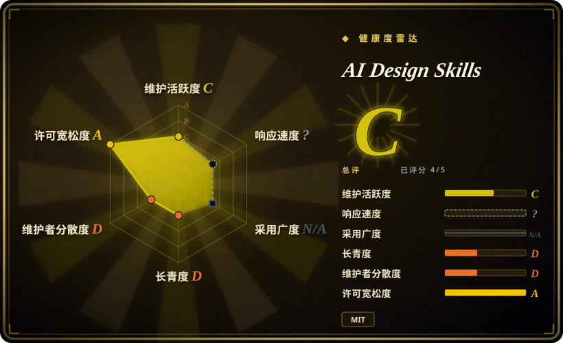
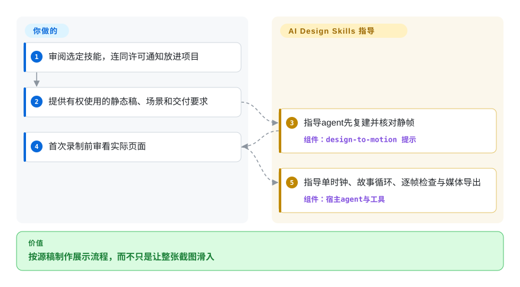
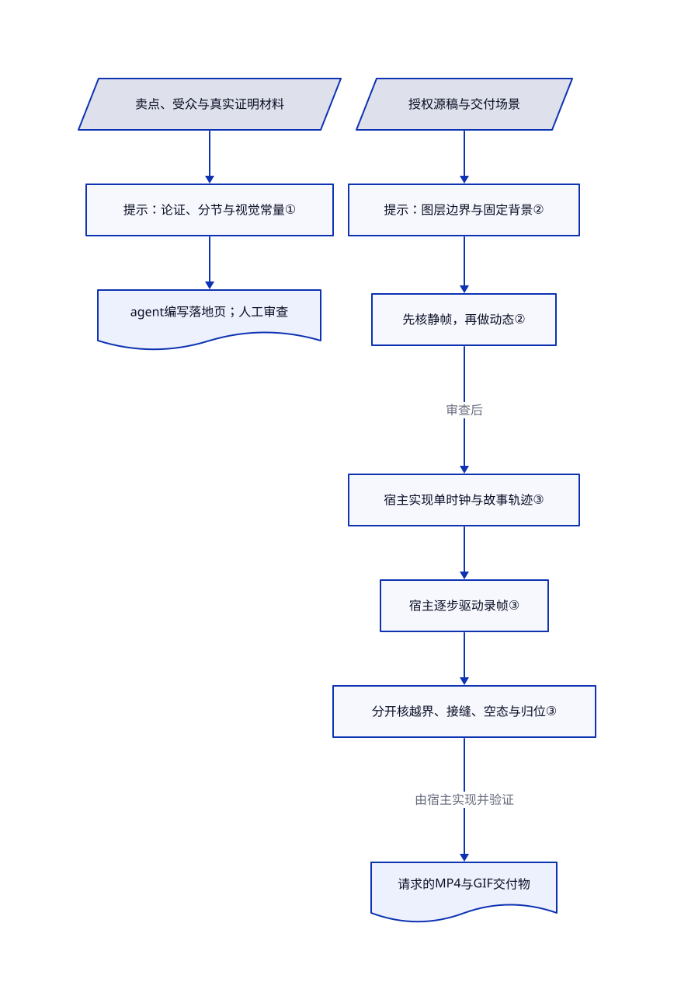

# AI Design Skills

你让静态稿动起来，agent却只让整图滑入，图表没故事，循环还有跳帧。Elaya的两份Markdown技能，把落地页规划与按源稿制作动效分开，再描述静帧检查和逐帧录制方法。

## 何时使用

你拿到有权使用的Figma画框或截图，要做产品展示：背景不变，内容从空态加载，卡片内部有清楚动作，最后交付MP4／GIF。比起调产品菜单的悬浮和点击反馈，当你更需要这条“按源稿复建到展示循环”的流程时，选这个包。另一入口也能在写页面前，先确定新落地页的卖点、受众、主行动与视觉数值。

仓库只有两份技能文档，不是渲染应用或导出服务。你提供编码agent、模型、设计授权和执行工具。它的区别是明确区分展示导出与生产网站：前者可用导出的文字图层，后者应保留真实HTML文字，并在离屏时暂停动态。

## 何时不用

- **你在做密集产品界面，需要跨会话保留决策。** 可看[Interface Design](../ui-taste/interface-design.zh.md)，或直接保留已有项目设计规范。本包落地页技能的触发范围很广，字体、字号、间距与必做揭示动效都很强势，不能让它悄悄覆盖现有品牌合同。
- **你要高频、可打断的产品交互。** 选[Skills For Design Engineers](../ui-taste/emilkowalski-skills.zh.md)。本包明确把较慢的展示编排与产品交互分开，一秒左右的入场不是菜单延迟建议。
- **问题是虚构统计和评价，而不是画面不够精致。** 用[Anti Slop](../ui-taste/anti-slop.zh.md)配真实业务证据。本包会索取证明材料，却也建议使用看起来真实的姓名和非整数示例数字；像真的不等于有来源。两种包的agent自填清单都不是机器证明。
- **你需要可执行浏览器API与断言，而不只是录制配方。** 用[Playwright](../../../web-automation/playwright-family/playwright.zh.md)作为自行实现、测试录制与导出工具的底座。本仓只有Markdown及内联片段，没有包清单、完整运行器、测试或示例导出文件，装好技能不等于保真通过。平面截图也不能可靠分离所有独立动画图层。

## 横向对比

| 替代品 | 是否收录 | 我们的评价 | 取舍 |
|---|---|---|---|
| [Skills For Design Engineers](../ui-taste/emilkowalski-skills.zh.md) | 已收录 | 产品交互的频率、打断和动效评审选Emil的包；把给定设计复建成展示循环和媒体文件时选本包。 | 产品动效有时应直接删除；本包更重源稿一致、可见故事循环和录制说明。两者都依赖宿主agent执行。 |
| [Interface Design](../ui-taste/interface-design.zh.md) | 已收录 | 仪表盘、设置页需要保留项目决策时选Interface Design；新转化落地页或给定视觉稿的导出流程选本包。 | 项目设计文件和逐组件检查点，对比固定落地页规则与媒体编排；两者都不是确定性构建门禁。 |
| [Anti Slop](../ui-taste/anti-slop.zh.md) | 已收录 | 需要保留自身视觉系统，同时拒绝无来源声明和无效控件时选Anti Slop；明确想采用本包视觉配方与展示结构时才选本包。 | 不定风格的完整性指导不会强加本包的字体、间距和揭示动效，但也不提供其Figma图层与视频时钟配方。 |

## 快速上手

先审阅固定提交中选定的`skills/`目录与根MIT通知，再只把需要的一份技能复制进项目支持的规则目录；[README](https://github.com/elayadesign/ai-design-skills/blob/38bbe5765600b9178b5395a823c9f6c8d2b8e730/README.md#L20-L64)列出`.claude/skills`、Cursor规则及其它宿主入口。用普通语言提出落地页或静态稿动画任务，不要以为它带有独立命令行程序。动效路线要提供有权使用的源稿、场景和交付物；Figma提取另需授权API访问，平面图则有分层限制。技能指导agent先复建静帧，首次录制前展示实页，再写动效、逐帧采集和FFmpeg导出。你负责模型、浏览器／录制工具链、必要凭据、输出审看及真实验证，本条目没有安装或执行这些步骤。复制技能文本仍须保留版权和许可通知：README简写的“不必署名”，不能取消实际[MIT通知条件](https://github.com/elayadesign/ai-design-skills/blob/38bbe5765600b9178b5395a823c9f6c8d2b8e730/LICENSE#L5-L13)。

<!-- flow-steps:begin (generated from flows/ai-design-skills.json by tools/flow_card.py — do not edit) -->

流程文字版

1. **你**：审阅选定技能，连同许可通知放进项目
2. **你**：提供有权使用的静态稿、场景和交付要求
3. **AI Design Skills**：指导agent先复建并核对静帧 — 组件：`design-to-motion 提示`
4. **你**：首次录制前审看实际页面
5. **AI Design Skills**：指导单时钟、故事循环、逐帧检查与媒体导出 — 组件：`宿主agent与工具`

**价值**：按源稿制作展示流程，而不只是让整张截图滑入

<!-- flow-steps:end -->

## 技术要点

<!-- mechanism:begin (generated from mechanisms/ai-design-skills.json by tools/mechanism_card.py; do not edit) -->

机制文字版

- 卖点、受众与真实证明材料
- 提示：论证、分节与视觉常量①
- agent编写落地页；人工审查
- 授权源稿与交付场景
- 提示：图层边界与固定背景②
- 先核静帧，再做动态②
- 宿主实现单时钟与故事轨迹③
- 宿主逐步驱动录帧③
- 分开核越界、接缝、空态与归位③
- 请求的MP4与GIF交付物

- 卖点、受众与真实证明材料 → 提示：论证、分节与视觉常量①
- 提示：论证、分节与视觉常量① → agent编写落地页；人工审查
- 授权源稿与交付场景 → 提示：图层边界与固定背景②
- 提示：图层边界与固定背景② → 先核静帧，再做动态②
- 先核静帧，再做动态② → 宿主实现单时钟与故事轨迹③（审查后）
- 宿主实现单时钟与故事轨迹③ → 宿主逐步驱动录帧③
- 宿主逐步驱动录帧③ → 分开核越界、接缝、空态与归位③
- 分开核越界、接缝、空态与归位③ → 请求的MP4与GIF交付物（由宿主实现并验证）

<!-- mechanism:end -->

### 1. 先定落地页论证，再应用视觉常量

- **解决：** 页面很精致，却没有明确卖点、受众或下一步。
- **做法：** 落地页提示先收集这些输入，选择结构、起草文案并逐节构建，再应用固定的字体、间距、圆角和动效规则。
- **边界：** 这是宿主agent指令，不是优化器或规则引擎。宽泛触发与强字体／揭示动效默认值可能冲突现有系统；示例数字或假设简报也不是真实转化证据。
- **源码：** [采集、结构与构建顺序第24–127行](https://github.com/elayadesign/ai-design-skills/blob/38bbe5765600b9178b5395a823c9f6c8d2b8e730/skills/landing-page-design/SKILL.md#L24-L127)、[视觉常量与真实感第146–357行](https://github.com/elayadesign/ai-design-skills/blob/38bbe5765600b9178b5395a823c9f6c8d2b8e730/skills/landing-page-design/SKILL.md#L146-L357)。

### 2. 把动效绑定到核对过的源稿及交付场景

- **解决：** 只让整张截图移动，或随意重画照片背景，会破坏原设计。
- **做法：** 动效提示区分展示与网站，按边界和层序导出独立运动图层，固定背景，并要求先比较静帧和参考图。展示文字可保留图片，网站文字应是HTML；另处理离屏与减少动态偏好。
- **边界：** 仓库没有Figma客户端或比图程序。图层权限、素材权利、API可用性与复建仍归操作者负责；文档的PSNR目标不是已经达到或普遍有效的感知质量分。
- **源码：** [场景区分第20–52行](https://github.com/elayadesign/ai-design-skills/blob/38bbe5765600b9178b5395a823c9f6c8d2b8e730/skills/design-to-motion/SKILL.md#L20-L52)、[源稿／图层／背景第72–190行](https://github.com/elayadesign/ai-design-skills/blob/38bbe5765600b9178b5395a823c9f6c8d2b8e730/skills/design-to-motion/SKILL.md#L72-L190)。

### 3. 描述可控单时钟与分开的循环检查

- **解决：** 实时录屏和只检查接缝，会漏掉时间漂移及空态里未清除的旧动画状态。
- **做法：** 配方区分静帧、循环和采集模式，用一个时钟驱动时间效果，以平均每秒60帧的整数毫秒步长采集；编码前分别检查形状越界、接缝、空拍与归位。
- **边界：** 时钟和录制片段要由宿主实现；没有附带运行器、锁定工具链或自动执行这些检查的门禁。本次没有生成页面、录帧、测保真或编码媒体。
- **源码：** [模式与时钟第172–190行](https://github.com/elayadesign/ai-design-skills/blob/38bbe5765600b9178b5395a823c9f6c8d2b8e730/skills/design-to-motion/SKILL.md#L172-L190)、[循环及动态检查第298–350行](https://github.com/elayadesign/ai-design-skills/blob/38bbe5765600b9178b5395a823c9f6c8d2b8e730/skills/design-to-motion/SKILL.md#L298-L350)、[采集与格式第354–417行](https://github.com/elayadesign/ai-design-skills/blob/38bbe5765600b9178b5395a823c9f6c8d2b8e730/skills/design-to-motion/SKILL.md#L354-L417)。

## 健康度与可持续性

- **维护快照，2026-10-25：** 2026-07-29创建，核验当日更新；贡献接口把四次提交归于仓库所有者，没有GitHub release。应固定技能内容，而不是期待稳定包发布。
- **维护权与持续性：** 五个文件包含两份技能与署名Elaya的真实MIT文本，仓龄约三个月，由个人维护。[推断：依据仓龄与可见所有权，未做长期结果观察] 当前关注度不构成强林迪先验或持续支持保证。
- **来源：** 动效文档致谢三个MIT项目，已读其实际许可；本仓两份技能blob均不与所抓三个源树完全相同。这不能支持“多数文件原样复制”的归因，也不证明全部文本改编和权属都已审计。
- **采用与范围：** 4574星、317个fork只是有日期的关注，不是安装、设计质量或转化提升实测。README链接的`redesign-skill`是另一仓库的配套，不是本包已安装的第三份技能，本批不扩收。

## 存疑（未验证）

- [未验证：没有安装或执行上游技能与生成代码] 未复现宿主激活、视觉／无障碍质量、转化效果、录制确定性、PSNR或媒体交付；仓库中的指令与代码片段不是运行通过证据。
- [未验证：未使用授权Figma访问或真实设计素材] 没有测试API权限、导出限制、CDN行为、源图许可与逐层复建。
- [推断：依据宽泛触发与固定视觉规则，未做多包实验] 同时加载多个设计包可能造成指令冲突；只在项目里启用选定技能，保留真实品牌规范。
- [未验证：精确Git blob比较不等于完整作者权属审计] 已读致谢许可和零相同技能blob不认证全部改编文字或下游素材，仍须保留真实通知并逐项核第三方材料。
