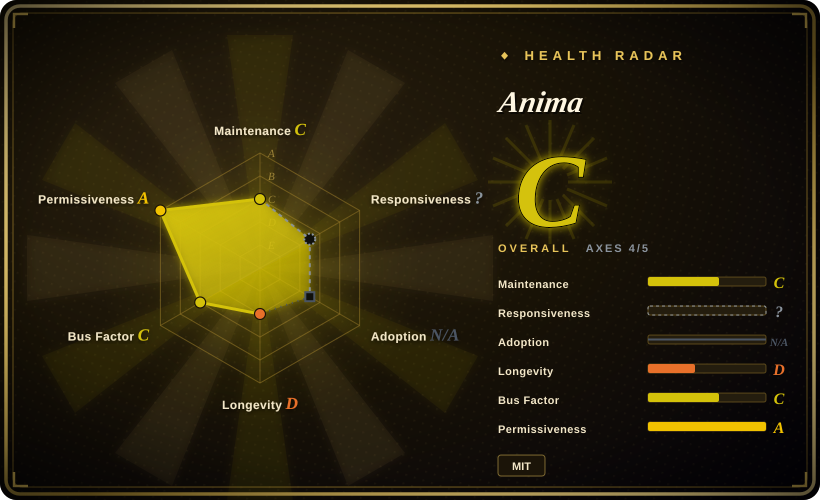
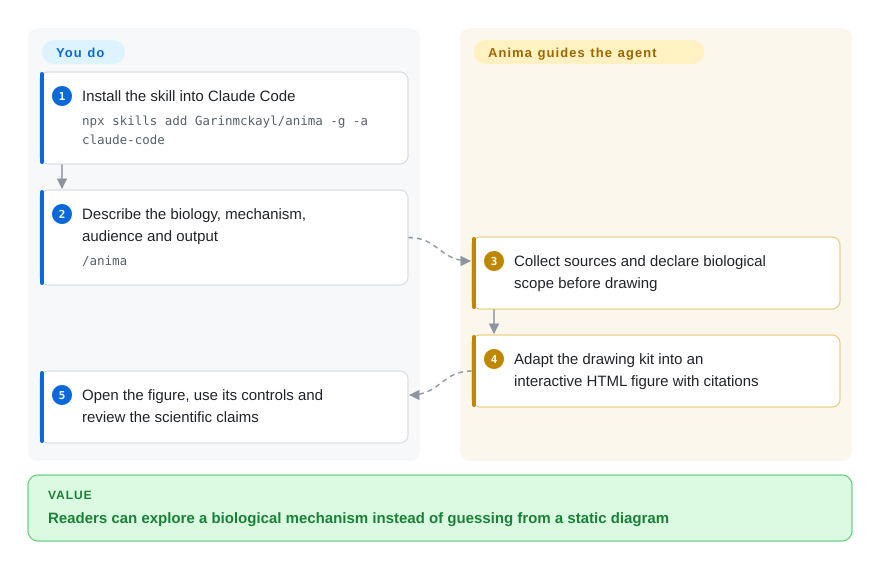
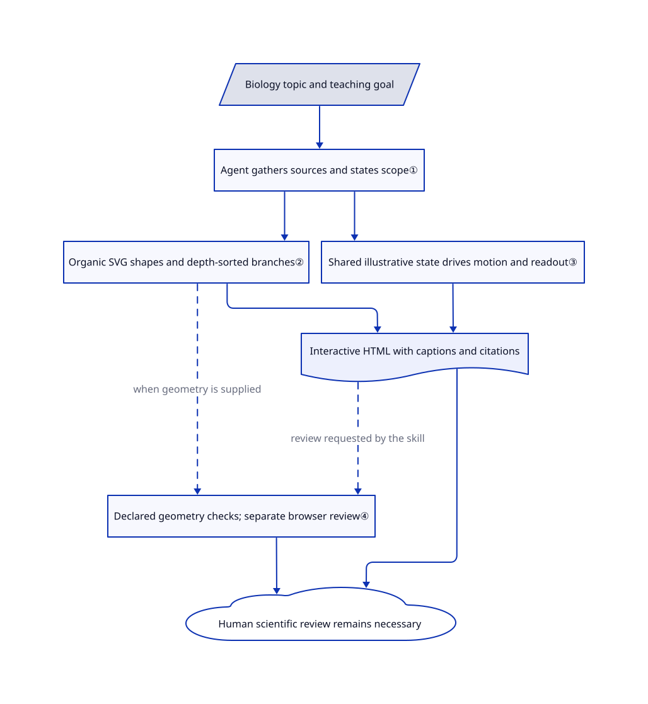

# Anima

Your biology lesson has a receptor diagram, but students cannot see what changes when a transporter is blocked. Anima guides Claude Code to build a sourced, interactive HTML figure with recognizable biological structures and a live readout.

## When to use

You teach biology or write a pharmacology explainer, and a static synapse picture cannot show the difference between blocking dopamine reuptake and reversing transport. You want readers to change a selector and watch the schematic mechanism change, with citations and uncertainty visible beside the figure. Choose Anima over a general diagram skill when biological structures, species-specific evidence and educational drug-safety limits matter more than editable boxes or a corporate style guide.

You already use Claude Code and can review both the generated code and the scientific claims. The repository supplies seven example builders, organic-shape helpers and reviewer checklists; it is a skill plus drawing code, not an autonomous scientific fact-checking service.

## When NOT to use

- **A clinical decision, dose recommendation or validated anatomy atlas:** use clinician-reviewed reference material and approved clinical systems instead. Anima explicitly excludes diagnosis and prescribing; its geometric checks cannot establish biological truth.
- **A software concept explained as a working machine:** choose [Anatomy](https://github.com/wheresryan22/anatomy), the general-purpose base Anima adapted, rather than the biology-specific examples and sourcing rules here.
- **An architecture file humans must keep editing:** choose [drawio-skill](drawio-skill.md). Anima's normal deliverable is active HTML/SVG and build code, not a source-synchronized `.drawio` model.
- **A report about code changes with evidence and reader decisions:** choose [visual-explainer](visual-explainer.md). Anima focuses on biological mechanism figures rather than narrative review pages.
- **No permission to run agent-written code or headless Chrome:** use a manually reviewed static figure, or [D2](../../../diagramming/d2.md) for a schematic. Anima's browser helpers are not a sandbox; capture accepts local files or URLs and enables local-file access.

## Comparison

| Alternative | In index | Our verdict | Tradeoff |
|---|---|---|---|
| [Anatomy](https://github.com/wheresryan22/anatomy) | not indexed | Choose Anima for biological structures and evidence-qualified mechanisms; choose Anatomy for machines and physical metaphors explaining technical ideas. | Anima adds biology primitives and seven example builders to an inherited drawing kit; Anatomy is not added in this tab batch. |
| [drawio-skill](drawio-skill.md) | ✅ | Choose drawio-skill when hand-editable architecture and source resynchronization decide the job; choose Anima when readers should manipulate a biological mechanism. | An editable diagram model preserves geometry changes; Anima instead provides live HTML with illustrative dynamics. |
| [visual-explainer](visual-explainer.md) | ✅ | Choose visual-explainer for a figure-led review of diffs or plans; choose Anima for a synapse, cell or molecular mechanism with controls. | General explanation pages carry narrative and feedback; Anima supplies biological drawing examples and domain-specific sourcing guidance. |

## Quick start

The documented install is `npx skills add Garinmckayl/anima -g -a claude-code`; the README requires Claude Code and Node.js 20.10 or later. Ask `/anima` for a biological subject, the mechanism, audience and output format; the skill directs the agent to collect sources, adapt a drawing and write a standalone HTML page. The kit uses Node built-ins; Chrome or Chromium is needed for the capture/verification scripts, not simply to generate geometry, while the resulting interactive page needs a browser. You supply the model access and its costs, source review, execution permission and final scientific judgment; installing the skill does not certify citations or automatically enforce its checklist. Without the agent workflow, the documented `node examples/dopamine-receptors/build.mjs` builds an existing example and `--light` selects its light version; that only reproduces the example, not a new scientifically validated figure.

<!-- flow-steps:begin (generated from flows/anima.json by tools/flow_card.py — do not edit) -->

Text version of the flow

1. **You**: Install the skill into Claude Code — `npx skills add Garinmckayl/anima -g -a claude-code`
2. **You**: Describe the biology, mechanism, audience and output — `/anima`
3. **Anima**: Collect sources and declare biological scope before drawing
4. **Anima**: Adapt the drawing kit into an interactive HTML figure with citations
5. **You**: Open the figure, use its controls and review the scientific claims

**Value**: Readers can explore a biological mechanism instead of guessing from a static diagram

<!-- flow-steps:end -->

## Key techniques

<!-- mechanism:begin (generated from mechanisms/anima.json by tools/mechanism_card.py; do not edit) -->

Text version of the mechanism

- Biology topic and teaching goal
- Agent gathers sources and states scope①
- Organic SVG shapes and depth-sorted branches②
- Shared illustrative state drives motion and readout③
- Interactive HTML with captions and citations
- Declared geometry checks; separate browser review④
- Human scientific review remains necessary

- Biology topic and teaching goal → Agent gathers sources and states scope①
- Agent gathers sources and states scope① → Organic SVG shapes and depth-sorted branches②
- Agent gathers sources and states scope① → Shared illustrative state drives motion and readout③
- Organic SVG shapes and depth-sorted branches② → Interactive HTML with captions and citations
- Shared illustrative state drives motion and readout③ → Interactive HTML with captions and citations
- Organic SVG shapes and depth-sorted branches② → Declared geometry checks; separate browser review④ (when geometry is supplied) [optional/fallback]
- Interactive HTML with captions and citations → Declared geometry checks; separate browser review④ (review requested by the skill) [optional/fallback]
- Declared geometry checks; separate browser review④ → Human scientific review remains necessary
- Interactive HTML with captions and citations → Human scientific review remains necessary

<!-- mechanism:end -->

### 1. Source the biology before choosing the geometry

- **Problem:** A convincing animation can hide invented numbers or present an animal finding as settled human biology.
- **How:** The workflow asks the agent to gather sources first, retain species, conditions and units, distinguish literal anatomy from metaphor, and place citations beside numbers. The neuron example explicitly labels its waveform illustrative and distinguishes endpoints from separate teaching references.
- **Limits:** These are authoring instructions and example captions, not a citation resolver or a runtime proof. The reader still needs domain review; the figure is educational, never a prescribing tool.
- **Source:** [Sourcing and workflow:25–61](https://github.com/Garinmckayl/anima/blob/f0249c4fdc94cc854abcff8bf34a087e37145714/SKILL.md#L25-L61), [neuron caption and references:108–116](https://github.com/Garinmckayl/anima/blob/f0249c4fdc94cc854abcff8bf34a087e37145714/examples/neuron/build.mjs#L108-L116).

### 2. Reuse organic forms and depth-sorted branches

- **Problem:** Cells and dendrites do not fit the boxes and connectors used by architecture diagram tools.
- **How:** `blobOf` projects a ring of 3D points into a smooth closed SVG outline with inset highlight/shade paths. Branch helpers split tube geometry into pieces and sort them by camera depth; the neuron builder assembles these with myelin, node markers and labels.
- **Limits:** This produces a schematic drawing, not a reconstruction from microscopy or a measured anatomical mesh. Depth sorting cannot establish correct biological shape, scale or connectivity.
- **Source:** [Organic geometry:5–55](https://github.com/Garinmckayl/anima/blob/f0249c4fdc94cc854abcff8bf34a087e37145714/kit/blob.mjs#L5-L55), [branch pieces:1–23](https://github.com/Garinmckayl/anima/blob/f0249c4fdc94cc854abcff8bf34a087e37145714/kit/branch.mjs#L1-L23), [neuron assembly:62–107](https://github.com/Garinmckayl/anima/blob/f0249c4fdc94cc854abcff8bf34a087e37145714/examples/neuron/build.mjs#L62-L107).

### 3. Couple motion and readout without claiming a physiological simulator

- **Problem:** An animated dot and a separately scripted number can contradict each other.
- **How:** In the neuron example, one time-based progress value selects an active node, positions the marker and computes the displayed potential. The same script handles pause, keyboard input, offscreen visibility and the operating system's reduced-motion preference.
- **Limits:** Its duration and activation waveform are illustrative, not a fitted electrophysiology model. Reduced motion disables Play in this example; the later sunflower fix must not be generalized to every figure.
- **Source:** [Neuron runtime:117–204](https://github.com/Garinmckayl/anima/blob/f0249c4fdc94cc854abcff8bf34a087e37145714/examples/neuron/build.mjs#L117-L204), [caption:113–116](https://github.com/Garinmckayl/anima/blob/f0249c4fdc94cc854abcff8bf34a087e37145714/examples/neuron/build.mjs#L113-L116).

### 4. Check declared geometry, then inspect actual browser output

- **Problem:** A valid SVG can contain crossing membrane outlines, missing label targets or inconsistent declared scale.
- **How:** The biology audit tests supplied boundary segments, target IDs and measurement ratios, returning errors and a nonzero CLI exit on failure. The workflow separately asks for desktop/phone screenshots, light/dark review and line-end checks; CI smoke-tests the kit and rebuilds all examples in both themes.
- **Limits:** The audit only sees the arrays and measurements supplied to it, not the full HTML or the literature. The neuron builder does not call `bioAudit`; the cited CI job does not run a browser or automatically enforce the whole review checklist. Capture prints console problems but its successful completion still exits zero.
- **Source:** [Audit implementation:52–130](https://github.com/Garinmckayl/anima/blob/f0249c4fdc94cc854abcff8bf34a087e37145714/kit/bio-audit.mjs#L52-L130), [review instructions:61–67](https://github.com/Garinmckayl/anima/blob/f0249c4fdc94cc854abcff8bf34a087e37145714/SKILL.md#L61-L67), [CI:17–42](https://github.com/Garinmckayl/anima/blob/f0249c4fdc94cc854abcff8bf34a087e37145714/.github/workflows/ci.yml#L17-L42), [capture completion:219–230](https://github.com/Garinmckayl/anima/blob/f0249c4fdc94cc854abcff8bf34a087e37145714/scripts/capture.mjs#L219-L230).

## Health & viability

- **2026-10-25 maintenance:** created October 11, last default-branch commit October 16; the changelog labels 0.1.0 on October 13, but no tags or GitHub releases exist. Seven example builders and a rebuild CI workflow are present; this two-week-old project has no tagged release line. Its security policy supports only the latest `main` commit.
- **Ownership and Lindy:** the User-owned repository's contributors list contains Garinmckayl and Copilot; commit and license names match Natnael Getenew. The short visible history provides no long-lived maintenance record. Treat adoption as a pinned experiment, not a durable platform commitment.
- **License and provenance:** the MIT file retains Ryan's copyright alongside Natnael Getenew's. History records importing Anatomy; a Git blob comparison against the fetched Anatomy tree found 15 of 95 files identical, including core drawing/runtime helpers. The biology primitives and seven builders supply distinct reusable substance rather than a renamed empty wrapper.
- **Adoption and readiness:** GitHub reports 237 stars and 24 forks on this date; those are attention, not measured classroom use or scientific validation. The open accessibility-audit issue still requests keyboard and screen-reader review. The 3D mode is explicitly beta in the skill.

## Caveats (unverified)

- [未验证：本批禁止安装或运行上游] Installation, rendering, interaction, accessibility and all upstream checks were inspected as source only; no upstream program or skill was executed.
- [未验证：未逐条复核上游引用的原始研究] Citation blocks and qualification language exist in the examples, but their presence does not establish every biological claim or numeric value as correct.
- [推断：依据是两周项目历史、无版本标签和个人主导贡献，未观察长期维护] Long-term maintenance and cross-example consistency remain unproven; pin the reviewed commit and review upgrades.
