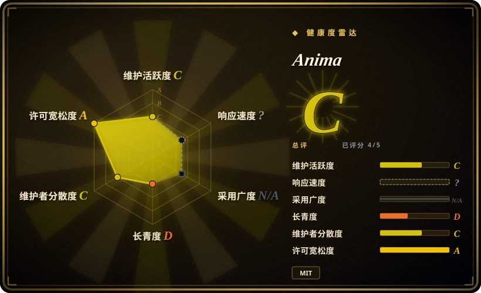
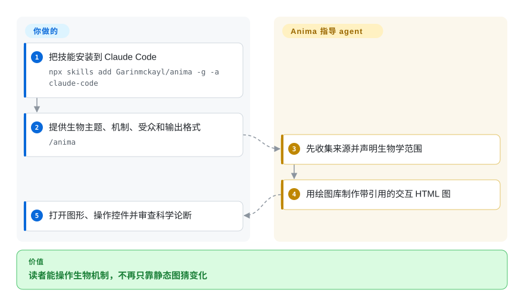
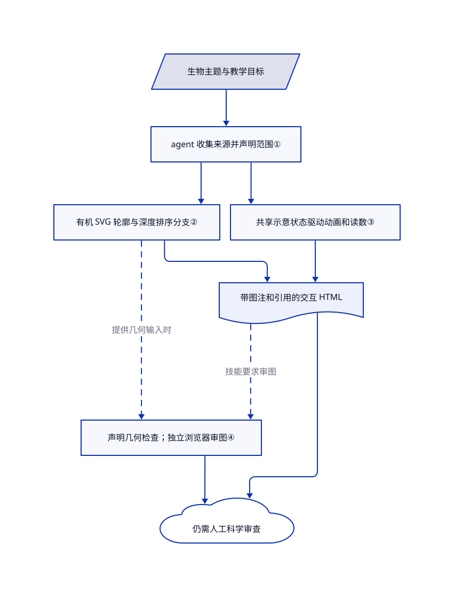

# Anima

你画出了突触，学生却看不出阻断转运体后发生什么。Anima 指导 Claude Code 制作交互式生物教学网页，让结构、动态读数和来源一起出现。

## 何时使用

你在讲生物课或写药理科普，静态突触图讲不清“阻断多巴胺回收”和“让转运体反向运输”的区别。你希望读者切换选项后看到示意机制变化，同时读到引用和证据局限。比起通用绘图技能，当生物结构、物种差异和药物教学边界比可编辑方框或品牌样式更重要时，选 Anima。

你已经使用 Claude Code，也能审查生成代码和科学论断。仓库提供七套样例构建脚本、有机形状工具和审图清单。它是技能加绘图代码，不是自主科学事实核验服务。

## 何时不用

- **要做临床判断、剂量推荐或经过验证的解剖图谱：** 改用经临床专家审查的参考资料和合规临床系统。Anima 明确排除诊断和处方；几何检查不能证明生物学结论。
- **要把软件概念解释成一台能运转的机器：** 选 [Anatomy](https://github.com/wheresryan22/anatomy)。它是 Anima 改编的通用底座，不局限于生物样例和领域引用规则。
- **人要继续编辑架构图：** 选 [drawio-skill](drawio-skill.zh.md)。Anima 通常交付可执行脚本的 HTML/SVG 和构建代码，不提供随源码同步的 `.drawio` 模型。
- **要讲代码变更，并收集读者对证据的裁决：** 选 [visual-explainer](visual-explainer.zh.md)。Anima 关注生物机制图，不是叙事评审页。
- **不能授权运行模型生成的代码或无头 Chrome：** 改用人工审过的静态图，或用 [D2](../../../diagramming/d2.zh.md) 画示意图。Anima 的浏览器脚本不是沙箱；截图入口接受本地文件或网址，并开启本地文件访问。

## 横向对比

| 替代品 | 是否收录 | 我们的评价 | 取舍 |
|---|---|---|---|
| [Anatomy](https://github.com/wheresryan22/anatomy) | 未收录 | 解释生物结构与带证据限定的机制选 Anima；用机器和物理隐喻解释技术概念选 Anatomy。 | Anima 在继承的绘图库上增加生物图元和七套样例；Anatomy 本批不扩收。 |
| [drawio-skill](drawio-skill.zh.md) | 已收录 | 架构图需要人工编辑并随源码同步时选 drawio-skill；读者需要操作生物机制时选 Anima。 | 前者用可编辑模型保留几何调整；后者用 HTML 展示示意动态。 |
| [visual-explainer](visual-explainer.zh.md) | 已收录 | 解释差异或方案的图文评审选 visual-explainer；制作带控件的突触、细胞或分子机制图选 Anima。 | 通用说明页承载叙事和反馈；Anima 提供生物绘图样例及领域取材规则。 |

## 快速上手

文档安装命令是 `npx skills add Garinmckayl/anima -g -a claude-code`，README 要求 Claude Code 和 Node.js 20.10 以上版本。用 `/anima` 提供生物主题、待解释机制、受众和输出格式；技能要求 agent 先取材，再改编图形并写出独立 HTML。绘图库只使用 Node 内置模块；截图和检查脚本需要 Chrome 或 Chromium，单纯生成几何不需要，最终交互页面则需要浏览器。你负责模型访问及费用、来源审查、执行授权和科学判断；安装技能不等于引用获认证，也不会自动强制执行清单。不走 agent 流程时，可用文档中的 `node examples/dopamine-receptors/build.mjs` 构建已有样例，追加 `--light` 选择浅色版本；这只复现样例，不会产出一幅新且经科学验证的图。

<!-- flow-steps:begin (generated from flows/anima.json by tools/flow_card.py — do not edit) -->

流程文字版

1. **你**：把技能安装到 Claude Code — `npx skills add Garinmckayl/anima -g -a claude-code`
2. **你**：提供生物主题、机制、受众和输出格式 — `/anima`
3. **Anima**：先收集来源并声明生物学范围
4. **Anima**：用绘图库制作带引用的交互 HTML 图
5. **你**：打开图形、操作控件并审查科学论断

**价值**：读者能操作生物机制，不再只靠静态图猜变化

<!-- flow-steps:end -->

## 技术要点

<!-- mechanism:begin (generated from mechanisms/anima.json by tools/mechanism_card.py; do not edit) -->

机制文字版

- 生物主题与教学目标
- agent 收集来源并声明范围①
- 有机 SVG 轮廓与深度排序分支②
- 共享示意状态驱动动画和读数③
- 带图注和引用的交互 HTML
- 声明几何检查；独立浏览器审图④
- 仍需人工科学审查

- 生物主题与教学目标 → agent 收集来源并声明范围①
- agent 收集来源并声明范围① → 有机 SVG 轮廓与深度排序分支②
- agent 收集来源并声明范围① → 共享示意状态驱动动画和读数③
- 有机 SVG 轮廓与深度排序分支② → 带图注和引用的交互 HTML
- 共享示意状态驱动动画和读数③ → 带图注和引用的交互 HTML
- 有机 SVG 轮廓与深度排序分支② → 声明几何检查；独立浏览器审图④（提供几何输入时）〔可选／兜底〕
- 带图注和引用的交互 HTML → 声明几何检查；独立浏览器审图④（技能要求审图）〔可选／兜底〕
- 声明几何检查；独立浏览器审图④ → 仍需人工科学审查
- 带图注和引用的交互 HTML → 仍需人工科学审查

<!-- mechanism:end -->

### 1. 先核生物材料，再决定几何形状

- **解决：** 动画看起来可信，却可能把数字编出来，或把动物结果说成人类定论。
- **做法：** 流程要求先收集来源，保留物种、条件和单位，区分真实结构与隐喻，并在数字旁附引用。神经元样例明确说明波形只是示意，电压端点来自不同教学资料。
- **边界：** 这是创作指令和样例图注，不是引用解析器或运行时证明。仍需领域审查；配图只供教学，不作处方工具。
- **源码：** [取材与流程第 25–61 行](https://github.com/Garinmckayl/anima/blob/f0249c4fdc94cc854abcff8bf34a087e37145714/SKILL.md#L25-L61)、[神经元图注与引用第 108–116 行](https://github.com/Garinmckayl/anima/blob/f0249c4fdc94cc854abcff8bf34a087e37145714/examples/neuron/build.mjs#L108-L116)。

### 2. 复用有机轮廓与按深度排序的分支

- **解决：** 细胞和树突不适合用架构图的方框、连线表达。
- **做法：** `blobOf` 把一圈三维点投影成平滑闭合 SVG，并生成内缩高光和阴影路径。分支工具把管状几何拆成片段，按相机深度排序；神经元脚本再拼入髓鞘、节点标记和标签。
- **边界：** 结果是示意绘图，不是显微图重建，也不是实测解剖网格。深度排序不证明生物形状、比例或连接正确。
- **源码：** [有机几何第 5–55 行](https://github.com/Garinmckayl/anima/blob/f0249c4fdc94cc854abcff8bf34a087e37145714/kit/blob.mjs#L5-L55)、[分支片段第 1–23 行](https://github.com/Garinmckayl/anima/blob/f0249c4fdc94cc854abcff8bf34a087e37145714/kit/branch.mjs#L1-L23)、[神经元组装第 62–107 行](https://github.com/Garinmckayl/anima/blob/f0249c4fdc94cc854abcff8bf34a087e37145714/examples/neuron/build.mjs#L62-L107)。

### 3. 共用动态状态，不冒充生理仿真

- **解决：** 移动光点和单独编写的数字容易互相矛盾。
- **做法：** 神经元样例用同一个时间进度选择活动节点、移动标记并计算显示电压。脚本同时处理暂停、键盘输入、离屏状态和系统的减少动态偏好。
- **边界：** 时长和激活波形只是示意，不是拟合的电生理模型。该样例在减少动态时禁用播放；不能把后来向日葵样例的修复推广到所有图。
- **源码：** [神经元运行时第 117–204 行](https://github.com/Garinmckayl/anima/blob/f0249c4fdc94cc854abcff8bf34a087e37145714/examples/neuron/build.mjs#L117-L204)、[示意说明第 113–116 行](https://github.com/Garinmckayl/anima/blob/f0249c4fdc94cc854abcff8bf34a087e37145714/examples/neuron/build.mjs#L113-L116)。

### 4. 检查声明的几何，再看浏览器实图

- **解决：** 合法 SVG 仍可能出现膜轮廓相交、标签指向不存在的部件或比例声明矛盾。
- **做法：** 生物检查器核对传入的边界线段、目标标识和尺寸比值，返回错误，并让失败的命令行调用非零退出。技能另外要求桌面和手机截图、深浅主题审查及线头检查；CI 对图库做冒烟检查，并重建所有样例的两种主题。
- **边界：** 检查器只看到调用者提供的数组和尺寸，不读取整页或文献。神经元脚本没有调用 `bioAudit`；所引 CI 不启动浏览器，也不强制执行整套审图清单。截图脚本打印控制台问题，但正常完成仍以零退出。
- **源码：** [检查实现第 52–130 行](https://github.com/Garinmckayl/anima/blob/f0249c4fdc94cc854abcff8bf34a087e37145714/kit/bio-audit.mjs#L52-L130)、[审图指令第 61–67 行](https://github.com/Garinmckayl/anima/blob/f0249c4fdc94cc854abcff8bf34a087e37145714/SKILL.md#L61-L67)、[持续集成第 17–42 行](https://github.com/Garinmckayl/anima/blob/f0249c4fdc94cc854abcff8bf34a087e37145714/.github/workflows/ci.yml#L17-L42)、[截图结束路径第 219–230 行](https://github.com/Garinmckayl/anima/blob/f0249c4fdc94cc854abcff8bf34a087e37145714/scripts/capture.mjs#L219-L230)。

## 健康度与可持续性

- **维护快照，2026-10-25：** 仓库创建于 10 月 11 日，默认分支最后提交为 10 月 16 日；变更日志将 10 月 13 日标为 0.1.0，但没有标签或 GitHub release。已有七套构建脚本和重建 CI；项目仅有两周历史，尚无带标签的发布线。安全策略只支持最新 `main` 提交。
- **治理与林迪判断：** 仓库归个人账户所有，贡献者列表包含 Garinmckayl 和 Copilot；提交姓名和许可证均对应 Natnael Getenew。可见历史太短，不能提供长期维护记录。应固定提交试用，不宜当成长期平台承诺。
- **许可与来源：** MIT 文本同时保留 Ryan 和 Natnael Getenew 的版权。历史记录了引入 Anatomy；与本次抓取的 Anatomy 树比较，95 个文件中有 15 个 blob 相同，包括核心绘图和运行时工具。新增生物图元及七套构建脚本提供了可复用内容，不只是换名空壳。
- **采用与成熟度：** 当日 GitHub 元数据为 237 星、24 次派生；它们表示关注，不代表课堂使用实测或科学验证。开放的无障碍审查 issue 仍在征集键盘和读屏检查。技能明确将三维模式标为测试版。

## 存疑（未验证）

- [未验证：本批禁止安装或运行上游] 本次只读了安装、渲染、交互、无障碍和上游检查的源码，没有执行上游程序或技能。
- [未验证：未逐条复核上游引用的原始研究] 样例确有引用区和证据限定，但不能据此确认每条生物论断或数字都正确。
- [推断：依据是两周项目历史、无版本标签和个人主导贡献，未观察长期维护] 长期维护和跨样例一致性尚无证明；应固定已审提交并复核更新。
