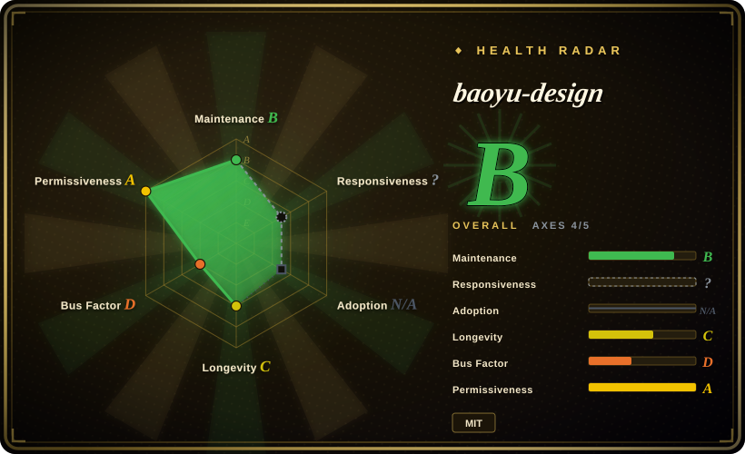
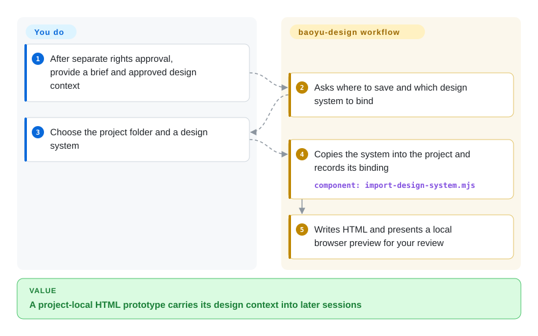
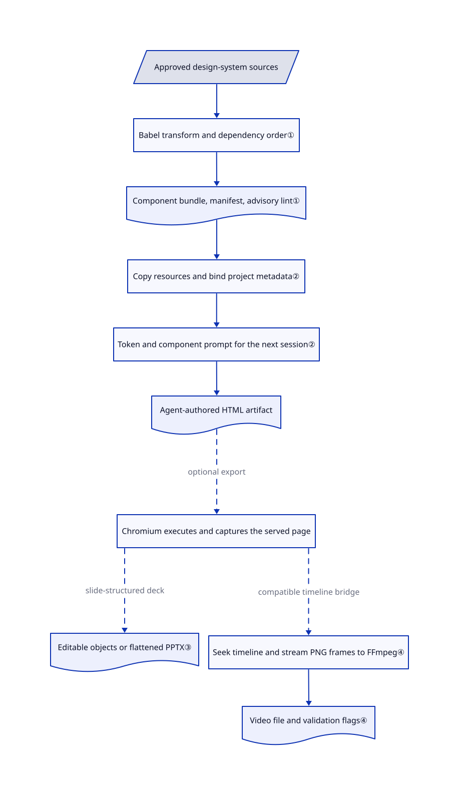

# baoyu-design

Your agent makes a plausible settings screen, but the next screen forgets the brand and the deck needs rebuilding in PowerPoint. baoyu-design binds local design-system files to HTML projects and supplies browser-based export scripts.

> [!WARNING]
> **Information entry only; rights remain unresolved.** The [root MIT](https://github.com/JimLiu/baoyu-design/blob/6530033592bf7fa58bc1a5a2a2ad278da45213a9/LICENSE#L1-L13) names Jim Liu. The [README](https://github.com/JimLiu/baoyu-design/blob/6530033592bf7fa58bc1a5a2a2ad278da45213a9/README.md#credits--license), [provenance](https://github.com/JimLiu/baoyu-design/blob/6530033592bf7fa58bc1a5a2a2ad278da45213a9/skills/baoyu-design/references/upstream-sync/provenance.json#L57-L84) and [copy report](https://github.com/JimLiu/baoyu-design/blob/6530033592bf7fa58bc1a5a2a2ad278da45213a9/skills/baoyu-design/references/upstream-sync/apply-report.json#L21-L48) record content extracted from the closed Claude Design product frontend. The reviewed materials do not establish permission to relicense that content. `NOASSERTION` avoids presenting the whole distribution as cleared MIT; it does not deny the author's root declaration for material they control. Inclusion is **not approval to install, copy extracted content, or redistribute**, nor a legal finding. The automated radar's root-license signal is not a complete rights audit.

## When to use

You maintain a product's visual prototypes across several agent sessions. You already have an approved UI kit, yet each new HTML screen invents another blue and another button shape. Study baoyu-design when you need to understand its project-local design-system binding: compiled components, CSS and assets travel with a prototype, and metadata tells the next session which system to read.

Its distinguishing surface is a file-oriented workflow spanning prototypes, decks and animation, rather than a screenshot-replica app or a diagram editor. Treat this entry as architecture and capability information until a separate rights review approves the precise files and intended use; the warning is not waived by this scenario.

## When NOT to use

- **You need an immediately approved installation or a redistributable bundle.** Do not adopt this distribution on the strength of its root MIT. Use the vendor-operated Claude Design service if its terms meet your task, or a separately cleared implementation; neither bypasses checking your input assets' rights.
- **You import untrusted design systems.** [Issue #16](https://github.com/JimLiu/baoyu-design/issues/16) reports CSS path traversal. The pinned parser follows normalized `@import` paths without a root-containment guard. For screenshot input, consider [screenshot-to-code](../../../ai-design-generation/screenshot-to-code.md), which avoids this design-system importer; it has its own model-service and data boundaries.
- **The deliverable must be an editable technical diagram.** Choose [drawio-skill](drawio-skill.md) for a source-linked `.drawio` model; HTML prototypes and flattened slide screenshots do not replace that model.
- **You need pixel reconstruction rather than a new design.** Choose [screenshot-to-code](../../../ai-design-generation/screenshot-to-code.md) for its image-cropping and replica workflow; baoyu-design starts from a brief and design context.
- **You want manual layer editing without local shell execution.** Choose a conventional Figma workflow under your account's terms. This pack delegates file writes, preview servers, browser automation and optional export subprocesses to the host agent; it is not a sandbox or an editor UI.

## Comparison

| Alternative | In index | Our verdict | Tradeoff |
|---|---|---|---|
| [huashu-design](huashu-design.md) | ✅ | For a broad HTML-artifact workflow, compare huashu-design's style and review system; study baoyu-design when project-local design-system binding is the deciding mechanism. | Both use agent-authored HTML and export tooling. This row does not certify either pack's third-party rights, and baoyu-design's known extraction gap remains a blocker to automatic adoption. |
| [screenshot-to-code](../../../ai-design-generation/screenshot-to-code.md) | ✅ | Pick screenshot-to-code when an existing screen must be rebuilt from pixels; study baoyu-design when one approved design system must guide new prototypes and decks. | The replica app brings image extraction and variants, but runs a backend and calls model services; baoyu-design reuses the host agent and local project files. |
| [drawio-skill](drawio-skill.md) | ✅ | Pick drawio-skill when engineers must edit and re-sync an architecture diagram; baoyu-design's HTML surface is broader but lacks that diagram model. | Human-adjustable geometry and source sync versus HTML-based screen, deck and motion composition. |
| Claude Design service | not a repo | Prefer the vendor's service when you want its managed design environment rather than a community extraction with unresolved redistribution authority. | Closed hosted product, not an OSS repository; vendor terms, account availability and service data handling replace local-agent operation. |

## Quick start

The [documented path](https://github.com/JimLiu/baoyu-design/blob/6530033592bf7fa58bc1a5a2a2ad278da45213a9/README.md#quick-start) uses `npx skills add JimLiu/baoyu-design`, then `/baoyu-design` in Claude Code or a plain-language design request; these are source quotations, **not an installation recommendation or authorization**. After a separate approval, a file-capable agent reads the routing instructions, asks for the output folder and design context, and writes under `designs/<project>/`. You supply the brief, approved assets, model access and its bill; the workflow supplies HTML, copied design-system resources and a local preview for your review. Base operation uses the host agent and local files; Node runs its scripts, and Python can serve previews. PPTX export adds Node 18+, Playwright/Chromium, JSZip and a vendored PptxGenJS build; video adds FFmpeg and its own build, so the README's general “no runtime” description does not cover the export paths. The card describes that workflow conditionally; none of it was installed or run for this entry.

<!-- flow-steps:begin (generated from flows/baoyu-design.json by tools/flow_card.py — do not edit) -->

Text version of the flow

1. **You**: After separate rights approval, provide a brief and approved design context
2. **baoyu-design**: Asks where to save and which design system to bind
3. **You**: Choose the project folder and a design system
4. **baoyu-design**: Copies the system into the project and records its binding — component: `import-design-system.mjs`
5. **baoyu-design**: Writes HTML and presents a local browser preview for your review

**Value**: A project-local HTML prototype carries its design context into later sessions

<!-- flow-steps:end -->

## Key techniques

<!-- mechanism:begin (generated from mechanisms/baoyu-design.json by tools/mechanism_card.py; do not edit) -->

Text version of the mechanism

- Approved design-system sources
- Babel transform and dependency order①
- Component bundle, manifest, advisory lint①
- Copy resources and bind project metadata②
- Token and component prompt for the next session②
- Agent-authored HTML artifact
- Chromium executes and captures the served page
- Editable objects or flattened PPTX③
- Seek timeline and stream PNG frames to FFmpeg④
- Video file and validation flags④

- Approved design-system sources → Babel transform and dependency order①
- Babel transform and dependency order① → Component bundle, manifest, advisory lint①
- Component bundle, manifest, advisory lint① → Copy resources and bind project metadata②
- Copy resources and bind project metadata② → Token and component prompt for the next session②
- Token and component prompt for the next session② → Agent-authored HTML artifact
- Agent-authored HTML artifact → Chromium executes and captures the served page (optional export) [optional/fallback]
- Chromium executes and captures the served page → Editable objects or flattened PPTX③ (slide-structured deck) [optional/fallback]
- Chromium executes and captures the served page → Seek timeline and stream PNG frames to FFmpeg④ (compatible timeline bridge) [optional/fallback]
- Seek timeline and stream PNG frames to FFmpeg④ → Video file and validation flags④

<!-- mechanism:end -->

### 1. Compile a design system into portable runtime files

- **Problem:** Component source, style tokens and usage rules are otherwise scattered across a UI kit.
- **How:** The local compiler transforms JSX/TSX with vendored Babel, orders sibling imports by dependency, and emits a browser component bundle, a manifest and an adherence-lint configuration. Source hashes record the inputs.
- **Limits:** Circular dependencies are not solved; per-file errors are recorded in the runtime namespace. Adherence rules warn, and unparsed component contracts get no rule: this is not hard enforcement of visual quality or safe imported code.
- **Source:** [Compiler and dependency ordering:97–204](https://github.com/JimLiu/baoyu-design/blob/6530033592bf7fa58bc1a5a2a2ad278da45213a9/skills/baoyu-design/agents/compile-design-system.mjs#L97-L204), [advisory rules and outputs:263–367](https://github.com/JimLiu/baoyu-design/blob/6530033592bf7fa58bc1a5a2a2ad278da45213a9/skills/baoyu-design/agents/compile-design-system.mjs#L263-L367).

### 2. Bind a copied system to a project and its next session

- **Problem:** A later agent session forgets which colors and components the previous screen used.
- **How:** The importer copies CSS dependencies, local assets and the compiled bundle into `_ds/<slug>/`; it updates `_d_meta.json`, chooses a primary system and writes `_ds_prompt.md` with the exact token names and usage excerpts. That prompt tells the next session what to read.
- **Limits:** The copy is a local snapshot, not a cryptographic release lock or a rights grant. CSS traversal remains a trust boundary; loading design-system prose is an agent instruction path, not an isolation mechanism.
- **Source:** [Copy set:65–133](https://github.com/JimLiu/baoyu-design/blob/6530033592bf7fa58bc1a5a2a2ad278da45213a9/skills/baoyu-design/agents/import-design-system.mjs#L65-L133), [metadata and generated prompt:153–211](https://github.com/JimLiu/baoyu-design/blob/6530033592bf7fa58bc1a5a2a2ad278da45213a9/skills/baoyu-design/agents/import-design-system.mjs#L153-L211), [unguarded CSS import recursion:95–117](https://github.com/JimLiu/baoyu-design/blob/6530033592bf7fa58bc1a5a2a2ad278da45213a9/skills/baoyu-design/agents/lib/ds-core.mjs#L95-L117).

### 3. Convert browser captures into two kinds of PowerPoint output

- **Problem:** A browser deck must become either editable slide objects or a visually flattened handoff.
- **How:** Playwright renders the served deck, then an injected capture routine returns layout data for editable PptxGenJS objects or screenshots for full-slide images. The orchestrator gathers notes, animation warnings and validation results into a machine-readable response.
- **Limits:** Only this workflow's slide-structured decks are supported, not arbitrary HTML. Screenshot mode has no editable objects or native animations; validation flags are returned with output, not a guarantee of rendering fidelity. Font setup can contact Google Fonts, and the browser runs page scripts.
- **Source:** [Two export branches:28–162](https://github.com/JimLiu/baoyu-design/blob/6530033592bf7fa58bc1a5a2a2ad278da45213a9/skills/baoyu-design/agents/gen-pptx/src/orchestrator/run.ts#L28-L162), [font fetches:75–120](https://github.com/JimLiu/baoyu-design/blob/6530033592bf7fa58bc1a5a2a2ad278da45213a9/skills/baoyu-design/agents/gen-pptx/src/browser/setup.ts#L75-L120), [documented deck restriction](https://github.com/JimLiu/baoyu-design/blob/6530033592bf7fa58bc1a5a2a2ad278da45213a9/README.md#decks--pptx-export).

### 4. Seek an animation timeline and stream frames to an encoder

- **Problem:** Recording live playback can introduce irregular timing into an animation export.
- **How:** The video runner waits for a page bridge exposing time control, pauses playback, seeks each frame time and streams PNG captures into an FFmpeg subprocess. It reports font readiness and repeated-frame warnings alongside the saved path.
- **Limits:** A compatible timeline bridge is required. This is not a general screen recorder. FFmpeg is killed on frame-capture failure, but partial-file removal is not implemented in the reviewed runner; both export CLIs call `process.exit()` inside their try/catch before the written finally-close path, so do not treat cleanup as guaranteed.
- **Source:** [Bridge and capture loop:127–229](https://github.com/JimLiu/baoyu-design/blob/6530033592bf7fa58bc1a5a2a2ad278da45213a9/skills/baoyu-design/agents/gen-video/src/orchestrator/run.ts#L127-L229), [encoder lifecycle:58–103](https://github.com/JimLiu/baoyu-design/blob/6530033592bf7fa58bc1a5a2a2ad278da45213a9/skills/baoyu-design/agents/gen-video/src/orchestrator/encode.ts#L58-L103), [video CLI:125–149](https://github.com/JimLiu/baoyu-design/blob/6530033592bf7fa58bc1a5a2a2ad278da45213a9/skills/baoyu-design/agents/gen-video/src/cli.ts#L125-L149), [PPTX CLI:99–122](https://github.com/JimLiu/baoyu-design/blob/6530033592bf7fa58bc1a5a2a2ad278da45213a9/skills/baoyu-design/agents/gen-pptx/src/cli.ts#L99-L122).

## Health & viability

- **Maintenance, checked 2026-10-24 UTC.** Default branch remains `6530033592bf7fa58bc1a5a2a2ad278da45213a9`; v1.3.0 and the last default-branch commit date are 2026-09-23. Releases v1.1.x, v1.2.0 and v1.3.0 span June–September. Not archived, but not receiving daily default-branch updates.
- **Governance and backing.** User-owned by JimLiu; the contributors endpoint lists JimLiu at 72 contributions and five others at one each. The reviewed tree contains tests and CI, but no dedicated governance, security-policy or contributor-policy file. The README explicitly says it is independent and not endorsed by Anthropic.
- **Age and adoption.** Created 2026-06-07, about four and a half months old; 4481 stars and 311 forks on this check are attention signals, not deployment counts. [推断] The short history and concentrated contributions support a weak Lindy prior, not an established-team durability claim.
- **Rights are the deciding risk.** Root MIT names the packager, while versioned extraction and copy records identify product-frontend material. The automatic license axis is A from GitHub's detected MIT; that signal does not resolve permissions for the extracted subset. The aggregate is B with 4/5 applicable axes scored; responsiveness is unknown with the scorer's `type_na` reason, while adoption is not applicable because no install-channel measurement is available. This entry authorizes no installation or redistribution.
- **Open reports are not shipped changes.** [Issue #16](https://github.com/JimLiu/baoyu-design/issues/16) remains open and its CSS path is visible in the pinned parser. [PR #20](https://github.com/JimLiu/baoyu-design/pull/20) proposes a newer extraction snapshot and itself attributes the text to Anthropic; it is unmerged and supplies no verified relicensing grant in the reviewed body. Do not describe that proposed snapshot as v1.3.0 functionality.
- **Execution and egress.** The export drivers accept HTTP(S) URLs and execute them in Chromium; they do not restrict targets to localhost. Model access follows the host agent, fonts can be fetched externally, and Figma/Canva sending is an optional documented workflow rather than an approved action here. Review source, network permissions and output directories separately; clean removal of files, processes and external copies is not proven.

## Caveats (unverified)

- [未验证] Authority to redistribute or relicense the Claude Design frontend extractions remains unestablished by the reviewed root LICENSE, README, provenance, copy report and PR #20 body. No rights-holder authorization was available in these materials; this is not a finding of infringement.
- [未验证] Visual fidelity, cross-agent compatibility, native PowerPoint animation playback, video encoding and cleanup were not exercised because this intake explicitly prohibits installing or executing upstream. Static source reading is not an export smoke test.
- [未验证] The end-to-end impact of issue #16 and the full network/secret-handling surface were not exploit-tested or comprehensively audited. The cited unguarded recursion and HTTP(S)/font capabilities are source observations, not proof of data exfiltration.
- [推断] Durability is uncertain because the repository is only about four and a half months old and contributions are concentrated in one account; stars do not establish production adoption or continued funding.
