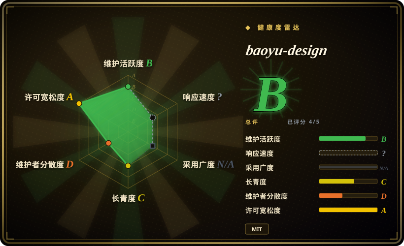
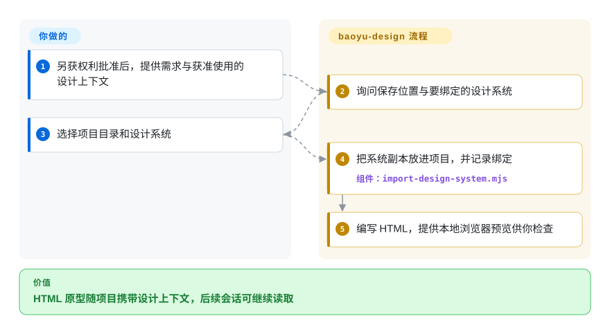
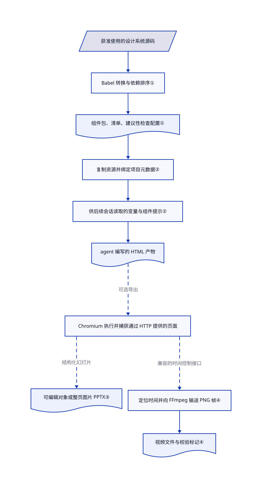

# baoyu-design

第一张设置页像样，第二张却换了品牌配色，做成幻灯片还要重排。baoyu-design 把本地设计系统绑定到 HTML 项目，并提供浏览器导出脚本。

> [!WARNING]
> **仅作信息收录，权利缺口未清。** [根 MIT](https://github.com/JimLiu/baoyu-design/blob/6530033592bf7fa58bc1a5a2a2ad278da45213a9/LICENSE#L1-L13)署名 Jim Liu。[README](https://github.com/JimLiu/baoyu-design/blob/6530033592bf7fa58bc1a5a2a2ad278da45213a9/README.md#credits--license)、[来源记录](https://github.com/JimLiu/baoyu-design/blob/6530033592bf7fa58bc1a5a2a2ad278da45213a9/skills/baoyu-design/references/upstream-sync/provenance.json#L57-L84)和[复制报告](https://github.com/JimLiu/baoyu-design/blob/6530033592bf7fa58bc1a5a2a2ad278da45213a9/skills/baoyu-design/references/upstream-sync/apply-report.json#L21-L48)记载了从闭源 Claude Design 产品前端提取的内容。所读材料不能证明该部分已获再许可。`NOASSERTION`用于避免把整包描述成已核清的 MIT，不否定作者对其有权处分部分的根许可声明。收录**不批准安装、复制提取内容或再分发**，也不作侵权法律判决。自动健康卡里的根许可信号不等于完整权利审计。

## 何时使用

你负责产品原型，要在多轮 agent 会话中保持同一套品牌。已经有获准使用的界面素材包，但每生成一张 HTML 页面，按钮形状和蓝色值又变了。若要了解“把设计系统随项目保存，下一轮继续读取”的做法，可以研究 baoyu-design：组件、样式与资源留在原型目录，元数据记录项目绑定了哪套系统。

它的区别是用本地文件串联原型、幻灯片与动画，不是截图复刻应用，也不是图表编辑器。这里提供架构与能力信息；具体文件和用途仍须另行完成权利审查。这个使用场景不豁免页首告警。

## 何时不用

- **需要拿来就装，或把整包再分发。** 不要只凭根 MIT 采用该分发。可考虑厂商运营的 Claude Design 服务，前提是条款符合任务；也可另选已独立核清权利的实现。输入素材仍须单独确认权利。
- **设计系统来自不可信来源。** [问题 #16](https://github.com/JimLiu/baoyu-design/issues/16)报告 CSS 路径越界。固定版本的解析器递归跟随规范化后的 `@import`，没有目录范围检查。若输入是截图，可考虑不经过这条导入路径的 [screenshot-to-code](../../../ai-design-generation/screenshot-to-code.zh.md)，但仍须评估其模型服务与数据边界。
- **交付物必须是可编辑技术图。** 选 [drawio-skill](drawio-skill.zh.md)，保留可与源码同步的 `.drawio` 模型；HTML 原型和整页截图不能代替这种模型。
- **任务是还原已有页面，而非设计新页面。** 选 [screenshot-to-code](../../../ai-design-generation/screenshot-to-code.zh.md)，使用截图裁图与复刻流程；baoyu-design 围绕需求说明和设计上下文展开。
- **希望手动编辑图层，不允许本地 shell 执行。** 按账户条款使用常规 Figma 工作流。此包把写文件、开预览服务、浏览器自动化和可选导出子进程交给宿主 agent；它不是沙箱，也不是图形编辑器。

## 横向对比

| 替代品 | 是否收录 | 我们的评价 | 取舍 |
|---|---|---|---|
| [huashu-design](huashu-design.zh.md) | ✅ | 需要广泛的 HTML 视觉产物流程时，对照 huashu-design 的风格与评审体系；关注项目本地设计系统绑定时，研究 baoyu-design 的实现。 | 两者都依赖 agent 编写 HTML 和导出工具。此行不替任何一方核清第三方权利，baoyu-design 的已知提取内容缺口仍阻止自动采用。 |
| [screenshot-to-code](../../../ai-design-generation/screenshot-to-code.zh.md) | ✅ | 要把已有截图还原成页面，选 screenshot-to-code；要让获准使用的系统指导新原型与幻灯片，研究 baoyu-design。 | 前者提供裁图和多方案，但要运行后端并调用模型服务；后者复用宿主 agent 与本地项目文件。 |
| [drawio-skill](drawio-skill.zh.md) | ✅ | 工程师要编辑并同步架构图，选 drawio-skill；baoyu-design 的 HTML 范围更广，却不保留这种图模型。 | 可手调的几何布局与源码同步，对比基于 HTML 的界面、幻灯片和动画编排。 |
| Claude Design 服务 | 非仓库 | 希望使用厂商托管的设计环境，而不是再分发依据存疑的社区提取包时，优先考虑原服务。 | 它是闭源托管产品，不是开源仓库；以厂商条款、账户可用性和服务数据处理边界换取免本地 agent 运维。 |

## 快速上手

[上游文档](https://github.com/JimLiu/baoyu-design/blob/6530033592bf7fa58bc1a5a2a2ad278da45213a9/README.md#quick-start)写的是先运行 `npx skills add JimLiu/baoyu-design`，再在 Claude Code 用 `/baoyu-design` 或直接描述任务；这里只引用路径，**不构成安装建议或授权**。另获批准后，具备文件能力的 agent 读取路由，询问保存目录和设计上下文，把文件写入 `designs/<project>/`。你负责需求、获准使用的素材、模型访问与费用；流程负责 HTML、设计系统资源副本和供你检查的本地预览。基本流程依赖宿主 agent 与本地文件，脚本使用 Node，预览可用 Python 服务。PPTX 导出另需 Node 18+、Playwright／Chromium、JSZip 和仓内 PptxGenJS 构建；视频还需 FFmpeg 和单独构建，因此 README 中概括性的“无运行时”不覆盖这些导出路径。下图仅描述附带前提的流程，本次没有安装或执行。

<!-- flow-steps:begin (generated from flows/baoyu-design.json by tools/flow_card.py — do not edit) -->

流程文字版

1. **你**：另获权利批准后，提供需求与获准使用的设计上下文
2. **baoyu-design**：询问保存位置与要绑定的设计系统
3. **你**：选择项目目录和设计系统
4. **baoyu-design**：把系统副本放进项目，并记录绑定 — 组件：`import-design-system.mjs`
5. **baoyu-design**：编写 HTML，提供本地浏览器预览供你检查

**价值**：HTML 原型随项目携带设计上下文，后续会话可继续读取

<!-- flow-steps:end -->

## 技术要点

<!-- mechanism:begin (generated from mechanisms/baoyu-design.json by tools/mechanism_card.py; do not edit) -->

机制文字版

- 获准使用的设计系统源码
- Babel 转换与依赖排序①
- 组件包、清单、建议性检查配置①
- 复制资源并绑定项目元数据②
- 供后续会话读取的变量与组件提示②
- agent 编写的 HTML 产物
- Chromium 执行并捕获通过 HTTP 提供的页面
- 可编辑对象或整页图片 PPTX③
- 定位时间并向 FFmpeg 输送 PNG 帧④
- 视频文件与校验标记④

- 获准使用的设计系统源码 → Babel 转换与依赖排序①
- Babel 转换与依赖排序① → 组件包、清单、建议性检查配置①
- 组件包、清单、建议性检查配置① → 复制资源并绑定项目元数据②
- 复制资源并绑定项目元数据② → 供后续会话读取的变量与组件提示②
- 供后续会话读取的变量与组件提示② → agent 编写的 HTML 产物
- agent 编写的 HTML 产物 → Chromium 执行并捕获通过 HTTP 提供的页面（可选导出）〔可选／兜底〕
- Chromium 执行并捕获通过 HTTP 提供的页面 → 可编辑对象或整页图片 PPTX③（结构化幻灯片）〔可选／兜底〕
- Chromium 执行并捕获通过 HTTP 提供的页面 → 定位时间并向 FFmpeg 输送 PNG 帧④（兼容的时间控制接口）〔可选／兜底〕
- 定位时间并向 FFmpeg 输送 PNG 帧④ → 视频文件与校验标记④

<!-- mechanism:end -->

### 1. 把设计系统编译成可携带的运行文件

- **解决：** 组件源码、样式变量和用法规则分散在素材包中，页面难以统一加载。
- **做法：** 本地编译器用仓内 Babel 转换 JSX／TSX，按依赖顺序排列同目录导入，生成浏览器组件包、清单和遵循性检查配置，并记录源码哈希。
- **边界：** 不解决循环依赖，逐文件错误记入运行时命名空间。检查配置仅告警，未解析出的组件契约不生成规则；它既不硬性保证视觉质量，也不保证导入代码安全。
- **源码：** [编译与依赖排序第 97–204 行](https://github.com/JimLiu/baoyu-design/blob/6530033592bf7fa58bc1a5a2a2ad278da45213a9/skills/baoyu-design/agents/compile-design-system.mjs#L97-L204)、[建议性规则与输出第 263–367 行](https://github.com/JimLiu/baoyu-design/blob/6530033592bf7fa58bc1a5a2a2ad278da45213a9/skills/baoyu-design/agents/compile-design-system.mjs#L263-L367)。

### 2. 把系统副本绑定到项目和下一轮会话

- **解决：** 后续会话忘记前一张页面用了哪些颜色与组件。
- **做法：** 导入器把 CSS 依赖、本地资源和组件包复制到 `_ds/<slug>/`，更新 `_d_meta.json`，选择主系统，并写出包含准确变量名与用法摘录的 `_ds_prompt.md`，供下一轮读取。
- **边界：** 这是本地快照，不是密码学版本锁，也不是素材授权。CSS 遍历仍是信任边界；加载设计系统文字属于 agent 指令路径，不是隔离机制。
- **源码：** [复制集合第 65–133 行](https://github.com/JimLiu/baoyu-design/blob/6530033592bf7fa58bc1a5a2a2ad278da45213a9/skills/baoyu-design/agents/import-design-system.mjs#L65-L133)、[元数据与提示生成第 153–211 行](https://github.com/JimLiu/baoyu-design/blob/6530033592bf7fa58bc1a5a2a2ad278da45213a9/skills/baoyu-design/agents/import-design-system.mjs#L153-L211)、[未限制目录范围的 CSS 递归第 95–117 行](https://github.com/JimLiu/baoyu-design/blob/6530033592bf7fa58bc1a5a2a2ad278da45213a9/skills/baoyu-design/agents/lib/ds-core.mjs#L95-L117)。

### 3. 把浏览器捕获转换成两类幻灯片

- **解决：** 浏览器幻灯片需要变成可编辑对象，或保持外观的整页图片。
- **做法：** Playwright 渲染通过 HTTP 提供的幻灯片，注入的捕获代码返回布局数据或截图，分别生成 PptxGenJS 原生对象或整页图片。编排器收集备注、动画告警和校验结果，供机器读取。
- **边界：** 只支持此流程生成的结构化幻灯片，不支持任意 HTML。截图模式没有可编辑对象和原生动画；输出附带校验标记，不保证还原精度。字体准备可以访问 Google Fonts，浏览器也会执行页面脚本。
- **源码：** [两条导出分支第 28–162 行](https://github.com/JimLiu/baoyu-design/blob/6530033592bf7fa58bc1a5a2a2ad278da45213a9/skills/baoyu-design/agents/gen-pptx/src/orchestrator/run.ts#L28-L162)、[字体请求第 75–120 行](https://github.com/JimLiu/baoyu-design/blob/6530033592bf7fa58bc1a5a2a2ad278da45213a9/skills/baoyu-design/agents/gen-pptx/src/browser/setup.ts#L75-L120)、[文档中的幻灯片范围限制](https://github.com/JimLiu/baoyu-design/blob/6530033592bf7fa58bc1a5a2a2ad278da45213a9/README.md#decks--pptx-export)。

### 4. 按时间定位动画，逐帧送入编码器

- **解决：** 直接录制实时播放，容易把不均匀的时序带进动画文件。
- **做法：** 视频编排器等待页面暴露时间控制接口，暂停播放，定位每一帧，再把 PNG 捕获送入 FFmpeg 子进程。返回文件路径时，也报告字体就绪状态和重复帧告警。
- **边界：** 页面必须提供兼容的时间控制接口，不是通用录屏器。捕获失败会杀掉 FFmpeg，但所读编排器没有删除残留文件；两个导出命令都在 try／catch 内调用 `process.exit()`，位置早于所写的 finally 关闭路径，不能把清理当作已保证。
- **源码：** [时间接口与逐帧循环第 127–229 行](https://github.com/JimLiu/baoyu-design/blob/6530033592bf7fa58bc1a5a2a2ad278da45213a9/skills/baoyu-design/agents/gen-video/src/orchestrator/run.ts#L127-L229)、[编码器生命周期第 58–103 行](https://github.com/JimLiu/baoyu-design/blob/6530033592bf7fa58bc1a5a2a2ad278da45213a9/skills/baoyu-design/agents/gen-video/src/orchestrator/encode.ts#L58-L103)、[视频命令第 125–149 行](https://github.com/JimLiu/baoyu-design/blob/6530033592bf7fa58bc1a5a2a2ad278da45213a9/skills/baoyu-design/agents/gen-video/src/cli.ts#L125-L149)、[PPTX 命令第 99–122 行](https://github.com/JimLiu/baoyu-design/blob/6530033592bf7fa58bc1a5a2a2ad278da45213a9/skills/baoyu-design/agents/gen-pptx/src/cli.ts#L99-L122)。

## 健康度与可持续性

- **维护，核验于 2026-10-24 UTC。** 默认分支仍为 `6530033592bf7fa58bc1a5a2a2ad278da45213a9`，v1.3.0 和默认分支最后提交日期均为 2026-09-23。v1.1.x、v1.2.0 和 v1.3.0 分布在六至九月。未归档，但默认分支并非每日更新。
- **治理与支持。** 个人账户 JimLiu 持有仓库，贡献者接口列出 JimLiu 的 72 次贡献，另五人各一次。所读目录有测试与 CI，但未见独立治理、安全政策或贡献政策文件。README 明示独立维护，未获 Anthropic 背书。
- **年龄与采用。** 创建于 2026-06-07，约四个半月；本次快照为 4481 星、311 fork，只能说明关注，不能当部署数。[推断] 历史短、贡献集中，支持的是较弱的 Lindy 先验，不能据此承诺成熟团队式的持续性。
- **决定性风险是权利范围。** 根 MIT 署名打包者，版本化提取与复制记录却指向产品前端材料。自动许可轴根据 GitHub 检出的 MIT 得 A，不会核清提取子集的授权。总分 B 覆盖五个适用轴中的四个；响应轴未知，评分器给出的原因是 `type_na`，采用轴因缺少安装渠道计量而不适用。本页不批准安装或再分发。
- **开放报告不等于已发布变化。** [问题 #16](https://github.com/JimLiu/baoyu-design/issues/16)仍开放，固定版本解析器也能看到对应 CSS 路径。[PR #20](https://github.com/JimLiu/baoyu-design/pull/20)提议更新提取快照，正文自称版权归 Anthropic；尚未合并，所读正文未提供可核验的再许可授权。不能把该提案写成 v1.3.0 功能。
- **执行与外发。** 导出驱动接受 HTTP／HTTPS 地址，并在 Chromium 执行页面，不限定 localhost。模型访问由宿主 agent 决定，字体可从外站获取，发送到 Figma／Canva 则是文档中的可选流程，不是本页批准的动作。源码、联网权限与输出目录须另审；文件、进程及外部副本的完整清理尚未证实。

## 存疑（未验证）

- [未验证] 所读根许可、README、来源记录、复制报告和 PR #20 正文不能证明 Claude Design 前端提取内容的再分发或再许可权限；材料中没有可核验的权利人授权。这不是侵权判决。
- [未验证] 本次明确禁止安装或执行上游，因此未实测视觉还原、跨 agent 兼容性、原生幻灯片动画播放、视频编码及清理。静态源码阅读不等于导出冒烟测试。
- [未验证] 未攻击复现问题 #16，也未全面审计联网与秘密处理路径。递归缺少范围检查、HTTP／HTTPS 和字体请求是源码观察，不是已经发生数据外泄的证据。
- [推断] 仓库只有约四个半月历史，贡献又集中于一个账户，因此持续性仍不确定；星数不能证明生产采用或持续资金。
