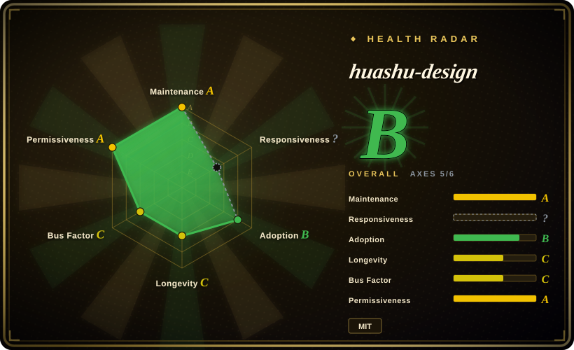
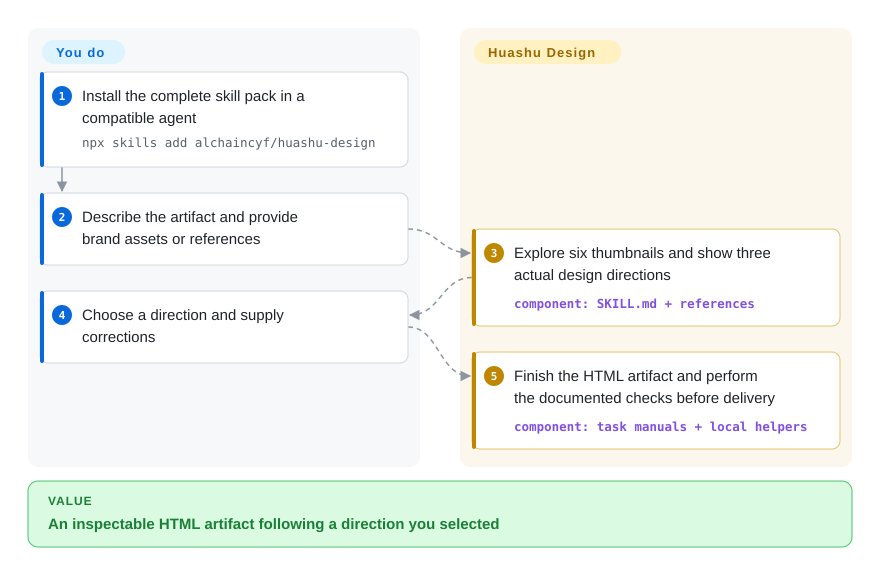
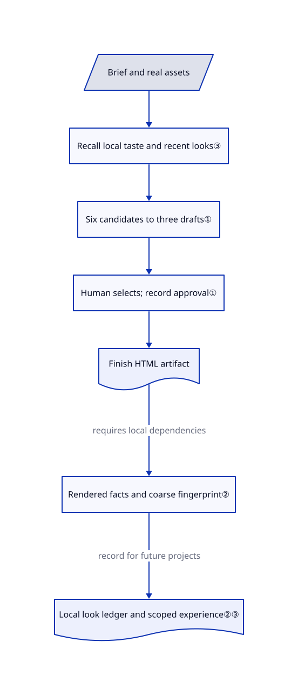

# huashu-design

Your agent makes three mockups that differ only in color. Huashu Design asks it to explore six candidates, show three actual designs, and wait for your choice before producing HTML-based prototypes, slides or motion assets.

## When to use

You need a clickable product demo or a presentation for a launch. Your agent keeps giving you the same centered headline and cards, even when you request three alternatives. Choose huashu-design when you want actual HTML drafts to compare, not a list of style adjectives: its instructions combine designer-led ideas, screenshotted reference works and an 84-style specimen library before narrowing six candidates to three drafts.

You supply the brief, brand assets and final direction. The agent follows task-specific manuals and uses local rendering/export helpers. Compared with Taste-Skill's frontend taste guidance, this is a broader artifact-production workflow with a deliberate human approval stop; compared with Stitch Skills, it does not require Stitch's hosted generation service.

## When NOT to use

- **You are implementing a production application with a backend.** Use your application stack plus [Taste-Skill](../ui-taste/taste-skill.md) for visual guidance; upstream explicitly excludes production web apps, SEO sites and backend systems.
- **You need Stitch screens converted into React, React Native or shadcn components.** Choose [Stitch Skills](../design-to-code/stitch-skills.md); huashu-design prioritizes inspectable HTML artifacts rather than that hosted design-to-code round trip.
- **You need research, information architecture or design-operations workflows.** Choose [Designer Skills](../ui-taste/designer-skills.md); this pack spends its workflow on visual delivery rather than a full design practice.
- **You cannot pause for design selection.** Use a pre-approved template or your existing design system. The skill explicitly stops after showing directions, even unattended, unless the user expressly skips the gate or the direction is already approved.
- **You require layer-level Figma handoff.** Use Figma, a hosted design product rather than a repository. PPTX export is a separate path, not a Figma round trip; inspect the exported result before promising editability.
- **You require a strict offline or fail-closed check.** Use a network-restricted renderer and an explicit dependency preflight instead. HTML may fetch CDNs, reference collection visits URLs, and the design linter exits successfully when Python Playwright is missing. Optional cloud narration/review also needs separate consent.
- **You need independently established rights to all prompt material.** Use your own design instructions or obtain a provenance review first. [Unverified: no third-party permission evidence in the reviewed sources] Upstream discloses deriving its workflow from circulating Claude Design system prompts; its root MIT notice alone does not resolve that third-party provenance.

## Comparison

| Alternative | In index | Our verdict | Tradeoff |
|---|---|---|---|
| [Stitch Skills](../design-to-code/stitch-skills.md) | Indexed | Choose Stitch for converting hosted Stitch screens into application components; choose huashu-design for HTML demos, decks and motion outside that service. | Stitch adds service credentials and a component-conversion workflow; huashu-design leaves application integration to you. |
| [Taste-Skill](../ui-taste/taste-skill.md) | Indexed | Choose Taste-Skill to guide visual implementation inside an app; choose huashu-design when you need several rendered artifact directions before building the final. | Taste-Skill mainly supplies instructions; huashu-design also carries samples, local checks and export helpers. |
| [Designer Skills](../ui-taste/designer-skills.md) | Indexed | Choose Designer Skills for research through design-system and critique work; choose huashu-design for a brief-to-visual-deliverable workflow. | Broader lifecycle knowledge versus a narrower delivery spine with human direction selection. |
| Figma | Not a repo | Choose Figma when designers need manual layer editing and collaborative handoff; choose huashu-design when conversational HTML generation is the priority. | Figma is a hosted product, not missing repository coverage; HTML artifacts do not preserve its editing model. |

## Quick start

Install the pack with `npx skills add alchaincyf/huashu-design` into an agent that can load Markdown skills. Confirm that the installation includes `references/`, `assets/`, `scripts/` and `demos/`, not just its main instruction file. Describe the artifact and provide brand material or reference examples; the agent prepares six thumbnails and three actual directions. Choose one before it continues into the final HTML and any requested export. You provide model/tool access, pay any model or optional cloud costs, and review both visuals and export fidelity; the pack supplies instructions and helpers, not a standalone design service. Local checking uses Python Playwright and Pillow, while the Node export manifest lists Playwright, Sharp, PptxGenJS and pdf-lib; video paths require media tools.

<!-- flow-steps:begin (generated from flows/huashu-design.json by tools/flow_card.py — do not edit) -->

Text version of the flow

1. **You**: Install the complete skill pack in a compatible agent — `npx skills add alchaincyf/huashu-design`
2. **You**: Describe the artifact and provide brand assets or references
3. **huashu-design**: Explore six thumbnails and show three actual design directions — component: `SKILL.md + references`
4. **You**: Choose a direction and supply corrections
5. **huashu-design**: Finish the HTML artifact and perform the documented checks before delivery — component: `task manuals + local helpers`

**Value**: An inspectable HTML artifact following a direction you selected

<!-- flow-steps:end -->

## Key techniques

<!-- mechanism:begin (generated from mechanisms/huashu-design.json by tools/mechanism_card.py; do not edit) -->

Text version of the mechanism

- Brief and real assets
- Recall local taste and recent looks③
- Six candidates to three drafts①
- Human selects; record approval①
- Finish HTML artifact
- Rendered facts and coarse fingerprint②
- Local look ledger and scoped experience②③

- Brief and real assets → Recall local taste and recent looks③
- Recall local taste and recent looks③ → Six candidates to three drafts①
- Six candidates to three drafts① → Human selects; record approval①
- Human selects; record approval① → Finish HTML artifact
- Finish HTML artifact → Rendered facts and coarse fingerprint② (requires local dependencies)
- Rendered facts and coarse fingerprint② → Local look ledger and scoped experience②③ (record for future projects)

<!-- mechanism:end -->

### 1. Separate exploration from user approval

- **Problem:** Three differently colored copies of one layout do not offer a real design choice.
- **How:** The main skill requests two candidates from each of three logics: designer reasoning, real reference works captured before use, and a style-library draw. Six thumbnails narrow to three actual drafts; the agent stops for the user's choice and records approval in a file.
- **Limits:** These are instructions, not universal runtime enforcement. The skill permits explicit skip, already-approved iterations and mechanical tasks; weak agents can produce one full draft and two lighter variants.
- **Source:** [Direction selection and exceptions](https://github.com/alchaincyf/huashu-design/blob/4fc7bfdbd5ec3fa2d43ce7a6433de60976a5e4b1/SKILL.md#L102-L116), [approval artifacts](https://github.com/alchaincyf/huashu-design/blob/4fc7bfdbd5ec3fa2d43ce7a6433de60976a5e4b1/SKILL.md#L136-L145), [weak-runtime fallback](https://github.com/alchaincyf/huashu-design/blob/4fc7bfdbd5ec3fa2d43ce7a6433de60976a5e4b1/SKILL.md#L174-L188).

### 2. Check rendered facts and retain a coarse visual fingerprint

- **Problem:** An HTML file can contain broken images or unreadable text, while successive designs repeat the same visual structure.
- **How:** Playwright collects rendered text sizes, colors and errors. Screenshots become a small palette and a normalized 32-by-20 edge vector; palette distance and vector correlation flag similar variants. The local JSONL ledger records these fingerprints and absolute project paths for later comparison.
- **Limits:** This is not an aesthetic score or complete accessibility audit. Contrast skips image and gradient backgrounds; screenshots reflect the selected viewport. Missing Python Playwright prints a skip message and exits zero, so a successful process is not proof of inspection.
- **Source:** [Contrast exclusions](https://github.com/alchaincyf/huashu-design/blob/4fc7bfdbd5ec3fa2d43ce7a6433de60976a5e4b1/scripts/design_lint.py#L58-L75), [fingerprints and collection](https://github.com/alchaincyf/huashu-design/blob/4fc7bfdbd5ec3fa2d43ce7a6433de60976a5e4b1/scripts/design_lint.py#L203-L284), [comparison rules](https://github.com/alchaincyf/huashu-design/blob/4fc7bfdbd5ec3fa2d43ce7a6433de60976a5e4b1/scripts/design_lint.py#L392-L403), [ledger writes](https://github.com/alchaincyf/huashu-design/blob/4fc7bfdbd5ec3fa2d43ce7a6433de60976a5e4b1/scripts/design_lint.py#L460-L497).

### 3. Separate personal taste from shared experience

- **Problem:** A comment about one cover can silently become a rule for every future project.
- **How:** The experience helper separates shipped guidance from local Markdown records. It always recalls local preferences, filters other experience by topic, excludes superseded local observations, and requires evidence for writes plus quotation marks for preferences. The main skill asks the agent to preserve the user's wording and scope and announce storage.
- **Limits:** Quote marks and evidence strings do not verify consent or truth. Preference scope is prose the agent must respect, not an enforced filter; local files can contain user quotes and project paths. Deleting the local home removes these records, not previously generated artifacts.
- **Source:** [Layering and recall](https://github.com/alchaincyf/huashu-design/blob/4fc7bfdbd5ec3fa2d43ce7a6433de60976a5e4b1/scripts/learn.py#L30-L102), [write requirements](https://github.com/alchaincyf/huashu-design/blob/4fc7bfdbd5ec3fa2d43ce7a6433de60976a5e4b1/scripts/learn.py#L105-L128), [user notice](https://github.com/alchaincyf/huashu-design/blob/4fc7bfdbd5ec3fa2d43ce7a6433de60976a5e4b1/SKILL.md#L162-L172), [local data inventory](https://github.com/alchaincyf/huashu-design/blob/4fc7bfdbd5ec3fa2d43ce7a6433de60976a5e4b1/SECURITY.md#L31-L40).

## Health & viability

- **Maintenance, 2026-10-27:** still `alchaincyf/huashu-design`, public, non-fork and not archived. Latest default-branch commit is dated October 23; v3.0.0 was released October 17. This is a content evolution, not a rename or replacement with an unrelated repository.
- **Age and governance:** created April 19, 191 days old. Maintenance A and longevity C support current activity, not a long Lindy record. The scorer finds two active maintainers with 97.8% of commits concentrated in the top author; governance remains C.
- **Adoption:** overall B covers five of six axes; responsiveness is unknown. Adoption B comes from release-asset downloads, including media, not measured skill installations or production users. Stars are attention rather than proof of delivery quality.
- **License and provenance:** the [root MIT file](https://github.com/alchaincyf/huashu-design/blob/4fc7bfdbd5ec3fa2d43ce7a6433de60976a5e4b1/LICENSE#L1-L21) requires retaining the copyright/permission notice. The README dates its change from a personal-use license to May 14. Its [Claude Design prompt-origin disclosure](https://github.com/alchaincyf/huashu-design/blob/4fc7bfdbd5ec3fa2d43ce7a6433de60976a5e4b1/README.en.md#L303-L305) and [origin story](https://github.com/alchaincyf/huashu-design/blob/4fc7bfdbd5ec3fa2d43ce7a6433de60976a5e4b1/README.en.md#L384-L390) already existed in the previously recorded commit. Reusable scripts and examples exist beyond that material; neither a root license nor the automated license grade establishes third-party rights.
- **Operational exposure:** local memory stores quotes and absolute paths. Asset/reference retrieval and browser CDNs can use the network; the host agent's model access is separate from local export. The [security statement](https://github.com/alchaincyf/huashu-design/blob/4fc7bfdbd5ec3fa2d43ce7a6433de60976a5e4b1/SECURITY.md#L7-L29) documents optional cloud consent, not a blanket offline guarantee.

## Caveats (unverified)

- [Unverified: upstream execution was excluded from this review] No generation, export, browser check or timing/quality claim was reproduced; advertised cross-agent parity is not demonstrated here.
- [Unverified: no third-party permission evidence in the reviewed sources] The disclosed use of circulating Claude Design system prompts leaves prompt provenance unresolved. This review does not establish infringement, ownership or a transferable grant from Anthropic.
- [Unverified: cloud scripts were not audited or run] Cloud consent behavior is documented upstream; this page does not certify every network path or the absence of telemetry.
