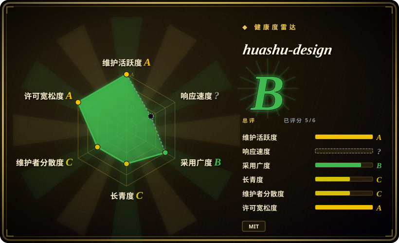
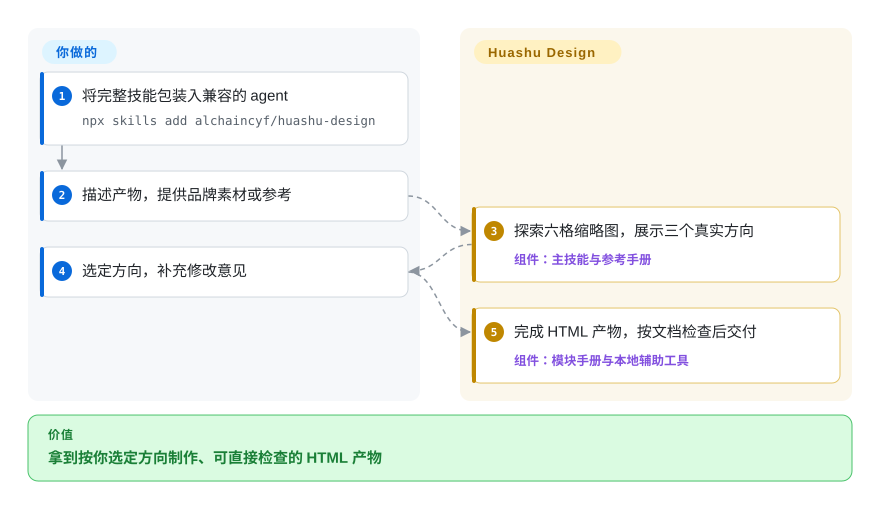
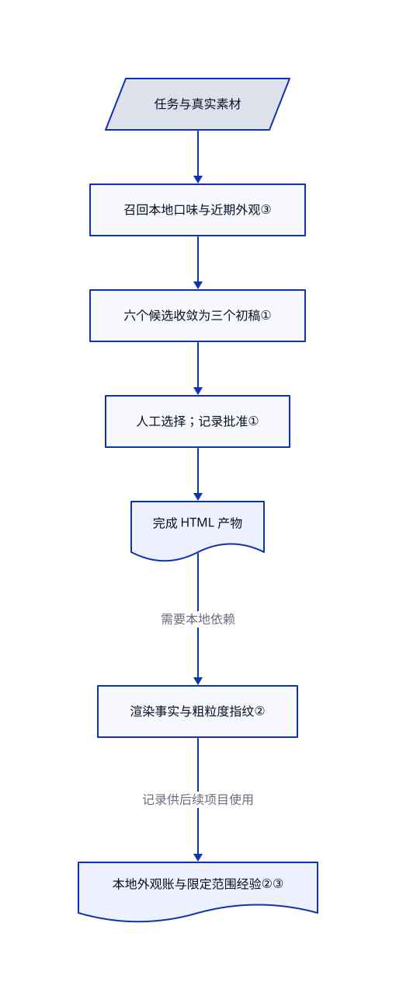

# huashu-design

你让 agent 出三版设计，拿到的却是同一布局换三种颜色。Huashu Design 要求先探索六个候选，再给你三个真实初稿，选定后才继续制作 HTML 原型、幻灯片或动效。

## 何时使用

你要给产品发布做可点击演示或演讲稿，agent 却总交出居中标题加卡片，连“三个方案”也只是换色。需要实际 HTML 初稿而不是风格形容词时，选 huashu-design。它要求先结合设计师思路、真实参考作品和带样张的 84 种风格库，再把六个候选收敛为三个初稿。

你提供任务、品牌素材和最终方向。agent 按任务读取模块手册，调用本地渲染与导出辅助工具。相比 Taste-Skill 的前端审美指导，它覆盖更完整的视觉交付，并刻意停下来等人选方向；相比 Stitch Skills，它不依赖 Stitch 托管生成服务。

## 何时不用

- **你在实现带后端的生产应用。** 用现有应用技术栈，加 [Taste-Skill](../ui-taste/taste-skill.zh.md) 补视觉指导；上游明确排除生产 Web 应用、SEO 网站与后端系统。
- **你要把 Stitch 页面转成 React、React Native 或 shadcn 组件。** 选 [Stitch Skills](../design-to-code/stitch-skills.zh.md)；huashu-design 优先交付可看的 HTML，而不是这条托管设计转代码链路。
- **你需要用户研究、信息架构或设计运营流程。** 选 [Designer Skills](../ui-taste/designer-skills.zh.md)；本项目把流程重点放在视觉产物，而不是完整设计实践。
- **你不能中途停下来选方案。** 用已批准模板或现有设计系统。除非用户明确跳过，或方向已经获批，否则技能要求展示后停止，即使无人值守也不例外。
- **你必须交付可逐层编辑的 Figma 稿。** 用 Figma；它是托管设计产品，不是仓库。PPTX 导出是另一条路径，不是 Figma 往返转换；承诺可编辑之前应检查实际导出结果。
- **你要求严格离线或缺检查即失败。** 改用限网渲染器和明确的依赖预检。HTML 可能请求 CDN，参考板会访问 URL，设计检查缺少 Python Playwright 时会成功退出；可选云端配音与视频评审也需要单独授权。
- **你要求所有提示词都有独立可核验授权。** 先用自写设计指令，或做来源审查。[未验证：所读材料未提供第三方许可证明] 上游披露从流传的 Claude Design 系统提示词推导工作流；根目录 MIT 声明不能单独解决第三方来源问题。

## 横向对比

| 替代品 | 是否收录 | 我们的评价 | 取舍 |
|---|---|---|---|
| [Stitch Skills](../design-to-code/stitch-skills.zh.md) | 已收录 | 要把托管 Stitch 页面转成应用组件时选 Stitch；不走该服务、要做 HTML 演示、幻灯片或动效时选 huashu-design。 | Stitch 增加服务凭据与组件转换流程；huashu-design 把应用集成留给你。 |
| [Taste-Skill](../ui-taste/taste-skill.zh.md) | 已收录 | 在应用内实现视觉界面时选 Taste-Skill；制作最终产物前要比较多个实渲染方向时选 huashu-design。 | Taste-Skill 主要提供指令；huashu-design 还带样例、本地检查和导出辅助工具。 |
| [Designer Skills](../ui-taste/designer-skills.zh.md) | 已收录 | 从研究到设计系统、评审都要覆盖时选 Designer Skills；任务书到视觉交付的链路选 huashu-design。 | 全生命周期知识覆盖，对比更窄但带人工选方向的交付主线。 |
| Figma | 非仓库 | 设计师需要手工编辑图层和协作交接时选 Figma；优先通过对话生成 HTML 时选 huashu-design。 | Figma 是托管产品，不是漏收的仓库；HTML 产物不保留其编辑模型。 |

## 快速上手

用 `npx skills add alchaincyf/huashu-design` 装入能加载 Markdown 技能的 agent。检查安装目录应包含 `references/`、`assets/`、`scripts/`、`demos/`，而不只是主指令文件。描述产物，提供品牌素材或参考作品；agent 先准备六格缩略图与三个真实方向。你选定后，它才继续制作最终 HTML，并按需导出。你提供模型与工具权限，承担模型或可选云服务费用，并验收视觉和导出保真度；项目提供指令和辅助工具，不是独立设计服务。本地检查需要 Python Playwright 与 Pillow；Node 导出清单列出 Playwright、Sharp、PptxGenJS、pdf-lib，视频路径另需媒体工具。

<!-- flow-steps:begin (generated from flows/huashu-design.json by tools/flow_card.py — do not edit) -->

流程文字版

1. **你**：将完整技能包装入兼容的 agent — `npx skills add alchaincyf/huashu-design`
2. **你**：描述产物，提供品牌素材或参考
3. **huashu-design**：探索六格缩略图，展示三个真实方向 — 组件：`主技能与参考手册`
4. **你**：选定方向，补充修改意见
5. **huashu-design**：完成 HTML 产物，按文档检查后交付 — 组件：`模块手册与本地辅助工具`

**价值**：拿到按你选定方向制作、可直接检查的 HTML 产物

<!-- flow-steps:end -->

## 技术要点

<!-- mechanism:begin (generated from mechanisms/huashu-design.json by tools/mechanism_card.py; do not edit) -->

机制文字版

- 任务与真实素材
- 召回本地口味与近期外观③
- 六个候选收敛为三个初稿①
- 人工选择；记录批准①
- 完成 HTML 产物
- 渲染事实与粗粒度指纹②
- 本地外观账与限定范围经验②③

- 任务与真实素材 → 召回本地口味与近期外观③
- 召回本地口味与近期外观③ → 六个候选收敛为三个初稿①
- 六个候选收敛为三个初稿① → 人工选择；记录批准①
- 人工选择；记录批准① → 完成 HTML 产物
- 完成 HTML 产物 → 渲染事实与粗粒度指纹②（需要本地依赖）
- 渲染事实与粗粒度指纹② → 本地外观账与限定范围经验②③（记录供后续项目使用）

<!-- mechanism:end -->

### 1. 把探索与人工批准分开

- **解决：** 同一布局换三种颜色，不是真正可选的设计方向。
- **做法：** 主技能要求三套逻辑各出两个候选，分别来自设计师思路、先截图再使用的真实作品、风格库抽样。六格缩略图收敛为三个真实初稿，agent 停下等待人选，并用文件记录批准。
- **边界：** 这是指令，不是全流程运行时强制。用户明确跳过、已批准方向内的迭代、机械操作均可豁免；弱运行环境允许一个完整版加两个轻量变体。
- **源码：** [方向与豁免](https://github.com/alchaincyf/huashu-design/blob/4fc7bfdbd5ec3fa2d43ce7a6433de60976a5e4b1/SKILL.md#L102-L116)、[批准文件](https://github.com/alchaincyf/huashu-design/blob/4fc7bfdbd5ec3fa2d43ce7a6433de60976a5e4b1/SKILL.md#L136-L145)、[弱环境降级](https://github.com/alchaincyf/huashu-design/blob/4fc7bfdbd5ec3fa2d43ce7a6433de60976a5e4b1/SKILL.md#L174-L188)。

### 2. 测渲染事实，保留粗粒度外观指纹

- **解决：** HTML 可能有裂图、小字；多个项目也可能反复使用同一视觉骨架。
- **做法：** Playwright 采集渲染后的字号、颜色和错误。截图压成小色板与标准化的 32×20 边缘向量，再用色板距离和向量相关度标记相似方案。本地 JSONL 账本保存指纹与绝对项目路径，供下次比较。
- **边界：** 它不评审美，也不是完整无障碍审计。对比度跳过图片与渐变背景，截图取决于所选视口；缺少 Python Playwright 时打印跳过并返回零，因此进程成功不代表检查已执行。
- **源码：** [对比度排除项](https://github.com/alchaincyf/huashu-design/blob/4fc7bfdbd5ec3fa2d43ce7a6433de60976a5e4b1/scripts/design_lint.py#L58-L75)、[指纹与采集](https://github.com/alchaincyf/huashu-design/blob/4fc7bfdbd5ec3fa2d43ce7a6433de60976a5e4b1/scripts/design_lint.py#L203-L284)、[相似判断](https://github.com/alchaincyf/huashu-design/blob/4fc7bfdbd5ec3fa2d43ce7a6433de60976a5e4b1/scripts/design_lint.py#L392-L403)、[账本写入](https://github.com/alchaincyf/huashu-design/blob/4fc7bfdbd5ec3fa2d43ce7a6433de60976a5e4b1/scripts/design_lint.py#L460-L497)。

### 3. 把个人口味与共享经验分层

- **解决：** 用户对某张封面的评价，可能悄悄变成所有项目的默认规则。
- **做法：** 经验工具分开读取随技能分发的知识和本地 Markdown 记录。它始终召回个人偏好，其余经验按主题过滤，并排除本地已取代观察；写入要求证据，偏好还必须带引号。主技能要求保留原话与适用范围，并告知用户记录行为。
- **边界：** 引号和证据字符串不能验证授权或真假。偏好范围依靠 agent 理解文字，不是强制过滤；本地文件会含原话与项目路径。删除本地记录目录，不会删除过去生成的产物。
- **源码：** [分层与召回](https://github.com/alchaincyf/huashu-design/blob/4fc7bfdbd5ec3fa2d43ce7a6433de60976a5e4b1/scripts/learn.py#L30-L102)、[写入要求](https://github.com/alchaincyf/huashu-design/blob/4fc7bfdbd5ec3fa2d43ce7a6433de60976a5e4b1/scripts/learn.py#L105-L128)、[告知要求](https://github.com/alchaincyf/huashu-design/blob/4fc7bfdbd5ec3fa2d43ce7a6433de60976a5e4b1/SKILL.md#L162-L172)、[本地数据清单](https://github.com/alchaincyf/huashu-design/blob/4fc7bfdbd5ec3fa2d43ce7a6433de60976a5e4b1/SECURITY.md#L31-L40)。

## 健康度与可持续性

- **维护，截至 2026-10-27：** 仍为 `alchaincyf/huashu-design`，公开、非 fork、未归档。默认分支最新提交在 10 月 23 日，v3.0.0 于 10 月 17 日发布。这是内容演进，不是改名或被替换成无关仓库。
- **年龄与治理：** 4 月 19 日创建，年龄 191 天。维护 A、长期性 C 说明当下活跃，不代表已积累长期 Lindy 记录。评分器找到两名活跃维护者，首位作者占提交的 97.8%，治理仍为 C。
- **采用：** 综合 B，六轴中五轴有分，响应度未知。采用 B 来自发布附件下载，其中包含媒体，不是技能安装量或生产用户数。星标体现关注，不能证明交付质量。
- **许可与来源：** [根目录 MIT 文件](https://github.com/alchaincyf/huashu-design/blob/4fc7bfdbd5ec3fa2d43ce7a6433de60976a5e4b1/LICENSE#L1-L21) 要求保留版权与许可声明。README 说 5 月 14 日从个人使用许可改为 MIT。[Claude Design 提示词来源披露](https://github.com/alchaincyf/huashu-design/blob/4fc7bfdbd5ec3fa2d43ce7a6433de60976a5e4b1/README.en.md#L303-L305) 及[起源说明](https://github.com/alchaincyf/huashu-design/blob/4fc7bfdbd5ec3fa2d43ce7a6433de60976a5e4b1/README.en.md#L384-L390) 在旧快照中已存在。仓库另有可复用脚本与样例；根许可和自动许可评分均不能证明第三方权利。
- **运行边界：** 本地记忆保存用户原话与绝对路径。素材获取、参考板和浏览器 CDN 可能联网，宿主 agent 的模型访问也不等于本地导出。[安全声明](https://github.com/alchaincyf/huashu-design/blob/4fc7bfdbd5ec3fa2d43ce7a6433de60976a5e4b1/SECURITY.md#L7-L29) 记载可选云服务的授权门，不是整体离线保证。

## 存疑（未验证）

- [未验证：本轮明确禁止运行上游] 未复现生成、导出、浏览器检查、耗时或质量宣传，也未证明不同 agent 的执行一致性。
- [未验证：所读材料未提供第三方许可证明] 上游披露使用流传的 Claude Design 系统提示词，提示词来源权利仍未解决。本轮不据此认定侵权、所有权或来自 Anthropic 的可转授许可。
- [未验证：未审计或运行云脚本] 云端授权行为来自上游文档，本页不认证全部网络路径或无遥测声明。
