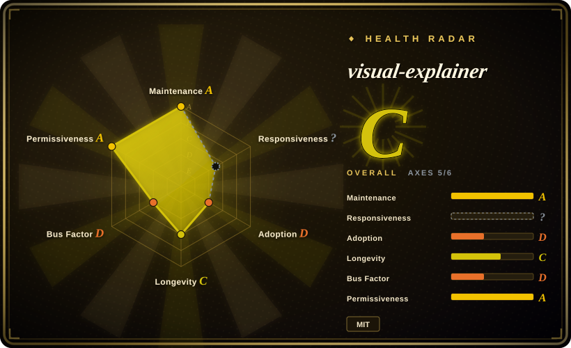
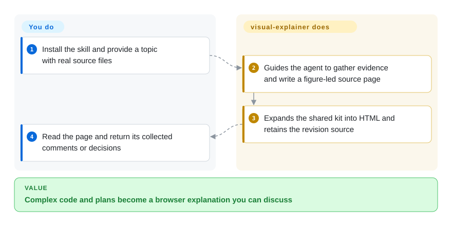
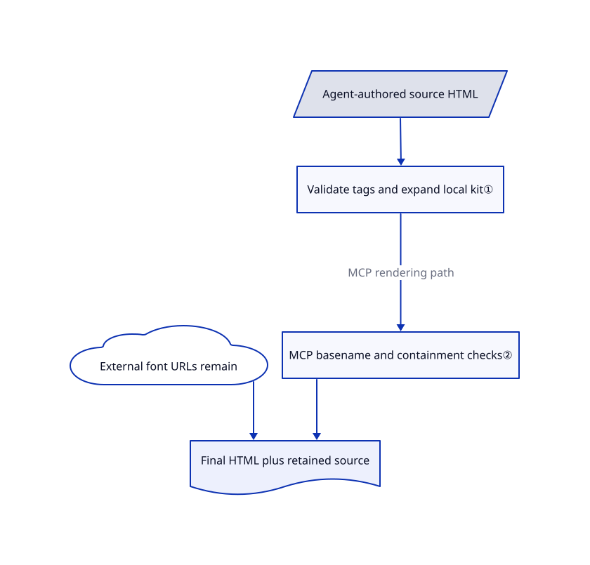

# visual-explainer

A terminal diff explanation turns into a wide table you cannot scan, and the architecture sketch wraps into broken ASCII. visual-explainer teaches your agent to write a figure-led HTML explanation with reusable page styles and reader feedback controls.

## When to use

You are reviewing a change, comparing a plan with code or explaining a system, and the reader needs to see the mechanism rather than scroll through terminal prose. You already have an agent that can inspect the sources; add this pack for the visual explanation and local HTML rendering. Choose it over archify when the deliverable combines a verdict, diagrams, evidence and reader decisions rather than one technical diagram. Choose drawio-skill if the team needs to keep editing boxes in a diagram editor afterward.

## When NOT to use

- **An editable architecture file that tracks source changes:** choose [drawio-skill](drawio-skill.md); this pack's revision source is HTML, not a source-synchronized diagram model.
- **One technical diagram with typed diagram input and exports:** choose [archify](archify.md), rather than adopting the broader review/page workflow.
- **Strict branding imported from a site:** consider [diagram-design](diagram-design.md); visual-explainer supplies its own registers and design conventions, although project design rules take precedence.
- **A guaranteed offline file:** the renderer inlines kit styles/scripts but inserts Google Fonts URLs; generated libraries can also use CDNs. Use [D2](../../../diagramming/d2.md) for a locally rendered static diagram, or bundle all web dependencies yourself.
- **Full-fidelity editable PowerPoint:** the optional exporter is static and best-effort. Use a dedicated presentation authoring workflow instead; animations, live SVG/canvas and JavaScript are not preserved by this export.

## Comparison

| Alternative | In index | Our verdict | Tradeoff |
|---|---|---|---|
| [archify](archify.md) | ✅ | Choose archify for a focused architecture/workflow diagram with renderer-backed checks; choose visual-explainer for a review or explanation page with several evidence figures and reader replies. | A typed diagram model narrows the artifact; freeform HTML can combine more evidence but needs model judgment and browser inspection. |
| [drawio-skill](drawio-skill.md) | ✅ | Choose drawio-skill when humans must keep hand-tuned geometry while syncing real source; choose visual-explainer when the deliverable is a readable browser explanation. | Editable model/provenance layers support diagram maintenance; HTML favors narrative, interaction and lightweight distribution. |
| [diagram-design](diagram-design.md) | ✅ | Choose diagram-design for a published figure matching a site's brand; choose visual-explainer for figure-led code reviews, plans and comparisons. | Brand onboarding emphasizes a specific visual identity; this pack emphasizes reusable registers, rendering helpers and feedback collection. |

## Quick start

Install the documented Claude Code marketplace plugin, the Pi package, or copy `plugins/visual-explainer/` into your host's skill directory. Ask the agent for a visual explanation and provide the real diff, plan or source files; it gathers the evidence and writes a short `.src.html` source. The bundled Node renderer expands the shared kit into the final HTML and keeps the source for small revisions. Open the file in a browser and send the page's collected feedback back to the agent; automatic opening and direct reply delivery depend on the host. You supply the model, source truth and review; the optional local MCP server prepares/render pages but does not call an LLM or verify all factual claims.

<!-- flow-steps:begin (generated from flows/visual-explainer.json by tools/flow_card.py — do not edit) -->

Text version of the flow

1. **You**: Install the skill and provide a topic with real source files
2. **visual-explainer**: Guides the agent to gather evidence and write a figure-led source page
3. **visual-explainer**: Expands the shared kit into HTML and retains the revision source
4. **You**: Read the page and return its collected comments or decisions

**Value**: Complex code and plans become a browser explanation you can discuss

<!-- flow-steps:end -->

## Key techniques

<!-- mechanism:begin (generated from mechanisms/visual-explainer.json by tools/mechanism_card.py; do not edit) -->

Text version of the mechanism

- Agent-authored source HTML
- Validate tags and expand local kit①
- External font URLs remain
- MCP basename and containment checks②
- Final HTML plus retained source

- Agent-authored source HTML → Validate tags and expand local kit①
- Validate tags and expand local kit① → MCP basename and containment checks② (MCP rendering path)
- MCP basename and containment checks② → Final HTML plus retained source
- External font URLs remain → Final HTML plus retained source

<!-- mechanism:end -->

### 1. Compile a small HTML source with shared visual primitives

- **Problem:** Rewriting complete styled pages makes small revisions noisy and causes design drift.
- **How:** A kit marker selects a register, inlines local CSS/script and expands flow, data and question tags. Invalid kit/tag structures stop rendering before writing; page statistics report figures, missing captions and prose outside figures.
- **Limits:** Ordinary HTML without kit tags passes through without those checks. Counts are not a factual review or a layout-quality proof, and the renderer still references external Google Fonts.
- **Source:** [Kit compilation](https://github.com/nicobailon/visual-explainer/blob/de82e3d1fbf2851ecdf873960b09cc7c8dab45b1/plugins/visual-explainer/kit/render.mjs#L25-L106), [CLI write path](https://github.com/nicobailon/visual-explainer/blob/de82e3d1fbf2851ecdf873960b09cc7c8dab45b1/plugins/visual-explainer/kit/render.mjs#L159-L189).

### 2. Keep MCP rendering inside an explicit output directory

- **Problem:** A model-facing render tool should not accept arbitrary filesystem write paths or confuse “opened” with “open requested.”
- **How:** The MCP server accepts a basename or an in-directory source path, checks containment and symlinks, writes via a temporary file and rename, and reports opener status separately. Opening defaults off; it serves prompts/resources over stdio without an HTTP listener.
- **Limits:** This is the MCP path, not a sandbox around the agent or every CLI. The output directory should be private to the user, and generated HTML remains active content when opened.
- **Source:** [Path and write checks](https://github.com/nicobailon/visual-explainer/blob/de82e3d1fbf2851ecdf873960b09cc7c8dab45b1/plugins/visual-explainer/mcp/server.mjs#L104-L159), [render and opener result](https://github.com/nicobailon/visual-explainer/blob/de82e3d1fbf2851ecdf873960b09cc7c8dab45b1/plugins/visual-explainer/mcp/server.mjs#L274-L320).

## Health & viability

- **2026-10-18:** v0.13.0 released October 17, following v0.12.0 on October 2. The project is actively evolving, including a source/render split and optional video export.
- Created February 2026, about eight months old. The MIT copyright and visible contribution history center on Nico Bailon; short history and concentrated ownership limit the Lindy case.
- The repository contains prompts, a local renderer and MCP/export code, not only visual examples. Host compatibility varies; copying a skill does not install every optional utility.
- Treat HTML as the fidelity source. PPTX and video have separate tool and runtime requirements; neither follows merely from installing the prompt pack.

## Caveats (unverified)

- [未验证：本批禁止执行上游技能与程序] Visual quality, browser layout checks and cross-host installation were not exercised.
- [推断：依据是模型自由编写 HTML 和工具只校验部分结构] A clean render can still contain incorrect evidence, omitted facts or misleading diagrams; source review remains necessary.
