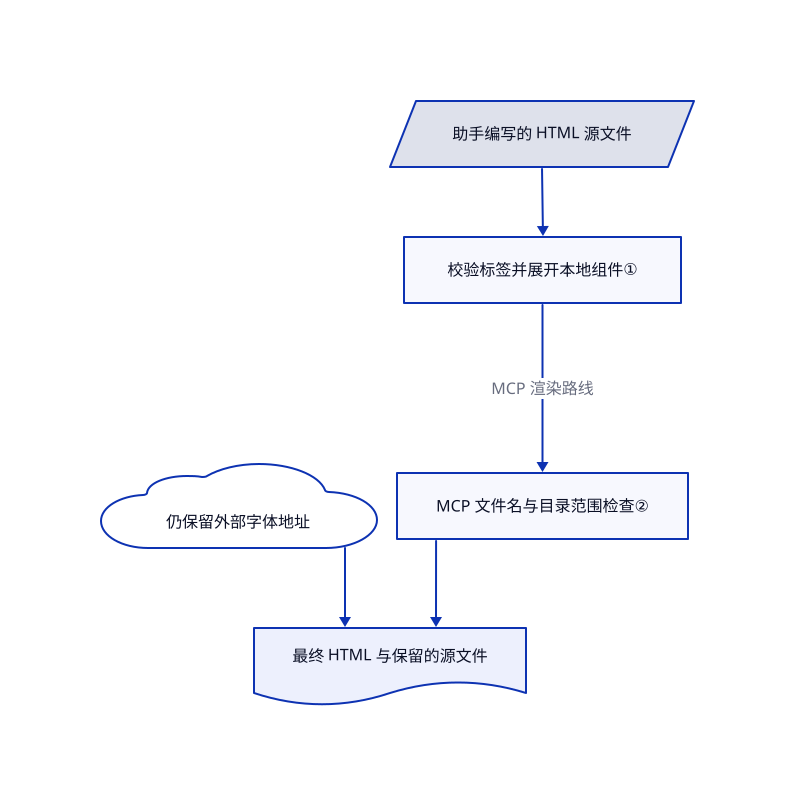

# visual-explainer

代码变更说明挤成终端宽表，架构图一换行就散。visual-explainer 让助手改写成以图为主的 HTML 解释页，并复用样式与读者反馈控件。

## 何时使用

你要审查修改、核对方案与代码，或解释系统机制，读者需要看见流程，而不是滚动终端长文。你已有能读源码的助手，加入本包来生成视觉解释与本地 HTML。相比 archify，本包适合同时容纳结论、图、证据和读者决策的页面，而不是一张技术图。若团队后续还要用编辑器拖动方框，则选 drawio-skill。

## 何时不用

- **架构文件要可编辑并跟踪源码变化：** 选 [drawio-skill](drawio-skill.zh.md)；本包的修订源是 HTML，不是持续同步的图模型。
- **只要一张有类型输入与导出的技术图：** 选 [archify](archify.zh.md)，不必采用更宽的审查页面流程。
- **必须导入站点品牌：** 看 [diagram-design](diagram-design.zh.md)；visual-explainer 自带页面风格与设计规则，虽允许项目设计规则优先。
- **必须完全离线：** 渲染器内联本地样式和脚本，但仍插入 Google Fonts 地址，生成库也可能来自 CDN。静态图可选本地渲染的 [D2](../../../diagramming/d2.zh.md)，或自行打包全部网页依赖。
- **要保真可编辑 PowerPoint：** 可选导出器只是静态尽力转换。应采用专门演示稿创作流程；它不会保留动画、实时 SVG、画布与 JavaScript。

## 横向对比

| 替代品 | 是否收录 | 我们的评价 | 取舍 |
|---|---|---|---|
| [archify](archify.zh.md) | ✅ | 聚焦架构或工作流图并要渲染器检查，选 archify；多张证据图和读者反馈的解释页，选 visual-explainer。 | 有类型的图模型收窄产物；自由 HTML 可组合更多证据，但更依赖模型判断和浏览器检查。 |
| [drawio-skill](drawio-skill.zh.md) | ✅ | 保留人工布局并同步真实源码，选 drawio-skill；交付浏览器可读解释，选 visual-explainer。 | 可编辑模型与来源层便于长期维护图；HTML 更适合叙事、交互和轻量分发。 |
| [diagram-design](diagram-design.zh.md) | ✅ | 发布图要符合站点品牌，选 diagram-design；代码审查、方案和对比要图文解释，选 visual-explainer。 | 品牌接入突出专属视觉；本包突出可复用页面风格、渲染助手与反馈收集。 |

## 快速上手

按文档安装 Claude Code 市场插件、Pi 包，或把 `plugins/visual-explainer/` 复制进宿主技能目录。要求助手生成视觉解释，并给真实差异、方案或源码；它取证后编写短 `.src.html` 源文件。内置 Node 渲染器把共享组件展开成最终 HTML，并保留源文件供小步修改。用浏览器打开，再把页面收集的反馈送回助手；自动打开和直接回传取决于宿主。你提供模型、真实资料和审查；可选本地 MCP 服务只准备和渲染页面，不调用模型，也不验证全部事实。

<!-- flow-steps:begin (generated from flows/visual-explainer.json by tools/flow_card.py — do not edit) -->

流程文字版

1. **你**：安装技能，提供主题和真实来源文件
2. **visual-explainer**：引导助手取证并编写以图为主的页面源文件
3. **visual-explainer**：展开共享组件生成 HTML，并保留修订源文件
4. **你**：阅读页面，回传收集的评论或裁决

**价值**：复杂代码和方案变成可讨论的浏览器解释页

<!-- flow-steps:end -->

## 技术要点

<!-- mechanism:begin (generated from mechanisms/visual-explainer.json by tools/mechanism_card.py; do not edit) -->

机制文字版

- 助手编写的 HTML 源文件
- 校验标签并展开本地组件①
- 仍保留外部字体地址
- MCP 文件名与目录范围检查②
- 最终 HTML 与保留的源文件

- 助手编写的 HTML 源文件 → 校验标签并展开本地组件①
- 校验标签并展开本地组件① → MCP 文件名与目录范围检查②（MCP 渲染路线）
- MCP 文件名与目录范围检查② → 最终 HTML 与保留的源文件
- 仍保留外部字体地址 → 最终 HTML 与保留的源文件

<!-- mechanism:end -->

### 1. 用共享视觉元素编译短 HTML 源文件

- **解决：** 每次重写完整样式页面，会让小改动产生大量噪声，并带来视觉漂移。
- **做法：** 组件标记选择页面风格，内联本地样式脚本，展开流程、数据和问题标签。结构无效时先报错，不写文件；页面统计报告图数、缺图注和图外正文量。
- **边界：** 不含组件标签的普通 HTML 会直接通过，不受这些检查。数量不代表事实审查或布局质量，渲染器仍引用在线 Google Fonts。
- **源码：** [组件编译](https://github.com/nicobailon/visual-explainer/blob/de82e3d1fbf2851ecdf873960b09cc7c8dab45b1/plugins/visual-explainer/kit/render.mjs#L25-L106)、[命令行写入路径](https://github.com/nicobailon/visual-explainer/blob/de82e3d1fbf2851ecdf873960b09cc7c8dab45b1/plugins/visual-explainer/kit/render.mjs#L159-L189)。

### 2. 把 MCP 渲染限制在明确输出目录

- **解决：** 面向模型的渲染工具不应接受任意写入路径，也不能把“请求打开”冒充“已打开”。
- **做法：** MCP 服务只接受文件名或目录内源路径，检查路径包含关系与软链，经临时文件和改名写入，另行报告打开器状态。默认不打开，使用标准输入输出提供提示词与资源，不监听 HTTP。
- **边界：** 这是 MCP 路径，不是包住助手或所有命令行的沙箱。输出目录应只允许本人写，打开后的 HTML 仍是活动内容。
- **源码：** [路径和写入检查](https://github.com/nicobailon/visual-explainer/blob/de82e3d1fbf2851ecdf873960b09cc7c8dab45b1/plugins/visual-explainer/mcp/server.mjs#L104-L159)、[渲染与打开结果](https://github.com/nicobailon/visual-explainer/blob/de82e3d1fbf2851ecdf873960b09cc7c8dab45b1/plugins/visual-explainer/mcp/server.mjs#L274-L320)。

## 健康度与可持续性

- **2026-10-18：** v0.13.0 于 10 月 17 日发布，上版 v0.12.0 为 10 月 2 日。项目持续演化，近期包含源码与渲染拆分及可选视频导出。
- 创建于 2026 年 2 月，约八个月。MIT 署名和可见提交都以 Nico Bailon 为中心，历史短、归属集中，林迪依据有限。
- 仓库有提示词、本地渲染器、MCP 与导出代码，不只是图片范例。宿主支持程度不同，复制技能也不等于安装全部可选工具。
- HTML 是视觉保真来源；PPTX 与视频各有工具和运行条件，不会因安装提示词包就自动齐备。

## 存疑（未验证）

- [未验证：本批禁止执行上游技能与程序] 未实测视觉质量、浏览器布局检查和跨宿主安装。
- [推断：依据是模型自由编写 HTML 和工具只校验部分结构] 渲染成功仍可能含错误证据、事实遗漏或误导图，必须审查来源。
