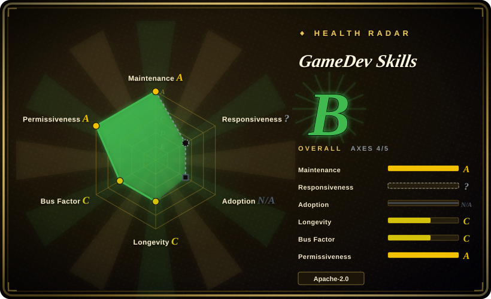
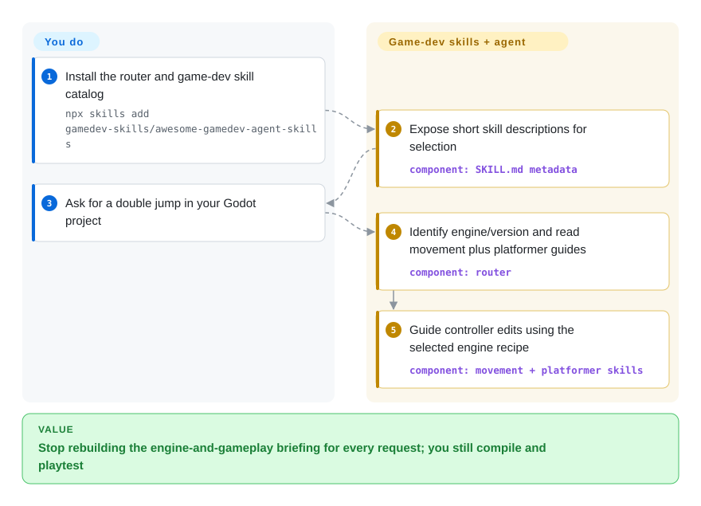
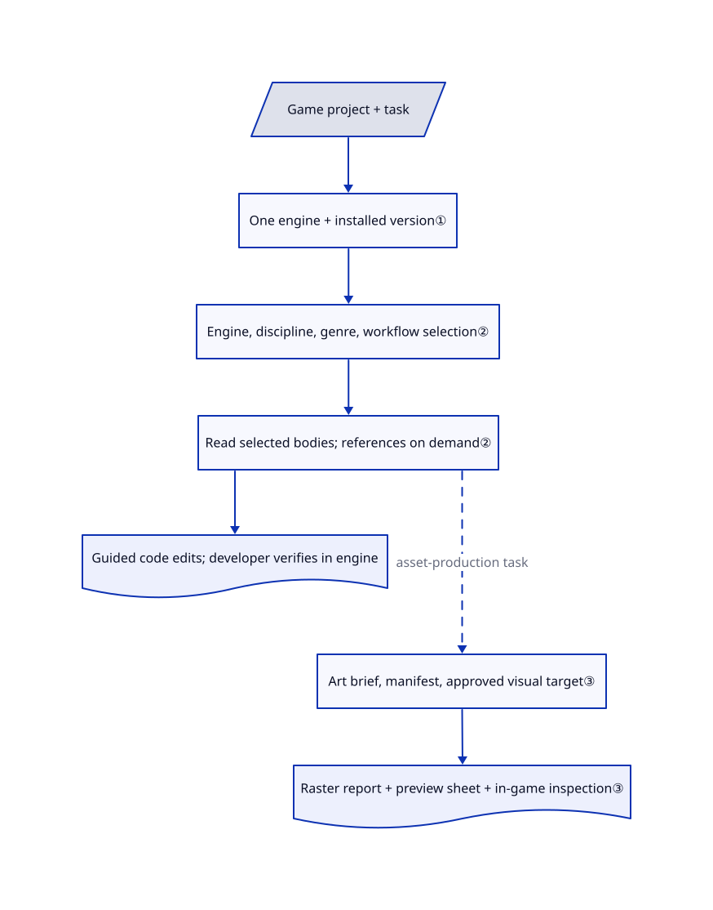

# GameDev Skills

Your agent writes a Godot controller with an obsolete movement call, then needs a different briefing for Unity inventory code. This pack selects engine-specific instructions and adds only the game-design or publishing guides the task needs.

## When to use

You are building a small game with a coding agent, and asking for “double jump” produces `move_and_slide(velocity)` copied from older Godot examples. Next you need save slots, camera follow, or an itch.io release, and a generic coding workflow does not supply those domain recipes. Choose this pack when you want one installable catalog covering ten engines or rendering libraries, with engine/version detection and reusable gameplay, genre, and shipping instructions rather than an editor-control service.

You still own the game project and its toolchain. The reviewed main branch contains 74 specialized skills plus a router: it can combine a Godot movement guide with a platformer guide, or an engine importer with an asset-production workflow. Its advantage over a general development-methodology pack is the game-specific material; it does not replace your test discipline or give the agent new editor tools.

## When NOT to use

- **You need the agent to create Unity scene objects, inspect the live hierarchy, or run Unity Test Runner.** Consider [CoderGamester/mcp-unity](https://github.com/CoderGamester/mcp-unity), an editor bridge using MCP — a protocol exposing tools to an agent. These Markdown skills are guidance, not a Unity connection; the bridge adds Node.js and editor-side setup.
- **You need a Godot execution feedback loop, not another controller recipe.** Choose [Coding-Solo/godot-mcp](https://github.com/Coding-Solo/godot-mcp) for launching the editor, running projects, and collecting debug output. This pack includes a headless-testing recipe, but you must supply Godot and actually run it.
- **Your failure is skipped design, tests, or review across all software projects.** Choose [Superpowers](../../agent-dev-methodology/coding-agent-harnesses/superpowers.md) for a general brainstorm-to-test workflow. This pack supplies domain knowledge, not a replacement for that lifecycle.
- **You require guaranteed routing or a certified cross-engine result.** Prefer a project-specific workflow with compiler/editor tests, or the matching editor bridge above when you need live state. Here the model follows prose; the repository validator checks metadata, links, catalog coverage, and bundles, not whether a controller or game works.

## Comparison

| Alternative | In index | Our verdict | Tradeoff |
|---|---|---|---|
| [Coding-Solo/godot-mcp](https://github.com/Coding-Solo/godot-mcp) | not indexed | For a Godot bug that requires running the scene and reading errors, choose godot-mcp; choose this pack when the missing piece is a version-aware gameplay recipe. | The bridge supplies execution tools but requires Godot, Node.js, and MCP configuration; this pack supplies instructions without that bridge. not added in this tab batch. |
| [CoderGamester/mcp-unity](https://github.com/CoderGamester/mcp-unity) | not indexed | For live Unity hierarchy changes and editor tests, choose mcp-unity; choose this pack for portable engine and game-design instructions. | The editor package and Node bridge add operational setup and permissions; a skill install alone cannot inspect a running scene. not added in this tab batch. |
| [Superpowers](../../agent-dev-methodology/coding-agent-harnesses/superpowers.md) | ✅ | If the agent skips requirements or failing tests, choose Superpowers; if it mixes game-engine APIs or lacks gameplay patterns, choose this pack. | Superpowers brings a general development process; this pack brings engine, discipline, genre, and publishing recipes. They address different gaps, so define ownership before combining them. |

## Quick start

Install with the documented `npx skills add gamedev-skills/awesome-gamedev-agent-skills`; the external installer places skill folders in the selected agent's discovery directory. A skill is a Markdown playbook with a short trigger description, not a running service; include the router as well as the specialized skills. Open your game project and ask “add a double jump to my Godot player”: the router instructs the agent to identify the engine/version and read the movement and platformer guides before editing. You supply the coding-agent access, engine installation, project files, and final compilation/playtest; the pack supplies recipes, not model credits or a built-in editor connection. For optional image checks, its asset helpers require Python 3.10+ and Pillow; image generation needs a separate available tool.

<!-- flow-steps:begin (generated from flows/awesome-gamedev-agent-skills.json by tools/flow_card.py — do not edit) -->

Text version of the flow

1. **You**: Install the router and game-dev skill catalog — `npx skills add gamedev-skills/awesome-gamedev-agent-skills`
2. **GameDev Skills**: Expose short skill descriptions for selection — component: `SKILL.md metadata`
3. **You**: Ask for a double jump in your Godot project
4. **GameDev Skills**: Identify engine/version and read movement plus platformer guides — component: `router`
5. **GameDev Skills**: Guide controller edits using the selected engine recipe — component: `movement + platformer skills`

**Value**: Stop rebuilding the engine-and-gameplay briefing for every request; you still compile and playtest

<!-- flow-steps:end -->

## Key techniques

<!-- mechanism:begin (generated from mechanisms/awesome-gamedev-agent-skills.json by tools/mechanism_card.py; do not edit) -->

Text version of the mechanism

- Game project + task
- One engine + installed version①
- Engine, discipline, genre, workflow selection②
- Read selected bodies; references on demand②
- Guided code edits; developer verifies in engine
- Art brief, manifest, approved visual target③
- Raster report + preview sheet + in-game inspection③

- Game project + task → One engine + installed version①
- One engine + installed version① → Engine, discipline, genre, workflow selection②
- Engine, discipline, genre, workflow selection② → Read selected bodies; references on demand②
- Read selected bodies; references on demand② → Guided code edits; developer verifies in engine
- Read selected bodies; references on demand② → Art brief, manifest, approved visual target③ (asset-production task) [optional/fallback]
- Art brief, manifest, approved visual target③ → Raster report + preview sheet + in-game inspection③

<!-- mechanism:end -->

### 1. Detect one engine and preserve its installed version

- **Problem:** Similar C# files or multiple web dependencies can select the wrong engine, while new examples can silently upgrade an existing project's APIs.
- **How:** The router uses project fingerprints such as `project.godot` or Unity's paired project directories. Its detection reference scopes ambiguous monorepos by target file and reads engine metadata or dependency locks before choosing APIs; catalog baselines apply to new projects only.
- **Limits:** This is an instruction for the model, not an executable detector. The router body says first match, while its reference adds ambiguity handling; custom engines and unresolved mixtures need an explicit user choice.
- **Source:** [Router detection and version rules](https://github.com/gamedev-skills/awesome-gamedev-agent-skills/blob/0a70cfc64672d512c5b5b6006b5dcb5cf90dbdbd/router/SKILL.md#L33-L68), [ambiguity and version sources](https://github.com/gamedev-skills/awesome-gamedev-agent-skills/blob/0a70cfc64672d512c5b5b6006b5dcb5cf90dbdbd/router/references/engine-detection.md#L22-L58).

### 2. Compose small playbooks without loading the whole catalog

- **Problem:** Loading every engine guide wastes context and mixes incompatible APIs; a genre guide can duplicate low-level movement or save-system instructions.
- **How:** Metadata selects a minimal set, then bodies and deeper references load on demand. The composition order is engine fundamentals, portable discipline, genre glue, then workflow; engine skills own API syntax and genre skills link to primitives. The Godot movement guide illustrates that division with argument-less `move_and_slide()` and links to physics, input, and platformer skills.
- **Limits:** Progressive loading still depends on the host agent honoring the router. The local validator checks names, resource links, routing-table mentions, and plugin membership; it does not prove correct prompt routing or execute engine examples.
- **Source:** [Read protocol and ownership](https://github.com/gamedev-skills/awesome-gamedev-agent-skills/blob/0a70cfc64672d512c5b5b6006b5dcb5cf90dbdbd/router/SKILL.md#L161-L188), [movement recipe](https://github.com/gamedev-skills/awesome-gamedev-agent-skills/blob/0a70cfc64672d512c5b5b6006b5dcb5cf90dbdbd/skills/godot/godot-2d-movement/SKILL.md#L23-L41), [structural validator](https://github.com/gamedev-skills/awesome-gamedev-agent-skills/blob/0a70cfc64672d512c5b5b6006b5dcb5cf90dbdbd/scripts/validate-skills.py#L257-L347).

### 3. Separate visual production decisions from deterministic asset checks

- **Problem:** Separately generated sprites can disagree on palette and scale, while a plausible preview can hide wrong dimensions or unusable transparency.
- **How:** The asset skill records an art brief and asset manifest, approves a representative visual target, produces related families, and requires native-scale or in-engine inspection. A Pillow helper measures size, color count, and alpha data, emits JSON, and exits nonzero on requested constraint failures; another builds a sorted nearest-neighbor contact sheet.
- **Limits:** The helper's `--require-alpha` checks channel presence, not useful transparent pixels. These scripts do not generate images or prove visual cohesion, animation quality, seams, topology, or asset rights; those remain workflow inspections and provenance records.
- **Source:** [Asset workflow and acceptance](https://github.com/gamedev-skills/awesome-gamedev-agent-skills/blob/0a70cfc64672d512c5b5b6006b5dcb5cf90dbdbd/skills/disciplines/create-game-assets/SKILL.md#L11-L42), [raster report](https://github.com/gamedev-skills/awesome-gamedev-agent-skills/blob/0a70cfc64672d512c5b5b6006b5dcb5cf90dbdbd/skills/disciplines/create-game-assets/scripts/asset_report.py#L29-L123), [preview sheet](https://github.com/gamedev-skills/awesome-gamedev-agent-skills/blob/0a70cfc64672d512c5b5b6006b5dcb5cf90dbdbd/skills/disciplines/create-game-assets/scripts/build_preview_sheet.py#L26-L83).

## Health & viability

- **Maintenance, 2026-10-21:** created 2026-06-24, not archived, last pushed 2026-10-09. The latest release remains v1.1.0 from June 26, describing 66 skills; reviewed main has 74 plus the router. Pin the reviewed commit rather than assuming the release and current catalog match. Sources: [releases](https://github.com/gamedev-skills/awesome-gamedev-agent-skills/releases), [reviewed tree](https://github.com/gamedev-skills/awesome-gamedev-agent-skills/tree/0a70cfc64672d512c5b5b6006b5dcb5cf90dbdbd).
- **Governance and backing, 2026-10-21:** organization-owned, with Abhishek Barali named as maintainer. The contributors endpoint lists seven contributors, led by 87 of 109 listed contributions; this is concentrated maintenance, not evidence of foundation backing. [Contribution policy](https://github.com/gamedev-skills/awesome-gamedev-agent-skills/blob/0a70cfc64672d512c5b5b6006b5dcb5cf90dbdbd/CONTRIBUTING.md) requires original, version-pinned work and router/distribution updates.
- **Longevity and adoption, 2026-10-21:** roughly four months old, with 2359 stars and 201 forks. [推断：based on age and recent commits, not deployment evidence] It is useful current reference material but lacks a long active history; popularity does not establish generated-game quality or future maintenance.
- **License and quality boundary, 2026-10-21:** Apache-2.0 and NOTICE name the maintainer and contributors; engine trademarks do not imply endorsement. CI is configured for structural validation, helper tests, and site checks, not a ten-engine integration suite. The [Bevy update PR](https://github.com/gamedev-skills/awesome-gamedev-agent-skills/pull/18) reports focused compile/runtime checks; that is not validation of every skill or host agent.
- **Radar coverage, 2026-10-21:** four of five applicable axes scored. The scorer assigns responsiveness `?` with reason `type_na` for this skill pack, and adoption `N/A` with reason `no_install_channel`; neither is a measured low score.

## Caveats (unverified)

- [未验证：upstream installation and engine execution were prohibited in this intake] The documented installer, automatic activation across clients, and final gameplay behavior were not reproduced. This page verifies files and instructions, not end-to-end compatibility or a productivity gain.
- [推断：the router is prose and its validator checks repository structure] Routing, version preservation, and acceptance steps are advisory model behavior, not hard runtime enforcement.
- [推断：created 2026-06-24 with recent October commits, no production-user evidence established here] Four months of activity supports trying pinned reference material, not a strong long-term sustainability claim.
