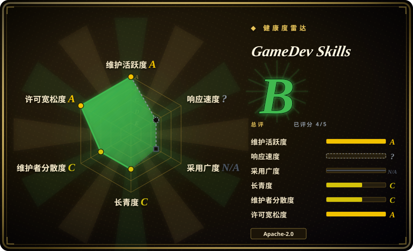
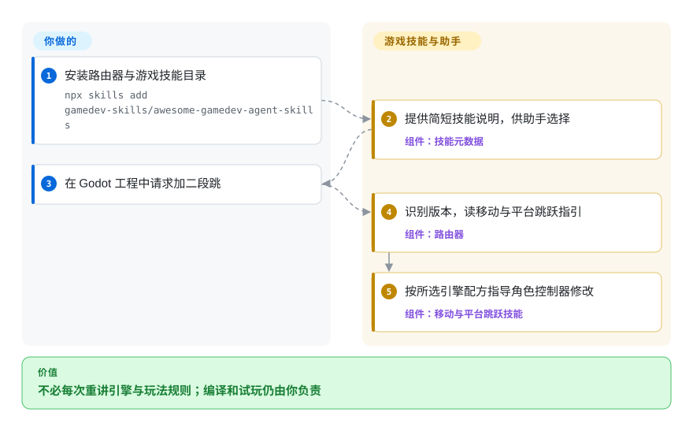
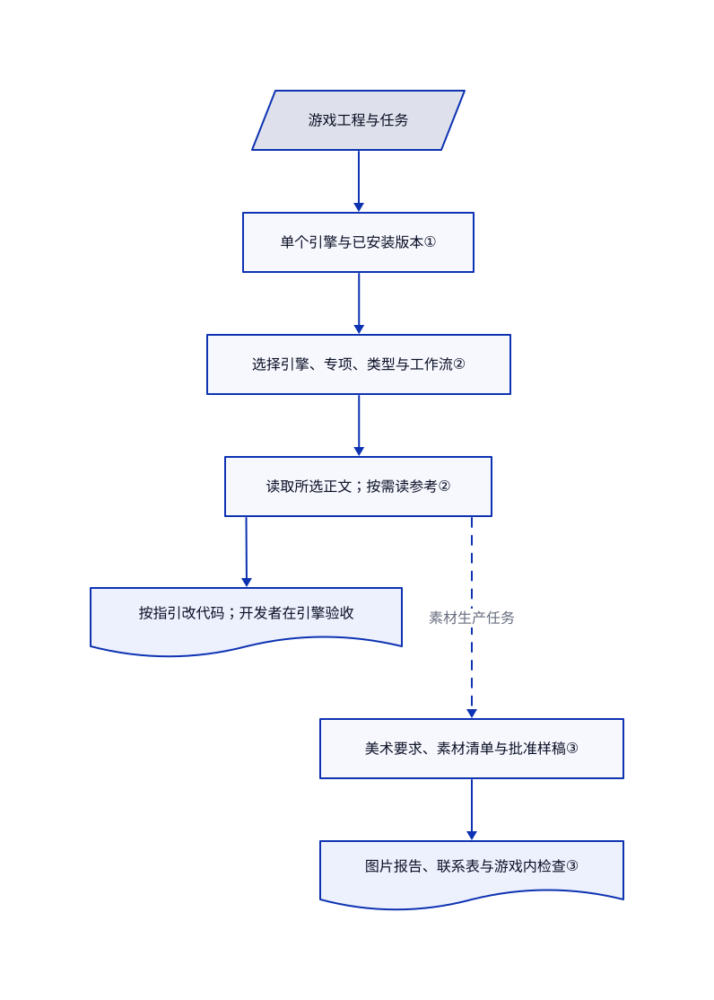

# GameDev Skills

让助手写 Godot 跳跃，它却套用旧版移动接口；换成 Unity 背包，你又要重新讲一遍规则。这个技能包先选引擎指引，再按任务补上玩法、类型或发行流程。

## 何时使用

你用编码助手做小游戏，让它“加二段跳”，它却从旧教程抄出 `move_and_slide(velocity)`。接着要做存档槽、跟随镜头或发布到 itch.io，通用开发流程又缺少这些领域做法。你希望一次安装就能覆盖十种引擎或渲染库，按项目版本选择接口，再组合玩法、游戏类型与发行指引，而不是接入编辑器控制服务，这时选它。

游戏工程和工具链仍由你负责。本次读取的主分支有 74 个专项技能及一个路由器：可以组合 Godot 移动与平台跳跃指引，也能组合引擎导入与素材生产流程。它比通用开发方法包更懂游戏任务，但不会替你建立测试纪律，也不会凭空增加编辑器操作工具。

## 何时不用

- **要让助手新建 Unity 场景对象、读取实时层级或运行编辑器测试。** 看 [CoderGamester/mcp-unity](https://github.com/CoderGamester/mcp-unity)。它通过 MCP（向助手提供工具的协议）连接编辑器；本包只是 Markdown 指引，不能代替连接，而且桥接方案另需 Node.js 与编辑器配置。
- **缺的是 Godot 运行反馈，而非又一份角色移动配方。** 选 [Coding-Solo/godot-mcp](https://github.com/Coding-Solo/godot-mcp)，用于打开编辑器、运行工程和读取调试输出。本包虽有无窗口测试指引，仍要你提供 Godot 并真正执行。
- **所有软件项目都会跳过需求、失败测试或评审。** 选 [Superpowers](../../agent-dev-methodology/coding-agent-harnesses/superpowers.zh.md)，建立从需求讨论到测试的通用流程。本包补领域知识，不替代开发生命周期。
- **要求路由必然正确，或所有引擎都有认证结果。** 应使用带编译器／编辑器测试的项目专用流程；需要实时状态时选上面的对应桥接方案。本包由模型遵循文字，仓库校验器只检查元数据、链接、目录覆盖和安装包成员，不证明角色或游戏能运行。

## 横向对比

| 替代品 | 是否收录 | 我们的评价 | 取舍 |
|---|---|---|---|
| [Coding-Solo/godot-mcp](https://github.com/Coding-Solo/godot-mcp) | 未收录 | Godot 排错需要运行场景并读取错误时选 godot-mcp；缺少符合项目版本的玩法配方时选本包。 | 桥接方案提供执行工具，代价是安装 Godot、Node.js 并配置 MCP；本包只提供指引。not added in this tab batch。 |
| [CoderGamester/mcp-unity](https://github.com/CoderGamester/mcp-unity) | 未收录 | 要修改实时 Unity 层级和跑编辑器测试时选 mcp-unity；要跨工具复用引擎及游戏设计指引时选本包。 | 编辑器插件与 Node 桥接增加配置和权限负担；只安装技能无法读取运行中的场景。not added in this tab batch。 |
| [Superpowers](../../agent-dev-methodology/coding-agent-harnesses/superpowers.zh.md) | ✅ | 助手总跳过需求或失败测试时选 Superpowers；混用引擎接口或缺玩法模式时选本包。 | Superpowers 提供通用开发过程，本包提供引擎、专项概念、游戏类型和发行配方；两者补不同缺口，叠加前应划清责任。 |

## 快速上手

按上游文档执行 `npx skills add gamedev-skills/awesome-gamedev-agent-skills`，外部安装器把技能目录放入所选助手的发现路径。技能是一份带触发说明的 Markdown 操作指引，不是常驻服务；除专项技能外，还要装路由器。打开游戏工程，提出“给我的 Godot 角色加二段跳”，路由器会要求助手先识别引擎和版本，再读移动与平台跳跃指引。你负责模型访问、引擎安装、工程文件和最终编译／试玩，本包负责配方，不包含模型额度或内置编辑器连接。可选图片检查工具另需 Python 3.10+ 与 Pillow；生成图片还需要独立可用的工具。

<!-- flow-steps:begin (generated from flows/awesome-gamedev-agent-skills.json by tools/flow_card.py — do not edit) -->

流程文字版

1. **你**：安装路由器与游戏技能目录 — `npx skills add gamedev-skills/awesome-gamedev-agent-skills`
2. **GameDev Skills**：提供简短技能说明，供助手选择 — 组件：`技能元数据`
3. **你**：在 Godot 工程中请求加二段跳
4. **GameDev Skills**：识别版本，读移动与平台跳跃指引 — 组件：`路由器`
5. **GameDev Skills**：按所选引擎配方指导角色控制器修改 — 组件：`移动与平台跳跃技能`

**价值**：不必每次重讲引擎与玩法规则；编译和试玩仍由你负责

<!-- flow-steps:end -->

## 技术要点

<!-- mechanism:begin (generated from mechanisms/awesome-gamedev-agent-skills.json by tools/mechanism_card.py; do not edit) -->

机制文字版

- 游戏工程与任务
- 单个引擎与已安装版本①
- 选择引擎、专项、类型与工作流②
- 读取所选正文；按需读参考②
- 按指引改代码；开发者在引擎验收
- 美术要求、素材清单与批准样稿③
- 图片报告、联系表与游戏内检查③

- 游戏工程与任务 → 单个引擎与已安装版本①
- 单个引擎与已安装版本① → 选择引擎、专项、类型与工作流②
- 选择引擎、专项、类型与工作流② → 读取所选正文；按需读参考②
- 读取所选正文；按需读参考② → 按指引改代码；开发者在引擎验收
- 读取所选正文；按需读参考② → 美术要求、素材清单与批准样稿③（素材生产任务）〔可选／兜底〕
- 美术要求、素材清单与批准样稿③ → 图片报告、联系表与游戏内检查③

<!-- mechanism:end -->

### 1. 识别单个引擎，保留项目当前版本

- **解决：** 相似的 C# 文件或多个网页依赖容易选错引擎，新示例还可能悄悄把旧工程接口升级。
- **做法：** 路由器读取 `project.godot` 等项目标记，Unity 则要求配对的工程目录。检测参考文档按目标文件消解多引擎仓库，并先读引擎元数据或依赖锁文件；目录中的基准版本只用于新项目。
- **边界：** 这是给模型的文字要求，不是可执行检测器。路由正文写先匹配先选，参考文档再补歧义处理；自定义引擎或无法消解的组合仍需用户明确选择。
- **源码：** [路由检测与版本规则](https://github.com/gamedev-skills/awesome-gamedev-agent-skills/blob/0a70cfc64672d512c5b5b6006b5dcb5cf90dbdbd/router/SKILL.md#L33-L68)、[歧义与版本来源](https://github.com/gamedev-skills/awesome-gamedev-agent-skills/blob/0a70cfc64672d512c5b5b6006b5dcb5cf90dbdbd/router/references/engine-detection.md#L22-L58)。

### 2. 组合小型指引，不一次塞入整个目录

- **解决：** 所有引擎指引一起加载会浪费上下文并混用接口，类型模板也可能重复讲移动或存档基础。
- **做法：** 先由元数据选最小技能集，再按需读取正文及深层参考。组合顺序是引擎基础、跨引擎专项概念、类型组织、工作流；引擎技能负责接口语法，类型技能引用基础能力。Godot 移动指引以无参数的 `move_and_slide()` 展示这种分工，并链接物理、输入与平台跳跃技能。
- **边界：** 按需加载依赖宿主助手遵循路由器。仓库校验器检查名称、资源链接、路由表提及和插件成员，不证明自然语言路由正确，也不执行引擎示例。
- **源码：** [读取协议与责任分工](https://github.com/gamedev-skills/awesome-gamedev-agent-skills/blob/0a70cfc64672d512c5b5b6006b5dcb5cf90dbdbd/router/SKILL.md#L161-L188)、[移动配方](https://github.com/gamedev-skills/awesome-gamedev-agent-skills/blob/0a70cfc64672d512c5b5b6006b5dcb5cf90dbdbd/skills/godot/godot-2d-movement/SKILL.md#L23-L41)、[结构校验器](https://github.com/gamedev-skills/awesome-gamedev-agent-skills/blob/0a70cfc64672d512c5b5b6006b5dcb5cf90dbdbd/scripts/validate-skills.py#L257-L347)。

### 3. 把美术决策与确定性素材检查分开

- **解决：** 分开生成的精灵会出现调色板和比例不一致，预览看似正常也可能掩盖错误尺寸或无用透明通道。
- **做法：** 素材技能记录美术要求与素材清单，先批准代表性样稿，再成组生产，最后要求原始显示尺寸或游戏内检查。一个 Pillow 工具测量尺寸、颜色数和透明通道，输出 JSON，指定约束失败时返回非零退出码；另一个按路径排序，用最近邻缩放生成联系表。
- **边界：** `--require-alpha` 只检查是否存在透明通道，不检查透明像素是否有用。脚本不生成图片，也不能证明风格一致、动画质量、拼接、拓扑或素材权利；这些仍由流程检查和来源记录负责。
- **源码：** [素材流程与验收](https://github.com/gamedev-skills/awesome-gamedev-agent-skills/blob/0a70cfc64672d512c5b5b6006b5dcb5cf90dbdbd/skills/disciplines/create-game-assets/SKILL.md#L11-L42)、[图片报告工具](https://github.com/gamedev-skills/awesome-gamedev-agent-skills/blob/0a70cfc64672d512c5b5b6006b5dcb5cf90dbdbd/skills/disciplines/create-game-assets/scripts/asset_report.py#L29-L123)、[联系表工具](https://github.com/gamedev-skills/awesome-gamedev-agent-skills/blob/0a70cfc64672d512c5b5b6006b5dcb5cf90dbdbd/skills/disciplines/create-game-assets/scripts/build_preview_sheet.py#L26-L83)。

## 健康度与可持续性

- **维护，截至 2026-10-21：** 创建于 2026-06-24，未归档，最后推送为 2026-10-09。最新发行仍是 6 月 26 日的 v1.1.0，当时说明为 66 个技能；本次主分支为 74 个加路由器。应固定读取过的提交，不要假设发行包和当前目录一致。来源：[发行记录](https://github.com/gamedev-skills/awesome-gamedev-agent-skills/releases)、[本次源码树](https://github.com/gamedev-skills/awesome-gamedev-agent-skills/tree/0a70cfc64672d512c5b5b6006b5dcb5cf90dbdbd)。
- **治理与支持，截至 2026-10-21：** 仓库由组织持有，README 指定 Abhishek Barali 为维护者。贡献者接口列出七人，首位占所列 109 次贡献中的 87 次；维护集中，不能据此认定有基金会支持。[贡献规则](https://github.com/gamedev-skills/awesome-gamedev-agent-skills/blob/0a70cfc64672d512c5b5b6006b5dcb5cf90dbdbd/CONTRIBUTING.md)要求原创、声明目标版本，并同步路由与分发配置。
- **年龄与采用，截至 2026-10-21：** 约四个月，2359 星、201 个 fork。[推断：依据年龄和近期提交，而非部署证据] 可作为当前参考材料试用，但缺少长期持续维护历史；热度不能证明生成游戏的质量或未来维护能力。
- **许可与质量边界，截至 2026-10-21：** Apache-2.0 与 NOTICE 署维护者及贡献者，引用引擎商标不代表官方背书。CI 配置检查结构、素材工具测试和文档站，不是十引擎集成测试。[Bevy 更新 PR](https://github.com/gamedev-skills/awesome-gamedev-agent-skills/pull/18)自述做过定向编译和运行检查，不能推广为所有技能或宿主助手都已验证。
- **雷达覆盖，截至 2026-10-21：** 五个适用轴中测得四轴。评分器把此技能包的响应速度记为 `?`，原因是 `type_na`；采用广度记为 `N/A`，原因是 `no_install_channel`。两者都不是实测低分。

## 存疑（未验证）

- [未验证：本轮禁止安装和执行上游及引擎] 未复现文档安装命令、各客户端自动激活与最终玩法表现；本页核对文件和指引，不证明端到端兼容性或效率提升。
- [推断：路由器是文字，校验器检查仓库结构] 路由、保留版本与验收步骤都是模型应遵守的规则，不是运行时硬保证。
- [推断：项目始于 2026-06-24，10 月仍有提交，本轮未建立生产用户证据] 四个月活跃足以支持试用固定版本的参考材料，不足以强判长期可持续性。
