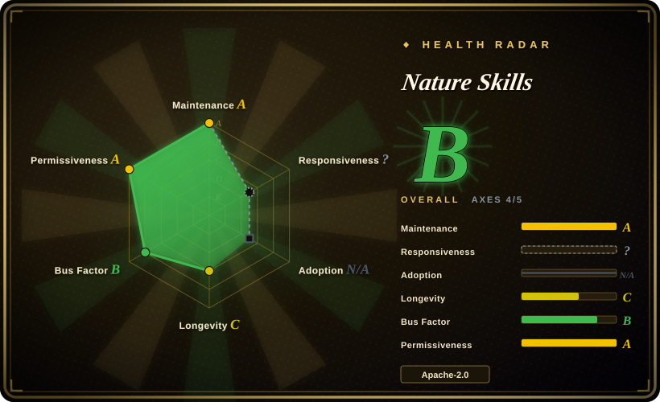
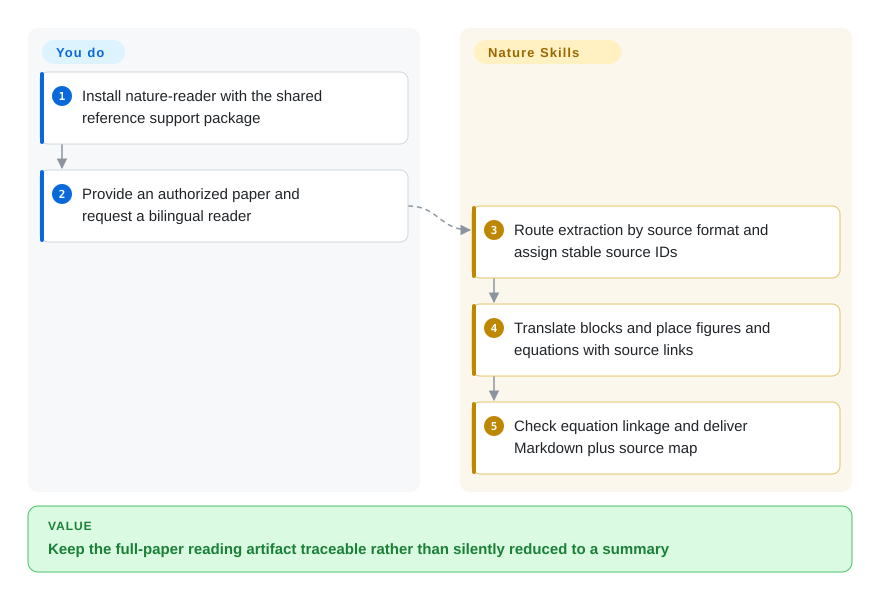
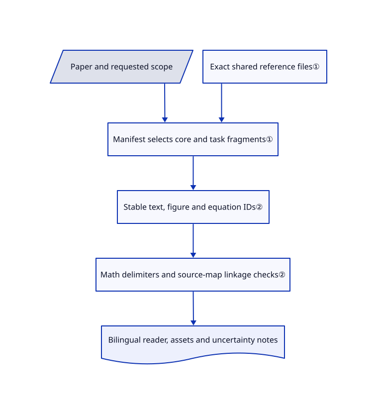

# Nature Skills

Your agent turns a full paper into an abstract-sized summary and loses the figure and equation references. Nature Skills supplies source-mapped reading workflows and separate manuscript, citation and revision skills, with shared reference files.

## When to use

You are reading a research paper bilingually or preparing a manuscript from evidence you already have, and need figures, equations and paragraph claims to remain traceable. Choose this pack when paper artifacts and publication workflows are the main task, rather than scientific-library APIs or econometric estimation. Install a small task-specific subset plus `nature-shared` where referenced; the collection is a host-agent workflow, not a standalone research application or an official journal product.

## When NOT to use

- **You need bioinformatics or chemistry library operations.** Choose [Scientific Agent Skills](scientific-agent-skills.md); this pack's distinguishing surface is manuscripts and paper artifacts, not the widest scientific API catalog.
- **You need an econometric identification and estimation pipeline.** Choose [Auto-Empirical Research Skills](auto-empirical-research-skills.md), while reviewing its mixed licenses; manuscript drafting does not establish a valid estimator.
- **You only need a concept explained to a general Chinese reader.** Choose [ljg-skills](../personal-collections/knowledge-content/ljg-skills.md); a full source map and journal-oriented workflow would add unnecessary structure.
- **You expect journal acceptance or verified science from a prompt.** Use current journal instructions and qualified human review. The skills themselves distinguish corpus-derived writing advice from official policy and require missing evidence to remain explicit.
- **The task requires unauthorized publisher or institutional access.** Use lawful open-access material instead. The downloader documents user-authorized sessions, not permission to bypass access controls; installing a skill never grants credentials or copyright rights.

## Comparison

| Alternative | In index | Our verdict | Tradeoff |
|---|---|---|---|
| [Scientific Agent Skills](scientific-agent-skills.md) | ✅ | Choose Scientific Agent Skills when scientific Python/database operations are missing; choose Nature Skills for source-grounded readers and manuscript deliverables. | Library-specific procedural knowledge versus a publication-artifact workflow; neither guarantees scientific validity. |
| [Auto-Empirical Research Skills](auto-empirical-research-skills.md) | ✅ | Choose AERS for causal identification, estimation and robustness tables; choose Nature Skills to read or write a paper from supplied evidence. | Methods-oriented analysis versus paper assembly; their licensing surfaces differ. |
| [ljg-skills](../personal-collections/knowledge-content/ljg-skills.md) | ✅ | Choose ljg-skills for concise Chinese conceptual distillation; choose Nature Skills when full source text, figures and equations must stay aligned. | Personal explanatory method versus larger research-artifact and runtime requirements. |

## Quick start

List the available packages with `npx skills add Yuan1z0825/nature-skills --list`, then select `nature-reader` and its required `nature-shared` support package for the chosen agent. Give the host a lawfully obtained paper and ask for a bilingual reader rather than a summary. The skill instructs the agent to create `paper.md`, `source_map.json`, translation notes and referenced assets, and to run its math validator before delivery. You still supply extraction/OCR tools as needed, model access, permissions and review of the translation. Optional search, figure-generation and downloader paths have additional Python, browser, API and credential setup; installing skill text does not provision those runtimes.

<!-- flow-steps:begin (generated from flows/nature-skills.json by tools/flow_card.py — do not edit) -->

Text version of the flow

1. **You**: Install nature-reader with the shared reference support package
2. **You**: Provide an authorized paper and request a bilingual reader
3. **Nature Skills**: Route extraction by source format and assign stable source IDs
4. **Nature Skills**: Translate blocks and place figures and equations with source links
5. **Nature Skills**: Check equation linkage and deliver Markdown plus source map

**Value**: Keep the full-paper reading artifact traceable rather than silently reduced to a summary

<!-- flow-steps:end -->

## Key techniques

<!-- mechanism:begin (generated from mechanisms/nature-skills.json by tools/mechanism_card.py; do not edit) -->

Text version of the mechanism

- Paper and requested scope
- Manifest selects core and task fragments①
- Exact shared reference files①
- Stable text, figure and equation IDs②
- Math delimiters and source-map linkage checks②
- Bilingual reader, assets and uncertainty notes

- Paper and requested scope → Manifest selects core and task fragments①
- Exact shared reference files① → Manifest selects core and task fragments①
- Manifest selects core and task fragments① → Stable text, figure and equation IDs②
- Stable text, figure and equation IDs② → Math delimiters and source-map linkage checks②
- Math delimiters and source-map linkage checks② → Bilingual reader, assets and uncertainty notes

<!-- mechanism:end -->

### 1. Route by task axes and share exact references

- **Problem:** Loading every research rule wastes context and can apply the wrong journal's requirements.
- **How:** Entry skills read a declarative manifest and load core files plus selected fragments. Reader routing distinguishes PDF, scans, HTML and identifiers; writing routing adds task, paper type, section, language and journal. Shared support provides requested definitions rather than a standalone workflow.
- **Limits:** These are model-followed loading rules, not an enforced runtime resolver. Installing a leaf without sibling shared files breaks referenced paths, and journal guidance still needs current-source checks.
- **Source:** [Reader manifest](https://github.com/Yuan1z0825/nature-skills/blob/f8797feed6405035e7d57f59cb8ba393c6a98802/skills/nature-reader/manifest.yaml), [writing router](https://github.com/Yuan1z0825/nature-skills/blob/f8797feed6405035e7d57f59cb8ba393c6a98802/skills/nature-writing/SKILL.md#L12-L49), [shared contract](https://github.com/Yuan1z0825/nature-skills/blob/f8797feed6405035e7d57f59cb8ba393c6a98802/skills/nature-shared/SKILL.md).

### 2. Give paper blocks stable identities and check equation linkage

- **Problem:** A fluent translation can silently lose equations, crops or their original locations.
- **How:** The reading workflow assigns stable IDs to text, captions, figures, tables and equations before translation. Its Python checker detects unbalanced math delimiters, bare LaTeX, duplicate anchors, missing equation-map entries and absent fallback images.
- **Limits:** Structural validation does not prove the equation's mathematical meaning, extraction accuracy or completeness of every translated paragraph; human source comparison is still required.
- **Source:** [Source-map workflow](https://github.com/Yuan1z0825/nature-skills/blob/f8797feed6405035e7d57f59cb8ba393c6a98802/skills/nature-reader/static/core/workflow.md#L15-L71), [actual validator](https://github.com/Yuan1z0825/nature-skills/blob/f8797feed6405035e7d57f59cb8ba393c6a98802/skills/nature-reader/scripts/validate_reader_math.py).

## Health & viability

- **2026-10-18:** created April 2026, unarchived, no published releases in the API sample. Several human contributors appear alongside substantial automation; README names a small core team.
- **Judgment:** six months of active work and a large star count justify inspection, not a strong Lindy prior. Pin a commit: the repository's current tree has 23 top-level skill entries including shared support, while the README badge says 22.
- **Rights and maintenance:** root Apache-2.0 and the downloader's retained MIT license are distinct. Content-contract tests and recent reader/citation fixes are useful maintenance signals; they are not independent evidence of publication quality.
- **Trust boundary:** documentation promotes commercial communities/account services alongside code. Those services are not required by the inspected reader workflow and are not endorsed here.

## Caveats (unverified)

- [未验证：未运行上游或真实论文验收] No reader, translation, reference-search result or manuscript was generated to validate end-to-end accuracy.
- [未验证：未审计全部技能] This read covered representative reader/writing/shared, search and installer paths, not every script's network behavior or every journal's current policy.
