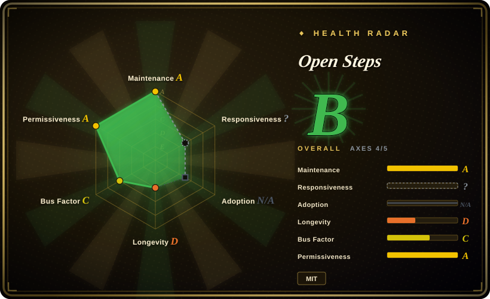
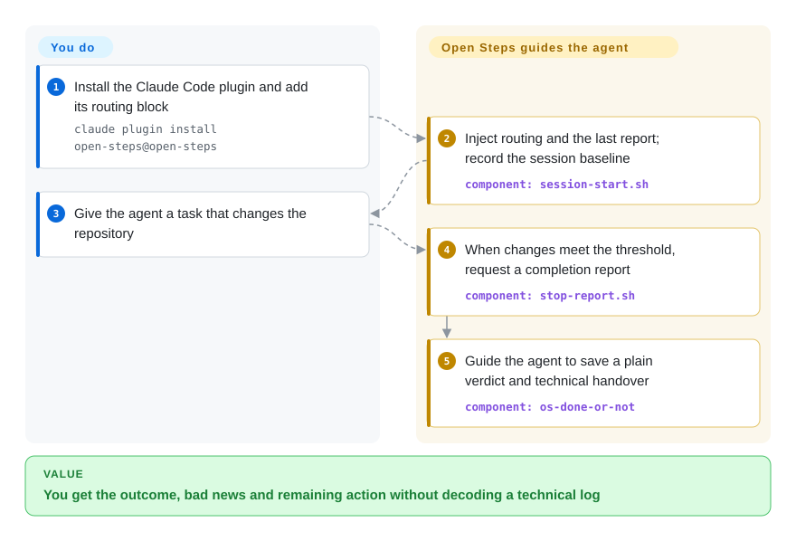
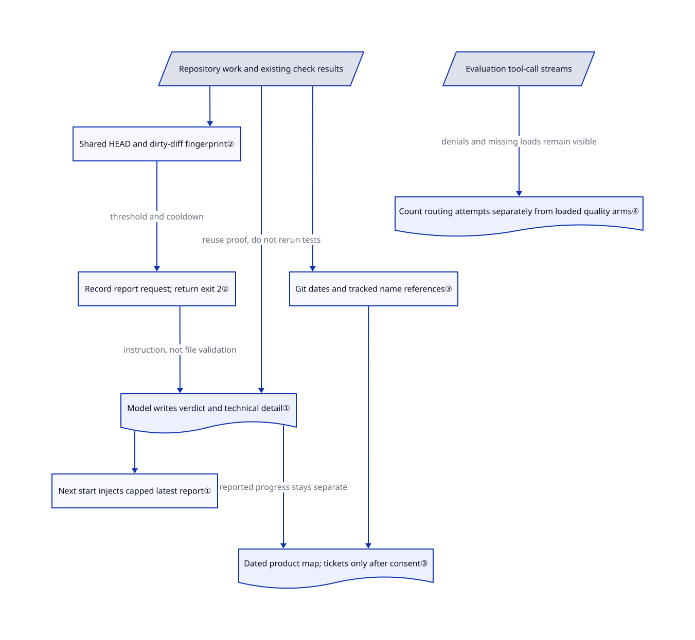

# Open Steps

Your agent says the checks are green, but you still cannot tell whether people can use the change or whether you can close the task. Open Steps gives the agent separate procedures for explaining the result, checking another session's claims, and carrying a report into the next session.

## When to use

You run development from the product side and receive a paragraph of commit identifiers instead of an answer to “is this live, and do you need me?” You want the bad news, missing checks, and next decision in ordinary language, without discarding the technical handover. Open Steps supplies eight Markdown skills for those moments, with a saved report and an optional product inventory. Pick it over a brevity overlay when the problem is accepting work and handing it over, not merely shortening replies.

The most integrated route is its Claude Code plugin. Codex CLI, Cursor CLI, and Gemini CLI have documented copy-and-wire paths, but their hook and skill-loading evidence is not equivalent. This is an instruction pack inside your existing agent, not another coding agent or an independent release verifier.

## When NOT to use

- **You only want shorter, action-first replies.** Choose [i-have-adhd](behavior-overlays/i-have-adhd.md) for reply shape, or [caveman](behavior-overlays/caveman.md) for brevity and optional tool-output compression. Open Steps also writes reports, installs lifecycle hooks, and introduces acceptance and merge policies.
- **Every merge must wait for an explicit release decision.** Prefer a read-only reporting rule in your own standing instructions until you reconcile this policy. `os-whats-next` and `os-check-work` instruct the agent to merge verified-ready PRs and list `Bash(gh pr merge *)` in Claude Code's pre-approved tools. They honor a task instruction saying merges happen on command only; installation alone is not a safe substitute for that instruction.
- **You need proof that tests ran or a report was saved.** Use your CI's required checks and branch protection as the release gate. The report skill reuses existing test results; the stop hook records a request before returning exit 2 and never checks whether a report exists. Its default cooldown is 900 seconds, not an acceptance deadline.
- **You need equivalent hooks on Kilo or OpenCode today.** Keep native per-harness wiring rather than copying the four-tool recipe. The reviewed version ships no Kilo/OpenCode adapter; [OpenCode support is an open request](https://github.com/kharmanskyi/open-steps/issues/51), not shipped functionality. Cursor's adapter requests a follow-up rather than blocking, and upstream reports no stop event in its tried headless runs.
- **You want a full test-first development method.** Choose [Superpowers](../../agent-dev-methodology/coding-agent-harnesses/superpowers.md). Open Steps structures communication and acceptance; its report procedure explicitly says not to rerun the test suite.
- **You want an automated dead-code remover.** Use your language's reference analysis and tests instead. The product census searches for a part's name in tracked text, not actual execution; its skill only recommends retirement and forbids deleting code.

## Comparison

| Alternative | In index | Our verdict | Tradeoff |
|---|---|---|---|
| [i-have-adhd](behavior-overlays/i-have-adhd.md) | ✅ | Choose i-have-adhd for action-first replies and repeated progress cues; choose Open Steps when you need a saved verdict about completion and a receiving-party check of another session. | A smaller style overlay avoids Open Steps' report store and merge workflow, but does not provide its report-to-handover loop. |
| [caveman](behavior-overlays/caveman.md) | ✅ | Choose caveman when token spend on prose and tool output is the target; choose Open Steps when a product owner needs explicit bad news, unchecked claims, and the next decision. | Caveman adds optional compression infrastructure; Open Steps adds instructions and local reports, without a demonstrated cost-saving claim. |
| [Superpowers](../../agent-dev-methodology/coding-agent-harnesses/superpowers.md) | ✅ | Choose Superpowers when the agent skips design, failing tests, or systematic debugging; choose Open Steps when the engineering work exists but its completion report is unusable to a non-engineer. | The development-method pack governs how work proceeds; Open Steps governs reporting and acceptance, with overlapping skill routing to reconcile if combined. |

## Quick start

For Claude Code, clone the repository, then run the README's local marketplace and plugin install from the clone's parent folder: `claude plugin marketplace add ./open-steps && claude plugin install open-steps@open-steps`. Add the supplied routing block to your standing instructions and explicitly decide whether merges require your command. The plugin wires two hooks, which are commands run at session start and stop; Git is required, while optional `gh` supplies GitHub state. Give the agent a normal task; the skills ask it to report outcomes with evidence, save `latest.md` plus a dated history under `~/.claude/open-steps/reports/<project>/`, and keep engineering detail separate from the short human report. You still provide the agent/model access, review permissions, and run the actual verification; this research installed or executed none of the upstream code.

<!-- flow-steps:begin (generated from flows/open-steps.json by tools/flow_card.py — do not edit) -->

Text version of the flow

1. **You**: Install the Claude Code plugin and add its routing block — `claude plugin install open-steps@open-steps`
2. **Open Steps**: Inject routing and the last report; record the session baseline — component: `session-start.sh`
3. **You**: Give the agent a task that changes the repository
4. **Open Steps**: When changes meet the threshold, request a completion report — component: `stop-report.sh`
5. **Open Steps**: Guide the agent to save a plain verdict and technical handover — component: `os-done-or-not`

**Value**: You get the outcome, bad news and remaining action without decoding a technical log

<!-- flow-steps:end -->

## Key techniques

<!-- mechanism:begin (generated from mechanisms/open-steps.json by tools/mechanism_card.py; do not edit) -->

Text version of the mechanism

- Repository work and existing check results
- Shared HEAD and dirty-diff fingerprint②
- Record report request; return exit 2②
- Model writes verdict and technical detail①
- Next start injects capped latest report①
- Git dates and tracked name references③
- Dated product map; tickets only after consent③
- Evaluation tool-call streams
- Count routing attempts separately from loaded quality arms④

- Repository work and existing check results → Shared HEAD and dirty-diff fingerprint②
- Shared HEAD and dirty-diff fingerprint② → Record report request; return exit 2② (threshold and cooldown)
- Record report request; return exit 2② → Model writes verdict and technical detail① (instruction, not file validation)
- Repository work and existing check results → Model writes verdict and technical detail① (reuse proof, do not rerun tests)
- Model writes verdict and technical detail① → Next start injects capped latest report①
- Repository work and existing check results → Git dates and tracked name references③
- Git dates and tracked name references③ → Dated product map; tickets only after consent③
- Model writes verdict and technical detail① → Dated product map; tickets only after consent③ (reported progress stays separate)
- Evaluation tool-call streams → Count routing attempts separately from loaded quality arms④ (denials and missing loads remain visible)

<!-- mechanism:end -->

### 1. Separate the human verdict from the technical handover

- **Problem:** A technically detailed report can hide whether work shipped, failed, or still needs a decision.
- **How:** `os-done-or-not` selects among eight outcomes, requires evidence for a “yes,” and saves a short verdict plus technical detail in both current and historical reports. Session start injects the routing table and at most 80 report lines by default, telling the next agent to verify the handover before relying on it.
- **Limits:** These are model instructions, not a schema validator. The report procedure only performs quick checks and reuses prior test results; the hook does not establish those results' correctness or freshness.
- **Source:** [Report procedure](https://github.com/kharmanskyi/open-steps/blob/4fa744ba8ea06ccf128a39853824c46ac391dd00/skills/os-done-or-not/SKILL.md#L31-L128), [context injection](https://github.com/kharmanskyi/open-steps/blob/4fa744ba8ea06ccf128a39853824c46ac391dd00/hooks/session-start.sh#L24-L68).

### 2. Request a report from a shared change fingerprint

- **Problem:** Work completed in a single reply can end without a handover, while reporting on the report itself can create a loop.
- **How:** Both hooks share one fingerprint implementation: repository path, HEAD, dirty-file names/status, and tracked diff content feed checksums. Start records the session baseline; stop compares it, checks the file threshold and cooldown, records the request, then exits 2. Reports live outside the repository, and `BIG-PICTURE.md` is excluded.
- **Limits:** No baseline means the first stop only records one. Untracked file contents are not hashed, and state uses the project's basename rather than a unique repository/session directory; simultaneous sessions share one state file. The stop tests changes, not report completion. Cursor and Gemini translate its result differently.
- **Source:** [Fingerprint and state paths](https://github.com/kharmanskyi/open-steps/blob/4fa744ba8ea06ccf128a39853824c46ac391dd00/hooks/fingerprint.sh#L24-L116), [stop conditions](https://github.com/kharmanskyi/open-steps/blob/4fa744ba8ea06ccf128a39853824c46ac391dd00/hooks/stop-report.sh#L22-L64), [adapter](https://github.com/kharmanskyi/open-steps/blob/4fa744ba8ea06ccf128a39853824c46ac391dd00/hooks/adapter.sh#L109-L148).

### 3. Keep measured repository age separate from product progress

- **Problem:** An untouched feature may be finished and in use, rather than abandoned or ready to delete.
- **How:** `census.sh` enumerates top-level tracked parts, measures commit dates, and searches other tracked files for each part's name. The skill combines those measurements with separately dated progress from reports in a marked block of `BIG-PICTURE.md`; a new file is added to the clone's local Git exclude list. Ticket creation requires an explicit yes.
- **Limits:** Name matching is not a dependency graph or usage telemetry. The six-month quiet window cannot distinguish mature parts in a young repository; the script emits that age limitation. The skill does not delete code, and product stages remain reported claims, not measured deployment state.
- **Source:** [Census algorithm](https://github.com/kharmanskyi/open-steps/blob/4fa744ba8ea06ccf128a39853824c46ac391dd00/skills/os-big-picture/scripts/census.sh#L23-L98), [file ownership and ticket rules](https://github.com/kharmanskyi/open-steps/blob/4fa744ba8ea06ccf128a39853824c46ac391dd00/skills/os-big-picture/SKILL.md#L36-L100).

### 4. Count attempted routing separately from loaded-skill quality

- **Problem:** A model can select a skill that permissions refuse, making an apparent “with skills” comparison actually run unaided.
- **How:** The scorer reads tool-call logs for routing, separately subtracts denied calls for execution, and marks a quality arm unmeasured when no skill loaded. It checks report shape with strings and counts an allowed fresh-agent call separately from a premortem's self-description.
- **Limits:** Activation is not answer quality. The published smoke tests use small authored phrase sets, inherited routing/style settings, and incomplete cross-tool runs; the main activation path counts a call even when denied. String matching cannot prove semantic correctness or independent reasoning.
- **Source:** [Calls versus execution](https://github.com/kharmanskyi/open-steps/blob/4fa744ba8ea06ccf128a39853824c46ac391dd00/evals/score.py#L136-L207), [quality filtering](https://github.com/kharmanskyi/open-steps/blob/4fa744ba8ea06ccf128a39853824c46ac391dd00/evals/score.py#L653-L689), [measurement limitations](https://github.com/kharmanskyi/open-steps/blob/4fa744ba8ea06ccf128a39853824c46ac391dd00/evals/README.md#L445-L493).

## Health & viability

- **Maintenance, 2026-10-26:** latest release is v0.4.8, published October 5, after v0.4.4–0.4.7 in late September/early October. The default branch remains at the reviewed October 5 commit, and the repository is not archived. [Release history](https://github.com/kharmanskyi/open-steps/releases).
- **Governance:** User-owned by Pavlo Kharmanskyi; the contributors endpoint shows 61 contributions from the owner and 16 across eight others. [CONTRIBUTING](https://github.com/kharmanskyi/open-steps/blob/4fa744ba8ea06ccf128a39853824c46ac391dd00/CONTRIBUTING.md#L97-L113) requires sign-off and non-confidential examples. No foundation governance is declared in the reviewed tree.
- **Age and adoption:** created August 25, 2026, about two months before verification; 1,233 stars and 109 forks are dated attention signals, not installation counts. [推断：age and concentrated contributions support a young, owner-dependent verdict, not a durable-maintenance guarantee.] Pin the version and review policy changes before updating.
- **Engineering signals:** upstream CI declares Linux/macOS hook and scorer tests plus plugin-manifest validation. [The measurement notes](https://github.com/kharmanskyi/open-steps/blob/4fa744ba8ea06ccf128a39853824c46ac391dd00/evals/README.md#L199-L285) explicitly distinguish watched behavior, manual hook input, and documentation-only wiring; reported activation percentages must not be treated as independent quality results.
- **Permissions and privacy:** [MIT](https://github.com/kharmanskyi/open-steps/blob/4fa744ba8ea06ccf128a39853824c46ac391dd00/LICENSE) names the same author as the manifest. The reviewed production shell scripts contain no direct network client calls; agent-requested `gh pr merge` and approved `gh issue create` still mutate GitHub. Report-tool grants cover `~/.claude/open-steps/**`, not just the current project. The start hook places report text in model context, so local storage is not a promise of offline processing.
- **Retention and install checks:** the README explicitly leaves reports outside the plugin after uninstall; manual routing/hook entries and any product-map/local-exclude additions need separate cleanup. [Issue 50](https://github.com/kharmanskyi/open-steps/issues/50) reports an install-check false pass when Antigravity's folder is mistaken for Gemini CLI; the relevant folder tests remain in the reviewed source.

## Caveats (unverified)

- [未验证：this pass only read upstream code and artifacts.] Installation, hook firing, uninstall, report retention on each harness, and live GitHub mutations were not exercised; remove instructions in the upstream README also state they have not been run.
- [未验证：the full paid-run transcripts are outside the upstream repository.] Published activation and premortem results were read alongside the scorer and limitations, not independently reproduced; they do not establish clarity, accuracy, token savings, or benefit from the routing block alone.
- [推断：based on the creation date and contribution distribution.] Long-term viability remains owner-dependent and unproven by age; stars do not establish production adoption.
- [推断：state paths use one basename-scoped file and no locking.] Concurrent sessions or repositories with the same basename can interfere with report baselines and report selection; this was identified statically, not reproduced here.
