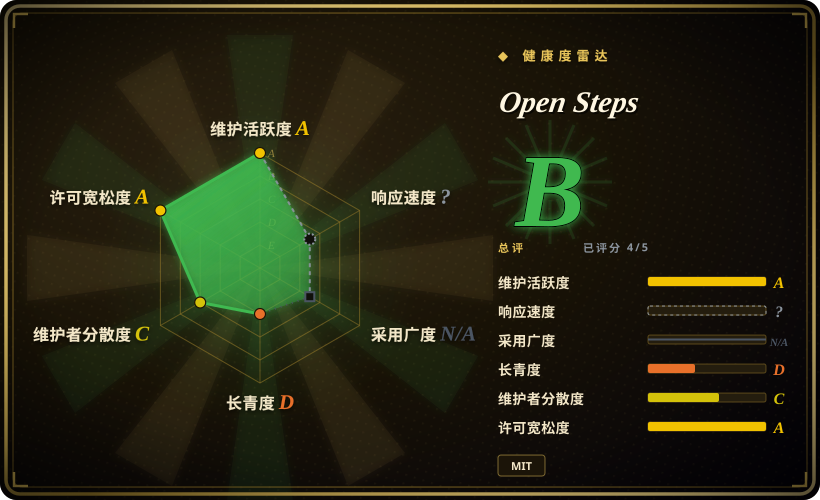
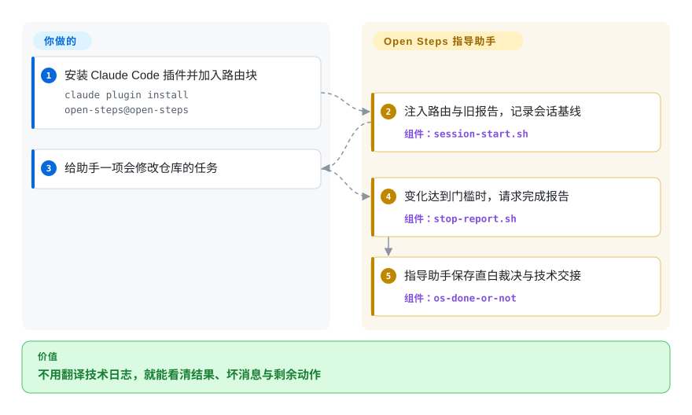
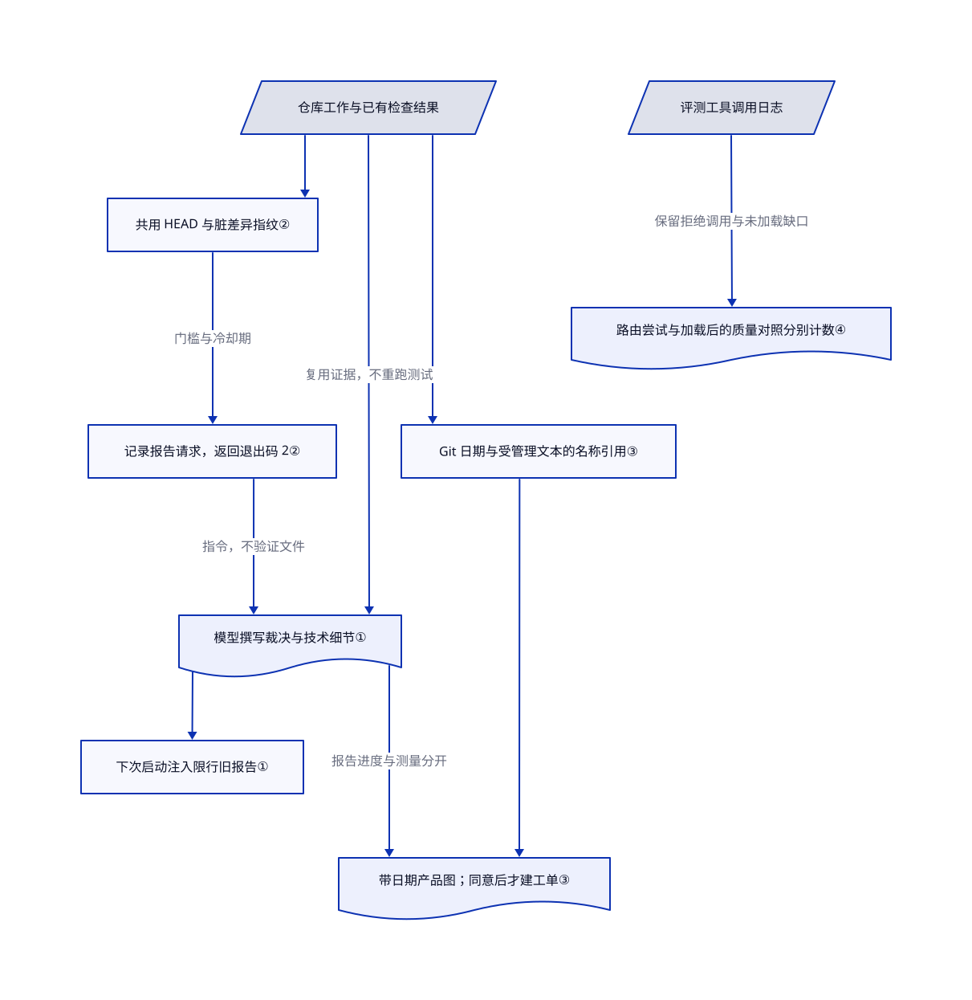

# Open Steps

助手说检查全绿，你却不知道用户能否用上改动，也不知道任务能否关闭。Open Steps 用不同技能解释结果、核对其他会话的完成声明，并把报告交给下一次会话。

## 何时使用

你从产品侧推动开发，却收到满屏提交编号，没人回答“上线了吗，还需要我做什么”。你想直接看到坏消息、未检查项和下一项决策，同时保留技术交接。Open Steps 为这些时刻提供八个 Markdown 技能，配有持久化报告和可选的产品清单。痛点是验收和交接，而不只是回复太长时，才选它而非单纯的精简表达技能。

Claude Code 插件的接线最完整。Codex CLI、Cursor CLI 和 Gemini CLI 提供复制技能和手动配置的路径，但各工具的钩子与技能加载证据并不等价。它是现有助手中的指令包，不是新的编码助手，也不是独立的发布验证器。

## 何时不用

- **只想先说动作、少说废话。** 选 [i-have-adhd](behavior-overlays/i-have-adhd.zh.md) 调整回复结构，或选 [caveman](behavior-overlays/caveman.zh.md) 精简表达并按需压缩工具输出。Open Steps 还会写报告、安装生命周期钩子，并引入验收与合并策略。
- **每次合并都必须等待明确发布指令。** 先在自己的常驻指令中使用只读报告规则，再协调合并政策。`os-whats-next` 和 `os-check-work` 要求助手合并验证就绪的 PR，并在 Claude Code 的预批准工具中列出 `Bash(gh pr merge *)`。它们遵守任务中的“仅按指令合并”限制，但不能把安装插件当作这条限制的替代品。
- **需要硬性证明测试跑过、报告已保存。** 用 CI 必需检查和分支保护把关。报告技能复用已有测试结果；停止钩子先记下请求，再返回退出码 2，从不检查报告是否存在。默认 900 秒冷却期不是验收时限。
- **今天就要在 Kilo 或 OpenCode 上获得相同钩子。** 保留各工具原生接线，别直接套四工具配方。所读版本没有 Kilo／OpenCode 适配器；[OpenCode 支持仍是开放请求](https://github.com/kharmanskyi/open-steps/issues/51)，不是已交付能力。Cursor 适配器只能请求后续消息，不能阻止停止；上游试过的无人在场运行也没有触发停止事件。
- **要完整的测试先行开发方法。** 选 [Superpowers](../../agent-dev-methodology/coding-agent-harnesses/superpowers.zh.md)。Open Steps 组织沟通和验收，报告流程明确要求不要重跑测试套件。
- **要自动清理死代码。** 改用语言自身的引用分析和测试。产品清点脚本只搜索其他受版本管理文本是否提到部件名，不检测真实执行；技能只建议退役，禁止删除代码。

## 横向对比

| 替代品 | 是否收录 | 我们的评价 | 取舍 |
|---|---|---|---|
| [i-have-adhd](behavior-overlays/i-have-adhd.zh.md) | 已收录 | 要先说动作、持续提示进度，选 i-have-adhd；要保存完成裁决并由接手方核对另一会话，选 Open Steps。 | 较小的风格覆盖层避开报告存储和合并流程，但没有报告到下一会话的交接闭环。 |
| [caveman](behavior-overlays/caveman.zh.md) | 已收录 | 要降低文字与工具输出的 token 花销，选 caveman；要让产品负责人看清坏消息、未核实声明和下一决策，选 Open Steps。 | caveman 可加压缩基础设施；Open Steps 增加指令与本地报告，没有已证实的成本节约承诺。 |
| [Superpowers](../../agent-dev-methodology/coding-agent-harnesses/superpowers.zh.md) | 已收录 | 助手跳过设计、失败测试或系统排错时，选 Superpowers；工程工作已存在但非工程读者看不懂完成报告时，选 Open Steps。 | 前者约束开发怎么进行；后者组织汇报和验收，叠加使用前要协调技能路由。 |

## 快速上手

Claude Code 路径先克隆仓库，再从克隆目录的父目录执行 README 的本地市场与插件安装命令：`claude plugin marketplace add ./open-steps && claude plugin install open-steps@open-steps`。把提供的路由块加入常驻指令，并明确决定合并是否必须等你下令。插件连接两个钩子，也就是会话开始和停止时运行的命令；需要 Git，可选的 `gh` 用来读取 GitHub 状态。照常交任务，技能会要求助手附证据汇报，并在 `~/.claude/open-steps/reports/<project>/` 保存 `latest.md` 和带日期的历史，把技术细节与简短的人用报告分开。你仍负责模型访问、权限审查和真实验证；本次研究没有安装或执行上游代码。

<!-- flow-steps:begin (generated from flows/open-steps.json by tools/flow_card.py — do not edit) -->

流程文字版

1. **你**：安装 Claude Code 插件并加入路由块 — `claude plugin install open-steps@open-steps`
2. **Open Steps**：注入路由与旧报告，记录会话基线 — 组件：`session-start.sh`
3. **你**：给助手一项会修改仓库的任务
4. **Open Steps**：变化达到门槛时，请求完成报告 — 组件：`stop-report.sh`
5. **Open Steps**：指导助手保存直白裁决与技术交接 — 组件：`os-done-or-not`

**价值**：不用翻译技术日志，就能看清结果、坏消息与剩余动作

<!-- flow-steps:end -->

## 技术要点

<!-- mechanism:begin (generated from mechanisms/open-steps.json by tools/mechanism_card.py; do not edit) -->

机制文字版

- 仓库工作与已有检查结果
- 共用 HEAD 与脏差异指纹②
- 记录报告请求，返回退出码 2②
- 模型撰写裁决与技术细节①
- 下次启动注入限行旧报告①
- Git 日期与受管理文本的名称引用③
- 带日期产品图；同意后才建工单③
- 评测工具调用日志
- 路由尝试与加载后的质量对照分别计数④

- 仓库工作与已有检查结果 → 共用 HEAD 与脏差异指纹②
- 共用 HEAD 与脏差异指纹② → 记录报告请求，返回退出码 2②（门槛与冷却期）
- 记录报告请求，返回退出码 2② → 模型撰写裁决与技术细节①（指令，不验证文件）
- 仓库工作与已有检查结果 → 模型撰写裁决与技术细节①（复用证据，不重跑测试）
- 模型撰写裁决与技术细节① → 下次启动注入限行旧报告①
- 仓库工作与已有检查结果 → Git 日期与受管理文本的名称引用③
- Git 日期与受管理文本的名称引用③ → 带日期产品图；同意后才建工单③
- 模型撰写裁决与技术细节① → 带日期产品图；同意后才建工单③（报告进度与测量分开）
- 评测工具调用日志 → 路由尝试与加载后的质量对照分别计数④（保留拒绝调用与未加载缺口）

<!-- mechanism:end -->

### 1. 将人用裁决与技术交接分开

- **解决：** 技术细节很多的报告，可能掩盖工作已上线、失败还是仍等决策。
- **做法：** `os-done-or-not` 先从八种结局中选一种，每个“是”都需证据，并把短裁决与技术细节保存为当前报告和历史报告。会话开始钩子注入路由表，默认最多附上 80 行旧报告，并要求接手助手重新核实后再依赖。
- **边界：** 这是给模型的指令，不是格式验证器。报告流程只做快速检查并复用已有测试结果；钩子不证明结果正确或仍然新鲜。
- **源码：** [报告流程](https://github.com/kharmanskyi/open-steps/blob/4fa744ba8ea06ccf128a39853824c46ac391dd00/skills/os-done-or-not/SKILL.md#L31-L128)、[上下文注入](https://github.com/kharmanskyi/open-steps/blob/4fa744ba8ea06ccf128a39853824c46ac391dd00/hooks/session-start.sh#L24-L68)。

### 2. 用同一份变更指纹请求报告

- **解决：** 一轮回复完成的工作可能没有交接，而给报告自身写报告又可能形成循环。
- **做法：** 两个钩子共用指纹实现，将仓库路径、HEAD、脏文件名与状态、已跟踪文件的差异内容送入校验和。开始时记录会话基线；停止时比较变化，检查文件数量与冷却期，记录请求后返回退出码 2。报告放在仓库外，`BIG-PICTURE.md` 被排除。
- **边界：** 没有基线时，首次停止只记录基线。未跟踪文件的内容不参与哈希；状态目录只用项目目录名，不是唯一的仓库与会话目录，并发会话共用一个状态文件。钩子检测变化，不检查报告完成；Cursor 和 Gemini 对结果的转换也不同。
- **源码：** [指纹与状态路径](https://github.com/kharmanskyi/open-steps/blob/4fa744ba8ea06ccf128a39853824c46ac391dd00/hooks/fingerprint.sh#L24-L116)、[停止条件](https://github.com/kharmanskyi/open-steps/blob/4fa744ba8ea06ccf128a39853824c46ac391dd00/hooks/stop-report.sh#L22-L64)、[适配器](https://github.com/kharmanskyi/open-steps/blob/4fa744ba8ea06ccf128a39853824c46ac391dd00/hooks/adapter.sh#L109-L148)。

### 3. 将仓库年龄实测与产品进度分开

- **解决：** 没人修改的功能，可能已经完成且仍在使用，不一定废弃或该删除。
- **做法：** `census.sh` 枚举顶层受版本管理部件，读取提交日期，并搜索其他受版本管理文件是否提到部件名。技能把这些测量与报告中单独标日期的进度放入 `BIG-PICTURE.md` 标记区；新建文件加入本克隆的 Git 本地忽略表。创建工单必须先获得明确同意。
- **边界：** 名称匹配不是依赖图，也不是使用遥测。默认六个月的静默窗口无法在年轻仓库中区分成熟部件，脚本会提示这一年龄限制。技能不删除代码；产品阶段来自报告，不是部署状态实测。
- **源码：** [清点算法](https://github.com/kharmanskyi/open-steps/blob/4fa744ba8ea06ccf128a39853824c46ac391dd00/skills/os-big-picture/scripts/census.sh#L23-L98)、[文件归属与工单规则](https://github.com/kharmanskyi/open-steps/blob/4fa744ba8ea06ccf128a39853824c46ac391dd00/skills/os-big-picture/SKILL.md#L36-L100)。

### 4. 将尝试路由与真实加载后的质量分开计数

- **解决：** 模型选中了技能，却被权限拒绝，会让“带技能”对照实际也在裸跑。
- **做法：** 评分器从工具调用日志统计路由，另扣除被拒调用统计执行；质量对照中没有技能真实加载时，标为未测量。它用字符串检查报告结构，并把获准的新 agent 调用与报告自称独立分开计数。
- **边界：** 触发不等于回答质量。公开冒烟测试使用少量作者自拟问题、继承的路由与风格设置，以及未完成的跨工具运行；主触发统计在调用被拒时仍计数。字符串匹配不能证明语义正确或独立推理。
- **源码：** [调用与执行区分](https://github.com/kharmanskyi/open-steps/blob/4fa744ba8ea06ccf128a39853824c46ac391dd00/evals/score.py#L136-L207)、[质量对照过滤](https://github.com/kharmanskyi/open-steps/blob/4fa744ba8ea06ccf128a39853824c46ac391dd00/evals/score.py#L653-L689)、[测量限制](https://github.com/kharmanskyi/open-steps/blob/4fa744ba8ea06ccf128a39853824c46ac391dd00/evals/README.md#L445-L493)。

## 健康度与可持续性

- **维护情况，截至 2026-10-26：** 最新版本 v0.4.8 发布于 10 月 5 日，9 月底到 10 月初先后发布 v0.4.4–0.4.7。默认分支仍停在所读的 10 月 5 日提交，仓库未归档。[发布历史](https://github.com/kharmanskyi/open-steps/releases)。
- **治理：** 仓库由个人 Pavlo Kharmanskyi 持有；贡献者接口显示，拥有者贡献 61 次，其他八人合计 16 次。[贡献规则](https://github.com/kharmanskyi/open-steps/blob/4fa744ba8ea06ccf128a39853824c46ac391dd00/CONTRIBUTING.md#L97-L113)要求签署贡献声明，示例不得含机密信息。所读文件树没有声明基金会治理。
- **年龄与采用：** 仓库创建于 2026 年 8 月 25 日，核验时约两个月；1,233 星和 109 个 fork 是当日关注信号，不是安装数。[推断：创建日期与贡献集中度支持“年轻、依赖拥有者”的判断，不支持长期维护保证。] 应固定版本，并在升级前复查政策变化。
- **工程信号：** 上游 CI 声明在 Linux／macOS 跑钩子与评分器测试，并验证插件清单。[测量说明](https://github.com/kharmanskyi/open-steps/blob/4fa744ba8ea06ccf128a39853824c46ac391dd00/evals/README.md#L199-L285)明确区分现场观察、手工输入钩子和只读文档接线；不能把触发百分比当作独立的质量结果。
- **权限与隐私：** [MIT 文件](https://github.com/kharmanskyi/open-steps/blob/4fa744ba8ea06ccf128a39853824c46ac391dd00/LICENSE)的作者与插件清单一致。所读生产 Shell 脚本没有直接调用网络客户端；助手执行的 `gh pr merge` 和获准的 `gh issue create` 仍会修改 GitHub。报告工具授权覆盖 `~/.claude/open-steps/**`，并不限于当前项目。开始钩子会把报告文字加入模型上下文，本地存储不等于离线处理承诺。
- **留存与安装检查：** README 明确说明，卸载插件后仍把报告留在插件目录之外；手工加入的路由、钩子、产品地图和本地忽略项需单独清理。[议题 50](https://github.com/kharmanskyi/open-steps/issues/50)报告安装检查把 Antigravity 目录误判为 Gemini CLI 后错误放行，相关目录判断仍在所读源码中。

## 存疑（未验证）

- [未验证：本轮只读上游源码和产物。] 没有实跑安装、钩子、卸载、各工具的报告留存或 GitHub 状态修改；上游 README 也说明卸载步骤尚未跑过。
- [未验证：完整付费运行日志不在上游仓库。] 已对照评分器与限制阅读触发和事前失败推演结果，但未独立复现；这些结果不能证明更清楚、更准确、更省 token，也不能单独证明路由块的收益。
- [推断：依据创建日期与贡献分布。] 长期可持续性依赖拥有者，年龄尚未提供耐久性证据；星数不能证明生产采用。
- [推断：状态路径只使用目录名范围的单文件，且没有锁。] 并发会话或同名仓库可能互相干扰基线与报告选择；这是静态分析结果，本轮未复现。
