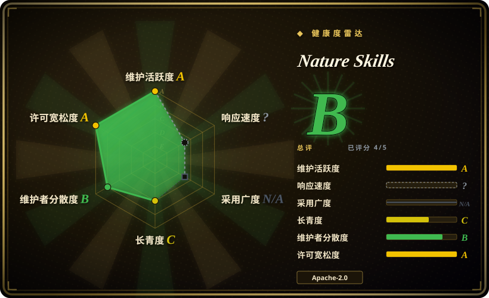
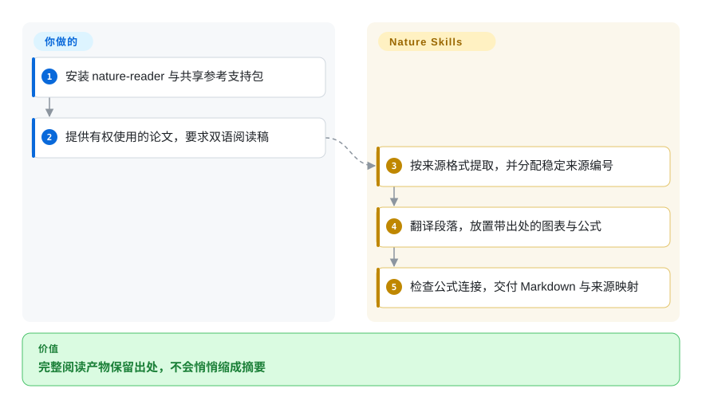
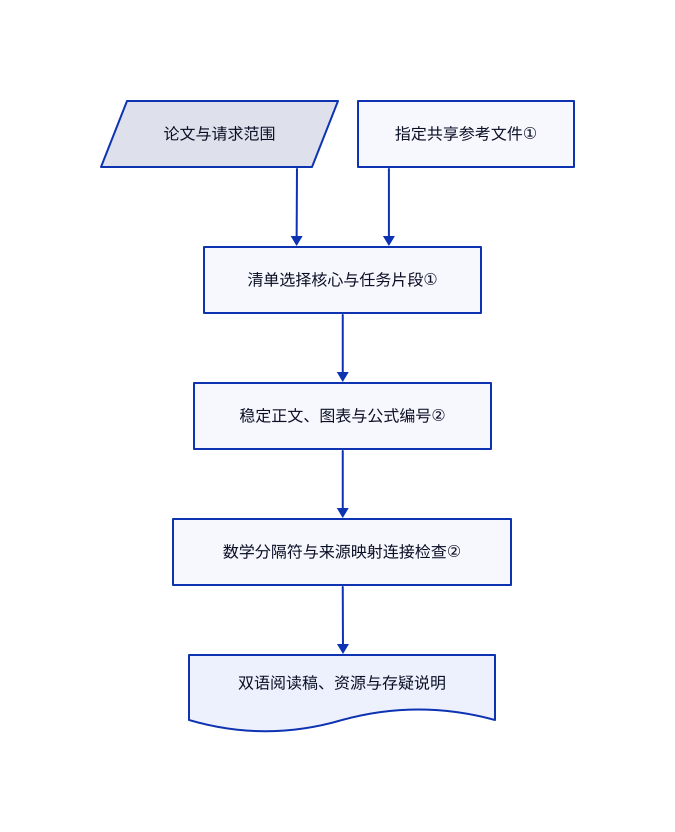

# Nature Skills

agent 把整篇论文压成摘要，还丢了图表和公式出处。Nature Skills 提供带来源映射的阅读流程，并把写稿、引文与返修拆成独立技能，共用参考文件。

## 何时使用

你要做论文双语精读，或基于已有证据准备稿件，希望图表、公式和段落论断都能追到来源。主要任务是论文产物和投稿流程，而非科学库 API 或计量估计时，选此合集。按任务安装小范围技能，并补齐它们引用的 `nature-shared`；这是宿主 agent 的流程，不是独立科研应用，也不是期刊官方产品。

## 何时不用

- **需要生信或化学库操作。** 选 [Scientific Agent Skills](scientific-agent-skills.zh.md)；此合集的主要差异是稿件与论文产物，而非最广的科学 API 目录。
- **需要计量识别与估计流水线。** 选 [Auto-Empirical Research Skills](auto-empirical-research-skills.zh.md)，并审阅混合许可；写稿不能证明估计方法成立。
- **只想给普通中文读者解释概念。** 选 [ljg-skills](../../personal-collections/knowledge-content/ljg-skills.zh.md)；完整来源映射和期刊流程会增加无用结构。
- **期待提示词保证录用或科学正确。** 使用最新期刊要求和合资格人工审阅。技能自身区分语料归纳建议与官方政策，并要求显式保留缺失证据。
- **需要未经授权的出版社或机构访问。** 改用合法开放材料。下载器描述的是用户授权会话，不是绕过访问控制；安装技能不授予凭据或版权权限。

## 横向对比

| 替代品 | 是否收录 | 我们的评价 | 取舍 |
|---|---|---|---|
| [Scientific Agent Skills](scientific-agent-skills.zh.md) | ✅ | 缺少科学 Python 与数据库操作，选 Scientific Agent Skills；要有出处的阅读稿和论文交付物，选 Nature Skills。 | 库级操作知识对比投稿产物流程；都不保证科学有效性。 |
| [Auto-Empirical Research Skills](auto-empirical-research-skills.zh.md) | ✅ | 因果识别、估计和稳健性表格选 AERS；基于已给证据读写论文选 Nature Skills。 | 方法分析对比论文组装；两者授权范围不同。 |
| [ljg-skills](../../personal-collections/knowledge-content/ljg-skills.zh.md) | ✅ | 简短中文概念提炼选 ljg-skills；全文、图表和公式必须对齐，选 Nature Skills。 | 个人解释方法对比更大的科研产物与运行依赖。 |

## 快速上手

先用 `npx skills add Yuan1z0825/nature-skills --list` 查看包名，再为目标 agent 选择 `nature-reader` 及所需的 `nature-shared`。提供合法取得的论文，明确要求双语阅读稿而非摘要。技能指示 agent 生成 `paper.md`、`source_map.json`、翻译说明和引用资源，并在交付前执行数学检查器。按需提取与 OCR 工具、模型访问、授权和翻译审阅仍由你提供。可选检索、生图和下载路径另有 Python、浏览器、API 与凭据设置；安装技能文本不会配置这些运行时。

<!-- flow-steps:begin (generated from flows/nature-skills.json by tools/flow_card.py — do not edit) -->

流程文字版

1. **你**：安装 nature-reader 与共享参考支持包
2. **你**：提供有权使用的论文，要求双语阅读稿
3. **Nature Skills**：按来源格式提取，并分配稳定来源编号
4. **Nature Skills**：翻译段落，放置带出处的图表与公式
5. **Nature Skills**：检查公式连接，交付 Markdown 与来源映射

**价值**：完整阅读产物保留出处，不会悄悄缩成摘要

<!-- flow-steps:end -->

## 技术要点

<!-- mechanism:begin (generated from mechanisms/nature-skills.json by tools/mechanism_card.py; do not edit) -->

机制文字版

- 论文与请求范围
- 清单选择核心与任务片段①
- 指定共享参考文件①
- 稳定正文、图表与公式编号②
- 数学分隔符与来源映射连接检查②
- 双语阅读稿、资源与存疑说明

- 论文与请求范围 → 清单选择核心与任务片段①
- 指定共享参考文件① → 清单选择核心与任务片段①
- 清单选择核心与任务片段① → 稳定正文、图表与公式编号②
- 稳定正文、图表与公式编号② → 数学分隔符与来源映射连接检查②
- 数学分隔符与来源映射连接检查② → 双语阅读稿、资源与存疑说明

<!-- mechanism:end -->

### 1. 按任务维度路由，并共用指定参考

- **解决：** 全量加载科研规则会挤占上下文，也可能套错期刊要求。
- **做法：** 入口读取声明清单，加载核心文件和选定片段。阅读路由区分 PDF、扫描、HTML 与标识符；写作另按任务、论文类型、章节、语言和期刊选择。共享包只提供被点名的定义，不独立运行流程。
- **边界：** 这是模型遵循的加载规则，不是强制解析器。只装叶子而缺共享同级文件会断路径；期刊规则仍须查最新来源。
- **源码：** [阅读清单](https://github.com/Yuan1z0825/nature-skills/blob/f8797feed6405035e7d57f59cb8ba393c6a98802/skills/nature-reader/manifest.yaml)、[写作路由](https://github.com/Yuan1z0825/nature-skills/blob/f8797feed6405035e7d57f59cb8ba393c6a98802/skills/nature-writing/SKILL.md#L12-L49)、[共享契约](https://github.com/Yuan1z0825/nature-skills/blob/f8797feed6405035e7d57f59cb8ba393c6a98802/skills/nature-shared/SKILL.md)。

### 2. 为论文块编号，再检查公式连接

- **解决：** 翻译即使流畅，仍可能悄悄丢掉公式、裁图和原位置。
- **做法：** 阅读流程先给正文、图注、图、表和公式分配稳定编号，再翻译。Python 检查器检测数学分隔符不配对、裸 LaTeX、重复锚点、缺失公式映射与缺失回退图片。
- **边界：** 结构验证不能证明公式数学含义、提取准确性或逐段翻译完整性，仍须人工对照原文。
- **源码：** [来源映射流程](https://github.com/Yuan1z0825/nature-skills/blob/f8797feed6405035e7d57f59cb8ba393c6a98802/skills/nature-reader/static/core/workflow.md#L15-L71)、[实际检查器](https://github.com/Yuan1z0825/nature-skills/blob/f8797feed6405035e7d57f59cb8ba393c6a98802/skills/nature-reader/scripts/validate_reader_math.py)。

## 健康度与可持续性

- **截至 2026-10-18：** 仓库建于 2026 年 4 月，未归档，API 样本无正式发布。大量自动化提交之外有多位人工贡献者，README 列出小型核心团队。
- **判断：** 六个月活跃开发与较高星数值得阅读，但不是强长期存续证据。应固定提交；当前树含共享包共 23 个顶层技能入口，README 徽章仍写 22。
- **权利与维护：** 根 Apache-2.0 与下载器保留的 MIT 许可应区分。内容契约测试和近期阅读稿、引文修复是维护信号，不是论文质量的独立证明。
- **信任边界：** 文档同时推广商业社群和账号服务。已读阅读稿路径不要求使用这些服务，本页也不背书。

## 存疑（未验证）

- [未验证：未运行上游或真实论文验收] 没有生成阅读稿、译文、文献检索结果或稿件来验证端到端准确性。
- [未验证：未审计全部技能] 本次覆盖有代表性的阅读、写作、共享、检索与安装路径，没有审计每个脚本的联网行为或每份期刊政策。
