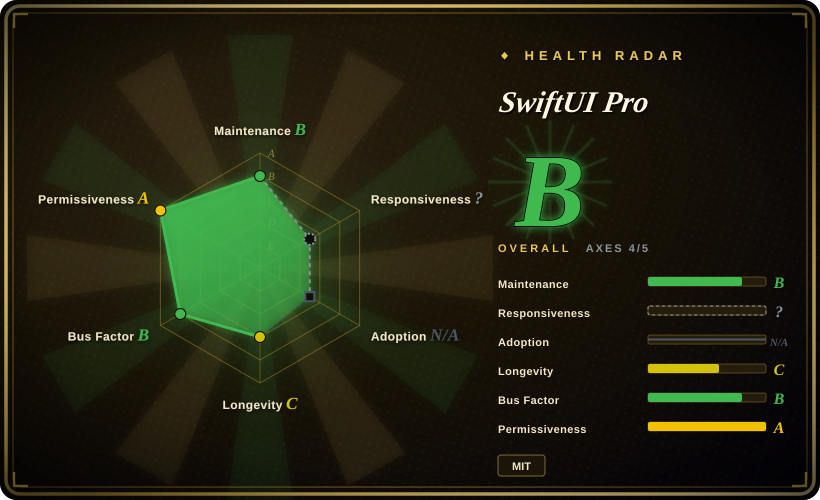
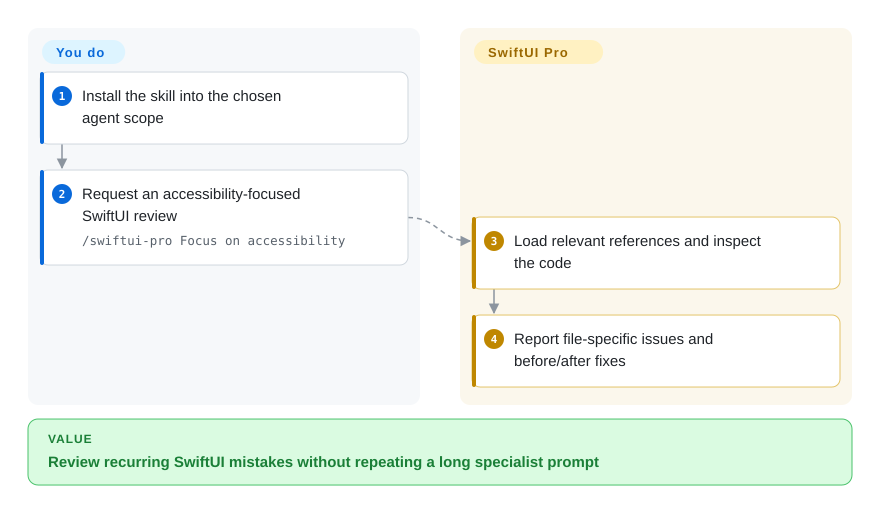
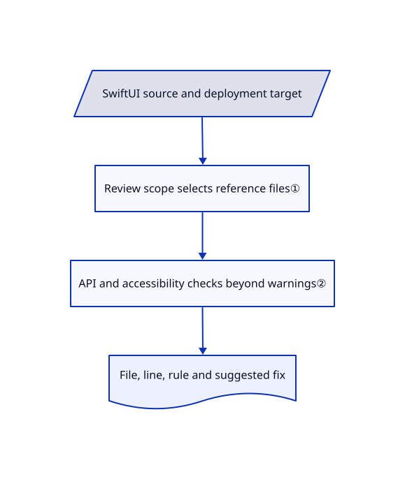

# SwiftUI Pro

Your generated SwiftUI compiles, yet icon-only controls remain unclear to VoiceOver and outdated APIs survive review. SwiftUI Pro routes the coding agent through focused Apple-platform checklists and asks for file-specific fixes.

## When to use

You maintain a SwiftUI app and want the agent to catch data-flow, navigation, accessibility and API mistakes that a warning-free build misses. Choose this focused skill over a broad personal collection when review guidance across several agent hosts is the main need, not simulator orchestration or App Store operations. You can ask for a partial review so the model reads only the relevant reference files.

## When NOT to use

- **You need deterministic CI checks.** Use [SwiftLint](https://github.com/realm/SwiftLint) alongside the compiler; the skill is advisory model context, not an executable analyzer.
- **Your deployment target or SDK is older.** Keep the project's compiler and availability checks authoritative. The skill's latest-platform assumptions must be filtered through the existing target; do not modernize blindly.
- **You need simulator launching or packaging workflows.** Use the relevant [Dimillian Skills](../personal-collections/engineering-workflows/dimillian-skills.md), checking its older snapshot against your toolchain, rather than expecting this review checklist to supply those integrations.

## Comparison

| Alternative | In index | Our verdict | Tradeoff |
|---|---|---|---|
| [Dimillian Skills](../personal-collections/engineering-workflows/dimillian-skills.md) | ✅ | Choose SwiftUI Pro for a focused cross-host review checklist; choose Dimillian for specific simulator, refactor and packaging workflows. | Narrow review scope versus a broader Apple collection whose indexed snapshot is older. |
| SwiftLint | not indexed | Choose SwiftLint for repeatable style failures in CI; choose SwiftUI Pro for semantic review explanations and proposed changes. | Executable rules versus model judgment; not added in this tab batch. |
| Xcode compiler and analyzers | not a repo | Keep Xcode authoritative for compiling against the real SDK; use SwiftUI Pro to supplement it with usability and modernization review. | Closed development product; compile success cannot establish accessible interaction. |

## Quick start

The README installs with `npx skills add https://github.com/twostraws/swiftui-agent-skill --skill swiftui-pro`, with project or global scope chosen by the installer. Ask the host to use `swiftui-pro`, or invoke `/swiftui-pro Focus on accessibility` in Claude Code. The agent reads the matching references and reports genuine issues by file and line with before/after fixes. You supply the code, deployment target and real Xcode validation; the skill does not build, measure performance or certify accessibility by itself. Treat unrelated modernization as suggestions rather than automatic scope expansion.

<!-- flow-steps:begin (generated from flows/swiftui-agent-skill.json by tools/flow_card.py — do not edit) -->

Text version of the flow

1. **You**: Install the skill into the chosen agent scope
2. **You**: Request an accessibility-focused SwiftUI review — `/swiftui-pro Focus on accessibility`
3. **SwiftUI Pro**: Load relevant references and inspect the code
4. **SwiftUI Pro**: Report file-specific issues and before/after fixes

**Value**: Review recurring SwiftUI mistakes without repeating a long specialist prompt

<!-- flow-steps:end -->

## Key techniques

<!-- mechanism:begin (generated from mechanisms/swiftui-agent-skill.json by tools/mechanism_card.py; do not edit) -->

Text version of the mechanism

- SwiftUI source and deployment target
- Review scope selects reference files①
- API and accessibility checks beyond warnings②
- File, line, rule and suggested fix

- SwiftUI source and deployment target → Review scope selects reference files①
- Review scope selects reference files① → API and accessibility checks beyond warnings②
- API and accessibility checks beyond warnings② → File, line, rule and suggested fix

<!-- mechanism:end -->

### 1. Load references according to review scope

- **Problem:** A full Apple review can consume context and propose unrelated rewrites for a small change.
- **How:** The entry skill routes API, data, navigation, design, accessibility and performance checks to separate files. Partial reviews load only relevant files, while deep performance guidance stays out of routine review.
- **Limits:** Routing is an instruction, not an enforced loader; platform-version statements must be checked against the project's actual SDK.
- **Source:** [Review routing and target checks](https://github.com/twostraws/SwiftUI-Agent-Skill/blob/ce32af1693b9e78a7d22ff48001c97a304d32063/swiftui-pro/SKILL.md#L10-L41).

### 2. Report concrete changes beyond compiler warnings

- **Problem:** Compilation does not catch every unclear accessibility label or soft-deprecated API.
- **How:** References explain icon-button text labels, Dynamic Type and reduced-motion checks; output instructions require file, line, rule and a before/after fix. The API guide explicitly calls out soft deprecations that do not produce ordinary warnings.
- **Limits:** Source suggestions cannot replace running VoiceOver, resizing windows or profiling on devices; a plausible finding can still be wrong.
- **Source:** [Accessibility rules](https://github.com/twostraws/SwiftUI-Agent-Skill/blob/ce32af1693b9e78a7d22ff48001c97a304d32063/swiftui-pro/references/accessibility.md), [API guide](https://github.com/twostraws/SwiftUI-Agent-Skill/blob/ce32af1693b9e78a7d22ff48001c97a304d32063/swiftui-pro/references/api.md#L1-L5), [finding format](https://github.com/twostraws/SwiftUI-Agent-Skill/blob/ce32af1693b9e78a7d22ff48001c97a304d32063/swiftui-pro/SKILL.md#L46-L54).

## Health & viability

- **2026-10-18:** created March 2026; Paul Hudson is named in both README and MIT LICENSE. A small skill/reference tree and plugin metadata make the artifact inspectable without running code.
- **Judgment:** seven months is weak Lindy evidence for rules tied to fast-moving Apple SDKs. Author expertise is useful context, not a substitute for checking version availability.
- **Maintenance risk:** the reviewed skill and API references include newer-platform assumptions beyond the README badges. Pin a commit and review target-specific advice rather than treating the badge as the complete support matrix.

## Caveats (unverified)

- [未验证：未在对应 Xcode SDK 编译] The latest-platform declarations in the skill were read as upstream instructions, not independently established API availability; validate each recommended symbol against the installed SDK.
